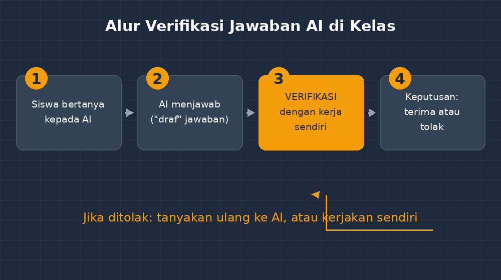

Kemarin sore, seusai jam pelajaran, dua siswa kelas VIII saya menyodorkan laptop mereka. Mereka sedang mengerjakan latihan di rumah, menabrak satu soal sistem persamaan linear, tidak paham, lalu — seperti yang sudah jadi kebiasaan anak-anak sekarang — menyalin soalnya ke sebuah chatbot AI. Jawaban datang dalam hitungan detik: rapi, bertahap, diakhiri kalimat tegas "Jadi, nilai $x = 3$ dan $y = 1$."

Masalahnya, jawaban yang benar adalah $x = 1$ dan $y = 3$. Chatbot itu salah arah di tengah jalan: saat memindahkan satu suku antar ruas, tandanya tidak berubah. Kesalahannya kecil, khas manusia, dan sama sekali tidak menurunkan rasa percaya dirinya. Baris terakhirnya tetap ditulis dengan nada seolah-olah tidak ada kemungkinan lain.

Saya tidak marah pada AI-nya. Saya justru bersyukur. Karena di depan saya, dua anak remaja sedang mengalami sesuatu yang tidak bisa saya jelaskan lewat ceramah: bahwa mesin yang terdengar sangat meyakinkan bisa saja salah.

<!--more-->

## Soal yang Menggugat AI

Saya minta mereka membuka kembali obrolan itu, lalu kami berdua — tiga orang sebenarnya — memeriksa langkah demi langkah di papan tulis. Sampai di baris kesalahan, salah satu siswa berkata pelan, "Oh, di sini Pak. Tanda miny-nya."

Dan setelah itu muncul kalimat yang menurut saya penting dari seluruh peristiwa itu: "Tapi kok dia tetap bilang jawabannya segituh, Pak? Padahal langkahnya sudah salah dari sini."

Pertanyaan itu adalah seluruh isi artikel ini. Chatbot tidak tahu dirinya salah. Ia tidak mengerjakan soal seperti manusia — ia mengarang kelanjutan yang paling mirip dengan teks yang pernah ia lihat. Ketika ia menulis "Jadi, nilai $x = 3$", kepastian itu hanya gaya bahasa, bukan hasil verifikasi. Ia tidak memasukkan kembali $3$ dan $1$ ke persamaan awal untuk mengecek. Ia bahkan tidak punya konsep "mengecek" seperti yang kita ajarkan ke siswa: baca ulang, substitusikan, bandingkan.

Untuk menghitung di rumah, siswa sudah lama punya kalkulator, dan kalkulator hampir tidak pernah salah berhitung. Bedanya dengan chatbot: kalkulator tidak pernah mengarang langkah. Kalau kita salah menekan, dia menghitung salah input dengan setia. Chatbot justru sebaliknya — langkahnya terlihat masuk akal, penjelasannya mengalir, dan kesalahannya bisa saja persis di satu tanda minus yang diam-diam mengubah segalanya. Kalkulator salah secara transparan; chatbot bisa salah secara elegan.

## Tiga Langkah Cek yang Saya Ajarkan

Bersama kelas, kami menyepakati tiga langkah cek yang paling sering menyelamatkan. Pertama, cek balik: masukkan kembali hasil ke soal awal. Kedua, kira-kira: apakah angkanya masuk akal — kalau jarak bus sekolah keluar 340 kilometer per jam, sesuatu pasti salah di langkah, bukan di dunia. Ketiga, bandingkan: kalau dua jalan penyelesaian yang berbeda mendarat di angka yang sama, kemungkinan besar benar; kalau berbeda, ada yang patut digugat. Ketiganya keterampilan matematika biasa, bukan materi baru. Hanya konteksnya yang baru: sekarang mereka punya lawan bicara yang sangat fasih.

## Verifikasi adalah Tugas yang Tidak Bisa Didelegasikan

Dari kejadian itu saya membuat satu aturan sederhana di kelas, dan saya sengaja buat pendek: **jawaban AI belum menjadi jawaban sampai kamu bisa menjelaskan kenapa dia benar.**

Maksudnya bukan melarang AI. Melarang justru tidak jujur dan tidak realistis — anak-anak membawa pintu ke mana-mana di kantong masing-masing. Maksudnya adalah memindahkan titik beratnya: AI boleh menjadi yang pertama menjawab, tapi siswa harus menjadi yang terakhir memutuskan. Ada beberapa kebiasaan kecil yang kami latih, dan yang paling ampuh justru yang paling kuno: **cek balik**. Untuk persamaan linear, artinya substitusikan pasangan $(x, y)$ yang diusulkan ke kedua persamaan awal. Sepuluh detik kerja tangan. Dalam kasus kemarin, sepuluh detik itu langsung membongkar jawaban percaya diri itu:

$$2x + y = 5 \quad\Rightarrow\quad 2(3) + 1 = 7 \neq 5$$

Baris satu ini lebih berpengaruh daripada sejam ceramah saya tentang kewaspadaan digital. Karena siswa yang menemukan sendiri bahwa mesin keliru, tidak akan lupa bahwa mesin bisa keliru.

## Sebuah Diagram yang Saya Gantung di Dinding Kelas

Supaya aturan itu tidak hilang di antara ratusan hal lain, saya buat satu diagram sederhana dan saya tempel di dekat lemari kelas. Alurnya cuma empat kotak, tapi anak-anak hafal karena bentuknya jelas ada "pintu" di tengahnya:

*Alur yang saya tempel di kelas: AI boleh menjawab lebih dulu, tapi keputusan akhir selalu melewati "pintu" verifikasi — dan pintu itu hanya bisa dibuka dengan kerja tangan siswa sendiri.*

Kotak ketiganya sengaja saya kasih garis lebih tebal. Anak-anak bertanya kenapa, dan saya jawab: karena di kotak itulah pelajaran sebenarnya terjadi. Tiga kotak lainnya boleh dikerjakan oleh mesin, siswa, atau siapa saja. Kotak verifikasi tidak. Itu satu-satunya bagian yang tidak bisa saya delegasikan kepada siapa pun, termasuk kepada AI.

## Kalkulator, Word Processor, dan AI

Sebenarnya setiap teknologi baru selalu melewati fase kepanikan yang sama. Kalkulator masuk kelas, lalu word processor, lalu mesin pencari — dan tiap kali ada suara yang bilang kemampuan dasar anak akan rusak. Yang benar-benar berubah setiap kali bukan kemampuan dasarnya, tapi di mana lapisan nilai itu dipindahkan. Ketika kalkulator jadi umum, berhitung cepat di atas kertas kehilangan nilai ujiannya, tapi memahami angka mana yang masuk akal justru naik harganya. Ketika AI jadi umum, saya kira yang naik harga adalah kemampuan menilai: menilai mana langkah yang benar, mana jawaban yang masuk akal, mana pernyataan yang perlu ditagih buktinya. Chatbot tidak menghapus kebutuhan akan nalar; ia justru membuat nalar jadi komoditas yang paling dicari.

## Kesalahan Mesin yang Justru Mengajari

Ada yang aneh sekaligus menarik: kesalahan chatbot kemarin ternyata memberi saya bahan ajar yang tidak bisa saya beli di buku paket. Kesalahan manusia di kelas biasanya malu-malu — siswa menutup buku, pura-pura tidak melihat. Kesalahan AI tidak malu. Ia tertulis rapi di layar, lengkap dengan alasan yang mengalir, dan bisa kita bedah bersama tanpa ada yang tersinggung. Saya jadi sering memakai trik ini. Ambil soal standar, minta AI mengerjakan, kadang sengaja saya pilih soal yang rawan salah — tanda operasi campuran, perpindahan ruas, perhitungan diskon bertingkat — lalu potongan jawabannya saya proyeksikan. Tugas kelas: beri tanda centang atau silang pada setiap baris, bukan pada jawaban akhir. Latihan mengoreksi baris demi baris inilah sebenarnya inti dari bekerja matematika; jawaban akhir cuma bunga dari deretan baris yang benar.

## Lalu Bagaimana dengan Nilai?

Rekan guru yang saya ajak bicara soal ini hampir selalu mendarat di satu pertanyaan: kalau siswa pakai AI untuk mengerjakan PR, dari mana kita tahu mana kerja dia dan mana kerja mesin? Jawaban jujur saya: tidak selalu bisa, dan mencoba membedakan satu per satu akan melelahkan kita sampai luar kepala.

Jadi saya mengubah pertanyaannya. Yang saya nilai di kelas bukan lagi "siapa yang mengerjakan", tapi "siapa yang bisa memverifikasi". Beberapa soal PR sekarang saya beri instruksi tambahan: "Jawaban soal nomor 3 ini salah. Temukan letak kesalahannya." Ketika soalnya seperti itu, menyalin jawaban AI tidak lagi menolong — karena tugasnya justru menilai jawaban itu. Menariknya, untuk membuat soal semacam ini saya juga dibantu AI: saya minta ia mengerjakan soal, ia kadang memang keliru, dan kesalahannya itulah bahan mentah soal saya. Dua puluh persen soal latihan terakhir saya lahir dari kesalahan mesin yang saya panen dengan sengaja.

## Ini Juga Cermin untuk Guru

Satu hal yang tidak enak tapi perlu saya akui: gaya chatbot yang tegas dan percaya diri itu ternyata tidak asing. Guru juga bisa melakukannya. Ada saat-saat saya menjelaskan terlalu cepat, yakin sekali, lalu pulang dan baru menyadari ada yang keliru di papan tulis tadi siang. Bedanya hanya satu — kalau siswa menantang, saya bisa membuktikan ulang, mengakui, dan memperbaiki. Mesin tidak punya ruang malu itu.

## Yang Saya Sadari Belakangan

Semakin saya merenung, semakin saya sadar bahwa literasi AI di kelas matematika ternyata tidak berbeda jauh dari mengajarkan siswa membedakan mana pendapat guru mana bunyi iklan. Intinya satu kebiasaan: **jangan pernah menerima pernyataan tanpa menagih alasannya.** Chatbot cuma lawan bicara yang paling fasih berdekorasi, jadi tempat latihan yang paling sering tersedia.

Anak yang kebiasaannya menagih alasan kepada AI — yang secara otomatis berhenti di tengah jawaban mesin dan bertanya "ini benar nggak sih?" — akan memakai kebiasaan yang sama ketika membaca berita, iklan, video pendek yang menjanjikan cepat kaya, dan klaim-klaim lain yang menghampirinya tiap hari. Matematika cuma arena latihannya; hasil latihannya jauh melampaui matematika.

Dan ada satu hal lagi yang membuat saya tenang dengan semua ini. Anak-anak tidak butuh saya menjelaskan bahwa AI itu cerdas — itu terlihat dalam lima detik pemakaian. Yang mereka butuhkan adalah pengalaman bertatap muka dengan AI yang keliru sambil percaya diri, dan seorang guru yang tidak buru-buru melarang, tapi justru berhenti sejenak dan berkata: "Eh, coba kamu periksa dulu. Siapa tahu dia salah."

Sepuluh detik substitusi. Itu saja. Tapi sepuluh detik itu yang membedakan antara anak yang dikawal mesin dan anak yang mengawal mesin.
