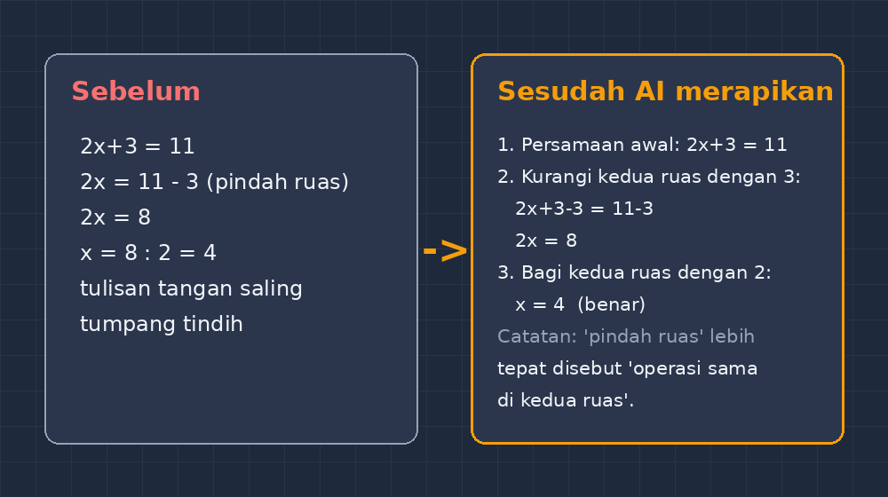

Malam Rabu lalu saya duduk di depan tumpukan lembar ulangan bab persamaan linear satu variabel. Ada satu lembar yang membuat saya diam agak lama. Tulisan tangan milik Rafi (bukan nama sebenarnya) benar-benar bertumpuk: dia menghapus dengan tangan, bukan penghapus, lalu menulis lagi di atas goresan yang sama. Di pinggirnya ada angka-angka yang mengambang tanpa tanda sama dengan, dan satu kalimat kecil bertulis "pindah ruas" yang ujungnya tertelan coretan.

Jawabannya, kalau saya berbaik hati membaca pelan-pelan, ternyata benar. $x = 4$. Benar. Tapi kalau saya membaca dengan kecepatan koreksi biasa — kelasnya 32 lembar, jam sudah sembilan malam — lembar itu mudah sekali saya tandai salah.

*Masalah koreksi sering bukan soal benar-salah, tapi soal keterbacaan. Di kanan, urutan berpikir Rafi yang saya tulis ulang rapi — termasuk catatan bahwa "pindah ruas" sebaiknya disebut dengan nama yang lebih jujur.*

## Yang selalu saya yakini: koreksi itu kegiatan membaca

Saya pernah menulis di blog ini tentang menilai langkah, bukan hanya jawaban. Prinsipnya masih sama. Tapi ada masalah pratis yang jarang dibicarakan: **langkah itu tidak selalu terbaca.** Bukan karena siswa tidak menulis langkah, tapi karena tulisannya berantakan, urutannya melompat, atau simbolnya ditulis setengah-setengah saat terburu-buru.

Jadi setiap koreksi sebenarnya punya dua pekerjaan sekaligus: menerjemahkan dulu, baru menilai. Pekerjaan penerjemahan ini yang paling menyita. Dan jujur saja, kejujuran saya di jam sembilan malam tidak sebaik kejujuran saya di jam pagi.

## Percobaan pertama: saya fotokan lembar Rafi

Karena penasaran, saya foto lembar Rafi dan saya berikan pada AI dengan prompt sederhana: "Transkripsikan tulisan tangan ini apa adanya, jangan dinilai, jangan dibenarkan. Kalau ada bagian yang tidak terbaca, tandai."

Hasilnya menarik. AI bisa membaca hampir semuanya — termasuk angka yang mengambang tadi, yang ternyata sisa perhitungan $11 - 3 = 8$ yang ditulis di pinggir karena ruangnya habis. Yang tidak terbaca, dia tandai jujur, tidak mengarang. Bagian itu lalu saya tanyakan langsung ke Rafi besok paginya: "Ini maksudnya apa?"

Rafi menjawab santai, seolah sudah tahu apa yang saya tanyakan: "Itu tanda sama dengan, Pak, tapi keburu tipis spasinya."

Rupa-rupanya dia punya alasan. Hanya saja alasannya tidak terbaca dari kertasnya.

## Lalu AI menuliskan ulang — dan di situlah nilainya

Transkrip saja sudah membantu, tapi bagian yang lebih berguna adalah ketika AI menyusun ulang urutan berpikir Rafi menjadi langkah yang rapi:

$$2x + 3 = 11$$
$$2x + 3 - 3 = 11 - 3$$
$$2x = 8$$
$$x = 4$$

Yang membuat saya berhenti sejenak bukan kerapian hasilnya, tapi satu kalimat komentar AI di bawahnya: bahwa istilah "pindah ruas" yang dipakai Rafi sebenarnya menyembunyikan operasi yang lebih jujur — bahwa kita melakukan operasi yang sama di kedua ruas. Menarik. Rafi menulis istilah yang dia dengar dari temannya, dan istilah itu bekerja untuk dia sampai sekarang. Tapi suatu hari, ketika dia bertemu soal yang pindah ruasnya tidak sederhana, istilah itu bisa berhenti bekerja.

Catatan kecil seperti ini yang tidak akan saya dapat dari koreksi cepat. Bukan karena saya tidak peduli, tapi karena ada batas waktu manusia yang mengoreksi tiga puluh dua lembar.

## Saya menetapkan batas: AI menerjemahkan, saya yang menilai

Dari percobaan itu, saya menarik garis tegas untuk diri sendiri. AI boleh:

- **membaca** tulisan berantakan dan menuliskan ulang apa adanya,
- **menandai** bagian yang tidak terbaca (bukan menebak),
- **menyusun ulang** urutan langkah supaya terlihat pola berpikirnya.

AI *tidak* saya minta memberi nilai, memberi umpan balik ke siswa, atau menyimpulkan pemahaman siswa. Penerjemah boleh. Juri tidak. Sebab penerjemah cukup punya mata yang baik; juri harus tahu konteks kelas, tahu kebiasaan Rafi, tahu bahwa lembar yang itu ditulis terburu-buru karena dia kejar waktu istirahat. Konteks itu milik saya.

Kekhawatiran yang wajar dan selalu saya ingat: AI bisa salah membaca. Bukan sekadar salah baca huruf, tapi salah baca *niat* — misalnya menafsirkan angka mengambang sebagai bagian dari langkah padahal cuma sisa coretan. Karena itu aturan kedua saya: hasil transkrip tidak pernah langsung saya pakai menilai. Kalau ada bagian yang menentukan benar-salah dan transkripnya meragukan, saya cek ke lembar aslinya, atau tanya siswanya. Malu bertanya sesat di jalan; malu menanyakan siswa, salah menilai.

## Efek samping yang tidak saya duga

Yang mengejutkan saya justru efek ke siswanya. Rafi tahu (kabarnya dari teman sebangku) bahwa lembar ulangannya difoto dan "dibaca komputer". Senin paginya dia datang membawa lembar kosong dan bertanya: "Pak, biar tulisan saya kebaca, harus gimana nulisnya?"

Saya hampir tertawa. Selama ini saya sudah berulang kali meminta tulisan yang rapi dengan cara biasa — imbauan di papan, catatan di lembar, bahkan contoh langsung. Semua masuk telinga kiri keluar telinga kanan. Tapi begitu ada "pembaca baru" yang ternyata sangat butuh keterbacaan, dia merasa sendiri pentingnya tulisan yang bisa diikuti orang lain.

Dari situ saya mulai satu kebiasaan kecil: sesekali saya ambil satu lembar acak, saya transkripsikan dengan bantuan AI, lalu saya tampilkan di kelas versi asli dan versi rapi berdampingan. Tanpa nama. Anak-anak bisa melihat sendiri mana yang enak dibaca. Tidak perlu saya ceramah. Lembar mereka sendiri yang bicara.

## Penerjemah di jam malam, guru di jam pagi

Ada satu hal yang saya sadari sejak percobaan pertama: waktu koreksi malam yang dulu paling melelahkan kini terbagi dua. Pekerjaan penerjemahan — yang mekanis, melelahkan mata, dan paling rentan bikin salah baca — bisa sebagian diserahkan. Yang tersisa adalah pekerjaan yang memang harus saya: memutuskan langkah mana yang pemahaman dan mana yang kebetulan, memutuskan siapa yang perlu dijemput, memutuskan apa yang besok dibahas di papan.

Bukan berarti koreksi jadi otomatis. Justru karena penerjemahannya jelas, tanggung jawab penilaiannya jadi lebih terasa. Kalau dulu saya bisa bilang "saya tandai salah karena tidak terbaca", sekarang alasan itu tinggal lebih tipis. Semua sudah diterjemahkan. Yang tersisa benar-benar keputusan.

Jadi kalau Bapak/Ibu guru menemukan lembar ulangan yang jawabannya benar tapi tulisannya mengkhianati, mungkin bisa mencoba alur kecil ini: foto, minta transkrip apa adanya, tandai yang tidak terbaca, baru nilai dari hasil terjemahan yang sudah dikonfirmasi. Tidak perlu alat canggih, tidak perlu mengubah cara menilai. Cuma menambah satu langkah penerjemahan di antara membaca dan menilai.

Di jam sembilan malam, itu terasa seperti punya rekan yang tidak mengantuk. Dan di jam pagi, keputusan tetap sepenuhnya milik saya. Sepatutnya memang begitu.
