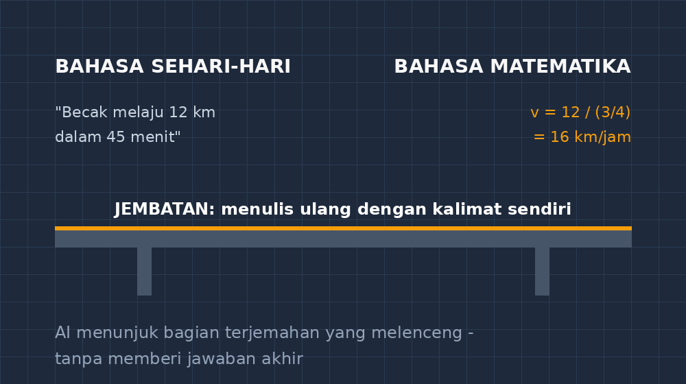

Ada satu momen setiap kali saya mengajar soal cerita yang hampir selalu berulang. Saya membacakan soal: sebuah becak melaju 12 kilometer dalam 45 menit. Lalu saya tanya, "Jadi kecepatannya berapa kilometer per jam?" Dan sebuah suara dari bangku belakang menjawab dengan penuh keyakinan, "Tiga puluh kilometer per jam, Pak." Ia bahkan sudah setengah berdiri, bangga dengan kecepatan jawabannya. Sayangnya, 12 kilometer dalam 45 menit itu bukan 30 kilometer per jam, melainkan 16. Ia membagi 12 dengan 45 lalu... ya, sudahlah. Yang penting ia berani menjawab.

<!--more-->

Yang menarik dari momen itu bukan kesalahannya. Yang menarik adalah sebelum soal itu ditulis, siswa yang sama bercerita panjang lebar kepada temannya tentang perjalanan pulangnya naik ojek — berapa jauh, berapa lama, macet di mana. Ia menguasai situasinya dengan bahasa sehari-hari. Tapi begitu situasi itu berubah menjadi soal bernomor, semua kemampuannya seperti terkunci di luar pintu.

## Dua bahasa, satu jembatan

Saya makin yakin bahwa soal cerita sebenarnya soal penerjemahan. Ada bahasa pertama: bahasa yang siswa pakai untuk bercerita tentang becak, ojek, harga gorengan, dan luas tanah kakeknya. Ada bahasa kedua: bahasa matematika dengan simbol-simbolnya yang hemat tapi tegas. Soal cerita meminta siswa berjalan dari bahasa pertama ke bahasa kedua. Dan jembatan itu — bukan rumusnya, bukan juga hitungannya — yang sering runtuh.

Kalimat "becak melaju 12 kilometer dalam 45 menit" harus diterjemahkan menjadi hubungan seperti $v = \frac{s}{t}$. Tapi siswa tidak melihat kalimat itu sebagai sesuatu yang bisa ditranskrip. Ia melihatnya sebagai cerita yang harus direspons, dan responsnya pun sering berupa tebakan operasi: angka yang ada, dijumlah atau dikalikan, biasanya salah satunya kebetulan benar.

Selama bertahun-tahun cara saya menutup jembatan itu adalah dengan meminta siswa menulis ulang soal dengan kalimatnya sendiri. Cara ini bagus, tapi ada masalah praktis yang tidak bisa saya pungkiri: di kelas yang berisi tiga puluh anak, saya tidak sempat mengecek setiap terjemahan. Anak yang terjemahannya sudah melenceng sejak awal akan berhitung dengan tekun di atas lenceng itu sendiri, dan baru ketahuan waktu koreksi — tiga hari kemudian, saat semuanya sudah dingin.

## AI sebagai penerjemah di sebelah meja

Percobaan saya yang paling terasa manfaatnya belakangan ini sederhana: siswa menulis ulang soal dengan bahasanya sendiri, lalu mengetiknya kepada sebuah chatbot AI dengan permintaan tertentu — bukan "kerjakan soal ini", tapi "terjemahan saya ini benar atau belum? Tunjukkan bagian mana yang berbeda dari soal aslinya, jangan beri jawaban."

Ketika terjemahan seorang siswa menulis "becak berjalan 45 jam untuk 12 kilometer" — percampuran waktu kebalik dan satuan tertukar — AI itu langsung menunjuk dua tempat yang berbeda dari soal aslinya. Tidak memberi jawaban akhir, tidak menghitung. Hanya menunjuk: di sini waktu kalian terbalik, di sini menit kalian jadi jam. Siswa itu melihat kesalahannya dalam hitungan detik, bukan tiga hari.

Ini yang membuat saya yakin AI di posisi ini bukan sekadar "korektor cepat". Ia menempati lubang yang selama ini memang kosong: umpan balik terjemahan yang cepat, sabar, dan tersedia untuk setiap anak — hal yang secara jujur tidak mungkin saya berikan sendirian di kelas tiga puluh orang. Saya tetap yang mengajari cara menerjemahkan; AI membantu memastikan tidak ada anak yang berjalan lama di jembatan yang runtuh tanpa ada yang memberi tahu.

## Jebakan yang saya waspadai

Tapi justru karena manfaatnya terasa sekali, saya makin hati-hati pada dua hal.

Pertama, risiko yang paling saya takuti bukan siswa curang. Yang saya takuti adalah siswa berhenti membaca soal dengan sungguh-sungguh karena tahu ada "pemeriksa" yang siap sedia. Kalau tugasnya berubah menjadi mengetik asal-asalan lalu menunggu dikoreksi, jembatan itu tidak pernah dilewati siswa — AI yang menyeberangkannya. Karena itu aturan di kelas saya tegas: AI hanya boleh menerima tulisan siswa, bukan soal aslinya. Perbandingan antara dua teks itulah pekerjaannya. Kalau siswa mengetik soal aslinya, ia tidak sedang belajar menerjemahkan; ia sedang menyuruh orang lain membaca.

Kedua, AI kadang terlalu "baik". Ia cenderung mengiyakan, memberi pujian dulu, baru menunjuk kesalahan dengan halus. Untuk soal matematika, kehalusan seperti itu bisa jadi kabur: "terjemahanmu bagus, hanya sedikit berbeda di bagian waktu" — padahal bagian waktu itulah seluruh soalnya. Karena itu saya selalu menuliskan contoh prompt untuk siswa, dan menekankan kata "jangan beri jawaban". Kalimat larangan itu ternyata paling penting. Tanpa itu, chatbot akan dengan sopan menyelesaikan soalnya, dan kelas saya berubah menjadi tempat menyalin jawaban dengan bantuan teknologi.

## Yang berubah di kelas

Setelah beberapa kali mencoba, perubahan yang paling saya rasakan bukan pada nilai. Nilai memang naik sedikit di bagian soal cerita, tapi itu menurut saya efek samping. Yang benar-benar berubah adalah perilaku membaca soal. Siswa mulai membaca soal seperti seorang penerjemah membaca naskah: siapa pelakunya, apa yang diketahui, apa yang ditanya, dalam satuan apa. Pertanyaan-pertanyaan itu dulu hanya keluar kalau saya memaksa lewat lembar kerja; sekarang mereka datang sendiri, karena siswa tahu tulisannya akan dibandingkan dan ia ingin tulisannya yang menang, bukan soalnya.

Ada juga efek kecil yang tidak saya rencanakan. Karena AI diminta menunjukkan perbedaan, siswa jadi terbiasa melihat kalimat soal sebagai sesuatu yang punya struktur — ada pelaku, ada besaran, ada satuan, ada pertanyaan. Beberapa anak bahkan mulai protes kalau soal yang saya buat kurang jelas pelakunya. "Pak, yang jalan ini becaknya atau pengendaranya?" Itu pertanyaan seorang penerjemah, dan saya menelan hormat sambil senyum. Soal yang saya tulis asal-asalan kini bisa ketahuan oleh murid saya sendiri. Tidak apa-apa. Itu pertanda jembatannya sedang dibangun, dan kali ini yang membangun bukan saya sendirian.

Penutupnya sederhana. AI tidak menggantikan pekerjaan mengajar saya menerjemahkan dunia ke bahasa matematika. Tapi ia membuat pekerjaan itu tidak lagi terjadi dalam kegelapan — setiap terjemahan yang melenceng kini ketahuan cepat, sebelum lenceng itu diwariskan ke seluruh lembar jawaban. Dan bagi saya, guru yang dulu sering menemukan kesalahan terlambat di tumpukan koreksi, itu bukan hal kecil.

*Skema sederhana: AI berdiri di tengah jembatan, menunjuk bagian terjemahan yang melenceng — tanpa memberi jawaban akhir.*
