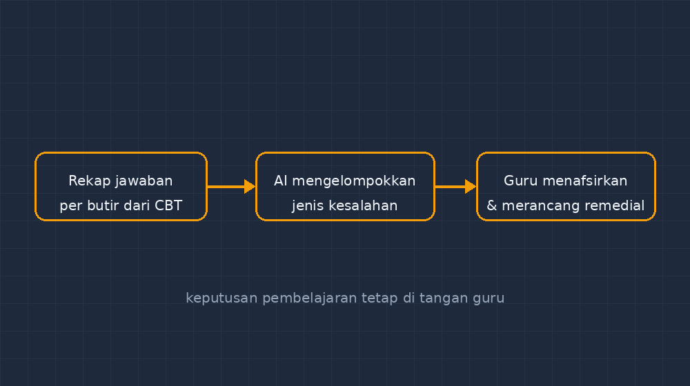

Koreksi ulangan harian bab bilangan berpangkat kemarin menghasilkan sesuatu yang tidak biasa. Dari tiga puluh dua lembar jawaban, dua puluh satu siswa salah di soal yang sama — soal nomor tujuh, tentang $(-2)^4$ berbanding $-2^4$. Saya berdiri di depan tumpukan kertas dan menyadari sesuatu yang sebenarnya sudah terjadi setiap kali koreksi, tapi jarang saya gali lebih dalam: kesalahan itu tidak tersebar acak. Mereka menggerombol. Ada kelompok yang salah di tanda, ada kelompok yang salah di urutan operasi, dan sisanya salah karena tergesa membaca soal.

Dulu, temuan seperti ini biasanya berhenti jadi keluhan di kepala saya sendiri. "Cih, tanda masih ketukar-ketukar juga." Lalu pekan berikutnya saya mengajar ulang seluruh bab dari awal, padahal yang perlu diperbaiki cuma satu titik kebingungan. Mubazir — untuk saya, yang waktu terbatas, dan untuk siswa yang sudah paham sebagian besar materi tapi dipaksa mengulang semuanya.

Malam itu saya membuka GezyCBT dan berpikir: data jawaban salah ini sebenarnya sudah saya simpan berbulan-bulan. Tinggal saya tidak pernah membacanya sebagai satu kesatuan.

<!--more-->

## Data yang Sudah Ada, Saja yang Saya Abaikan

Setiap kali siswa mengerjakan soal di GezyCBT, sistem mencatat jawaban mereka per butir: apa yang mereka pilih, benar atau salah, berapa lama. Selama ini saya hanya melihat angka akhirnya — nilai rata-rata, yang terendah, yang tertinggi — lalu menutup tab. Padahal di dalamnya ada lapisan informasi yang jauh lebih berharga: *pilihan pengecoh yang dipilih siswa saat salah*.

Jika 18 siswa memilih opsi C di soal $(-2)^4$, dan opsi C saya rancang sebagai hasil dari $-2^4$, maka saya tidak hanya tahu bahwa mereka salah. Saya tahu *apa yang dipikirkan* mereka saat salah. Itu diagnosis, bukan sekadar angka merah.

Masalahnya, membaca pola ini manual itu melelahkan. Saya harus menyandingkan soal satu per satu, mengingat desain pengecoh tiap butir, lalu menghitung. Untuk satu ulangan bisa, untuk satu semester penuh dari enam kelas — tidak sanggup. Dan di sinilah untuk pertama kalinya saya merasa AI benar-benar masuk ke pekerjaan inti saya sebagai guru, bukan sekadar alat bikin soal.

## Menyerahkan Pekerjaan Bosan ke Mesin

Prosesnya sederhana, dan saya sengaja membuatnya sederhana. Saya ekspor rekap jawaban per butir dari GezyCBT — persentase siswa yang memilih tiap opsi — lalu menempelkannya ke AI bersama deskripsi singkat desain pengecoh tiap soal: "opsi B = lupa sifat pangkat nol", "opsi C = salah tanda", dan seterusnya. Yang saya minta hanya satu: kelompokkan kesalahan berdasarkan jenisnya, urutkan dari yang paling banyak, dan tunjukkan soal mana saja yang masuk tiap kelompok.

Hasilnya bukan keajaiban. Tapi hasilnya rapi, dan itulah yang saya butuhkan. Untuk ulangan bilangan berpangkat itu, polanya berjajar seperti ini:

| Kelompok kesalahan | Soal terkait | Perkiraan penyebab |
|---|---|---|
| Salah tanda pada pangkat | no. 7, 12, 15 | Membedakan $(-a)^n$ dan $-a^n$ |
| Urutan operasi campuran | no. 3, 9 | Kerjakan penjumlahan sebelum pangkat |
| Sifat pangkat nol | no. 5 | Anggap $a^0 = 0$ |

Dua puluh menit kerja yang biasanya makan satu malam koreksi berakhir jadi satu tabel. Dan tabel itu mengubah rencana mengajar saya pekan berikutnya secara total. Saya tidak mengulang seluruh bab. Saya membuat satu aktivitas khusus tentang tanda pada pangkat — lengkap dengan contoh berhadapan $(-2)^4$ dan $-2^4$ di papan tulis, dikerjakan siswa berpasangan — dan melompati materi yang datanya bilang sudah aman.

*Alur sederhananya: rekap jawaban CBT dikelompokkan AI menjadi pola kesalahan, lalu keputusan pembelajaran remedial tetap di tangan guru.*

## Yang Tidak Saya Serahkan ke AI

Perlu saya tegaskan, karena kekhawatiran rekan guru wajar: keputusan mengajar tidak saya serahkan ke mesin. AI mengelompokkan; saya yang menafsirkan. Ketika AI bilang "salah tanda muncul di tiga soal", saya yang harus menebak kenapa — apakah miskonsepsi beneran, atau soal saya yang penulisannya rancu, atau siswa kehabisan waktu di bagian akhir. Mesin tidak tahu bahwa kelas 8B selalu tergesa karena jam pelajaran saya di kelas itu digabung dengan pengumuman OSIS. Saya tahu.

Ada juga penangkalan penting yang saya pelajari dari pengalaman sebelumnya dengan AI: jangan langsung percaya. Sekali, AI mengelompokkan soal nomor 9 ke "urutan operasi", padahal setelah saya cek ulang, pengecoh opsi B di soal itu sebenarnya mendesain kesalahan sifat pangkat, bukan urutan. Data yang saya tempel kurang lengkap, jadi kesimpulannya ikut miring. Sejak itu saya jadikan kebiasaan: setiap pengelompokan AI saya baca sambil membuka kembali soalnya. AI itu asisten penyusun laporan, bukan pemberi vonis.

Dan satu lagi: pola kesalahan dari CBT hanya menceritakan *apa* yang salah, bukan *mengapa*. Untuk yang kedua, saya tetap harus mengobrol dengan siswa. Tabel itu justru membuat percakapan saya jadi lebih tajam — saya bertanya spesifik: "Kamu pilih C waktu itu, apa yang ada di kepalamu?" Daripada bertanya umum: "Kok ini masih salah?"

## Dari Angka Merah ke Peta

Kalau saya renungkan, perubahan terbesar bukan pada efisiensi — walaupun itu nyata. Perubahan terbesar ada pada cara saya memandang jawaban salah. Dulu kesalahan siswa rasanya seperti laporan kegagalan, sesuatu yang harus dicoret merah dan diperbaiki. Sekarang ia terasa seperti peta: titik-titik yang menggerombol menunjukkan di mana anak-anak saya tersesat, dan peta yang baik memanggil saya untuk datang ke tempat itu — bukan mengulang perjalanan dari awal.

Untuk Bapak/Ibu yang sudah punya CBT atau bahkan hanya rekap jawaban di spreadsheet, saya sarankan mencoba lewat satu ulangan saja dulu. Tempelkan rekapnya ke AI, minta pengelompokan, lalu buka kembali soalnya satu per satu untuk memverifikasi. Kalau hasilnya masuk akal, coba rencanakan satu aktivitas remedial yang hanya menyasar kelompok kesalahan teratas. Rasakan bedanya dengan mengulang seluruh bab.

Data itu sudah ada di tangan kita. Yang kurang hanyalah keberanian membacanya sampai tuntas — dan kini, bantuan untuk membacanya dengan lebih cepat.
