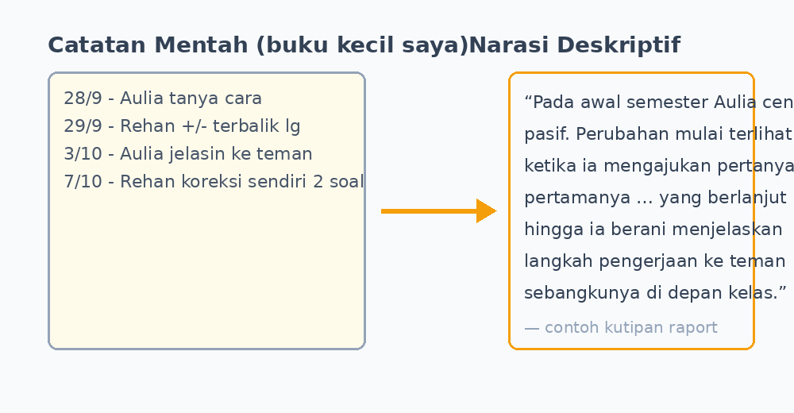

Kalau Bapak/Ibu guru kelas atau wali murid, pasti kenal momen ini: sudah malam, meja penuh cangkir kopi yang sudah dingin, dan buku kecil catatan observasi terbuka di depan. Di dalamnya ada tulisan tangan saya sendiri yang setengahnya tidak bisa saya baca. "Aulia tanya cara" — tanya cara apa? Kapan tanggalnya? Soal nomor berapa? Catatan yang bulan September terasa jelas itu, di bulan Desember, berubah menjadi teka-teki yang harus saya pecahkan sendiri sebelum bisa menulis satu paragraf narasi raport.

<!--more-->

Tahun ini jumlah catatan itu lebih banyak dari biasanya. Sejak saya mulai konsisten melakukan observasi informal — sekadar mencatat hal kecil yang terjadi di kelas: siapa yang akhirnya berani bertanya, siapa yang miskonsepsinya berulang, siapa yang membantu temannya tanpa disuruh — buku kecil saya justru penuh. Itu kabar baik untuk penilaian, tapi kabar buruk untuk waktu. Karena bagusnya catatan itu baru "jadi" kalau sudah diubah menjadi narasi deskriptif yang bisa dibaca orang tua murid.

Maka semester ini saya mencoba sesuatu yang setahun lalu mungkin akan saya tolak: saya minta bantuan AI untuk menyusun draf narasi raport dari catatan observasi saya. Dan yang mengejutkan saya bukan hasilnya — tapi betapa banyak hal yang harus saya atur sendiri supaya hasilnya layak dipakai.

## Masalahnya Bukan Menulis, Tapi Menyusun

Dulu saya sempat pikir, "Ah, menulis raport kan cuma soal kata-kata." Ternyata bukan. Yang melelahkan adalah proses menyusun: membaca belasan catatan tentang satu murid yang tersebar di empat bulan, mengurutkannya jadi garis cerita, lalu memutuskan potongan mana yang penting dan mana yang hanya kejadian sekali.

Contohnya catatan saya tentang Aulia, murid kelas VIII yang selama semester pertama hampir tidak pernah mengangkat tangan:

- 28 September: "Aulia tanya cara nomor 3 (ke saya, pelan-pelan)"
- 3 Oktober: "Aulia jelasin langkah ke teman sebangku, sendiri"
- 7 November: "tanya di depan kelas, pertama kali!"

Tiga catatan pendek. Tapi ketika saya menatapnya malam itu, yang saya butuhkan bukan sekadar menggabungkan ketiganya, melainkan menemukan benang merahnya: perubahan dari pasif menjadi berani bertanya, yang bergerak pelan tapi konsisten. Itu pekerjaan berpikir. Dan pekerjaan berpikir itulah, sadar saya kemudian, yang tidak boleh saya serahkan kepada siapa pun — termasuk kepada AI.

*Catatan pendek di buku kecil harus diubah menjadi narasi yang punya alur — di sinilah sebagian besar waktu saya habis setiap akhir semester.*

## Aturan Main yang Saya Buat untuk Diri Sendiri

Karena penasaran sekaligus waswas, saya menetapkan aturan main sebelum mulai. Bukan aturan untuk AI-nya, sebenarnya — aturan untuk saya.

**Pertama, AI hanya menerima catatan saya, apa adanya.** Saya ketik ulang isi buku kecil itu — termasuk singkatan-singkatan aneh seperti "RHN msh trblk +/-" (Rehan masih terbalik tanda negatif) — lalu saya minta AI menyusunnya secara kronologis dan menandai bagian mana yang merujuk ke catatan mana. Tidak ada yang ditambahkan dari luar. Kalau catatannya cuma tiga baris, drafnya harus bertumpu pada tiga baris itu.

**Kedua, AI tidak boleh mengarang kata sifat.** Ini bagian paling sensitif. Narasi raport yang baik itu spesifik: "mulai berani mengajukan pertanyaan saat pembahasan soal" jauh lebih berharga daripada "menunjukkan perkembangan yang baik". Kata-kata mulus tapi kosong itu jebakan terbesar — dan AI, kalau tidak dikunci, sangat senang memakainya. Saya jadi punya kebiasaan baru: setiap kata sifat dalam draf, saya cari catatan pendukungnya. Tidak ada catatannya? Kalimat itu hapus.

**Ketiga, kalimat terakhir selalu saya tulis ulang sendiri.** Karena raport itu dokumen resmi dengan nama saya di dalamnya. AI boleh menyusun kerangka, menata kronologi, bahkan menawarkan beberapa variasi kalimat pembuka. Tapi kalimat yang akhirnya dikirim ke orang tua murid harus lolos telinga saya dulu: apakah kalimat ini terdengar seperti saya yang biasa bicara soal murid-murid saya? Kadang ya, kadang saya rombak setengahnya.

Hasilnya untuk Aulia kurang lebih begini setelah saya poles:

> Pada awal semester, Aulia cenderung mengamati dari tempat duduknya. Perubahan pertama terlihat ketika ia mulai mengajukan pertanyaan secara langsung kepada saya, meskipun dengan suara kecil. Yang membuat saya menghargai perkembangannya adalah tahap berikutnya: ia tidak berhenti pada bertanya untuk dirinya sendiri, tetapi mulai menjelaskan langkah pengerjaan kepada teman sebangkunya tanpa diminta. Menjelaskan dengan kata-kata sendiri, menurut pengalaman saya, adalah tanda pemahaman yang jauh lebih dalam daripada sekadar menjawab benar.

Tidak ada satu kalimat pun di situ yang tidak punya jejak catatan. Tapi ada sesuatu yang jelas berbeda dibanding kalau saya menulisnya sendiri pukul sebelas malam dengan mata sudah perih: narasinya lebih tenang, lebih terstruktur, dan — jujur saja — lebih adil bagi muridnya, karena tidak ada satu pun perkembangan yang terlewat hanya karena catatannya kecil dan hampir tidak terbaca.

## Yang Tidak Berubah

Ada kekhawatiran yang wajar saya dengar dari rekan guru: "Nanti guru jadi malas menilai sendiri, kan tinggal titip ke AI?" Kekhawatiran yang sama yang dulu membuat saya ragu. Tapi pengalaman satu semester ini justru menunjukkan arah yang sebaliknya — dengan syarat AI diposisikan sebagai asisten pengolah, bukan penilai.

Karena AI tidak pernah berada di kelas saya. AI tidak melihat wajah Rehan ketika ia menyadari sendiri bahwa tanda minusnya terbalik, lalu mengoreksi dua soalnya tanpa saya suruh. Catatan "Rehan koreksi sendiri 2 soal" di buku kecil itu adalah hasil pengamatan mata saya — dan itulah bahan baku yang paling mahal dalam seluruh proses ini. AI hanya membantu mengubah bahan baku itu menjadi bentuk yang bisa dibaca. Tanpa catatan yang jujur dan spesifik, AI hanya akan menghasilkan narasi kosong yang terdengar bagus — dan orang tua bisa mencium narasi kosong dari jarak jauh.

Justru karena rutin minta bantuan menyusun, saya jadi lebih disiplin mencatat. Kalau tahu catatan itu nanti benar-benar dipakai, saya menulisnya lebih detail di kelas. Jadi ada siklus yang sehat di sini: alat membuat catatan lebih bernilai, catatan yang bernilai membuat pengamatan lebih tekun.

## Penutup: Tetap Guru yang Menilai

Kalau direcap, bantuan AI dalam pekerjaan raport saya bekerja di tiga titik: menata catatan yang berantakan secara kronologis, membantu menemukan benang merah antar-catatan, dan menyodorkan draf kalimat yang kemudian saya edit habis-habisan. Tiga titik itu semuanya berada **setelah** pekerjaan terpenting selesai: mengamati, mencatat, dan memutuskan apa yang berarti bagi murid.

Bapak/Ibu yang sedang mempertimbangkan hal serupa, saran saya sederhana: mulai dari catatan yang sudah ada, bukan dari AI-nya. Coba ketik ulang catatan observasi satu murid saja, minta bantuan menyusunnya, lalu bandingkan drafnya dengan catatan asli. Batas antara "membantu menyusun" dan "menggantikan penilaian" akan langsung terasa — dan selama garis itu tetap kita pegang, saya rasa alat ini aman untuk dipakai guru.

Malam-malam koreksi raport masih akan tetap ada, tentu. Tapi tahun ini, minimal, buku kecil saya tidak lagi menjadi teka-teki yang harus dipecahkan sendirian.
