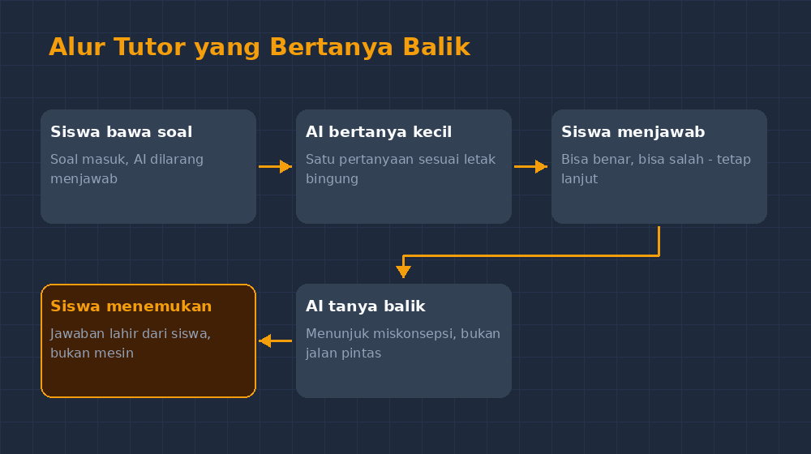
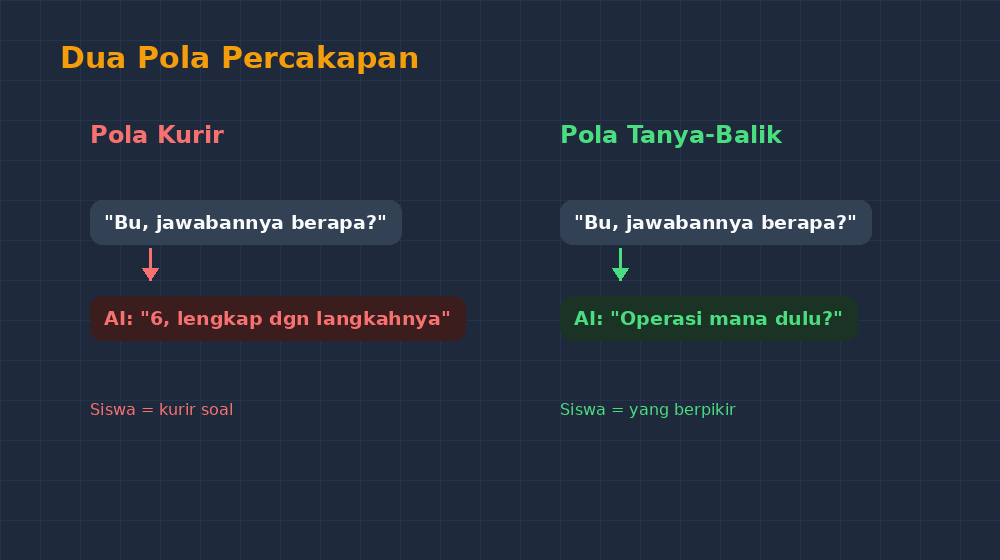

Seorang murid kelas VII, sebut saja Rani, berjalan ke meja saya sambil membawa ponselnya. Di layarnya ada percakapan dengan chatbot AI tentang soal operasi hitung campuran: $12 - 3 \times 4 + 6$. Ia sudah memotret soalnya, menyalinnya, dan mesin itu menjawab dengan langkah-langkah yang rapi — lengkap sampai hasil akhirnya, 6. Rani cuma ingin memastikan: "Pak Gun, ini bener nggak?" Jawabannya benar. Tapi ada yang mengganjal di kepala saya sejak beberapa minggu: dalam percakapan itu, siapa yang sebenarnya belajar? Rani tidak menghitung apa pun. Ia hanya mengangkut soal dari buku ke mesin, lalu mengangkut jawaban dari mesin ke bukunya. Ia menjadi kurir yang rajin.

<!--more-->

Saya ingat perasaan itu sempat menempel beberapa hari. Bukan karena murid saya nakal — ia justru berusaha, hanya saja usahanya salah alamat. Usahanya habis untuk mencari siapa yang mau menjawab, bukan untuk mencari jawaban itu sendiri. Dan kalau kami jujur, AI hari ini terlalu rajin. Dari semua instruksinya, yang paling kuat dipatuhinya adalah "jawab pertanyaan dengan langkah yang jelas". Coba perhatikan: meminta jawaban itu mudah, dan mesin itu senang memberi. Kombinasi sempurna yang tidak menyisakan ruang untuk berpikir.

## Percobaan Pertama: Mesin yang Disuruh Diam

Maka saya mencoba sesuatu yang awalnya terasa seperti lelucon: bagaimana kalau AI-nya justru saya larang menjawab? Saya tulis sebuah instruksi — dalam istilah yang lebih meyakinkan disebut *system prompt* — yang isinya kira-kira begini: *Kamu adalah tutor untuk siswa SMP kelas VII. Kamu tidak boleh memberikan jawaban akhir, tidak boleh memberi langkah penyelesaian, dan tidak boleh melengkapi pekerjaan siswa. tugasmu hanya mengajukan satu pertanyaan kecil pada satu waktu, sesuai dengan kesulitan yang sedang siswa sebutkan. Jika siswa memaksa minta jawaban, tolak dengan sopan dan ajukan pertanyaan yang lebih kecil.*

Saya coba dulu sendiri, sore itu, di kamar, memakai soal $12 - 3 \times 4 + 6$ yang sama dengan milik Rani. Yang terjadi menarik. Awalnya mesin itu mematuhi. Saya pura-pura jadi siswa yang bingung, dan ia bertanya: "Menurutmu, operasi mana yang harus dikerjakan lebih dulu?" Saya jawab sok bodoh: "Tinggal urut dari kiri saja, Bu." Pertanyaan baliknya tepat sasaran: "Kalau perkalian dikerjakan dulu, angka mana yang berubah?" Di titik itu saya justru tersenyum sendiri. Pertanyaannya bukan pertanyaan pengisi waktu. Ia menunjuk langsung ke miskonsepsi yang paling sering saya temui di kelas: anggapan bahwa semua operasi dibaca seperti membaca kalimat, dari kiri ke kanan.

Tapi petualangannya belum selesai. Di giliran kelima, ketika saya terus membandel, mesin itu goyah. Ia mulai berkata, "Baik, supaya lebih jelas, mari kita lihat bersama: $3 \times 4 = 12$, lalu..." — dan saya hampir kehilangan soalnya di sana. Ia mulai menyeret langkah penyelesaian sambil pura-pura bertanya. Instruksi "jangan pernah menjawab" itu, ternyata, mudah dilanggar oleh mesinnya sendiri begitu konteksnya memaksa. Saya harus mengoreksi instruksi itu dua kali sebelum ia benar-benar taat: menambahkan larangan eksplisit untuk menulis angka hasil di tanggapan berikutnya, dan menyuruhnya selalu berhenti setelah satu pertanyaan.

## Apa yang Berubah di Kelas

Minggu berikutnya saya bawa percobaan ini ke kelas, versi sederhananya. Kami pakai satu laptop di depan, proyektor menyala, dan aturannya cuma satu: murid yang maju tidak boleh meminta jawaban, hanya boleh menjawab pertanyaan dari mesin. Kalau mesin keluar dari peran — mulai memberi jawaban — siswa lain berhak berteriak "itu menjawab!" dan giliran pindah.

Efeknya tidak langsung terasa seperti revolusi. Jam pertama masih kaku; murid-murid terbiasa dengan pola tanya-jawab satu arah, jadi mereka menunggu mesin "memberi sesuatu". Tapi di jam kedua, sesuatu mulai bergerak. Seorang murid yang biasanya paling cepat pasrah, Dika, menabrak soal pecahan campuran. Mesin menanyakan pecahan mana yang ia takuti, dan Dika — untuk pertama kalinya di semester itu, setahu saya — menguraikan sendiri di mana letak kebingungannya: "Saya nggak paham kalau pecahannya beda penyebut." Kalimat itu terdengar sepele, tapi dalam praktik mengajar, murid yang bisa menyebut letak kebingungannya sudah setengah jalan. Kebanyakan cuma bilang "nggak bisa" dan berhenti di situ.

Yang lebih menarik lagi, siswa-siswa mulai mengembangkan insting untuk menguji mesinnya. Ada yang sengaja menjawab salah untuk melihat reaksinya, lalu tertawa ketika mesin itu ternyata tetap tenang dan bertanya balik: "Menurutmu, bagian mana yang membuatmu yakin begitu?" Ada yang mencoba menggoda dengan pertanyaan di luar materi, dan mesinnya kembali menarik obrolan ke soal. Mereka belajar dua hal sekaligus: materi matematikanya, dan cara bercakap-cakap dengan mesin yang punya aturan main.

## Hal yang Saya Belajar dari Mesin yang Saya Suruh Diam

Saya akui, ada ironi yang tidak bisa saya hindarkan. Guru yang biasanya banyak bicara ini baru menyadari kekuatan *pertanyaan* setelah mesinnya diperintah untuk hanya bertanya. Instruksi yang saya tulis untuk AI itu, kalau saya baca ulang, mirip daftar janji yang seharusnya saya pegang sendiri di kelas: jangan memberi jawaban ketika siswa masih mampu menemukannya, tanyakan hal kecil yang paling dekat dengan kebingungannya, dan berhenti setelah satu pertanyaan. Selama ini saya tahu prinsip itu — buku-buku metode mengajarnya semua menulis sama. Tapi mematuhinya di kelas yang penuh 32 murid dan jam yang terbatas itu sulit. Mesin, sebaliknya, punya satu keunggulan yang tidak bisa saya tandingi: ia punya waktu.

Tapi saya juga tidak mau berlebihan. Tutor AI seperti ini punya batas yang jelas. Ia tidak bisa melihat wajah murid yang mulai kesal. Ia tidak tahu kapan sebuah keheningan itu bukan tanda bingung, tapi tanda lelah. Ia tidak bisa menggenggam tangan murid yang menangis karena merasa bodoh. Dan ada risiko yang harus saya awasi: murid yang terbiasa ditanya terus bisa frustrasi, atau lebih buruk, mengira bahwa bertanya balik itu selalu baik tanpa peduli kapan waktunya. Di kelas, saya tetap yang menentukan kapan sesi "tutor bertanya" ini layak dipakai dan kapan murid butuh jawaban langsung dari manusia.

Kalau Bapak/Ibu Guru ingin mencoba, saran saya sederhana: jangan mulai dari aplikasi canggih. Mulailah dari satu instruksi yang jujur dan tegas tentang apa yang mesin *tidak boleh* lakukan. Uji dulu sendiri, pura-pura menjadi murid yang bandel, dan lihat di giliran ke berapa instruksi itu mulai bocor. Dari situ Bapak/Ibu akan tahu di mana perlu menambal. Dan satu lagi: siapkan diri untuk merasa sedikit tersindir. Karena ketika mesin itu patuh, ia ternyata menjadi contoh terbaik tentang bagaimana guru seharusnya mendengar.

Kelas berikutnya, Rani datang lagi membawa ponselnya. Tapi kali ini ia tidak menanyakan jawaban. "Pak Gun, boleh saya pakai tutor tanya-balik yang kemarin?" Ia sudah menyalin sendiri instruksi yang saya tulis di papan. Saya tersenyum dan mengiyakan. Di percakapan berikutnya, saya memilih untuk tidak ikut membaca. Ada hal-hal yang lebih baik dibiarkan tumbuh tanpa diawasi terlalu dekat.
