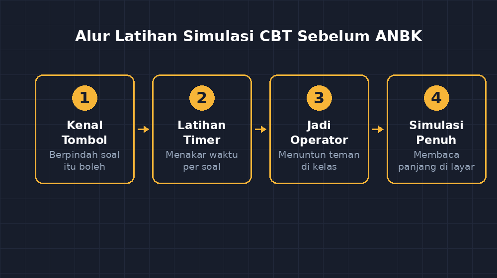

Beberapa pekan lalu saya menerima pengumuman yang membuat jadwal mengajar saya sedikit kacau: kelas delapan akan mengikuti ANBK. Asesmen Nasional Berbasis Komputer. Saya membaca surat itu dua kali, bukan karena bahasanya sulit, tapi karena saya langsung membayangkan wajah siswa-siswa saya ketika mereka nanti duduk di depan layar.

Bukan soal materi yang membuat saya cemas. Sebagian besar konten ANBK menguji literasi dan numerasi — hal-hal yang selama ini sudah kita asah di kelas. Yang membuat saya cemas adalah hal yang lebih sederhana dan sering diremehkan: **apakah mereka bisa mengoperasikan ujiannya sendiri?**

<!--more-->

## Kejadian kecil yang membuka mata saya

Tahun lalu, saat percobaan ANBK perdana di sekolah kami, ada satu momen yang tidak akan saya lupakan. Seorang siswa — sebut saja Raka — sudah lama duduk di depan komputernya, tidak menyentuh apa-apa. Saya berjalan mendekat dan bertanya pelan, "Kenapa, Rak? Soalnya sulit?"

Dia menggeleng. "Soalnya belum saya baca, Pak. Saya nggak tahu cara geser halamannya."

Saya berdiri di sana merasa bodoh. Sepuluh menit pertama asesmen, dan satu anak saya menghabiskannya untuk mencari-cari tombol. Bukan karena dia tidak bisa berhitung. Bukan karena dia tidak bisa membaca. Karena tidak ada seorang pun yang pernah mengajarinya *bahasa mesin ujian* itu sendiri: di mana tombol jawaban, bagaimana berpindah soal, apa arti tanda di pojok layar, apa yang terjadi kalau waktu habis.

Sejak hari itu saya percaya satu hal: **menjadi mahir dalam asesmen berbasis komputer adalah keterampilan tersendiri, terpisah dari kemampuan berhitung.** Dan keterampilan itu harus dilatih, bukan sekadar dijelaskan.

## Masalahnya: latihan butuh tempat latihan

Idealnya, siswa berlatih di platform resmi simulasi ANBK. Realitasnya di sekolah kami: jumlah komputer terbatas, jaringan suka rewel, dan jadwal lab selalu berebut dengan ujian sekolah lain. Latihan yang seharusnya rutin jadinya sekali-dua kali, dan itu pun terburu-buru.

Dari situlah saya mulai berpikir jahat dengan cara yang produktif: *kalau tempat latihannya langka, ya saya bikin sendiri yang bisa dipakai kapan saja.* Saya bukan programmer, tapi seperti sudah sering saya ceritakan di blog ini, perangkat AI dan sedikit keberanian mencoba sudah membuat saya membangun beberapa aplikasi kecil — kuis interaktif, CBT untuk ulangan harian, dan sebagainya. Aplikasi CBT ulangan harian itu ternyata bisa dipakai ulang untuk tujuan yang jauh lebih mulia: **simulasi ANBK versi kelas saya.**

## Tiga hal yang saya pastikan ada di simulasi

Saat menyiapkan simulasi, saya tidak mengejar tampilan yang sama persis dengan platform resmi. Yang saya kejar adalah tiga kebiasaan yang menurut saya paling menentukan di hari H.

**Pertama, kebiasaan berpindah soal.** Di ANBK, siswa boleh mengerjakan soal dalam urutan apa pun dan kembali ke soal sebelumnya. Kebiasaan ini tidak alami bagi anak yang terbiasa dengan lembar kertas, di mana nomor satu selalu dikerjakan lebih dulu. Di simulasi saya, mereka berlatih melompat: "Kerjakan nomor lima dulu, lalu balik ke nomor dua." Terdengar sepele, tapi bagi anak yang panik, tahu bahwa *kembali itu boleh* adalah obat yang ampuh.

**Kedua, kebiasaan membaca soal berbasis teks panjang di layar.** Soal literasi ANBK sering menyajikan kutipan panjang, tabel, atau grafik. Membaca di layar terasa berbeda dari membaca di kertas; mata mudah lelah, dan anak cenderung memindai alih-alih membaca. Dengan simulasi, mereka terbiasa membaca paragraf panjang sambil menggulir layar — keterampilan kecil yang kalau tidak dilatih akan memakan waktu di hari H.

**Ketiga, kebiasaan mengelola waktu.** Di simulasi saya ada timer. Di awal, siswa-siswa saya selalu kaget: "Pak, waktunya jalan sendiri?" Justru itu intinya. Mereka belajar menakar sendiri: soal yang macet, tinggalkan dulu; jangan rela sepuluh menit lenyap untuk satu soal.

Cara saya mengajarkan penakaran waktu cukup sederhana. Kalau satu paket berisi lima soal dan waktunya dua puluh menit, rata-rata adalah empat menit per soal:

$$\frac{20 \text{ menit}}{5 \text{ soal}} = 4 \text{ menit per soal}$$

Tapi saya tidak membiarkannya berhenti di hitungan rata-rata. Kami diskusikan juga: soal hitungan biasanya lebih cepat dari soal cerita panjang, jadi menit-menit yang tersisa dari soal mudah boleh dipindahkan ke soal yang berat. Numerasi dalam konteks nyata, bukan di lembar soal.

## Siswa jadi penguji satu sama lain

Ada satu keputusan kecil yang ternyata berdampak besar. Setelah beberapa sesi simulasi, saya meminta siswa bergantian menjadi "operator": anak yang memegang komputer proyektor di depan kelas, membuka aplikasinya, dan menuntun teman-temannya berpindah soal sesuai perintah saya.

Awalnya saya kira ini cuma variasi biar kelas tidak bosan. Ternyata peran operator mengubah sesuatu yang lebih dalam. Anak yang menjadi operator harus tahu persis di mana setiap tombol berada. Dia yang menjelaskan "klik ikon ini untuk lanjut" akan mengingatnya jauh lebih awet daripada anak yang hanya mendengar. Kelas jadi punya beberapa ahli teknis kecil yang siap menolong temannya kalau hari H nanti ada yang bingung — dan saya tidak bisa berjaga di sebelas komputer sekaligus.

*Alur latihan kami: dari kenal tombol, latihan berpindah soal, sampai simulasi penuh dengan timer.*

## Hasil yang tidak saya duga

Yang paling mengejutkan bukan nilai atau kecepatan mengerjakan. Yang paling mengejutkan adalah berkurangnya pertanyaan di hari H. Pada ANBK sesungguhnya tahun ini, dari kelas yang rutin berlatih, saya hanya menerima dua pertanyaan teknis — dan keduanya dijawab oleh siswa, bukan oleh saya. Sisanya, anak-anak langsung bekerja: membaca, berpikir, mengklik, berpindah.

Raka yang dulu tersesat sepuluh menit? Dia sekarang justru salah satu operator andalan. Ketika anak kelas tujuh bertanya-tanya soal ANBK tahun depan, Raka yang menjawab, "Tenang aja, tombolnya ada di sini."

## Penutup: soal rasa asing

Kalau direnungkan, masalah utama siswa kami di asesmen berbasis komputer bukan teknologinya — mereka generasi yang tumbuh dengan layar. Masalahnya adalah *rasa asing pada format ujian*: bahwa ujian berbentuk sistem yang punya aturan main sendiri, dan aturan main itu bisa dipelajari sebelum hari H.

Sebagai guru, kita tidak selalu bisa menyediakan platform resmi atau lab komputer seluas yang kita harapkan. Tapi kita bisa menyediakan yang paling penting: **pengalaman.** Pengalaman bahwa berpindah soal itu boleh, bahwa timer itu bukan musuh, bahwa membaca di layar itu biasa saja.

Simulasi saya sederhana — jauh dari sempurna, dan mungkin tampilannya tidak mirip platform resmi. Tapi siswa tidak menguji tampilannya. Mereka menguji keberanian mereka sendiri di depan layar, dan itulah yang berhasil kita latih.

Kalau Bapak/Ibu guru sedang menyiapkan siswa untuk ANBK dan terhalang keterbatasan lab atau jadwal, mungkin pesan dari kelas saya adalah ini: jangan tunggu tempat latihan yang sempurna. Latihan yang sederhana tapi rutin jauh lebih berharga daripada satu kali latihan yang megah tapi cuma sekali. Anak-anak kita tidak butuh teknologi canggih; mereka butuh keakraban dengan cara kerja ujian itu, dan keakraban hanya tumbuh dari pertemuan yang berulang.
