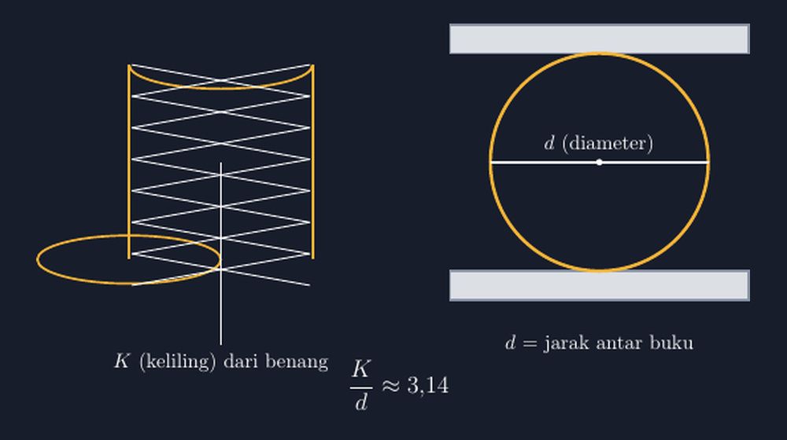

Ada satu rumus yang setiap anak SMP hafal di luar kepala: $K = \pi d$. Mereka bisa menuliskannya bahkan sambil membawa obrolan lain. Tetapi tahun lalu, ketika saya bertanya pada kelas VIII, "Pi itu sebenarnya apa?" jawabannya merata seperti pasukan paduan suara: "Tiga koma satu empat, Pak." Saya tanya lagi, tiga koma satu empat itu dapat dari mana? Hening. Ada yang berani menjawab, "Dari rumus, Pak."

Nah, di titik itulah saya merasa ada yang belum selesai. Anak-anak tahu angkanya, tapi tidak tahu angka itu lahir dari mana. Seolah-olah $\pi$ adalah tetangga yang namanya hafal, tapi tidak pernah diajak bicara.

Musim ini saya coba cara lain. Pekan itu saya minta siswa membawa satu barang dari rumah: benda apa saja yang bentuknya lingkaran penuh. Kaleng susu, tutup jar, gelas, piring, rol lakban. Saya sendiri siapkan benang kulit sepatu yang sudah tidak terpakai dan satu gulung benang jahit biasa. Modalnya murah sekali, tapi kegiatannya jadi salah satu yang paling lama saya ingat tahun ini.

<!--more-->

## Meja Kelas Berubah Jadi Laboratorium

Kegiatannya cuma dua langkah, tapi dua langkah yang dikerjakan dengan serius.

Pertama, lilitkan benang sekali putaran penuh pada benda lingkaran itu. Tandai posisi bertemunya benang dengan ibu jari, lalu luruskan benang dan ukur panjangnya dengan penggaris. Itulah **keliling** lingkaran benda itu — diukur sungguhan, bukan dihitung dari rumus.

Kedua, ukur **diameter**-nya: jarak lurus terpanjang dari satu tepi ke tepi seberang, melewati pusat. Untuk kaleng, cara paling mudah adalah menyandarkannya ke dua buku sejajar lalu mengukur jarak antar buku.

Lalu datang bagian yang bagi saya paling berbudi: bagi keliling dengan diameter. Setiap kelompok menuliskan hasilnya di papan tulis kecil, satu baris satu kelompok.

Hasilnya, kurang lebih begini:

| Benda | Keliling (cm) | Diameter (cm) | Keliling : Diameter |
|---|---|---|---|
| Kaleng susu | 24,5 | 7,8 | 3,14 |
| Tutup jar | 22,6 | 7,2 | 3,14 |
| Piring plastik | 80,1 | 25,5 | 3,14 |
| Gelas kaca | 26,4 | 8,4 | 3,14 |
| Rol lakban | 40,0 | 12,7 | 3,15 |
| Tutup botol kecil | 8,8 | 2,8 | 3,14 |

Kelas hening beberapa detik. Lalu seorang siswa yang biasanya paling pendiam, Nadia, bilang pelan, "Kok semuanya sama, Pak?" Itu pertanyaan yang saya tunggu sejak lima menit pertama.

## Angka yang Tidak Rebut Jabatan

Di sinilah diskusi berubah rasa. Semua benda di kelas itu berbeda ukuran — ada yang sebesar piring, ada yang sekecil tutup botol. Tetapi hasil pembagian keliling oleh diameternya menolak menyerah: semuanya berkumpul di sekitar angka yang sama, sekitar tiga koma satu koma empat.

Itulah inti dari $\pi$. Bukan angka karangan sang guru, bukan pula angka yang dihafal karena disuruh. $\pi$ adalah **perbandingan yang ternyata sama untuk semua lingkaran**, sebesar apa pun lingkarannya. Kalau keesokan harinya siswa mengukur ban sepeda, tenda lingkaran, atau roda ferris wheel, perbandingannya tetap bertahan di angka yang sama. Inilah yang membuat $\pi$ terasa sedikit ajaib — bukan karena rumit, tapi karena konsisten.

Tentu ada yang bertanya, kenapa hasilnya tidak persis $3{,}14159265358979...$ Padahal yang kami dapat tiga koma satu empat, tiga koma satu lima, kadang tiga koma satu dua. Jawabannya justru pelajaran pengukuran yang saya sukai:

1. Benang tidak bisa dililit rapat sempurna; ada celah dan tumpukan halus.
2. Penggaris kami hanya teliti sampai milimeter.
3. Diameternya sendiri tidak selalu kami temukan di titik terlebar yang benar.

Jadi ketidakpastian kecil itu bukan kegagalan — itu wajar untuk alat seadanya. Yang penting adalah arahnya: semua hasil berkumpul dekat-dekat angka yang sama, dan makin hati-hati pengukurannya, makin dekat dengan $3{,}14159...$ Angka pastinya tidak perlu diberitahu siapa-siapa; dia muncul sendiri dari data.

*Contoh pengukuran yang kami lakukan: benang dililit sekali putaran pada kaleng (kiri), lalu kelilingnya dibandingkan dengan diameter yang diukur lewat dua buku sejajar (kanan). Perbandingan keduanya selalu sekitar 3,14.*

## Kembali ke Rumus dengan Rasa Berbeda

Setelah tabel papan tulis itu terbentuk, saya baru menuliskan rumus yang selama ini mereka hafal:

$$K = \pi \times d$$

Kali ini rumusnya tidak turun dari langit. Dia hanya merangkum apa yang tadi pagi mereka buktikan sendiri dengan tangan: keliling lingkaran selalu sekitar tiga koma satu empat kali diameternya. Kalau diameternya diketahui, kalikan $3{,}14$ — bukan karena buku berkata begitu, tapi karena tabel di papan tulis berkata begitu.

Dari rumus itu, hubungannya dengan jari-jari tinggal satu langkah: karena $d = 2r$, maka $K = 2\pi r$. Anak-anak yang sebelumnya bingung kenapa ada $2\pi r$ dan $\pi d$ yang terlihat seperti dua rumus berbeda sekarang bisa melihat keduanya adalah satu kalimat yang sama, hanya ditulis dengan ukuran yang berbeda-beda.

Kami lanjutkan sedikit ke arah luas dengan lelucon sederhana: kalau keliling itu panjang pagar, luasnya adalah rumput di dalam pagar. Dua besaran berbeda satuan, dua konsep berbeda, dan sering tertukar di lembar jawaban. Perbandingan yang mereka temukan tadi hanya berbicara tentang pagarnya.

## Yang Saya Pelajari dari Benang Sehelai

Saya pernah mengira kegiatan seperti ini boros waktu. Satu jam pelajaran habis untuk memilin benang dan menyalin tabel — padahal bisa dipakai latihan soal sepuluh nomor. Tapi lihatlah bedanya: latihan soal menguji apakah anak bisa memakai rumus; kegiatan benang membuat anak tahu rumus itu datang dari mana. Yang pertama terhapus setelah ujian; yang kedua melekat.

Ada juga halusirah yang saya simpan. Salah satu kelompok, iseng, mengukur tutup botol kecil dengan benang dan hasilnya 3,21 — meleset lumayan jauh. Saya tidak menghukum mereka; saya tunjukkan kenapa: benda terlalu kecil, satu milimeter pun bergeser banyak dalam persentase. Anak-anak belajar bahwa ketelitian itu soal konteks, bukan sekadar rajin.

Jadi kalau Bapak/Ibu guru sedang mencari cara memperkenalkan $\pi$ yang tidak berhenti di hafalan, saya sarankan mulai dari lemari ajar yang paling tidak diperhitungkan: tas siswa. Di dalamnya ada kaleng, tutup jar, gelas — semua adalah lingkaran yang siap dibicangkan. Yang kami perlukan hanya benang, penggaris, dan kesediaan menahan diri untuk tidak menuliskan rumus terlalu cepat.

Karena pada akhirnya, matematika yang dibelaskan sering bukan yang paling canggih, melainkan yang paling dekat dengan tangan.

> 📎 **Berkas TikZ lengkap:** [tex/ukuran-keliling-diameter.tex](tex/ukuran-keliling-diameter.tex) — siap kompilasi (butuh paket `tikz`).
