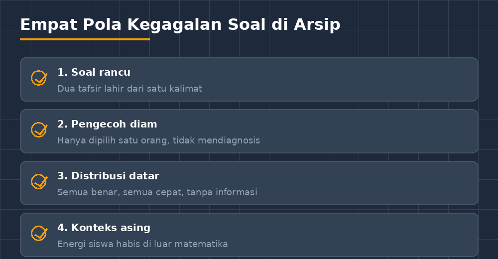
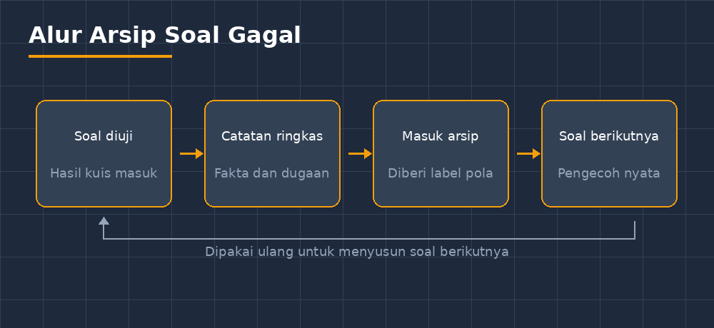

Ada satu sampul cokelat di folder dokumen komputer saya yang judulnya mungkin terdengar aneh: *Soal Gagal*. Di dalamnya tidak ada soal bagus. Justru sebaliknya — semua soal yang pernah saya uji di kelas dan hasilnya tidak seperti yang saya harapkan. Soal yang membuat separuh kelas diam bingung bukan karena sulit, tapi karena kalimatnya rancu. Soal yang pengecohnya tidak dipilih siapa-siapa. Soal yang jawabannya ketahuan hanya dari membaca pilihan pertama.

Dulu, soal-soal seperti itu saya coret begitu saja dari dokumen induk. Dianggap sampah. Tahun ini saya mengubah kebiasaan itu: soal yang gagal saya pindahkan ke arsip khusus, lengkap dengan catatan singkat apa yang salah dan bukti dari kelas.

<!--more-->

## Bermula dari Satu Soal Harga

Arsip itu bermula dari satu soal aritmetika sosial yang saya berikan di kelas VII. Bunyinya kira-kira begini: sebuah toko membeli tas dengan harga Rp85.000, lalu menjualnya Rp110.000. Berapa persen untungnya?

Soal ini secara teknis tidak salah. Tetapi waktu saya buka hasil kuis, dari tiga puluh satu anak, hampir separuh memilih jawaban $\frac{110.000-85.000}{110.000} \times 100\%$. Mereka menghitung untung dari *harga jual*, bukan dari *harga beli*.

Awalnya saya menyalahkan mereka: kurang teliti, tidak membaca soal dengan saksama. Tetapi ketika saya duduk membaca ulang soal itu malam harinya, saya menyadari sesuatu yang lebih jujur: di kehidupan sehari-hari, memang untung sering dibicarakan dari uang yang diterima. "Modal 85, dapet 110, untung 25." Kata "persen untungnya" tidak pernah terdengar sebagai "persen dari modal" dalam percakapan. Kesalahan itu bukan kecerobohan — ia adalah *miskonsepsi yang wajar*, dan soal saya tidak mengantisipasinya.

Soal itu tidak saya buang. Saya pindahkan ke arsip, dan saya tulis satu kalimat catatan di bawahnya: *"Kelas VII-B, 12 dari 31 memilih pengecoh untung/harga jual. Perlu soal pendamping yang membandingkan kedua cara pandang ini secara eksplisit."* Soal itu kini menjadi alasan saya menulis sepasang soal baru: satu yang menanyakan persen untung terhadap harga beli, satu lagi yang menanyakan persen terhadap harga jual, diletakkan berdampingan. Saat pasangan itu saya berikan di kelas yang lain, diskusi yang muncul jauh lebih hidup daripada satu soal tunggal yang benar-salah.

## Catatan Singkat yang Membuat Arsip Hidup

Ada satu hal yang membuat arsip kegagalan ini berbeda dari sekadar "tumpukan soal lama": setiap soal disertai catatan. Tanpa catatan, lima tahun kemudian saya hanya akan melihat soal aritmetika sosial biasa dan tidak ingat apa masalahnya. Dengan catatan, soal itu menyimpan pelajaran.

Format catatan saya sengaja dibuat sangat ringkas, agar tidak melelahkan sehingga kebiasaan ini bertahan:

- **Di kelas mana diuji, kapan**, dan jumlah siswa.
- **Apa yang terjadi**: satu-dua kalimat fakta, bukan opini. Misalnya "19 dari 32 memilih pengecoh A", atau "lebih dari separuh menyerahkan lembar kosong", atau "selesai semua dalam tiga menit".
- **Dugaan penyebab**: ini bagian saya, bukan bagian siswa. Kalimatnya harus dimulai dengan "saya". "Saya menaruh data di tengah kalimat panjang sehingga mudah terlewat." "Saya memberi konteks pasar yang tidak akrab bagi anak desa." "Saya membuat soal nomor 3 terlalu mirip nomor 2."
- **Rencana**: soal dirombak, dipensiunkan, atau diselamatkan sebagian.

Kalimat "dugaan penyebab dimulai dengan *saya*" itu penting. Kalau catatan saya berbunyi "siswa lemah", arsip itu tidak akan pernah mengubah cara saya menyusun soal. Kalau catatannya "saya menempatkan pengecoh yang lebih menyerupai jawaban benar daripada jawaban benar itu sendiri", maka arsip itu langsung memberi perbaikan yang bisa dikerjakan.

## Jenis Kegagalan yang Sering Saya Temui

Setelah setahun, isi arsip itu ternyata berpola. Kegagalan soal di kelas saya hampir selalu masuk salah satu kotak berikut.

Yang pertama, **soal yang rancu**. Biasanya karena kalimat yang terlalu panjang dengan dua data terjalin di tengahnya, atau kata yang bisa ditafsirkan dua arah. Soal keliling yang pernah saya tulis memakai kata "di kelilingi pagar" — separuh kelas menghitung panjang pagar, separuh lagi menghitung luas kebun karena mereka membaca kalimatnya sebagai informasi latar. Dua tafsir, dua jawaban, dan pengecoh saya tidak mengantisipasi salah satunya.

Yang kedua, **pengecoh yang tidak bekerja**. Ada soal perkalian pecahan di mana pengecoh yang saya rancang untuk menangkap siswa yang "menyamakan penyebut" hanya dipilih satu orang. Artinya pengecoh itu tidak mendiagnosis apa pun — dia hanya ada di kertas. Sebaliknya ada pengecoh yang terlalu sukses: dipilih oleh hampir semua siswa yang salah, sehingga soal itu bukan lagi mengukur pemahaman tetapi mengukur daya tahan terhadap satu jebakan.

Yang ketiga, **soal yang tidak berdistribusi**. Ini yang paling sering. Saya sadar dari lembar jawaban yang seragam: semua benar, semua cepat, tidak ada informasi apa pun yang bisa saya petik. Soal itu bukan jelek — dia hanya tidak berguna untuk asesmen. Tempatnya bukan dibuang, tapi dipindah ke kumpulan soal pemanasan.

Yang keempat, **konteks yang tidak akrab**. Soal tentang tarif parkir per jam di kota besar, dihadapi anak-anak yang sehari-hari berangkat naik angkutan desa. Jawaban mereka tidak salah secara prosedur — mereka hanya menghabiskan energi berpikir untuk hal yang seharusnya tidak perlu dipikirkan.

## Arsip yang Mulai Membayar Utangnya

Manfaat arsip ini baru terasa setelah beberapa bulan, dan bentuknya tidak selalu seperti yang saya bayangkan.

Yang paling terasa adalah saat menyusun ulangan: saya sekarang punya daftar *miskonsepsi yang benar-benar muncul di kelas saya*, bukan miskonsepsi yang tertulis di buku pedoman. Pengecoh yang saya rancang sekarang lahir dari jawaban nyata siswa, bukan dari tebakan saya tentang kesalahan yang mungkin terjadi. Tingkat keberhasilan pengecoh — seberapa sering dia dipilih dan oleh siapa — jadi alat ukur kualitas soal itu sendiri.

Manfaat kedua: arsip ini menyelamatkan soal yang benar tapi salah tempat. Ada soal luas gabungan yang gagal sebagai soal ulangan karena terlalu mudah bagi kelas IX — tapi ternyata pas dan hidup ketika dipakai sebagai soal pembuka diskusi di kelas VIII. Soal tidak berpindah nilai kebenarannya; yang berpindah adalah tugasnya.

Manfaat ketiga, dan ini yang paling saya hargai: arsip ini mengubah perasaan saya terhadap kegagalan mengajar sendiri. Dulu soal yang meleset terasa seperti memalukan, sesuatu yang harus ditutup cepat-cepat. Sekarang meleset itu bahan baku. Ada rasa lega yang aneh ketika menutup hari dengan menambah satu entri ke arsip — seolah hari itu kejadian buruknya sudah dikunci dan disimpan dengan rapi, tidak akan mengulang diri tanpa saya sadari.

## Catatan untuk Teman-Saya Sendiri di Masa Depan

Kalau ada rekan guru yang ingin mencoba, saran saya hanya satu: mulai dari satu soal, bukan dari sistem. Jangan buat lembar kerja rumit dengan sepuluh kolom. Satu soal, satu catatan empat baris, cukup. Kebiasaan kecil yang bertahan jauh lebih berharga daripada sistem sempurna yang mati setelah dua minggu.

Dan satu hal lagi yang perlu diakui jujur: tidak semua entri di arsip itu sudah saya tindak lanjuti. Ada entri dari bulan Maret yang catatannya masih berbunyi "perlu dipikirkan lagi". Arsip kegagalan memang bukan daftar tugas yang wajib lunas — dia lebih mirip peta. Peta boleh punya wilayah yang belum dijelajahi. Yang penting, wilayah itu tercatat, dan bukan lagi hilang di antara coretan koreksi yang terhapus begitu saja.

Sampul cokelat itu sekarang bukan lagi tempat sampah digital. Dia arsip paling jujur yang saya punya tentang kelas saya — karena hanya berisi hal-hal yang benar-benar terjadi, bukan hal-hal yang seharusnya terjadi.
