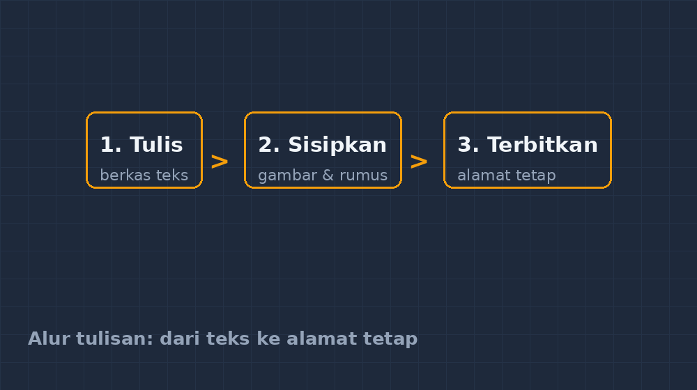
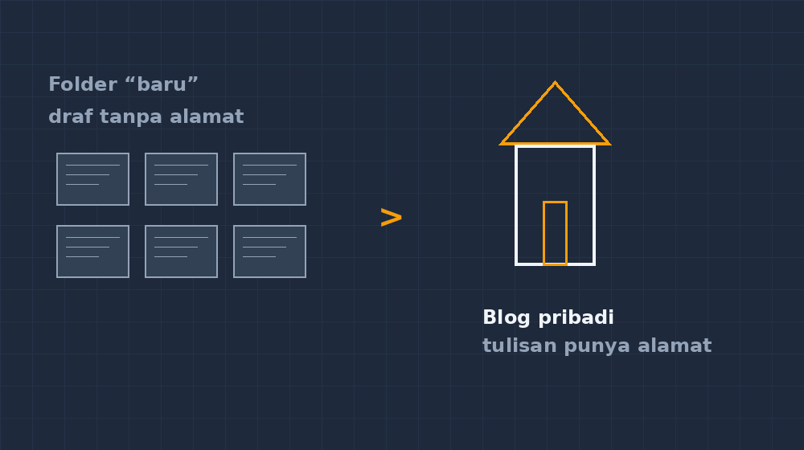

Malam itu saya menutup dokumen yang isinya tiga artikel setengah jadi. Semuanya tersimpan di folder yang namanya "baru" — dan memang baru, karena saya sendiri lupa kapan terakhir menyentuhnya. Ada tulisan tentang cara saya mengajarkan pecahan, ada coretan tentang soal yang pernah bikin kelas VII heboh, ada juga rangkuman refleksi yang niatnya mau dikirim ke rekan sejawat tapi tak pernah selesai. Ketiganya tidur rapi di laptop, sehat-sehat saja, tapi tidak pernah bertemu siapa pun.

Di titik itu saya sadar sesuatu yang agak memalukan: saya yang setiap hari mengajak siswa menyelesaikan pekerjaan sampai tuntas, ternyata punya tumpukan karya yang tidak pernah saya selesaikan penerbitannya. Bukan karena malas menulis — menulis justru bagian yang paling saya nikmati. Tetapi tulisan yang hanya tinggal di folder "baru" itu beda kelas dengan tulisan yang punya alamat.

<!--more-->

## Tulisan yang tidak punya alamat itu seperti apa?

Coba bayangkan saya membagikan handout ke siswa, lalu pulang sebelum menuliskan nama, kelas, atau nomor halaman. Besoknya lembar itu berpindah tangan, berpindah kelas, dan tidak ada yang tahu dari mana asalnya. Itulah rasanya menulis tanpa rumah: tulisan bisa dibaca orang, bisa berpindah dari satu grup WhatsApp ke grup lain, tapi tidak ada yang bisa menemukan tulisan-tulisan *lain* dari penulis yang sama.

Dulu solusi saya sederhana: unggah ke media sosial, selesai. Masalahnya, unggahan itu umurnya pendek. Tiga hari kemudian tulisan tentang trik mengajarkan bilangan negatif sudah tenggelam di bawah meme dan kiriman undangan. Kalau ada rekan guru bertanya "Kak, yang dulu tentang miskonsepsi minus itu di mana ya?", saya selalu harus menggali riwayat unggahan sendiri. Kadang ketemu, seringnya tidak.

Sebuah blog mengubah pertanyaan itu. Sekarang saya tinggal menjawab: "Cari di blog saya, ada di bagian kategori begitu." Tulisan punya tempat tetap. Ia tidak tenggelam, tidak berpindah, dan — ini yang paling penting bagi saya — ia menyimpan jejak bahwa penulisnya pernah berpikir begitu pada waktu tertentu.

## Keputusan kecil yang ternyata besar: bikin sendiri

Sebenarnya ada banyak jalan instan. Daftar di platform blog gratis, pilih tema yang lucu, selesai dalam sepuluh menit. Tapi karena saya sudah jauh-jauh masuk ke dunia membangun aplikasi sendiri lewat proyek GezyTech — mulai dari kuis interaktif, CBT, sampai aplikasi jurnal mengajar — rasanya aneh kalau rumah untuk tulisan saya justru disewa di tempat orang.

Jadi saya pilih jalan yang sedikit lebih menanjak: blog yang dibangun dari berkas teks biasa, digabungkan oleh sebuah program kecil, lalu hasilnya ditaruh di server. Terdengar teknis, dan memang awalnya saya cuma setengah paham. Tapi ada tiga hal yang membuat jalan ini sepadan bagi seorang guru.

Pertama, tulisan saya tersimpan sebagai berkas teks yang bisa saya baca puluhan tahun lagi, terlepas dari aplikasi apa yang sedang populer. Kedua, semuanya tercatat dalam riwayat perubahan — saya bisa melihat tulisan saya versi bulan lalu, kapan saya memperbaikinya, apa yang berubah. Ketiga, dan ini favorit saya: menulis dan menggambar matematika jadi satu kegiatan yang mulus. Formula seperti $x = \frac{-b \pm \sqrt{b^2 - 4ac}}{2a}$ tidak perlu difoto dari buku atau diketik ulang asal-asalan; ia diketik, dan tampil persis.

*Alur sederhana yang saya jalani: menulis di berkas teks, menambahkan gambar, lalu menerbitkan. Tidak ada langkah yang hilang di antara tumpukan kertas.*

## Yang saya pelajari di perjalanan

Membangun blog sendiri mengajari saya hal-hal yang tidak saya duga akan berhubungan dengan profesi mengajar.

Yang pertama: **detail kecil itu penting**. Ada masa-masa ketika saya mengubah sesuatu yang terlihat sepele, lalu seluruh halaman blog mendadak kosong. Panik, tentu. Setelah ditelusuri pelan-pelan, penyebabnya cuma satu baris pengaturan yang saya tulis dalam format yang salah — semacam menulis pecahan tanpa garis pemisah, semua angkanya ada tapi maknanya hilang. Sejak itu saya jadi lebih hati-hati membaca pesan kesalahan, bukan langsung menebak-nebak. Kebiasaan ini ternyata lulus pakai ke kelas: saat siswa salah hitung, saya kini terbiasa bertanya "baris mana yang kamu ubah terakhir?" sebelum menyalahkan angkanya.

Yang kedua: **gambar harus bisa dipertanggungjawabkan**. Sebagai guru matematika, saya sering butuh gambar: bidang koordinat, bangun datar, diagram. Awalnya saya pakai gambar hasil screenshot asal, lalu sadar banyak yang proporsinya tidak jujur — sudut yang seharusnya siku terlihat lancip, jarak yang seharusnya sama tampak beda. Di blog inilah saya akhirnya serius belajar menggambar dengan kode, sehingga setiap titik dan garis punya koordinat yang bisa saya pertanggungjawabkan. Kebiasaan ini bahkan menjalar ke aplikasi-aplikasi GezyTech yang saya bangun: media matematika tidak boleh mengarang geometrinya sendiri.

Yang ketiga: **terbit itu mengubah cara menulis**. Ketika tulisan tahu akan dibaca orang, saya jadi lebih jeli memilih contoh, lebih jujur menceritakan kegagalan kelas, dan lebih berhati-hati soal istilah. Menulis untuk folder "baru" dan menulis untuk pembaca ternyata dua kegiatan yang berbeda — yang pertama menenangkan diri sendiri, yang kedua melayani orang lain.

*Sebelum dan sesudah: tumpukan draf tanpa alamat, dan tulisan yang akhirnya punya "tempat tinggal" yang bisa dikunjungi siapa saja.*

## Kenapa guru sebaiknya punya rumah tulisan sendiri

Saya tidak akan mengklaim semua guru harus membangun blog dari kode. Tidak wajib. Tapi saya akan gigih mengusulkan: punya *satu* tempat yang alamatnya milik sendiri, di mana tulisan-tulisan tentang praktik mengajar berkumpul dan tidak tergantung izin platform.

Alasannya praktis. Portofolio guru kini sering diminta — untuk sertifikasi, untuk pengembangan karier, untuk melamar sesuatu. Memiliki blog pribadi berarti portofolio itu sudah setengah jadi: terkumpul, bertanggal, dan berisi bukti kerja nyata, bukan klaim. Rekan guru yang membacanya bisa menangkap gaya mengajar kita jauh lebih jujur daripada dari lembaran formulir.

Alasannya yang lebih dalam: menulis publik memaksa kita berpikir lebih runtut. Ada kalanya di kelas saya merasa menjelaskan sesuatu dengan lancar, lalu ketika menuliskannya, urutan berpikir itu retak — ternyata ada loncatan yang selama ini saya tutupi dengan gestur dan intonasi. Menulis menangkap loncatan itu. Sering kali tulisan yang saya terbitkan justru membuat pembelajaran berikutnya lebih baik, karena saya sudah dipaksa merapikan pikiran saya di atas kertas.

Dan satu lagi yang tidak saya duga: tulisan yang terbit punya cara sendiri untuk berkelana. Ada rekan guru dari kota lain yang menghubungi karena menemukan tulisan saya lewat mesin pencari, lalu kita berdiskusi soal miskonsepsi yang dia hadapi di kelasnya. Pertukaran kecil seperti itu tidak akan pernah terjadi kalau tulisan itu tetap tidur di folder "baru".

## Penutup: rumah yang terus dirapikan

Blog ini, seperti rumah sungguhan, tidak pernah benar-benar selesai. Kadang saya mengganti tampilannya, kadang memperbaiki tautan yang mati, kadang sekadar menata ulang kategori karena tulisan sudah menumpuk. Tapi justru kesederhanaan kerja apinya yang saya sukai: setiap kali saya selesai menulis, saya tahu persis apa langkah terakhirnya, dan tulisan itu langsung punya alamat yang bisa saya bagikan ke siapa pun.

Kalau Bapak/Ibu sedang menimbang untuk memulai — mulailah dari yang kecil. Satu tulisan tentang satu kejadian di kelas, ditulis dengan jujur, sudah lebih berharga daripada sepuluh draf yang menunggu kesempurnaan. Rumahnya bisa disewa dulu di platform mana pun; yang penting kebiasaan menulis dan menerbitkan itu jalan. Nanti kalau rasa punya alamat sendiri mulai menggigit — seperti yang terjadi pada saya — baru kita bicara soal membangunnya dari fondasi.

Selamat menulis. Semoga tulisan Bapak/Ibu cepat menemukan alamatnya.
