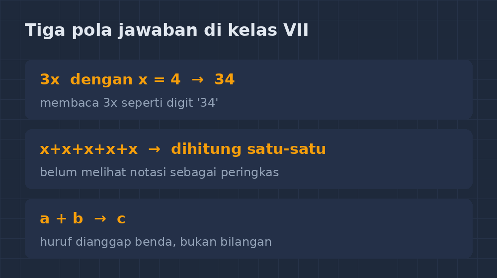
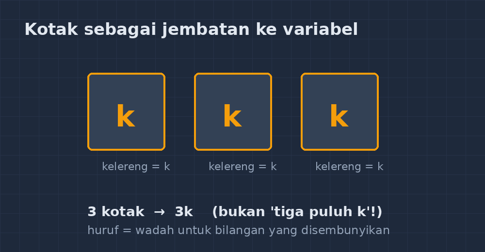

Kalau ditanya bagian mana dari matematika SMP yang paling bikin wajah murid saya berubah — dari semangat jadi bingung — jawabannya bukan trigonometri, bukan juga statistika. Jawabannya: pertemuan pertama dengan huruf.

Di kelas VII, biasanya sekitar bulan November, kami sampai ke bab aljabar. Sebelum bab itu, matematika mereka adalah dunia angka. Empat kali tiga sama dengan dua belas, jelas, beres, bisa dihitung dengan jari kalau terdesak. Lalu tiba-tiba saya menulis di papan: $3x + 5 = 20$. Dan dunia mereka runtuh sedikit.

Tahun ini saya memutuskan untuk tidak langsung memberi aturan. Saya ingin mendengar dulu apa yang sebenarnya terjadi di kepala mereka. Yang saya temukan justru mengajari saya lebih banyak daripada yang saya harapkan.

<!--more-->

## "Tiga eks" yang sebenarnya bukan tiga eks

Miskonsepsi pertama, dan yang paling saya duga, adalah tentang arti $3x$. Ketika saya bertanya berapa nilai $3x$ jika $x = 4$, hampir seperlima kelas menjawab 34.

Tiga puluh empat. Bukan dua belas.

Saat saya gali lebih dalam, baru kelihatan logikanya: bagi mereka, "3x" dibaca seperti "34" — tiga menempel dengan empat, jadi tiga puluh empat. Huruf itu diperlakukan seperti digit, bukan seperti sesuatu yang dikalikan. Ini bukan kelalaian. Ini benar-benar cara mereka membaca simbol, dan cara itu masuk akal menurut pengalaman mereka selama enam tahun di SD, di mana angka yang menempel selalu berarti gabungan nilai tempat.

Miskonsepsi kedua datang dari arah lain. Ada siswa yang menjawab $3x$ dengan $x + x + x$ dan itu — hebat — benar. Tapi ketika saya lanjutkan ke $x + x + x + x + x$, sebagian menghitungnya dengan menambahkan satu-satu di kepala, lambat dan berisiko salah, tanpa sadar bahwa itu bisa langsung ditulis $5x$. Mereka memahami ide, tapi belum melihat bahwa notasi aljabar justru dibuat untuk mempersingkat.

Yang ketiga paling menarik bagi saya: siswa yang menganggap huruf adalah "objek". $a + a = 2a$, oke. Tapi $a + b$? Beberapa jawab $c$. Masuk akal, kan? Kalau satu apel ditambah satu buku, hasilnya "satu apel dan satu buku", bukan "dua sesuatu". Justru jawaban $c$ itu menunjukkan bahwa mereka memikirkan konteks, bukan asal menghitung. Masalahnya cuma satu: di aljabar, $a$ dan $b$ mewakili bilangan, bukan benda.

*Tiga pola jawaban yang saya kumpulkan dari satu kelas VII — masing-masing punya logika sendiri yang bisa dilacak.*

## Dari mana huruf itu datang sebenarnya

Setelah melihat semua itu, saya menyimpulkan sesuatu yang sederhana tapi sering saya lupakan: siswa tidak salah karena bodoh. Mereka salah karena membawa kebiasaan lama ke wilayah baru. Aljabar bukan bab yang sulit karena materinya sulit; dia sulit karena menuntut perubahan cara *membaca*.

Karena itu tahun ini saya mengubah pendekatan. Sebelum menyentuh notasi, saya mulai dari kotak.

Saya bawa kardus kecil bertuliskan huruf "k" ke kelas. Saya bilang: "Di dalam kotak ini ada beberapa kelereng, jumlahnya saya sembunyikan. Kita sebut saja jumlahnya $k$." Lalu saya taruh dua kardus lain yang identik di sampingnya. "Berapa total kelereng ketiga kotak ini?" Jawabannya datang sendiri: tiga kotak, jadi $3k$. Tidak ada yang menjawab $3k$ diartikan "tiga puluh k" di sini, karena konteks kotak membuat makna perkalian terasa wajar.

Baru setelah itu saya menuliskan $3k$ di papan dan menghubungkannya dengan kotak-kotak tadi. Huruf berhenti menjadi misteri; dia jadi nama untuk sebuah bilangan yang sedang disembunyikan.

Untuk $a + b$, saya pakai dua kardus berbeda — satu bertuliskan $a$, satu $b$. "Kalau isinya bisa berbeda, boleh kita gabung?" Mereka sendiri yang menyimpulkan: tidak, kecuali isinya ternyata sama. Kesimpulan itu yang keluar dari mulut mereka sendiri jauh lebih bertahan daripada aturan "suku sejenis" yang saya diktahkan di tahun-tahun sebelumnya.

## Latihan yang sengaja menjebak

Langkah kedua saya adalah memperkenalkan soal-soal "perangkap" secara sengaja dan terbuka. Saya bilang ke murid: "Soal-soal ini dibuat untuk menjebak. Temukan jebakannya."

Contohnya: jika $a = 3$, berapakah $2a$? Dan berapa $ab$ jika $a = 3$ dan $b = 4$? Soal kedua sengaja menggoda jawaban 34 — dan di sinilah diskusi seru terjadi. Murid yang tadinya menjawab 34 sekarang harus mempertahankan atau merevisi jawabannya di depan teman-temannya, dan revisi yang lahir dari diskusi itu terasa seperti penemuan mereka sendiri.

Ada satu momen yang tidak akan saya lupa. Seorang siswa yang biasanya paling pendiam tiba-tiba angkat tangan dan bilang, "Pak, jadi huruf itu kayak wadah, ya? Isinya bisa diganti-ganti." Saya hampir menangis. Itu inti aljabar — variabel sebagai wadah yang isinya bisa berubah — dirumuskan oleh anak kelas tujuh dengan bahasanya sendiri, bukan dari halaman buku paket.

*Kotak bertuliskan huruf jadi jembatan: dari "benda berisi" ke "bilangan yang belum diketahui".*

## Apa yang saya pelajari dari bab ini

Mengajar aljabar selama bertahun-tahun mengajari saya satu hal yang juga relevan di luar matematika: miskonsepsi tidak hilang dengan koreksi, dia hilang dengan penggantian cara pandang. Kalau saya hanya bilang "$3x$ itu tiga kali $x$, ingat!", jawaban 34 mungkin tidak muncul lagi di lembar kerja — tapi cara berpikirnya masih ada, menunggu momen lain untuk keluar.

Sekarang saya lebih sabar dengan jawaban aneh. Jawaban aneh adalah data. Ketika siswa menjawab $c$ untuk $a+b$, dia sedang memberi tahu saya bagaimana dia melihat dunia — dan tugas saya bukan menghapusnya dengan coretan merah, tapi menawarkan cara pandang yang lebih muat.

Kalau Bapak/Ibu rekan guru sedang menghadapi bab aljabar di kelas VII, mungkin bisa dicoba: mundur dulu dari notasi, mainkan benda konkret, biarkan siswa yang menamai. Huruf akan terasa jauh kurang menakutkan kalau dia datang sebagai jawaban atas pertanyaan, bukan sebagai simbol yang dipaksakan.

Dan jujur saja — setiap kali melihat $3x$ sekarang, saya jadi ingat kardus-kardus kecil itu. Ternyata materi paling abstrak di matematika SMP bisa dimulai dari sesuatu yang bisa diangkat dengan dua tangan.
