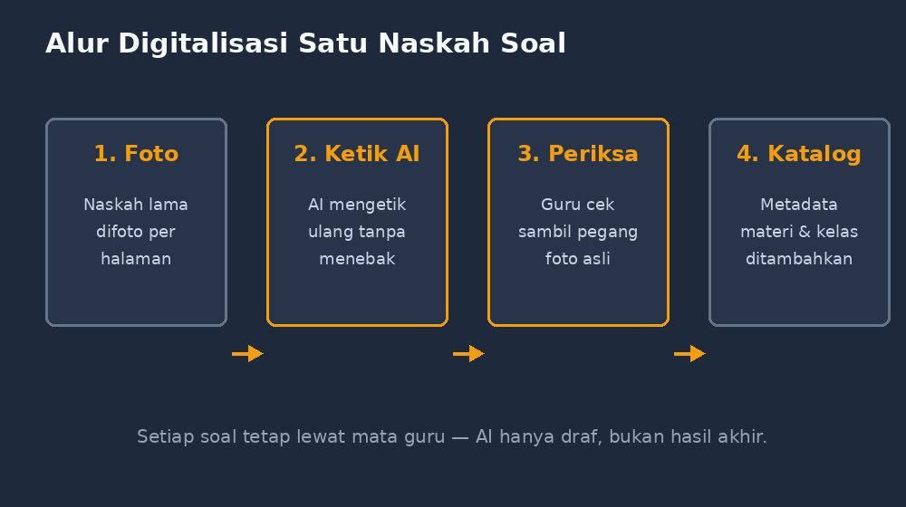

Di lemari kantor MGMP ada satu kardus yang sebenarnya sudah lama saya pandang dengan perasaan campur aduk. Isinya lembar soal—ulangan harian, soal UAS, soal olimpiade tingkat kecamatan, sampai soal ulangan kenaikan kelas dari tahun 2013. Semuanya tulisan tangan di atas formulir fotokopian, sebagian sudah menguning, dan ada satu halaman yang di pojoknya masih ada coretan kopi. Setiap kali ada guru baru yang bertanya "Pak, ada soal tahun lalu tidak?", jawaban saya selalu sama: "Ada, tapi harus gali dulu."

Gali. Itu kata yang tepat. Karena arsip soal yang tidak bisa dicari pada dasarnya sama dengan tidak ada.

Kali ini saya memutuskan untuk benar-benar menggalinya sekalian—tapi bukan dengan mengetik ulang semuanya sendiri. Saya mengajak AI. Artikel ini adalah cerita bagaimana prosesnya berjalan, apa saja yang mengejutkan saya, dan di mana letak garis yang menurut saya tidak boleh dilewati.

<!--more-->

## Titik Awal: Menyadari bahwa Masalahnya adalah Pencarian, bukan Kepemilikan

Awalnya saya mengira masalah saya adalah kekurangan soal. Ternyata bukan. Begitu saya benar-benar menghitung isi kardus itu, ada lebih dari dua ratus naskah soal. Masalahnya, selama belasan tahun itu, saya tidak pernah bisa menjawab pertanyaan seperti: "Soal tentang pecahan senilai bentuk soal cerita yang pernah saya buat itu ada di naskah mana?"

Sebuah bank soal yang baik seharusnya bisa menjawab pertanyaan semacam itu dalam hitungan detik. Bank soal yang tersimpan sebagai tumpukan kertas di kardus tidak pernah bisa. Jadi tujuan saya bukan sekadar "mendigitalkan", melainkan membuat arsip itu *bisa dicari*—berdasarkan materi, jenjang kelas, bentuk soal, bahkan tingkat kesulitannya.

Dari sana barulah jelas pekerjaannya: setiap naskah harus menjadi teks digital yang terstruktur. Alurnya saya gambarkan sederhana seperti ini:

*Empat langkah per naskah—dan langkah ketiga yang tidak boleh dilewati.*

Dan di sinilah mengetik ulang manual jadi masalah. Dua ratus naskah, masing-masing sekitar lima sampai delapan soal, dengan tulisan tangan yang kadang saya sendiri harus membaca dua kali. Kalau saya kerjakan sendiri satu jam per malam, itu pekerjaan berbulan-bulan.

## AI sebagai Juru Ketik yang Cepat—tapi Butuh Pengawasan

Cara kerjanya sederhana di delarasinya, menantang di pelaksanaannya. Saya memfoto setiap halaman naskah, memberikannya kepada model AI dengan perintah yang konsisten: *ketik ulang soal-soal di gambar ini ke format tertentu, jangan mengubah redaksinya, tandai bagian yang tidak terbaca sebagai [tak terbaca], jangan menebak*.

Hasilnya untuk soal cetak yang masih jelas hampir sempurna—tinggal saya rapikan. Untuk tulisan tangan, hasilnya bervariasi. Ada naskah 2015 yang tulisannya rapi dan langsung ketik ulang dengan mulus. Ada juga naskah 2013 di mana AI dengan percaya diri menuliskan "sebuah persegi memiliki diagonal 12 cm" padahal yang saya baca di foto adalah "sebuah persegi panjang". Angka dua belas dan dua puluh juga pernah tertukar begitu saja.

Tiga pelajaran praktis yang saya tarik dari proses ini:

Pertama, **perintah yang konsisten jauh lebih penting daripada perintah yang pintar**. Ketika saya tetap memakai satu template perintah yang sama untuk semua foto, hasilnya seragam dan mudah diperiksa. Begitu saya asal bertanya dengan kalimat berbeda-beda, format hasilnya ikut berantakan.

Kedua, **AI harus dilarang menebak**. Kalimat "jangan menebak, tandai yang tidak jelas" terdengar sepele, tapi ini pembeda terbesar antara hasil yang bisa saya percaya dan hasil yang bisa menjerat saya. AI yang tidak boleh menebak akan menulis [tak terbaca]—dan itu justru kabar baik, karena saya tahu persis bagian mana yang harus saya periksa dengan mata sendiri.

Ketiga, **pemeriksaan harus dilakukan per naskah, bukan per tumpukan**. Saya mengalokasikan waktu membaca ulang hasil ketikan AI sambil memegang foto aslinya. Untuk angka-angka dalam soal matematika, saya membaca dua kali lebih teliti daripada redaksinya. Karena kesalahan angka dalam soal tidak hanya membuat soal salah—ia bisa membuat soal *tidak punya jawaban*, dan itu baru ketahuan di tengah ulangan.

## Dari Teks Lepas menjadi Bank Soal yang Bisa Dicari

Mengubah naskah jadi teks saja belum cukup. Bagian yang menurut saya justru paling menyenangkan adalah menata metadata setiap soal. Setiap soal akhirnya saya simpan dengan format yang sama: kode soal, kelas, materi (mengikuti bab di kurikulum), bentuk soal, dan catatan singkat.

Setelah itu segala macam hal menjadi mungkin. Saya bisa meminta: "Tampilkan semua soal pecahan untuk kelas VII yang bentuknya soal cerita." Atau ketika menyusun paket ulangan, saya tinggal memilih beberapa kode soal dan hasilnya langsung rapi. Bahkan proses penyusunan kisi-kisi jadi berbeda—saya bisa melihat, misalnya, bahwa arsip saya kaya soal hitungan rutin tapi langka soal penalaran, lalu sengaja menambah yang kurang itu.

Ada satu momen kecil yang membuat semua usaha ini terasa berbalas. Suatu sore, rekan sejawat butuh tiga soal perbandingan senilai konteks pasar untuk latihan mendadak besok pagi. Dulu, permintaan seperti itu berarti saya membongkar kardus. Kali ini saya membuka arsip, mengetik beberapa kata, dan dalam satu menit mengirim tiga soal lengkap dengan kuncinya. Soal-soal itu ternyata soal buatan saya sendiri tahun 2017—yang selama ini tidur di kardus.

## Garis yang Saya Jaga

Meski puas, ada beberapa hal yang sengaja saya jaga sepanjang proses ini.

Soal hasil ketikan AI **tidak langsung saya pakai tanpa dibaca ulang**. Ini bukan formalitas. Sepengalaman saya menguji AI dengan soal-soal sebelum ini, model bisa salah dengan nada yang sama percaya dirinya seperti saat benar. Karena itu saya memperlakukan hasil ketikan AI sebagai *draf yang sudah 90% jadi*, bukan hasil akhir.

Saya juga **tidak memasukkan hal-hal yang bukan milik saya untuk dibagikan**. Soal buatan guru lain yang ada di arsip MGMP, misalnya—untuk arsip pribadi boleh, tapi kalau hasil digitalisasinya mau dipakai atau disebarluaskan, izin tetap perlu. Digitalisasi memudahkan penyalinan, dan kemudahan itu bukan alasan untuk melonggarkan kebiasaan baik.

Terakhir, saya menuliskan **keterangan sumber di setiap soal**: berasal dari naskah tahun berapa, pernah dipakai di ulangan apa. Bank soal yang baik itu arsip yang jujur, bukan sekadar tumpukan teks.

## Yang Saya Pelajari tentang Mengajar dari Proses Ini

Hal yang tidak saya duga: proses mendigitalkan soal lama ternyata seperti membaca jurnal perjalanan saya sebagai guru. Soal-soal tahun awal rata-rata "Hitunglah luas persegi panjang berikut"—kering, langsung ke rumus. Soal-soal tahun-tahun belakangan mulai punya cerita, konteks, bahkan pengecoh yang sengaja dirancang. Saya tidak sadar sudah berubah sejauh itu sampai saya melihatnya berjajar dalam satu arsip.

Jadi ketika ada rekan guru yang bertanya "pakai AI untuk apa saja, Pak?", jawaban saya belakangan bukan lagi soal membuat soal baru. Salah satu pemakaian paling berdampak justru yang terdengar paling membosankan: mengetik ulang kertas lama. Karena sesuatu yang sudah kita buat dengan susah payah tidak seharusnya hilang nilainya hanya karena tidak bisa dicari.

Kardus di lemari itu sekarang tinggal kenangan—isinya sudah seluruhnya pindah ke layar. Tapi foto-foto aslinya tetap saya simpan. Sekalipun AI sudah membantu sampai sejauh ini, ada satu kebiasaan yang tidak akan saya tinggalkan: memverifikasi dengan mata sendiri, soal demi soal.
