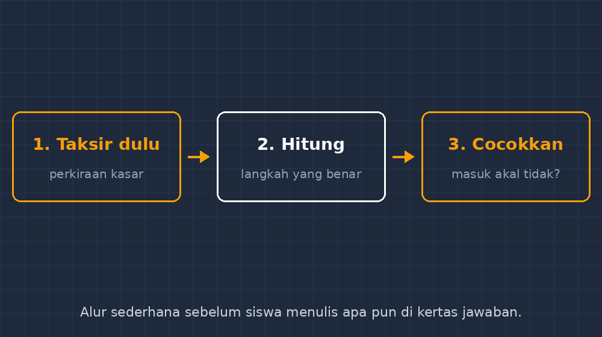

Ada satu pemandangan di kelas yang tahun-tahun awal mengajar saya tanggapi dengan mencoret besar-besaran di kertas jawaban: siswa yang sampai pada jawaban bahwa harga satu buku tulis adalah Rp4.500 setelah diskon, padahal harga normalnya tertulis Rp15.000. Atau siswa yang menyimpulkan tinggi pohon di halaman sekolah 320 meter. Jawabannya salah, tentu. Tapi yang membuat saya duduk diam sebentar bukan kesalahannya — melainkan ketenangannya. Siswa itu menyerahkan kertas dengan wajah tenang, yakin bahwa semuanya sudah beres.

<!--more-->

Kalau dicermati, jawaban seperti itu hampir selalu lahir dari proses yang benar di bagian-bagian tertentu. Operasinya jalan, angkanya pindah dari kiri ke kanan sesuai aturan, lalu di akhir muncul hasil yang tidak disapa siapa-siapa. Siswa tidak pernah mengajak hasil itu bicara. Angka terakhir bagi dia bukan sesuatu yang punya arti; dia hanya alamat tempat perhitungan berhenti.

Di titik itu saya sadar, yang kurang bukan kecakapan menghitung. Yang kurang adalah kebiasaan yang lebih tua dari semua rumus: menaksir dulu, sebelum menghitung.

## Taksir bukan menebak

Ada kesalahpahaman yang perlu saya luruskan lebih dulu, termasuk kepada diri saya sendiri di masa lalu. Dulu saya menolak materi "perkiraan" karena menganggapnya ilmu yang longgar — matematika itu harus eksak, kenapa mengajari anak menebak? Ternyata saya yang salah paham. Menaksir bukan menebak asal; menaksir adalah menghitung dengan cara kasar agar kita tahu *kisaran* jawaban sebelum bekerja dengan serius.

Contoh sederhana yang sekarang sering saya pakai: berapa $38 \times 21$? Sebelum siswa menghitung, saya minta mereka mengucapkan perkiraannya dengan suara. $38$ itu hampir $40$, dan $21$ itu hampir $20$, jadi jawabannya kira-kira $40 \times 20 = 800$. Kata kuncinya bukan "benar", tapi "sekitar delapan ratus". Kalau nanti hasil hitung persisnya keluar $798$, taksiran itu mengangguk puas. Kalau keluar $7980$ karena siswa lupa membawa nol, taksiran yang sama berteriak lebih dulu daripada nilai di rapor.

Yang menarik, siswa sebenarnya punya bakat bawaan untuk ini. Mereka menaksir setiap hari — berapa lama ke sekolah naik sepeda, cukup atau tidaknya uang jajan sampai jam istirahat kedua, masih muat atau tidaknya tugas di map. Bakat itu hanya tidak pernah diizinkan masuk pintu matematika. Di pelajaran saya, pintunya dipagari angka eksak, dan semua yang longgar disuruh menunggu di luar.

## Insiden kalkulator yang tidak dicurigai

Tahun ajaran ini saya mengalami satu insiden yang jadi pemicu seriusnya aturan ini. Dalam latihan soal cerita, ada soal tentang harga tiket bus per orang dan jumlah penumpang. Seorang siswa, sebut saja Raka, bekerja rapi dengan alat hitung di HP — soalnya memang diperbolehkan untuk bagian itu. Jawabannya: tiket per orang Rp87.512, dan dia menuliskannya dengan keyakinan penuh, lengkap dengan langkah yang benar.

Masalahnya, jumlah tiket keseluruhan di soal adalah Rp87.512 *untuk 24 orang*. Raka membagi dengan angka yang salah posisi dan sampai pada hasil yang — bagi siapa pun yang pernah naik bus antarkota — jelas mustahil. Tapi tidak ada sirene yang berbunyi di kepalanya, karena tidak pernah ada yang mengajarkan bunyi sirene itu.

Sejak hari itu, aturan kelas saya berubah bentuk. Dulu taksiran hanya muncul di bab tertentu, "Perkiraan" atau "Bilangan Besar", lalu menghilang begitu bab berganti. Sekarang taksiran jadi kebiasaan di semua bab, sebagaimana duduk sebelum berangkat. Alurnya saya tempel di dinding dan gambar di bahan ajar, cuma tiga kotak: taksir dulu, hitung dengan langkah yang benar, lalu cocokkan — masuk akal atau tidak. Kotak ketiga yang paling sering dilewati siswa, dan justru kotak ketiga itulah yang membedakan orang yang menghitung dari orang yang bermatematika.

## Bagaimana saya melatihnya tanpa membuat siswa bosan

Melatih kebiasaan ternyata lebih sulit daripada melatih keterampilan, karena kebiasaan harus dilakukan pada momen yang tepat, bukan di jam khusus. Beberapa hal yang saya jalankan:

**Kotak taksiran di setiap soal.** Di lembar kerja, saya sisipkan satu kotak kosong kecil di atas ruang kerja: "Perkiraan jawabanku: ____". Tidak dinilai benar-salahnya, tapi wajib terisi. Cukup beberapa minggu sampai siswa terganggu rasanya mengerjakan soal dengan kotak kosong — dan itulah tujuannya, mengubah rasa terganggu menjadi rasa penasaran.

**Bandingkan taksiran antarteman.** Untuk soal yang sama, saya minta tiga siswa menyebut taksirannya masing-masing, lalu kelas memutuskan taksiran siapa yang paling wajar dan kenapa. Di sini muncul percakapan yang tidak pernah saya dapat dari latihan hitung biasa: "Kalau $48$ aku bulatkan ke $50$, lebih tinggi dikit", atau "Jangan dibulatkan ke bawah dua-duanya, nanti taksirannya jadi kekecilan." Siswa sedang bernalar tentang bilangan, bukan sekadar mengoperasikannya.

**Soal jebakan yang jawabannya mustahil.** Sesekali saya memberi soal yang langkahnya benar tetapi hasilnya mustahil — seperti soal Raka — dan tidak berkata apa-apa. Siswa yang sudah terlatih menaksir akan berdiri dan berkata, "Bu, ini kok aneh?" Siswa yang belum akan mengumpulkan jawaban tenang seperti biasa. Perbedaan kedua kelompok itu, yang saya catat di jurnal mengajar, lebih jujur daripada nilai ulangan mana pun.

Satu catatan jujur: kebiasaan ini tidak ditanam dengan sekali penerangan. Bulan pertama, kotak taksiran diisi iseng — angka acak yang tidak disambungkan dengan apa pun. Saya tidak marah; saya hanya sesekali membacakan taksiran tertentu dan menanyakannya ulang di depan kelas. Lambat laun siswa belajar bahwa kotak itu punya konsekuensi: kalau diisi asal, ia tidak bisa melindungi apa-apa.

## Kaitannya dengan hal-hal di luar matematika

Ada satu hal lagi yang membuat saya makin yakin dengan kebiasaan ini. Anak-anak kita tumbuh di lingkungan yang penuh angka yang disajikan tanpa proses — angka di layar, di pesan yang diteruskan, di video yang terburu-buru. Reaksi yang dilatih kebanyakan konten adalah percaya atau tidak percaya, hitam atau putih. Padahal kecakapan yang dibutuhkan ada di tengah: bertanya "kira-kira seberapa besar yang wajar di sini?" sebelum menerima atau menolak.

Menaksir adalah bentuk paling kecil dan paling terukur dari sikap kritis itu. Anak yang terbiasa mengatakan "harganya tidak mungkin sekian" terhadap soal bus, kelak — saya berharap — akan mengatakan hal yang sama terhadap klaim diskon 90% yang tetap mahal, atau angka statistik yang dikutip tanpa konteks. Itu bukan pelajaran matematika lagi; itu pendidikan. Tapi pintu masuknya ternyata sesederhana perkiraan kasar sebuah perkalian.

Penutupnya, saya kutip suasana kelas kemarin. Kami mengerjakan soal luas, dan seorang siswa yang dulu termasuk yang paling tenang menyerahkan jawaban mustahil kini berhenti di tengah pekerjaannya, menatap hasil hitungnya, lalu berkata keras-keras, "Ini kegedean, deh. Taksiranku cuma sekitar dua ratus." Dia menghapus, mengulang, dan sampai pada jawaban yang benar — sendiri, tanpa saya berkata apa-apa.

Itu momen yang tidak akan muncul di nilai apa pun. Tapi bagi saya, hari itu kelas berhasil.

---

*Kalau Bapak/Ibu guru mencoba kebiasaan serupa, kabari saya bagaimana bentuk adaptasinya di kelas masing-masing — terutama untuk jenjang atau materi yang taksirannya tidak sekadar bilangan besar.*
