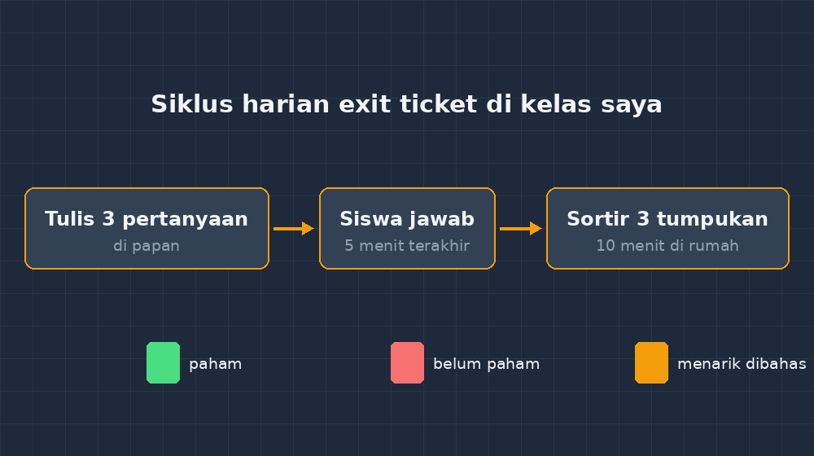

Ada satu kebiasaan di kelas saya yang dulu selalu berjalan sama setiap hari: bel berbunyi, saya menutup materi buru-buru, siswa mengepak tas sambil setengah mendengarkan, lalu semua pulang. Keesokan harinya, barulah di awal pelajaran, saya menanyakan "kemarin sampai mana ya?" — dan sering kali jawabannya membuat saya kaget. Yang saya kira sudah paham ternyata masih tersangkut di langkah kedua; yang saya kira bingung ternyata sudah jalan jauh lebih depan.

Persoalannya sederhana: kabar dari kelas itu datang terlalu malam. Saya baru tahu apa yang terjadi di kepala mereka setelah kelasnya sendiri sudah selesai.Padahal, sebenarnya, jendela untuk menangkap kabar itu selalu terbuka setiap hari — hanya lima menit terakhir sebelum bel, dan selembar kertas kecil.

Alatnya sering disebut *exit ticket*, atau kartu keluar. Di kelas saya kini bentuknya sangat sederhana: kertas HVS dipotong dua, jadi separuh lembar per anak. Tiga pertanyaan singkat di papan tulis, siswa menjawab di kertas itu, dan kertasnya diserahkan ke meja depan sebelum keluar kelas. Lima menit. Tidak dinilai, tidak diberi tanda merah, tidak dicatat di leger. Hanya dibaca.

<!--more-->

## Tiga pertanyaan yang saya pakai

Saya tidak berinovasi jauh. Pertanyaannya hampir selalu tiga, dengan kerangka yang sama:

1. Satu hal yang kamu pahami hari ini.
2. Satu hal yang masih membingungkan.
3. Satu pertanyaan yang ingin kamu tanyakan.

Kerangka ini memang bukan ciptaan saya — banyak buku asesmen formatif membahasnya — tetapi cara ia bekerja di kelas nyata tetap membuat saya takjub setiap kali. Pertanyaan pertama memaksa siswa merangkum dengan bahasanya sendiri, dan justru di sinilah miskonsepsi paling sering bocor. Bukan dari jawaban salah, tapi dari kalimat yang hampir benar: *"gradien itu kemiringan garis, jadi kalau garisnya naik gradiennya positif, kalau turun negatif, kecuali kalau garisnya tegak."* Kalimat seperti itu tidak akan pernah muncul di lembar jawaban pilihan ganda.

Pertanyaan kedua justru favorit saya. Anak-anak pada awalnya ragu menulis "saya tidak paham" — di kelas, mengaku bingung terasa seperti mengaku kalah. Tetapi ketika mereka tahu kertas itu tidak dinilai dan tidak dibacakan, halaman itu menjadi tempat paling jujur di seluruh jam pelajaran. Ada yang menulis dua baris penjelasan mengapa dia bingung, dan penjelasan itu sering lebih menceritakan letak persoalannya daripada hasil ulangan manapun.

Pertanyaan ketiga sering saya sebut "jembatan untuk pertemuan berikutnya". Kadang isinya serius: "Pak, kalau gradiennya nol itu garisnya seperti apa?" Kadang menggelitik: "Pak, kapan kita tidak pakai pelajaran ini?" Dua-duanya saya bawa pulang.

## Menyaring empat puluh kartu dalam sepuluh menit

Yang membuat exit ticket dulu saya hindari adalah bayangan koreksi. Empat puluh kertas tambahan setiap hari, bagaimana mungkin? Ternyata cara membacanya beda sama sekali dari mengoreksi pekerjaan. Saya tidak mencari benar-salah. Saya hanya menyortir jadi tiga tumpukan: paham, belum paham, dan *menarik untuk dibahas*. Sepuluh menit di rumah, selesai.

*Siklus harian exit ticket di kelas saya — sederhana, tapi berulang setiap hari.*

Dari tumpukan itulah keputusan esok hari diambil. Kalau tumpukan "belum paham" lebih dari sepertiga kelas, pembuka besok bukan materi baru, tetapi satu contoh lagi yang dikerjakan pelan-pelan di papan. Kalau yang bingung hanya tiga anak, saya mendekati mereka individu saat latihan — dan menakjubkan, mereka hampir selalu berkata "iya Pak, saya memang mau nanya tapi malu". Kalau ada kartu yang menarik, saya bawakan ke kelas keesokan harinya: "Ada yang kemarin nanya begini..." Anak yang bertanya merasa dilihat, dan yang lain melihat bahwa bertanya itu aman.

Ini intinya: exit ticket bukan alat menilai siswa, tapi alat menilai *pengajaran saya sendiri*. Kalau separuh kelas menulis bahwa langkah pemfaktoran yang membingungkan, maka yang perlu direvisi pertama bukan pemahaman mereka, tapi cara saya menjelaskan langkah itu. Kertas-kertas kecil itu jadi cermin.

## Sedikit penyesuaian untuk kelas yang berbeda

Tidak semua kelas menerima format yang sama. Di kelas yang ramai, lima menit terakhir mudah berubah jadi riuh mengepak tas, jadi saya beri aturan sederhana: kertas tidak diserahkan, tidak keluar kelas. Aturan itu cukup; anak-anak memahaminya sebagai bagian dari rutinitas, seperti mencuci tangan sebelum makan.

Untuk anak yang menulis lambat, saya izinkan menjawab dengan kalimat pendek, bahkan poin-poin. Ada juga siswa yang lebih nyaman menggambar — satu anak pernah menjawab pertanyaan "apa yang membingungkan" dengan menggambar dua garis yang hampir sejajar dan menandai celah kecil di antaranya, lalu menulis satu kata: "ini". Itu jawaban yang saya pahami sempurna.

Kadang saya juga mengganti pertanyaan sesuai materi. Saat bab statistik, pertanyaan pertamanya saya ubah jadi "coba jelaskan ke ibumu kenapa median dipakai kalau datanya ada yang ekstrem". Jawaban-jawaban itu sekaligus jadi latihan komunikasi matematis — keterampilan yang jarang kebagian waktu kalau harus menunggu giliran di kelas.

## Tumpukan kecil yang jujur

Yang paling saya hargai dari kebiasaan kecil ini: ia mengubah hubungan saya dengan kelas sendiri. Dulu akhir hari sering saya tutup dengan pertanyaan menggantung — "tadi anak-anak paham tidak ya?" Sekarang saya punya tumpukan kertas separuh lembar yang memberi jawaban jujur, bahkan dari anak yang tidak pernah angkat tangan.

Ada satu kartu yang saya simpan sampai sekarang. Ditulis anak yang nilainya selalu di bawah rata-rata, yang biasanya diam sepanjang jam: *"Pak, hari ini akhirnya saya paham. Tapi pelan-pelan ya besok."* Tidak ada angka di kertas itu, tapi kalau saya diminta menunjukkan bukti bahwa asesmen formatif itu bekerja, kartu itulah yang saya keluarkan.

Bapak/Ibu yang ingin mencoba: mulailah dua kali seminggu saja, bukan setiap hari. Potong kertasnya di rumah sambil menonton — sembilan puluh potongan butuh sepuluh menit. Yang penting bukan kerapian formatnya, tapi kesungguhan membacanya. Kertas kecil itu hanya bernilai kalau besok pagi kelasnya merasakan perubahannya.
