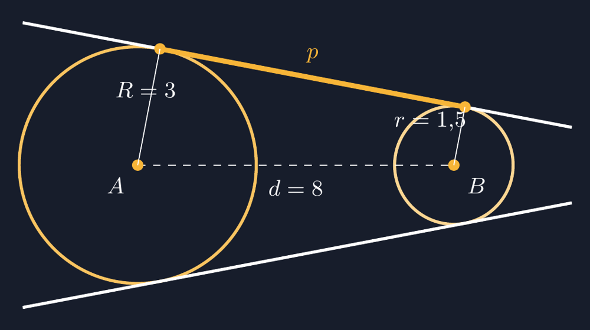

Ada satu materi di kelas VIII yang setiap tahun selalu membuat papan tulis saya berantakan: garis singgung persekutuan dua lingkaran. Bukan karena materinya sulit secara konsep, tapi karena menggambarnya dengan tangan itu luar biasa tipis selisihnya antara "benar" dan "hampir benar". Garis yang saya maksud menyinggung, dalam gambar saya, hampir selalu memotong sedikit di ujungnya. Siswa yang jeli pasti menyahut, "Pak, garisnya nembus, tuh." Dan mereka benar.

Pernah suatu hari saya menggambar dua lingkaran di papan — yang besar di kiri, yang kecil di kanan — lalu menyenggolkan penggaris dari atas lingkaran besar ke atas lingkaran kecil. Saya gambar, saya lihat, dan saya diam sebentar. Garis itu memotong lingkaran besar di dua titik, bukan menyinggung. Anak-anak tertawa. Saya ikut tertawa, lalu saya bilang, "Nah, justru ini pelajarannya. Kalau menggambar saja susah seakurat ini, bagaimana kalau kita serahkan ke komputer yang bisa menghitung?"

Sejak itu, bagian ini selalu saya tutup dengan sesi TikZ di laptop, diproyeksikan ke layar kelas.


*Gambar 1. Dua lingkaran dengan dua garis singgung persekutuan luar. Segmen singgung $p$ antara titik singgung atas kedua lingkaran ditandai — inilah yang di soal sering ditanyakan panjangnya.*

## Dari Mana Garis Itu Berdiri

Yang membuat garis singgung persekutuan luar "aman digambar komputer" adalah fakta bahwa posisinya bisa dihitung, bukan dikira-kira. Misalkan lingkaran pertama berpusat di $A$ dengan jari-jari $R$, lingkaran kedua berpusat di $B$ dengan jari-jari $r$, dan jarak kedua pusat $d$. Syaratnya sederhana: $d \geq R - r$, jadi kedua lingkaran tidak saling menelan.

Anggap kita memandang dari $A$ ke $B$, dan di layar komputer poros $x$ mengarah ke kanan. Arah garis singgung persekutuan atas bisa dituliskan lewat sebuah "kemiringan khusus":

$$ n = \left( \frac{r - R}{d},\ -\sqrt{1 - \left(\frac{r-R}{d}\right)^2} \right) $$

Vektor $n$ ini adalah arah yang **tegak lurus** terhadap garis singgungnya sendiri. Kalau saya kalikan dengan jari-jari, saya langsung dapat titik singgung di masing-masing lingkaran:

$$ P_1 = A + R\,n, \qquad P_2 = B + r\,n $$

Sisi yang bagus dari rumus ini: ia bekerja apa pun bedanya jari-jari. Kalau $R = r$, maka $n$ tepat mengarah lurus ke atas dan kedua garis singgungnya sejajar dengan garis pusat — persis seperti dua rel kereta yang sama tinggi. Kalau $R > r$, garisnya miring turun ke arah lingkaran kecil, seperti yang kita lihat di Gambar 1.

Di kelas, saya tidak akan mengharuskan siswa menghafal rumus vektor ini. Yang penting mereka melihat bahwa titik singgungnya **bukan asal tempel** — ia hasil perhitungan yang bisa dibuktikan. Lalu garis singgungnya sendiri? Panjang segmen $p$ antara $P_1$ dan $P_2$ juga punya rumus yang indah:

$$ p = \sqrt{d^2 - (R - r)^2} $$

Kalau kedua lingkaran sama besar, $R = r$, rumus itu menyusut jadi $p = d$. Kedua titik singgung berjarak persis seperti jarak pusatnya. Ini sering bikin siswa kaget — "berarti garis singgungnya sepanjang garis pusatnya, Pak?" Ya, dan itu bukan kebetulan; itu karena segiempat $APP_2B$ jadi persegi panjang.

## Menerjemahkan ke TikZ

Sekarang bagian yang saya suka: memasukkan ini ke TikZ dan membiarkan komputer yang menggambar. TikZ tidak tahu soal garis singgung persekutuan secara bawaan, jadi saya yang menghitung titik singgungnya, lalu menyuruh TikZ menghubungkan. Inti ide kodenya begini:

```latex
% Lingkaran besar: pusat A(0,0), R=3
% Lingkaran kecil: pusat B(8,0), r=1.5
% Normal garis singgung atas:
%   nx = (r - R) / d
%   ny = -sqrt(1 - nx^2)
% Titik singgung:
%   P1 = A + R*(nx, ny)
%   P2 = B + r*(nx, ny)
```

Nilai numeriknya, untuk kasus di Gambar 1:

- $d = 8$, $R = 3$, $r = 1{,}5$
- $\dfrac{r - R}{d} = \dfrac{-1{,}5}{8} = -0{,}1875$
- $n_y = -\sqrt{1 - 0{,}1875^2} \approx -0{,}982$

Jadi titik singgung atasnya:

- $P_1 = (3 \times (-0{,}1875),\ 3 \times (-0{,}982)) = (-0{,}5625,\ -2{,}947)$ — tapi karena saya memakai sumbu $y$ layar yang positif ke atas di TikZ, hasilnya muncul di **atas** lingkaran besar.
- $P_2 = (1{,}5 \times (-0{,}1875),\ 1{,}5 \times (-0{,}982))$ relative ke $B$, jadi di sekitar $(7{,}72,\ 1{,}47)$ di layar.

Titik singgung bawahnya tinggal membalik tanda $n_y$. Dari empat titik ini, saya tarik dua garis: satu di atas, satu di bawah. Yang saya suka dari cara ini, saya tidak perlu "menaksir" di mana garis itu harus lewat — ia lewat persis di titik singgung, karena saya yang menghitung, bukan yang mengira.

Berbekal angka ini, saya cukup menulis di TikZ:

```latex
\coordinate (P1) at (0.5625, 2.9469);
\coordinate (P2) at (8.28125, 1.4735);
\draw (P1) -- (P2);   % garis singgung atas
\draw (Q1) -- (Q2);   % garis singgung bawah
```

Sisanya hanya pengaturan warna, ketebalan, dan label $R$, $r$, $d$, serta $p$ supaya siswa bisa membaca gambar tanpa saya jelaskan panjang.

## Yang Siswa Lihat di Kelas

Ketika gambar seperti ini muncul di layar, biasanya ada hening sebentar — karena selama ini mereka melihat gambar soal yang sering digambar setengah hati. Ada anak yang pernah berkomentar, "Pak, ini gambar soal yang beneran nempel, ya." Kata "beneran nempel" itu yang saya simpan. Itu artinya mereka mulai membedakan gambar yang **jujur** dengan gambar yang cuma **mengiasi**.

Kalau siswa sudah terbiasa dengan gambar yang akurat, mereka jadi lebih peka saat gambar di buku atau di soal ujian tidak konsisten. Ini latihan literasi visual yang halus tapi nyata: belajar mempercayai gambar bukan karena "kata buku begitu", tapi karena gambar itu lulus uji geometri.

## Penutup: Karena Gambar Juga Punya Tanggung Jawab

Saya sering bilang ke rekan guru bahwa menggambar di TikZ itu bukan soal pamer teknologi. Ia soal **jujur**. Ketika saya gambar garis singgung dengan tangan dan ia memotong lingkaran padahal seharusnya menyinggung, ada siswa yang tersesat — bukan karena materi, tapi karena gambar yang bohong.

Dengan TikZ, saya bisa menggambar sekali, menyimpan berkasnya, dan pakai berulang kali tiap tahun ajaran. Kalau ada yang perlu diubah — jari-jari lingkaran kedua, misalnya — saya tinggal ganti satu angka, dan seluruh gambar menyesuaikan diri dengan sendirinya. Tidak perlu gambar ulang di papan, tidak perlu berharap tangan saya seg stabil itu.

Berkas lengkapnya saya sertakan di bawah. Kalau Bapak/Ibu ingin mencoba, cukup ganti nilai $R$, $r$, dan $d$ di bagian koordinat, dan gambar akan tetap benar — karena titik singgungnya dihitung, bukan dikira.

> 📎 **Berkas TikZ lengkap:** [garis-singgung-persekutuan-dua-lingkaran-tikz.tex](tex/garis-singgung-persekutuan-dua-lingkaran-tikz.tex) — siap kompilasi (butuh paket `tikz` dan `xcolor`).
