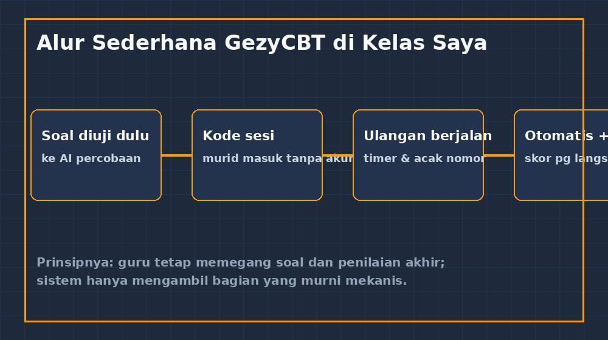
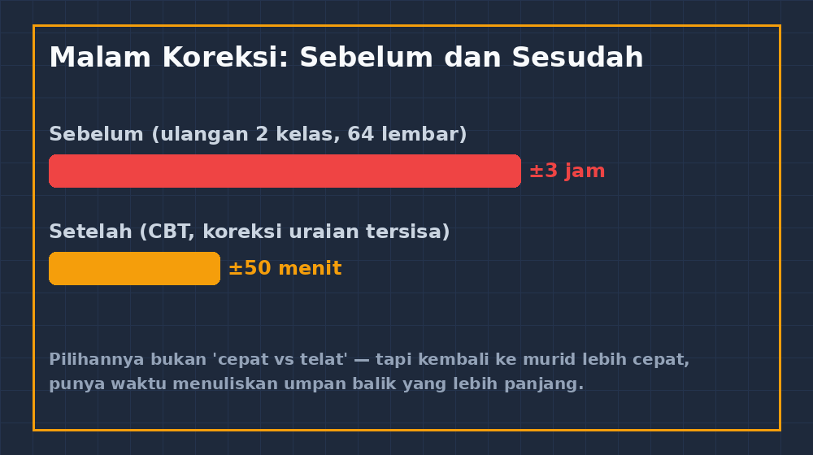

Jam sembilan malam, meja makan di rumah sudah lama tidak berfungsi sebagai meja makan. Di atasnya ada dua tumpukan lembar jawaban ulangan tengah semester, pulpen merah, dan secangkir teh yang entah sudah dingin sejak kapan. Dua kelas, enam puluh empat siswa, sepuluh soal — delapan pilihan ganda dan dua uraian. Saya mulai koreksi sambil setengah menonton istrinya menyiapkan bekal besok, dan begitu sadar jam dinding sudah menunjukkan setengah dua belas.

<!--more-->

Malam itu bukan pertama kali, dan dulu saya menganggapnya bagian normal dari profesi. Guru memeriksa, ya memeriksa. Tapi ada satu momen kecil yang mengubah cara pandang saya: di lembar jawaban nomor tujuh, seorang siswa menjawab $-\!3$ untuk soal yang jawabannya $3$. Saya hampir saja mencoret, lalu teringat dia duduk di bangku dekat jendela, anak yang kemarin bertanya kenapa hasil $(-2)^2$ berbeda dengan $-2^2$. Kemungkinan besar itu salah tulis tanda, bukan salah paham. Tapi bagaimana saya bisa pasti dari sepotong jawaban tunggal tanpa proses? Dan dengan enam puluh tiga lembar lagi menunggu, jujur saja, saya tidak punya ruang untuk memikirkannya terlalu lama.

Di situ saya mulai berpikir bukan tentang "koreksi itu melelahkan", tapi tentang apa yang hilang *karena* koreksi melelahkan.

## Yang hilang bukan waktu, tapi umpan balik

Kalau ditanya kenapa saya akhirnya membangun aplikasi CBT sendiri, jawabannya bukan "biar cepat". Kecepatan itu manis, tapi bukan intinya. Yang sebenarnya hilang adalah peristiwa kecil yang tidak pernah tercatat di dokumen kurikulum mana pun: kejadian guru menemukan pola kesalahan yang menarik, lalu besok paginya membahasnya di kelas *sambil masih hangat*.

Saat mengoreksi manual, pola itu memang kadang terlihat — "wah, banyak yang keliru di soal pecahan" — tapi seringnya baru sadar setelah nilai sudah diketik ke leger, dua minggu kemudian, saat ulangan berikutnya hampir maju. Umpan balik yang datang dua minggu terlambat itu seperti membahas peta perjalanan setelah kita sampai di tujuan. Manfaatnya tinggal dokumentasi.

Dengan skor pilihan ganda yang tersaji begitu murid menekan tombol selesai, malam itu juga saya bisa lihat: 62% kelas salah di nomor soal yang menanyakan perbandingan dua pecahan. Bukan soal sulit, tapi soal yang butuh membandingkan $\frac{3}{4}$ dengan $\frac{5}{7}$ — dan ternyata kebanyakan langsung membandingkan penyebutnya. Kebetulan? Tidak, ini pola. Dan pola paling berguna kalau dibahas saat ingatan soalnya masih segar di kepala murid.

## Kenapa tidak pakai platform yang sudah ada?

Pertanyaan yang wajar, dan saya pernah mencoba. Ada beberapa kendala yang sangat lokal, yang mungkin hanya berlaku di sekolah saya tapi di situlah saya hidup:

Pertama, soal saya penuh notasi matematika. Banyak platform quiz populer memang mendukung rumus, tapi sering dengan cara yang membuat frustasi — kadang harus lewat editor tersendiri, kadang hasil rendernya kecil atau patah-patah. Soal matematika SMP yang sudah cukup menantang secara isi, kalau tampilannya berantakan, kesulitan murid bertambah bukan karena soalnya. Saya mau soal saya dirender dengan LaTeX sungguhan, dan itu berarti saya butuh kendali penuh atas halaman soal.

Kedua, infrastruktur sekolah saya sederhana. Murid membawa HP sendiri, kadang dua-tiga orang berbagi satu perangkat kalau jaringan lagi rewel. Saya butuh sesuatu yang ringan: masuk lewat kode sesi tanpa registrasi, jalan mulus di browser HP kentang, dan kalau koneksi putus di tengah jalan, jawaban yang sudah terisi tidak hilang. Kebanyakan layanan berbayar overkill dan langganannya tidak realistis lewat anggaran sekolah.

Ketiga — dan ini yang paling jujur — saya sudah terlanjur menikmati proses membangun. GezyTech dimulai dari aplikasi kuis sederhana, lalu Multivote. CBT adalah anak berikutnya di keluarga itu, dan menulis kode untuk kebutuhan kelas sendiri terasa seperti menyiapkan alat masak sesuai tangan kita sendiri.

*Empat langkah sederhana: soal diuji dulu, murid masuk dengan kode sesi, ulangan berjalan dengan timer dan nomor teracak, lalu skor pilihan ganda keluar otomatis dan uraian menunggu giliran saya.*

## Yang saya serahkan ke sistem, dan yang tidak

Ada garis yang saya gambar dengan tegas saat merancang GezyCBT: sistem hanya boleh mengambil pekerjaan yang murni mekanis.

Yang saya serahkan: pencatatan waktu, pengacakan nomor soal (biar menyontek ke tetangga jadi tidak ergonomis), perhitungan skor pilihan ganda, rekap nilai ke satu lembar yang bisa saya ekspor, dan penyimpanan jawaban uraian dalam bentuk yang rapi untuk dikoreksi satu per satu tanpa menggulir empat puluh file terpisah.

Yang sengaja TIDAK saya serahkan: penilaian uraian otomatis. Ini keputusan yang beberapa kali diperdebatkan — termasuk dengan diri sendiri. Bisa saja saya pasang penilaian berbasis kata kunci, atau bahkan menyambungkan model AI untuk menilai jawaban uraian. Tapi untuk soal matematika SMP, jawaban murid terlalu kaya akan cara menalar yang aneh dan menarik. Ada yang menjawab benar dengan jalan yang tidak saya bayangkan saat menulis kunci; ada yang menjawab keliru tapi prosesnya menunjukkan miskonsepsi yang justru layak dibahas. Kalau itu diserahkan ke mesin, saya kehilangan persis hal yang paling berharga dari mengoreksi: membaca cara berpikir murid.

Jadi pembagiannya begini — mesin mengurus *kapan* dan *berapa*, saya tetap mengurus *kenapa*. Skor pilihan ganda keluar instan, dua soal uraian per murid saya koreksi dengan tangan, tapi kini lewat antarmuka yang menyusun semuanya berdampingan. Waktu koreksi total turun dari sekitar tiga jam jadi sekitar lima puluh menit, dan yang lebih penting, jam delapan malam meja makan kembali jadi meja makan.

*Angkanya dari pengalaman saya sendiri untuk ulangan dua kelas — bukan hasil penelitian formal, tapi cukup untuk mengubah rutinitas malam saya.*

## Hal-hal kecil yang ternyata menentukan

Kalau Bapak/Ibu ada yang terpikir untuk mencoba serupa, beberapa detail kecil ini ternyata jauh lebih penting daripada fitur-fitur mencolok:

Autosave setiap jawaban, bukan di akhir. Di percobaan pertama, satu murid menutup browser tak sengaja di soal sembilan dan semua jawabannya lenyap — dia nyaris menangis. Sejak itu jawaban tersimpan ke server begitu dia pindah soal. Kelihatannya sepele, tapi bagi murid yang cemas, bukti bahwa "kerjaannya tidak akan hilang" adalah bentuk kepedulian desain.

Petunjuk jumlah soal dan sisa waktu yang jujur dan konsisten. Kecemasan matematika yang pernah saya tulis di artikel sebelumnya sering dipicu ketidakpastian, bukan soalnya. Halaman yang jujur soal sisa waktu dan posisi soal mengurangi separuh pertanyaan panik di kelas.

Dan uji dulu sebelum dipakai sungguhan. Kebiasaan saya kini: setiap paket soal baru diuji dulu oleh "murid percobaan" — saya biasa pakai AI untuk menjawab seperti murid, mencari soal yang ambigu atau kuncinya salah. Lebih baik ketemu kunci yang salah oleh mesin malam sebelumnya daripada oleh tiga puluh dua anak besok paginya.

## Penutup: alat tidak menggantikan mata guru

Sore ini saya mengoreksi sepuluh jawaban uraian di aplikasi buatan sendiri, sambil sesekali berhenti karena menemukan jawaban yang bikin senyum — seorang siswa menggambar diagram batang di area jawaban untuk soal statistik, lengkap dengan keterangan "pak, saya gambar manual ya soalnya tidak ada pilihan". Tepat saat itulah saya yakin garis yang saya gambar itu benar: biarkan mesin menghitung skor pilihan ganda yang delapan puluh persen kasusnya memang mekanis, dan simpan mata guru untuk hal-hal yang hanya bisa dilihat manusia.

GezyCBT bukan sesuatu yang canggih. Kodenya sederhana, berjalan di VPS kecil, tanpa fitur yang membuat heran orang luar. Tapi dia dibangun dari satu malam koreksi yang panjang, dan setiap fiturnya menjawab keluhan yang nyata. Kalau begitu harganya, saya rasa itu jauh lebih berharga daripada sekadar daftar fitur terpanjang.
