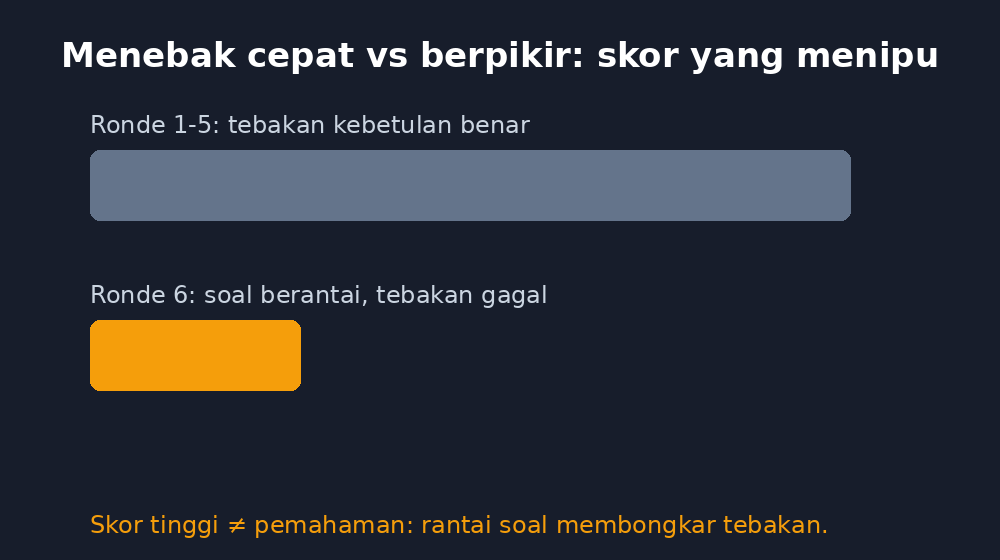
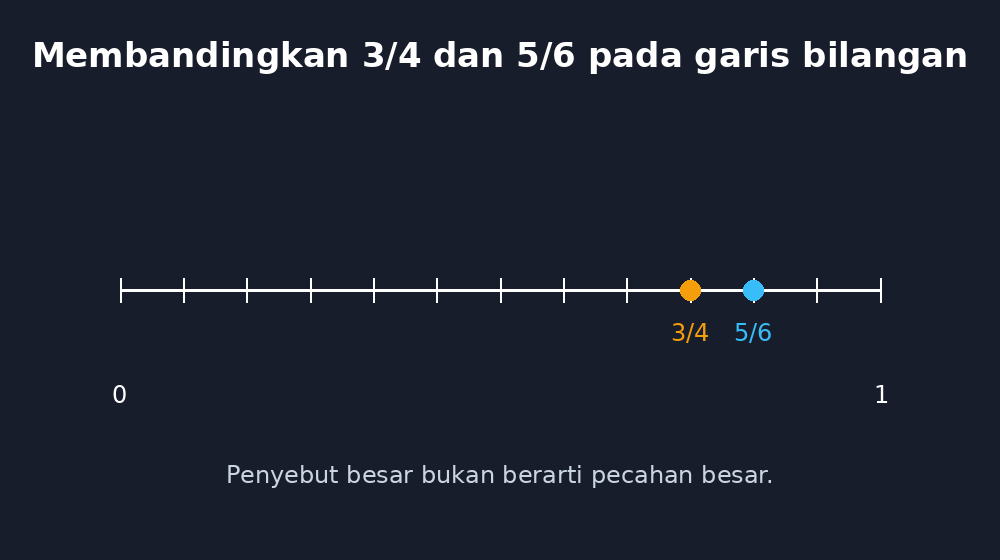

Anak-anak saya di kelas delapan punya hubungan yang aneh dengan kata "kuis". Mereka menggeliat kalau kuis itu ujian, tapi mata mereka langsung berbinar kalau kuis itu berbentuk permainan. Saya paham sekali. Saya juga begitu waktu kecil — di warung dekat sekolah dulu ada mesin game sederhana, dan saya bisa menghabiskan uang jajan cuma untuk mengalahkan rekor teman sendiri di satu permainan yang berulang-ulang. Sesuatu yang melelahkan kalau disebut latihan menjadi menyenangkan kalau disebut tantangan.

<!--more-->

Maka wajar kalau ide "game edukasi" itu menggoda setiap guru. Dan sejak saya mulai membangun aplikasi-aplikasi kecil untuk pembelajaran sendiri — yang akhirnya saya kumpulkan di bawah nama GezyTech — satu-satunya jenis aplikasi yang paling sering saya tunda justru permainan. Bukan karena sulit dibuat. Karena terlalu mudah dibuat dengan cara yang salah.

## Kuis berkedip bukan game

Kalau kita hanya menambahkan efek suara dan latar berwarna pada bank soal pilihan ganda, hasilnya bukan game. Itu kuis yang lebih berisik. Saya pernah mencoba versi awal seperti itu di kelas: siswa berlomba menjawab cepat, kelas ramai, terasa meriah. Tapi waktu saya cermati, banyak anak itu tidak membaca soal sampai selesai. Mereka mengenali kata kunci di kalimat pertama, menebak opsi, dan melompat ke soal berikutnya. Skornya tinggi, pemahamannya tidak berpindah.

Ada satu momen yang saya tidak lupa. Seorang siswa yang dari awal memimpin papan skor mendadak terhenti di soal pecahan. Dia menunggu waktu habis, dua kali, tiga kali, lalu diam. Ketika saya dekati, dia bilang: "Yang ini caranya beda, Pak." Dia tahu soal itu tidak bisa ditebak — dan justru itu bukti bahwa semua ronde sebelumnya dia lewati dengan tebakan yang kebetulan benar. Permainan itu tidak mengajarkan apa-apa kepadanya; ia hanya memberi saya angka palsu tentang seberapa siap kelas saya.

Dari situ saya menyimpulkan sesuatu yang sekarang jadi pegangan saya: game edukasi yang baik justru harus membuat tebakan acak terasa tidak menguntungkan. Kalau menang lebih mudah lewat menebak daripada lewat berpikir, permainan itu sedang mengajarkan kebiasaan yang bertentangan dengan matematika itu sendiri.

## GezyGames dan satu prinsip sederhana

Dari keraguan itulah GezyGames lahir. Dia adalah aplikasi paling sederhana di keluarga GezyTech — jauh lebih sederhana daripada GezyCBT yang punya sistem ujian lengkap, atau GezyMath yang punya media interaktif per materi. Tugasnya satu: menjadi kumpulan permainan matematika pendek yang bisa dimainkan lima sampai sepuluh menit, cocok untuk sela-sela pelajaran atau penutup sebelum bel.

Tapi ada satu prinsip yang saya jaga di setiap permainannya: skor hanya tumbuh dari langkah yang benar, dan langkah yang benar itu terlihat. Beberapa contohnya sederhana tapi disengaja.

Pada permainan operasi bilangan bulat, jawaban benar yang didapat dari cara hitung yang salah tidak mungkin dipertahankan lama, karena soal berikutnya selalu membangun pada hasil sebelumnya. Kalau di ronde sebelumnya anak menang $-3 + 7 = -10$ dengan cara menebak, di ronde berikutnya dia akan tersandung soal seperti $(-3 + 7) - (-2)$, dan menebak tidak lagi kebetulan benar. Rantai perhitungan itu bekerja seperti di kelas: kesalahan konsep yang tertutupi di satu soal akan terbongkar di soal lain.

Pada permainan membandingkan pecahan, saya tidak memberi pilihan ganda sama sekali. Siswa memasukkan jawaban sendiri, dan permainan menampilkan garis bilangan: di mana $3/4$ dan $5/6$ benar-benar berada. Anak yang selama ini menganggap "penyebut besar berarti pecahan besar" melihat sendiri posisi kedua pecahan itu — bukan ditegur guru, tapi ditunjukkan gambar. Ini pelajaran yang sama dengan yang saya tulis dulu tentang lipatan kertas: media yang jujur mengalahkan hafalan trik.

Ada juga permainan estimasi — memperkirakan hasil hitung sebelum menghitung tepat. Permainan ini favorit saya, karena dia menghukum kebiasaan menekan tombol kalkulator tanpa berpikir. Menebak 4.800 untuk $49 \times 98$ memberi lebih banyak poin daripada menebak 480.200, meskipun keduanya salah. Permainan itu bilang: pikirkan dulu besarannya, baru kerjakan.

## Yang saya belajar dari papan skor

Papan skor ternyata tidak sesederhana yang saya bayangkan. Versi pertamanya menampilkan peringkat kelas, dan langsung terlihat masalah lama muncul lagi dalam bentuk baru: anak yang cepat terus di atas, anak yang lambat menyerah karena merasa tidak mungkin mengejar. Ini persis kecemasan matematika yang pernah saya tulis, hanya berpindah media.

Maka papan skor GezyGames sekarang bermain dengan pembanding diri. Anak melihat rekornya sendiri dulu — dari 6 benar minggu lalu menjadi 9 benar minggu ini — sebelum melihat posisinya dibanding teman. Dan kemenangan yang dirayakan bukan hanya yang tertinggi. Permainan memberi pengakuan untuk hal-hal yang bisa dikejar siapa saja: bermain lebih lama tanpa salah satu kali saja, atau mencoba permainan yang belum pernah disentuh.

Apakah ini menyelamatkan semua anak? Tentu tidak. Tapi ada perubahan kecil yang saya saksikan: anak-anak yang biasanya menunggu giliran di pojok sekarang ikut antre memainkan ronde kedua. Bagi saya, itu sudah cukup untuk melanjutkan membangunnya.

## Game adalah guru yang tidak bosan — kalau kita yang merancangnya

Ada satu hal lagi yang membuat saya bertahan di proyek ini. Setiap kali saya mengubah aturan permainan — misalnya menambah tampilan garis bilangan di soal pecahan — permainan itu menerapkan perubahan itu dengan kesabaran yang tidak pernah saya miliki. Di kelas nyata, menjelaskan hal yang sama untuk anak ke-empat puluh di hari yang panas memang menguras. Permainan menjelaskan itu untuk jutaan kali tanpa nada jengkel, tanpa menyerah pada anak yang butuh dua puluh kali percobaan.

Tapi kesabaran itu hanya berguna kalau yang dirancang benar. Game edukasi yang buruk bukan guru yang sabar — dia mesin yang melatih menebak. Dan yang menentukan dia jadi yang mana bukan teknologinya, tapi guru yang memilih soal mana yang layak masuk, kesalahan umum mana yang harus dijebolkan, dan pujian mana yang pantas diberikan.

Sama seperti aplikasi GezyTech lainnya, GezyGames tidak menggantikan apa pun yang saya lakukan di depan kelas. Dia hanya mengambil satu bagian kecil — latihan berulang yang butuh motivasi — dan mencoba menanganinya dengan jujur. Sisanya, cerita tentang kenapa $-3 + 7$ tidak mungkin $-10$, tetap harus terjadi di antara saya dan anak-anak, di papan tulis, sambil saling bertanya.

Dan justru di situ letak rencana saya berikutnya: membuat permainan yang bisa dicatat hasilnya ke jurnal mengajar saya, supaya pola kesalahan yang tertangkap saat bermain tidak berhenti sebagai skor yang memudar, tapi sampai ke rencana pembelajaran hari berikutnya. Permainan yang baik harus bercerita kepada gurunya juga.
