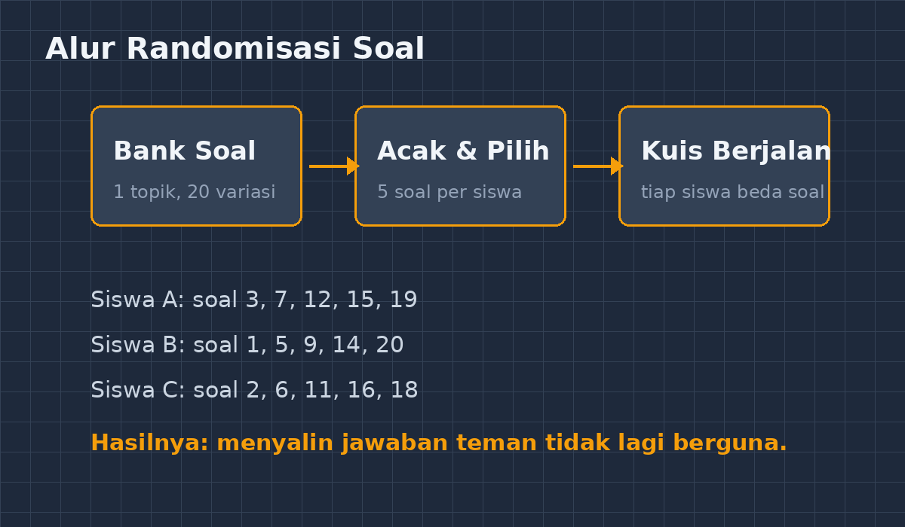
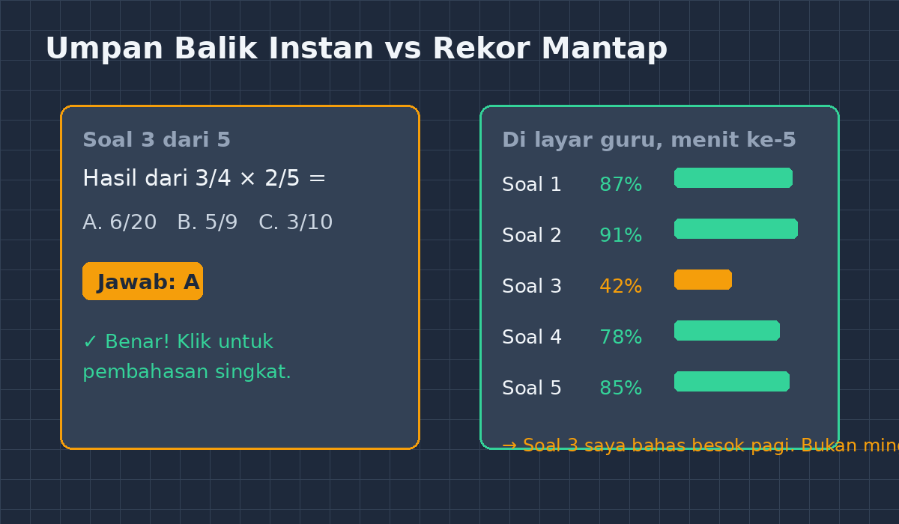

Kalau Bapak/Ibu guru pernah mengawas kuis di kelas yang cukup ramai, mungkin akrab dengan pemandangan ini: satu siswa menunduk pelan ke arah teman sebangkunya, lalu dua lembar jawaban berjalan sejajar seperti kereta api. Pada kuis matematika, kejadian ini punya tingkat kesulitan tersendiri, karena menyalin jawaban hitungan itu mudah — angka akhirnya cuma satu, dan mencontek angka akhir tidak membutuhkan keberanian yang luar biasa.

<!--more-->

Dulu saya menanggapi cara klasik: berjalan pelan di lorong tengah kelas, membuat suara batuk yang cukup terdengar sampai baris kedua. Efektif sebentar. Begitu saya berbalik ke papan tulis, kereta api itu berjalan lagi. Beberapa kali saya juga mengganti setiap lembar soal dengan urutan berbeda — membuat paket A, paket B, paket C — sampai suatu sore saya sadar sedang mengoreksi tiga versi kunci jawaban sekaligus sambil menyedot mi instan yang sudah lama kehilangan suhu idealnya. Di situlah saya berpikir: kalau saya harus membuat variasi soal secara manual, lebih baik saya minta komputer yang mengerjakannya.

## Ide sederhana: satu bank soal, banyak wajah

Inti dari aplikasi kuis interaktif yang saya bangun sebagai bagian dari GezyTech sebenarnya sederhana. Setiap topik saya isi dengan satu bank soal — katakanlah dua puluh soal tentang perkalian pecahan. Ketika siswa menekan tombol mulai, aplikasi mengambil lima soal secara acak dari bank itu. Bukan sekadar urutannya yang diacak; setiap siswa menerima kombinasi yang berbeda.

*Ilustrasi alurnya: bank soal yang sama, tetapi setiap siswa menerima kombinasi berbeda.*

Efeknya terasa di menit pertama. Kereta api jawaban langsung bubar. Siswa A melihat soal tentang $\frac{3}{4} \times \frac{2}{5}$, sedangkan teman sebangkunya sedang berurusan dengan $\frac{1}{2} \times \frac{3}{8}$. Menyalin tidak lagi berguna — yang bisa disalin tinggal strategi, dan kalau mau menyalin strategi, ya harus paham dulu. Lucunya, ada siswa yang komplain dengan wajah serius: "Pak, soal saya kok beda dengan milik Raka? Tidak adil, saya tidak bisa minta bantuan." Saya jawab, "Nah, itu memang tujuannya." Dia terdiam, lalu tertawa sendiri. Setidaknya dia jujur.

Yang menarik, kekhawatiran lama soal keadilan penilaian ternyata tidak terbukti. Karena setiap soal di bank sudah saya jaga tingkat kesulitannya dalam rentang yang wajar, lima soal acak mana pun menghasilkan tantangan yang setara. Bahkan ada manfaat tersembunyi: antar kuis yang berulang, siswa yang remedial mendapat soal berbeda dari percobaan pertamanya, jadi remedial bukan latihan hafalan jawaban lama.

## Bagian yang paling mengubah kelas saya: umpan balik detik itu juga

Randomisasi ternyata bukan fitur yang paling berdampak. Yang lebih mengubah dinamika kelas adalah umpan balik instan. Begitu siswa menekan jawaban, dia langsung tahu benar atau salah, lengkap dengan pembahasan singkat jika keliru.

*Kiri: yang dilihat siswa — jawaban dinilai detik itu juga. Kanan: ringkasan per soal yang muncul di layar saya.*

Dulu, siklus koreksi saya berjalan seperti ini: kuis hari Senin, kumpulkan kertas, koreksi malam itu atau dua malam berikutnya (jujur, kadang tiga), baru ulang kembali hari Kamis atau Jumat. Artinya ada jeda empat sampai lima hari antara kesalahan siswa dan penjelasan saya. Dalam jeda selama itu, miskonsepsi sudah mengakar dengan nyaman. Anak yang salah menganggap $\frac{3}{4} \times \frac{2}{5}$ sama dengan $\frac{3+2}{4+5}$ sudah lima hari menganggap itu benar, dilengkapi perasaan yakin karena tidak ada yang menegur.

Sekarang siklusnya berdetak dalam hitungan menit. Layar saya menampilkan rekap per soal secara langsung: soal nomor tiga dijawab benar oleh 42 persen kelas, sementara yang lain di atas delapan puluh persen. Jadi saya tahu persis di mana anak-anak tersandung — bahkan sebelum bel pulang. Besok pagi, bukan minggu depan, saya buka pelajaran dengan membahas soal nomor tiga itu. Pembahasan jadi terarah oleh data, bukan oleh tebakan saya tentang mana yang "mungkin" sulit.

Ada juga manfaat yang tidak saya rencanakan. Karena penilaian berjalan otomatis, waktu koreksi yang dulu memakan malam-malam saya kini kosong. Sebagian saya pakai untuk merancang soal baru (pekerjaan tidak hilang, hanya berpindah dari mengoreksi ke menyusun), sebagian — saya akui — untuk tidur lebih awal. Guru yang kurang tidur mengajar matematika dengan sabar yang menipis, dan sabar adalah bahan ajar yang tidak tercantum di silabus.

## Soal yang acak tetap harus soal yang baik

Satu hal yang ingin saya tekankan kepada rekan guru yang tertarik mencoba: randomisasi tidak menolong soal yang buruk. Aplikasi cuma menyajikan; kualitas tetap tanggung jawab saya. Bank soal yang isinya lima belas variasi dari tipe soal yang sama persis hanyalah lima belas kembar yang berpakaian berbeda. Variasi yang sehat itu menggoyang sudut pandang yang berbeda — satu soal minta hasil akhirnya, satu minta mencari bagian yang hilang, satu lagi minta siswa menilai pernyataan benar-salah beserta alasannya.

Karena itu kebiasaan baru saya: setiap kali menambah soal ke bank, saya uji dulu dengan AI sebagai "murid percobaan" — cara yang pernah saya tulis di artikel sebelumnya. AI mengerjakan soal itu, dan kalau jawabannya melenceng karena soalnya ambigu, saya perbaiki sebelum soal itu berhadapan dengan anak-anak. Kombinasi kecil ini — AI sebagai penguji awal, aplikasi sebagai penyaji acak — terasa seperti punya asisten penulis soal yang tidak pernah mengeluh lembur.

## Penutup: masalah lama, bentuk baru

Saya tidak mau mengklaim aplikasi kuis ini merevolusi kelas saya. Siswa masih tetap harus paham konsep perkalian pecahan, dan tidak ada aplikasi yang bisa menggantikan momen saya duduk di samping anak yang menyerah sebelum mulai. Yang berubah lebih sederhana dari itu: kecurangan jawaban kehilangan pasar, koreksi tidak lagi menyita malam, dan kesalahan siswa sampai ke telinga saya sebelum mengeras jadi kebiasaan.

Bagi saya, itu justru gambaran yang realistis tentang teknologi pendidikan. Alat ini tidak mengajarkan matematika — saya yang tetap mengajarkan. Tapi alat ini membersihkan hal-hal kecil yang selama ini menyita waktu dan energi, sehingga yang tersisa untuk kelas adalah bagian terpenting: mengajar. Kalau Bapak/Ibu punya masalah kuis yang mirip dengan punya saya dulu, mungkin mulai dari satu bank soal kecil — sepuluh butir tentang satu topik saja — sudah cukup untuk merasakan bedanya. Saya mulai dari sana, dan kereta api jawaban tidak pernah berjalan lagi sejak itu.
