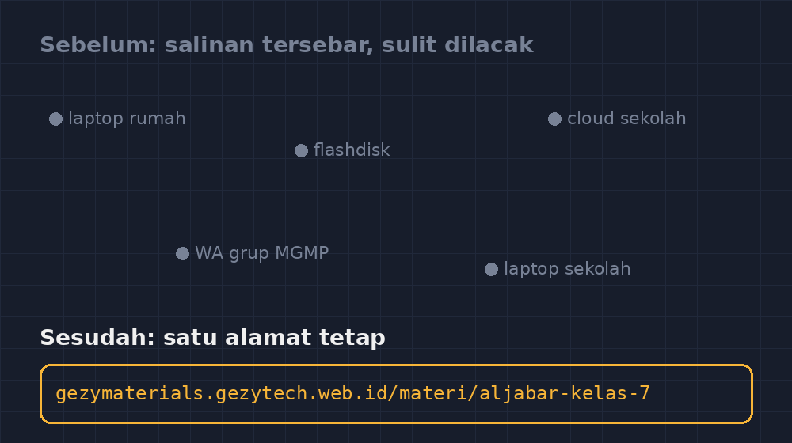

Bapak/Ibu guru matematika mungkin kenal situasi ini: jam pelajaran dimulai lima menit lagi, paket soal latihan harus dibagikan sekarang, tapi printer sekolah sedang antre dipakai guru lain. Atau lebih buruk: soal sudah jadi di komputer di rumah, tersimpan rapi, tapi pagi harinya lupa dibawa. Saya pernah dua-duanya, dan dua-duanya membuat saya akhirnya membangun satu aplikasi lagi untuk diri saya sendiri: GezyMaterials.

<!--more-->

*Sebelum: materi tersebar di lima tempat yang tidak saling bicara. Sesudah: satu alamat tetap yang tidak berubah meski isinya diperbaiki.*

## Persoalannya Sebenarnya Bukan Soalnya

Selama bertahun-tahun, kekayaan intelektual saya tersimpan di tempat-tempat yang tidak bicara satu sama lain. Soal ulangan bab bilangan bulat ada di laptop rumah. Modul ajar kurikulum merdeka ada di flashdisk yang suka hilang. LKS digital yang saya sunting ada di akun cloud sekolah dengan kata sandi yang perlu saya buka catatan untuk mengingatnya. Materi pengayaan? Ada di WhatsApp grup MGMP, tergeser ribuan pesan ke bawah.

Semua file itu ada — itu yang membuat saya dulu merasa sudah "terorganisir". Tapi setiap kali butuh, saya selalu mengalami yang sama: mencari, membuka beberapa folder, mengunduh ulang, dan menyadari bahwa versi terbaru sebenarnya ada di laptop lain. Persoalannya bukan soalnya. Persoalannya adalah soal-soal itu tidak punya alamat tetap.

Guru-guru senior di sekolah saya punya jawaban klasik untuk ini: lemari arsip kertas. Sistem mereka jujur — satu map satu bab, dan setiap orang tahu di mana harus mencari. Yang mereka kehilangan hanya fleksibilitas: map itu tidak bisa dibuka dari rumah jam sebelas malam saat saya tiba-tiba teringat soal cerita yang cocok untuk besok.

## Ide Sederhana: Setiap Materi Punya Alamat

GezyMaterials pada dasarnya saya bangun dengan satu prinsip yang saya pinjam dari cara saya mengajar bilangan: setiap benda harus punya alamat yang jelas dan konsisten. Kalau bilangan bulat punya tempat pada garis bilangan, maka setiap paket soal, modul, dan materi pengayaan harus punya tempat pada satu daftar yang bisa saya buka dari mana saja.

Jadi aplikasinya saya buat sesederhana mungkin. Ada daftar materi yang bisa difilter berdasarkan kelas, bab, dan jenis materi. Setiap materi punya halaman sendiri dengan alamat yang stabil — alamat yang tidak berubah meskipun saya memperbaiki isinya berkali-kali. Ini poin yang penting dan sering terlewat: ketika saya menuliskan alamat materi aljabar kelas tujuh di jurnal mengajar saya, alamat itu harus tetap valid setahun kemudian, justru ketika isinya sudah saya perbaiki tiga kali.

Di halaman materi itu, siswa atau saya bisa membuka berkasnya langsung, atau menyalin tautannya untuk dibagikan di grup kelas. Tidak perlu mengunduh, tidak perlu login yang berbelit, tidak perlu tanya "Pak, yang mana yang versi terbaru?"

## Momen yang Membuat Saya Yakin

Beberapa minggu setelah GezyMaterials jalan, ada satu momen kecil yang saya ingat sampai sekarang. Siswa saya yang sering absen karena ikut lomba bulu tangkis menghubungi saya sebelum ulangan harian. Biasanya percakapan seperti itu berakhir dengan saya memotret lembar soal latihan dan mengirimnya — hasil foto yang miring, sebagian tertutup bayangan tangan, dan kadang halaman yang salah.

Kali ini saya hanya mengirim satu tautan. Dia membukanya, mengerjakan, dan menghubungi saya lagi bukan untuk menanyakan soalnya, tapi untuk menanyakan nomor tiga yang dia anggap janggal. Itu percakapan yang jauh lebih baik. Yang saya sediakan bukan lagi foto soal, tapi akses. Perbedaannya terasa kecil di sisi saya — satu menit memotret versus sepuluh detik menyalin tautan — tapi di sisi siswa rasanya seperti beda kelas.

## Tantangan yang Tidak Saya Duga

Bagian tersulit ternyata bukan teknisnya, tapi kebiasaan saya sendiri. Seminggu pertama, saya masih menyimpan berkas di folder laptop seperti biasa, lalu baru mengunggahnya ke GezyMaterials kalau sempat. Hasilnya: aplikasi itu berisi materi-materi yang setengah usang. Aplikasi apa pun hanya sebagus kebiasaan orang yang mengisinya.

Yang akhirnya berhasil adalah mengubah urutan: sekarang materi baru langsung masuk ke GezyMaterials dulu, dan salinan di laptop hanya cadangan. Saya pakai aturan sederhana — kalau materi tidak ada di aplikasi, berarti materi itu belum selesai. Ini agak menyerupai cara saya memaksa diri menulis jurnal mengajar setiap hari: kebiasaannya yang membangun sistem, bukan sebaliknya.

Tantangan lain adalah menjaga kejujuran metadata. Mudah sekali mengunggah materi dan menandainya "Kelas 8, Bab 4" padahal sebenarnya untuk pengayaan kelas 9. Kalau labelnya bohong, pencarian jadi bohong, dan kepercayaan pada seluruh sistem runtuh. Saya belajar ini dari pengalaman menata bank soal: katalog yang tidak dirawat lebih buruk daripada tumpukan kertas.

## Refleksi: Guru Sebagai Penjaga Akses

Kalau dipikir lagi, pekerjaan saya sebagai guru bukan cuma membuat materi yang baik, tapi memastikan materi itu sampai ke yang butuh pada waktu yang tepat. Sebuah soal latihan yang bagus tapi tidak bisa diakses siswa yang absen, secara efektif sama saja dengan tidak ada. Itu kesimpulan yang agak menyakitkan bagi saya yang dulu bangga dengan "arsip lengkap di laptop".

GezyMaterials bukan aplikasi canggih. Ia tidak punya fitur kecerdasan buatan, tidak menganalisis jawaban, tidak apa-apa yang menarik untuk dipamerkan. Tapi ia menyelesaikan satu masalah nyata dengan cara yang bisa saya pertahankan setiap hari, dan setelah setahun, itu satu-satunya ukuran yang masih saya percaya untuk teknologi pendidikan: kalau setiap pagi saya masih memakainya tanpa merasa terbebani, berarti ia memang dibangun untuk kehidupan sekolah yang sesungguhnya, bukan untuk demo.

Bagi Bapak/Ibu yang sedang menimbang membangun alat serupa: mulailah dari masalah yang paling sering membuat kesal di jam malam sebelum mengajar. Untuk saya, itu adalah soal yang lupa dibawa. Alamat tetap untuk setiap materi ternyata jawabannya.
