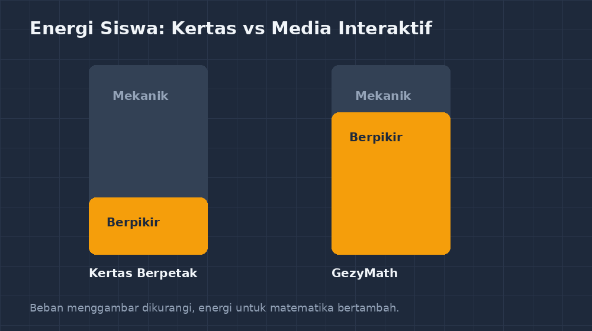

Suatu hari Selasa bulan lalu, saya sedang berjaga di lab komputer ketika jam pelajaran matematika kelas 8C masuk ke sesi praktik. Guru pengganti yang hari itu menjabat jam pelajaran saya meminta murid-murid untuk membuka sebuah situs "media belajar matematika interaktif" yang mereka temukan sendiri di internet. Saya yang kebetulan lewat melihat layar mereka: ada grafik bergerak, ada tombol warna-warni, ada bunyi "correct!" saat jawaban benar. Tapi sepuluh menit kemudian, yang saya lihat murid-muridnya sudah asyik bermain tombol warna dan bunyi saja, tanpa ada satu pun yang benar-benar memikirkan konsep koordinat yang sedang mereka "pelajari".

<!--more-->

Momen itu terasa seperti bacaan ulang dari pengalaman yang sudah pernah saya alami sendiri. Dulu, ketika baru mulai membuat aplikasi-aplikasi GezyTech, saya juga tergoda membuat sesuatu yang "kelihatan hebat": animasi banyak, tombol ramai, warna mencolok. Tapi ada satu pertanyaan sederhana yang akhirnya selalu saya pakai untuk menyaring ide aplikasi baru: **kalau aplikasi ini dihapus besok pagi, materi apa yang tidak bisa saya ajarkan hari itu?** Kalau jawabannya "tidak ada, karena bisa pakai papan tulis saja", berarti aplikasi itu belum layak dibangun — ia hanya pengkali tamu di dalam kelas, bukan bagian dari pembelajaran.

Itulah semangat yang saya bawa ketika merancang **GezyMath**, media matematika interaktif untuk materi-materi yang menurut saya paling sulit dijelaskan dengan papan tulis biasa. Saya ingin menuliskan sedikit cerita di balik aplikasi ini, bukan untuk pamer, tapi karena mungkin ada rekan guru yang juga sedang berpikir hal serupa: media apa yang layak dibuat, dan media apa yang sebaiknya tidak perlu dibuat.

## Media yang tidak menyaingi guru

Hal pertama yang saya putuskan: GezyMath tidak dirancang untuk menggantikan penjelasan guru di depan kelas. Ia justru dirancang untuk dipakai **bersamaan** dengan penjelasan. Ketika saya menjelaskan transformasi geometri, misalnya, siswa bisa langsung membuka halaman GezyMath dan mencoba menggeser titik-titik titik sudut segitiga untuk melihat sendiri bagaimana bayangan segitiga berubah ketika digeser dua satuan ke kanan, atau diputar $90^\circ$ searah jarum jam.

Kalau dipikir lagi, kejadian seperti ini sebenarnya tidak butuh aplikasi canggih. Bisa juga pakai kertas berpetak dan pensil, memindahkan titik satu per satu. Tapi saya menyadari sesuatu setelah bertahun-tahun mengajar: **yang membuat siswa SMP kesulitan di transformasi bukan konsepnya, tapi kelelahan motoriknya.** Menggambar bayangan segitiga di kertas berpetak itu melelahkan; siswa yang semangatnya habis untuk menggambar, bukan untuk berpikir. Di sinilah media digital punya nilai: ia menghilangkan beban mekanis yang tidak ada hubungannya dengan matematika, sehingga energi kognitif siswa tersisa untuk hal yang benar-benar penting.

*Ilustrasi sederhana: tugas siswa di media interaktif seharusnya "memutuskan", bukan "menggambar ulang".*

## Tiga syarat yang saya pakai

Setelah beberapa kali gagal dan diulang, akhirnya saya menetapkan tiga syarat untuk setiap modul yang masuk ke GezyMath. Pertama, **modul harus menjawab pertanyaan matematika yang tidak bisa dijawab papan tulis dengan sama cepatnya.** Untuk transformasi geometri, pertanyaan itu misalnya: "kalau titik sudutnya diubah, di mana bayangannya, dan kenapa?" Ini butuh eksperimen cepat berulang-ulang — pas untuk layar sentuh atau mouse, lambat untuk kapur.

Kedua, **modul harus memberi umpan balik yang benar, bukan cuma benar-salah.** Ini pelajaran yang saya ambil dari GezyKuis dulu. Kalau aplikasi cuma bilang "salah, coba lagi", siswa akan menebak-menebak sampai kebetulan benar. Yang lebih berguna adalah umpan balik yang menunjukkan *mengapa* salah. Untuk modul perbandingan senilai, misalnya, aplikasi tidak hanya bilang jawaban $x = 15$ itu keliru — ia menampilkan perbandingan dua rasio yang siswa tulis, sehingga siswa bisa lihat sendiri bahwa $\frac{4}{6} \neq \frac{6}{4}$ meskipun angkanya sama-sama "empat dan enam".

Ketiga, **modul harus tetap masuk akal kalau listrik mati.** Maksudnya bukan harfiah — tapi kalau esensi materi bisa digambar ulang di papan tulis dengan lima menit, modul itu tidak perlu dibuat. Kalau modul transformasi butuh lima puluh gambar berbeda untuk eksplorasi siswa, ya itu yang pantas jadi aplikasi. Kayak filter, syarat ketiga ini terdengar aneh, tapi dia yang paling sering menyelamatkan saya dari buang waktu.

## Realita di lab yang tidak ideal

Tentu tidak semua berjalan mulus. Saya ingat pertama kali membawa kelas 8A ke lab komputer untuk mencoba modul perbandingan. Setengah komputer loginnya lambat, dua unit bahkan tidak bisa masuk sama sekali. Siswa yang komputernya mati akhirnya berdua-duaan di satu unit — dan justru itu yang bikin saya mikir: malah bagus. Mereka saling menjelaskan, saling menantang "coba geser yang mana supaya bayangannya keluar dari kotak". Diskusi yang biasanya saya paksa keluar di kelas biasa, di lab tadi muncul sendiri.

Ada juga siswa yang saya kira akan langsung jago, tapi ternyata kebingungan bukan di matematikanya, tapi di **tampilan** aplikasi: dia tidak sadar ada slider yang bisa digeser. Dari situ saya belajar bahwa UI sederhana itu bukan soal estetika, tapi soal aksesibilitas belajar. Sekarang setiap modul GezyMath saya usahakan ada satu elemen interaksi utama saja, ditandai jelas, dan ada instruksi satu kalimat di atasnya. Kalau siswa perlu membaca tiga paragraf cara pakai sebelum bisa belajar matematika, aplikasinya sudah gagal sebelum mulai.

## Yang tetap saya pegang

Kalau ditanya apakah semua kelas akan berubah jadi digital karena adanya aplikasi seperti ini, jawaban saya jujur saja: tidak, dan saya tidak mau. Papan tulis masih jadi alat utama saya. Yang berubah bukan metode mengajarnya, tapi **jangkauan eksplorasinya**. Materi yang dulu cuma bisa saya tunjukkan satu contoh di papan, sekarang bisa dicoba siswa sendiri dua puluh kali dalam sepuluh menit, masing-masing dengan angka yang berbeda-beda.

Bagi rekan guru yang sedang tergoda mencoba membuat atau memakai media interaktif, saran saya sederhana saja: mulai dari materi yang benar-benar menyiksa kalian kalau dijelaskan dengan papan tulis. Di situ letak nilai tambahnya. Media yang bagus bukan yang paling ramai, tapi yang paling dekat dengan kesulitan nyata siswa. Dan kalau suatu hari aplikasi buatan kita justru lebih banyak dipakai untuk main warna daripada untuk berpikir, berarti kita salah rancang — dan itu wajar, asal mau diulang.
