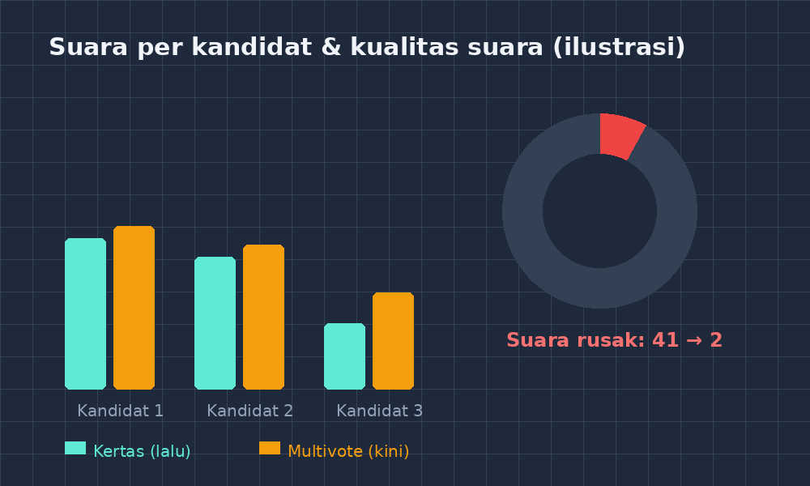

Kalau Bapak/Ibu pernah jadi panitia pemilihan ketua OSIS, pasti kenal pemandangan ini: satu ruang kelas berubah jadi markas penghitungan. Kertas suara berhamburan, tiga guru duduk di meja panjang sambil sesekali berdebat, "ini coretannya sah nggak ya?", dan pengumuman baru bisa dibacakan jam tujuh malam — sementara murid-murid sudah pulang dan kabarnya isu-isu mulai beredar di grup WhatsApp: *hasilnya dimanipulasi, katanya*.

<!--more-->

Itu pemandangan di sekolah saya tahun lalu. Sampai akhirnya saya berpikir, di sekolah yang setiap hari kami pakai aplikasi kuis dan CBT buatan sendiri, kenapa urusan satu hal yang paling "demokratis" ini justru masih pakai karton dan pulpen?

## Masalahnya bukan hitung, tapi kepercayaan

Awalnya saya kira masalah utamanya kelelahan penghitungan. Ternyata bukan. Dari sekian banyak keluhan yang saya dengar dari murid setelah pemilihan tahun lalu, yang paling sering muncul bukan "hitungannya salah", melainkan "kita nggak tahu hitungannya benar".

Ini dua hal yang berbeda, dan bedanya penting. Yang pertama soal aritmetika; yang kedua soal transparansi. Sebagus apa pun niat panitia, begitu hasil hanya diumumkan sekali jadi — tanpa proses yang bisa dilihat — keraguan tinggal di kepala sebagian orang. Dan keraguan itu bertahun-tahun tidak mati; ia diwariskan ke adik-adik kelas lewat obrolan di kantin.

Sekalian, ada urusan teknis kecil yang ternyata besar dampaknya: suara rusak (golput, dua centang, coretan ambigu). Pemilihan tahun lalu ada 41 kertas rusak dari total 512. Itu delapan persen suara yang hilang — cukup besar untuk mengubah urutan calon jika perebutannya ketat. Sebagai guru matematika saya otomatis menghitung: kalau selisih kandidat pertama dan kedua hanya 23 suara, maka 41 suara rusak itu berpotensi jadi penentu. Ironis, tapi nyata.

## Kenapa tidak pakai aplikasi polling yang sudah ada?

Saya sempat mencoba beberapa aplikasi polling publik. Ada dua hal yang bikin saya mundur. Pertama, kebanyakan minta murid punya akun atau login dengan email — dan realitanya di sekolah kami, setengah murid lupa password, sebagian lagi tidak mau memasang email sekolah. Kedua, soal data. Nama-nama murid dan pilihan politik mini mereka bukan hal yang mau saya titipkan ke server yang entah di mana dan siapa yang bisa lihat.

Karena itu saya menulis sendiri. Saya beri nama Multivote — bagian dari keluarga aplikasi GezyTech yang sudah saya bangun selama dua tahun. Prinsipnya sederhana: *satu kode akses, tanpa login, satu suara*. Murid masukkan kode yang dibagikan panitia di kelas, lihat daftar calon, pilih satu, konfirmasi, selesai. Server mencatat perangkat, bukan nama, jadi satu perangkat tidak bisa memilih dua kali — tapi juga tidak ada daftar "siapa memilih siapa" yang bocor.

Arsitekturnya memang tidak canggih-canggih amat: aplikasi kecil berbasis Bun, database SQLite satu file, dan berjalan di VPS yang sama dengan aplikasi-aplikasi GezyTech lainnya. Justru kesederhanaan itulah yang saya cari. Kalau ada yang rusak, saya bisa bongkar sendiri dalam satu sore, tanpa menunggu dukungan teknis siapa pun.

## Hari pemungutan suara

Tahun ini pemilihan berjalan seperti ini: murid masuk satu per satu ke tiga tablet yang kami taruh di aula (kami sengaja tidak pakai HP pribadi, biar tidak ada yang "meminjamkan" ponselnya ke teman di luar sekolah), masukkan kode, pilih, selesai. Rata-rata sepuluh detik per murid.

Hasil real-time kami tampilkan di proyektor di ruang guru: angka suara tiap kandidat naik sedikit demi sedikit, tanpa nama pemilih. Murid yang sudah memilih keluar sambil menoleh ke layar di koridor, mencoba menebak tren. Ada yang kompel, "Pak, kok kandidat dua mendadak naik ya pas kelas VIII selesai?"

Dan di situlah saya menemukan momen pembelajaran yang tidak saya rencanakan. Seorang murid kelas VII bertanya kenapa grafiknya berbentuk seperti itu. Akhirnya kita duduk bersama tiga anak, dan saya menggambar garis di papan: sumbu mendatar jam, sumbu tegak jumlah suara, dan kita bahas kenapa garis kandidat satu melandai saat kelas VII selesai memilih, lalu menanjak lagi. Itu pelajaran fungsi dan grafik — dari data yang mereka buat sendiri, tentang hal yang mereka pedulikan. Saya mengajar matematika dua belas tahun, dan jarang ada pengantar grafik sekuat itu.

*Angka ilustrasi hasil pemilihan: perbandingan suara per kandidat dan komposisi suara sah, rusak, serta golput antara pemilihan tahun lalu (kertas) dan tahun ini (Multivote). Perhatikan kolom rusak yang menyusut dari 41 menjadi 2 — dua sisanya kesalahan input panitia, bukan murid.*

## Angka-angka setelahnya

Beberapa hal yang terukur, biar tulisan ini tidak cuma cerita hangat:

- Waktu penghitungan dari selesai memilih sampai pengumuman: dari sekitar enam jam menjadi *hampir nol* — pengumuman bisa dibacakan sepuluh menit setelah tablet terakhir ditutup.
- Suara rusak: dari 41 menjadi 2.
- Partisipasi: naik tipis, dari 471 menjadi 498 pemilih. Saya curiga ini karena tiga tablet di aula terasa lebih "ringan" daripada antre di bilik suara.

Dan yang tidak terukur tapi paling saya hargai: tidak ada satu pun isu kecurangan beredar setelah pengumuman. Bukan karena murid jadi percaya pada guru — tapi karena mereka *melihat* angkanya bergerak sendiri di layar.

## Catatan jujur untuk yang mau meniru

Tidak semua mulus. Tiga hal yang saya pelajari dengan cara yang kurang nyaman:

Pertama, jangan lakukan uji coba di hari H. Pemilihan perdana dengan sistem digital di sekolah kami gagal setengah jalan karena saya belum menguji skenario "dua murid memakai kode yang sama hampir bersamaan" di perangkat berbeda. Untung itu saat gladi resik. Sekarang setiap fitur baru Multivote selalu saya uji dulu dengan murid-murid percobaan — kebiasaan yang sebenarnya sudah saya tuliskan di artikel sebelumnya tentang menjadikan AI murid percobaan, dan ternyata berlaku juga untuk manusia sungguhan.

Kedua, sediakan jalur cadangan. Kami tetap menyiapkan kertas suara untuk murid yang tidak bisa menggunakan tablet (ada satu siswa dengan keterbatasan penglihatan). Demokrasi sekolah bukan tempat yang tepat untuk "kalau sistemnya error ya maaf".

Ketiga, rawat harapannya. Aplikasi yang dipakai sekali setahun mudah dilupakan sampai tiba-tiba perlu. Jadi sekarang Multivote saya pakai juga untuk hal-hal kecil: memilih nama kelompok, voting tempat studi wisata, bahkan menentukan topik proyek matematika. Kebiasaan kecil ini menjaga aplikasi tetap hidup — dan membiasakan murid bahwa suara mereka bisa dihitung dengan cepat dan adil.

## Penutup: yang sebenarnya diajarkan

Kalau direnungkan, pemilihan OSIS itu sendiri sebenarnya adalah pelajaran — bukan pelajaran PPKn semata, tapi pelajaran tentang data, tentang kepercayaan, dan tentang apa artinya sistem yang adil. Selama hasil ditentukan oleh karton yang dihitung di ruang tertutup, murid belajar bahwa demokrasi itu soal percaya pada orang. Begitu hasil terbuka dan terhitung di depan mata, mereka belajar bahwa demokrasi itu soal sistem yang bisa diperiksa.

Saya tidak tahu dari 498 murid yang memilih tahun ini, berapa yang benar-benar menangkap pelajaran itu. Tapi tiga anak yang duduk bersama saya membaca grafik suara di papan — mereka paham. Dan buat saya, itu sudah lebih dari cukup untuk satu sore kerja menulis aplikasi kecil bernama Multivote.
