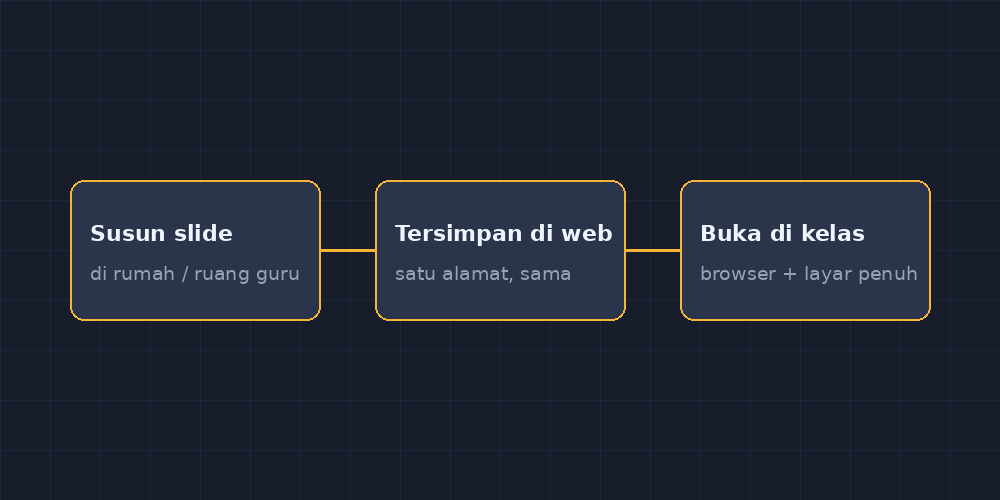

Ada satu rutinitas yang dulu menghabiskan tenaga saya setiap hari Rabu dan Kamis: memikul laptop dari ruang guru ke kelas delapan di lantai dua. Bukan laptop besar, tapi dengan charger, kabel HDMI yang ujungnya mulai lepas, dan satu USB berisi presentasi cadangan. Kalau ada kelas yang jadwalnya berurutan di lantai berbeda, saya yang naik-turun tangga dua kali. Rekan saya pernah menertawakan, "Pak Gun itu kayak pendaki gunung, cuma gunungnya tangga sekolah."

Masalahnya bukan cuma lelah. Masalah sebenarnya adalah file.

<!--more-->

## File yang tinggal di satu tempat

Dulu saya menyiapkan slide di laptop di rumah. Di sekolah, laptop itu harus ikut. Sekali saya lupa — hanya sekali, tapi cukup — dan saya harus mengajar transformasi geometri dengan berpegang pada papan tulis dan ingatan tentang apa yang semalam saya rancang sedemikian rapi. Anak-anak baik-baik saja, tapi saya merasa seperti koki yang datang ke dapur tanpa membawa bahan.

Alternatifnya adalah mengunggah slide ke penyimpanan awan lalu membukanya dari komputer sekolah. Bisa. Tapi komputer sekolah kadang lambat membuka layanan awan, kadang meminta login yang lupa kata sandinya, dan kadang — ini yang paling menyebalkan — tampilan slide berantakan karena versi pembuka berkasnya berbeda. Font berubah, animasi hilang, gambar bergeser. Slide yang semalam saya susun dengan hati-hati tiba di kelas seperti koper yang sudah dibongkar orang di perjalanan.

Sebagai guru matematika, hal yang paling saya takutkan adalah slide yang tampilannya berubah. Karena di slide matematika, posisi itu makna. Segitiga siku-siku yang siku-sikunya saya letakkan di kiri bawah ada alasannya. Panah translasi yang panjangnya dua kotak ada alasannya. Kalau render-nya bergeser, siswa yang jeli akan bertanya, "Pak, kok gambarnya beda dengan yang di lembar kerja?" Dan jujur saja, menjawab "mungkin filenya rusak" bukan jawaban yang menenangkan bagi seorang guru yang mengajarkan anak-anak untuk peduli pada ketelitian.

## Ide sederhana: slide sebagai halaman web

Tahap pertama perubahan datang bukan dari niat membangun aplikasi, melainkan dari kebiasaan. Suatu hari saya mencoba menulis materi di satu halaman HTML sederhana, satu bagian per layar, dan menampilkannya lewat browser dengan mode layar penuh. Ternyata jalan. Font tidak berubah, gambar tidak geser, dan yang penting: halaman itu hidup di satu alamat. Dari laptop mana pun, dari komputer sekolah mana pun, saya tinggal membuka alamat itu.

Dari kebiasaan kecil itulah GezySlide lahir. Karena saya sudah punya pengalaman membangun GezyKuis, GezyCBT, dan Multivote, saya tahu arahnya: aplikasi web kecil, dijalankan sendiri di server, dibuka dari browser. Tidak perlu instal apa pun di komputer kelas. Tidak perlu memikul laptop. Saya menyiapkan slide di rumah (atau di ruang guru, atau di ponsel kalau terpaksa), dan di kelas saya cukup membuka alamatnya, menekan layar penuh, selesai.

*Alur sederhana GezySlide: disusun sekali, dibuka dari perangkat mana pun di kelas.*

## Apa yang berubah di kelas

Perubahan pertama dan paling terasa: tangga sekolah tidak lagi jadi bagian dari pekerjaan saya. Ini terdengar sepele, tapi energi yang dulu habis untuk naik-turun tangga sambil memanggul tas sekarang tersisa untuk hal-hal yang lebih penting. Seperti memperhatikan bahwa anak di bangku belakang berhenti mencatat, lalu mendekat ke arahnya dan menanyakan bagian mana yang belum jelas.

Perubahan kedua: saya jadi berani membuat slide yang lebih hidup. Karena slide-nya berupa halaman web, saya bisa menaruh sesuatu yang dulu terlalu ribet kalau harus lewat aplikasi presentasi biasa. Pertanyaan pancingan yang muncul satu per satu saat saya menekan tombol. Animasi kecil pada penjumlahan pecahan yang menyebutkan penyebutnya bertahap. Kotak yang muncul untuk menahan jawaban siswa dulu sebelum jawaban saya tampil. Tidak ada yang revolusioner — guru lain mungkin sudah melakukannya dengan alat lain — tapi yang penting, semuanya *tampil persis seperti yang saya rancang*, di komputer mana pun.

Perubahan ketiga justru yang paling tak saya duga: slide jadi bahan ajar yang tidak habis. Karena slidanya hidup di web, saya tinggal membagikan tautannya ke grup kelas setelah pelajaran. Siswa yang absen bisa membuka sendiri. Siswa yang kurang paham bisa menatap ulang slide persegipanjang itu di rumah, pelan-pelan, tanpa harus malu bertanya di kelas. Ibu dari salah satu siswa pernah mengirim pesan, katanya anaknya membuka ulang slide tentang lingkaran tiga kali semalaman. Bukan karena saya mengharuskan — karena tautannya memang ada di sana.

## Slide yang menuntut saya lebih disiplin

Tapi ada sisi yang perlu saya akui: ketika membuat media jadi semudah itu, godaannya juga jadi semudah itu. Godaan menjejalkan slide penuh teks karena "ya sudah, siswa tinggal baca sendiri nanti." Pengalaman beberapa bulan mengajari saya aturan main sederhana untuk diri sendiri:

Satu slide, satu gagasan. Kalau saya harus menjelaskan dua hal, itu dua slide. Slide yang penuh itu bukan slide, itu lembar kerja yang diproyeksikan.

Slide bukan pengganti penjelasan. Slide GezySlide yang paling berhasil di kelas saya justru yang paling sedikit kata-katanya: satu soal, satu gambar, satu pertanyaan. Sisanya ada di mulut saya dan di obrolan kelas. Slide yang berdiri sendiri tanpa guru itu kontradiksi — kalau memang bisa dipahami tanpa penjelasan, mengapa harus di kelas?

Dan yang paling penting: slide harus menuruti alur berpikir siswa, bukan alur berpikir saya waktu malam. Dulu slide saya tersusun persis seperti draf materi saya. Sekarang saya selalu menyiapkan satu slide "pertanyaan siswa" — slide kosong yang hanya memuat satu pertanyaan terbuka — di tengah presentasi, sebagai pengingat bahwa kelas bukan tayangan satu arah.

## Soal matematika di slide

Untuk pelajaran matematika, ada tantangan khusus: notasi. Menulis $\frac{3}{4} + \frac{1}{6}$ sebagai teks biasa di slide itu menyiksa mata, dan kalau hanya memakai gambar hasil potongan layar, ukurannya sering tidak serasi dengan teks lain. Untungnya halaman web punya jalur yang sudah matang: notasi matematika bisa dirender rapi langsung di browser, jadi soal di slide tampil sama persis dengan yang ada di lembar kerja. Konsistensi kecil seperti ini yang membuat siswa tidak bingung berpindah dari layar ke kertas.

Untuk gambar geometri, saya sudah punya kebiasaan dari artikel-artikel sebelumnya: gambar soal dibuat dengan TikZ yang presisi, lalu hasilnya dimasukkan ke slide. Sekali lagi, karena slide itu halaman web, gambar itu tampil tajam di proyektor — bukan gambar yang buram karena diperbesar melebihi ukuran asalnya.

## Yang saya pelajari

Membangun GezySlide tidak membuat saya guru yang lebih pintar mengajar. Yang berubah adalah gesekan-gesekan kecil yang hilang: gesekan memikul laptop, gesekan file yang tidak tampil seperti seharusnya, gesekan materi yang hanya hidup di satu perangkat. Dan entah kenapa, ketika gesekan kecil hilang, ruang untuk hal besar terbuka dengan sendirinya. Saya lebih banyak menyiapkan pertanyaan yang bagus, karena koneksi ke slide sudah bukan masalah lagi.

Kalau ada rekan guru yang ingin mencoba serupa, saya tidak akan menyuruh langsung membangun aplikasi sendiri — itu jalur yang panjang dan saya sendiri menempuhnya bertahap karena kebetulan gemar meraba-raba teknologi. Tapi satu hal bisa langsung dicoba siapa saja: coba buat satu materi dalam bentuk halaman web sederhana, satu bagian per layar, dan lihat bedanya saat di kelas. Kadang perubahan besar di kelas dimulai dari hal yang teknisnya sangat kecil.

Untuk saya, tangga sekolah sudah bukan lagi musuh. Laptop tinggal di ruang guru, dan saya naik ke kelas delapan dengan tangan yang kosong — cukup membawa gagasan dan daftar pertanyaan yang, semoga, membuat anak-anak ikut bertanya.
