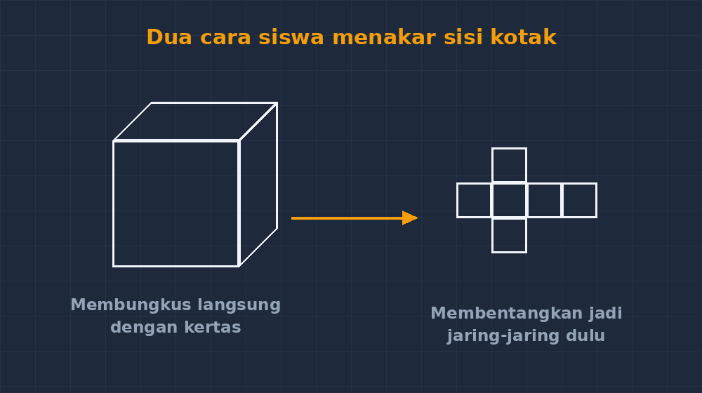

Ada satu momen yang tidak pernah bisa saya lupakan dari tahun-tahun awal mengajar. Saya memberi soal rutin: sebuah balok berukuran $8\text{ cm} \times 5\text{ cm} \times 4\text{ cm}$, hitung luas permukaannya. Jawaban yang kembali rapi semua: $2 \times (8{\cdot}5 + 8{\cdot}4 + 5{\cdot}4) = 2 \times (40 + 32 + 20) = 184$. Lalu saya ubah soalnya sedikit saja — "kotak itu dicat semua sisinya kecuali alasnya, berapa luas cat yang dibutuhkan?" — dan kelas hening. Dua pertiga murid tetap menulis $184$.

Mereka tidak bodoh. Mereka hanya hafal rumus, dan rumus tidak punya kesempatan bicara ketika soalnya berubah bentuk. Di momen itu saya sadar ada sesuatu yang retak, dan retaknya bukan di anak-anak.

<!--more-->

## Rumus yang datang tanpa cerita

Mari kita jujur: rumus luas permukaan balok memang terlihat menakutkan kalau disodorkan mentah-mentah. $L = 2(pl + pt + lt)$. Dua, kali, tiga pasang, ditambah. Sebagai guru, tergoda sekali memberikannya sebagai "jurus cepat" — tulis di papan, beri tiga contoh, latihan sepuluh soal, selesai. Skor latihan soal bagus. Semua senang.

Tapi hafalan itu seperti menumpuk kartu. Selama soalnya datang dari arah yang sama, kartunya berdiri. Begitu angin datang dari samping — soal cat, soal kotak tanpa tutup, soal akuarium yang tidak perlu ditutup atasnya — tumpukan itu roboh. Dan yang paling menyakitkan, murid yang roboh itu sering merasa *mereka* yang salah, padahal yang retak adalah cara rumus itu sampai ke mereka.

Di titik itu saya mulai bereksperimen dengan satu perubahan yang terdengar sepele: **menahan diri untuk tidak memberi rumus lebih dulu**.

## Menunda rumus, bukan menghapusnya

Perlu saya tegaskan: saya tidak anti-rumus. Rumus itu ringkasan yang indah — ia adalah hasil akhir dari proses berpikir yang sudah dilakukan manusia berabad-abad. Masalahnya bukan pada rumusnya, tapi pada urutannya. Rumus yang datang sebelum pengalaman adalah kesimpulan tanpa cerita. Rumus yang datang *setelah* pengalaman adalah hadiah atas kerja keras.

Jadi pada pertemuan berikutnya, saya masuk kelas membawa — bukan rumus — tapi beberapa kardus bekas berbagai ukuran. Tugasnya sederhana: "Kalau mau membungkus kotak ini dengan kertas kado sampai rapat semua sisinya, kertas minimal berapa luas?" Saya sengaja tidak menyebut kata *luas permukaan* di awal. Biarkan bahasanya dulu milik anak-anak: "kertasnya menutup semua sisi."

Kelompok-kelompok mulai mengukur, memotong kertas di atas meja, ada yang melipat kertas membungkus kotak langsung, ada yang memutuskan membongkar dulu — membentangkan kotak jadi jaring-jaring, mengukur satu per satu, lalu menjumlahkan. Dari barisan belakang saya dengar debat: "kertasnya kekurangan sisi depan!" Itu suara yang tidak pernah muncul ketika mereka hanya menghafal $2(pl+pt+lt)$.

## Debat yang lebih berharga daripada jawaban

Yang menarik dari kelas itu bukan hasil akhirnya, tapi pertengahannya. Ada kelompok yang menghitung dengan cara "enam sisi dijumlah satu-satu": $40 + 40 + 32 + 32 + 20 + 20$. Ada kelompok lain yang menemukan sendiri versi yang lebih ringkas: "kan ada tiga pasang sisi yang sama, jadi dua kali jumlahnya." Ketika saya minta kedua kelompok menuliskan caranya di papan, kelas jadi ribut membandingkan.

Dan di sanalah, dengan mulut mereka sendiri, lahir kalimat yang biasanya saya diktahkan: *balok itu punya tiga pasang sisi yang kongruen, sehingga jumlah luasnya dua kali penjumlahan tiga luas yang berbeda.* Bedanya, kalimat ini bukan titipan saya. Ia milik mereka. Ketika minggu depannya muncul soal kotak tanpa tutup, kelompok yang dulu membongkar jaring-jaring langsung berkomentar, "yang ini satu sisi dibuang saja, jadi rumusnya dikurangi satu lt."

Perhatikan apa yang terjadi: rumus tidak lagi benda yang dihafal, tapi *kalimat yang bisa diperdebatkan*. Murid bisa mengedit rumus karena mereka tahu darimana rumus itu berasal. Hafalan yang retak tadi — saya baru sadar setelahnya — retaknya karena rumus disodorkan sebagai titik awal, padahal seharusnya dia garis finish.

## Berapa banyak rumus yang bisa ditemukan sendiri?

Tidak semua. Saya juga pernah berlebihan, coba-coba membiarkan siswa "menemukan sendiri" rumus volume kerucut, dan hasilnya kekacauan — anak SD kelas sembilan tidak akan menemukan $\frac{1}{3}\pi r^2 h$ tanpa alat bantu yang jauh lebih canggih dari kardus bekas. Ada batasnya, dan menemukan batas itu sendiri adalah pekerjaan guru yang berkelanjutan.

Kriteria yang saya pakai sekarang sederhana: jika penurunannya bisa *dilihat* — dengan benda nyata, lipatan, jaring-jaring, atau gambar — biarkan siswa berjalan dulu, rumus menyusul. Volume balok bisa: tumpuk persegi panjang. Luas jajargenjang bisa: potong dan pindahkan jadi persegi panjang. Luas lingkaran bisa (kira-kira): potong juring-juring dan susun jadi persegi panjang. Tapi rumus kuadrat sempurna untuk akar-akar persamaan? Itu alat, dan kadang alat boleh diberikan langsung — asalkan kita jujur bilang, "ini alat yang sudah diracik orang lain; tugas kalian tahu kapan memakainya."

Kuncinya konsistensi: murid harus tahu bahwa di kelas saya, "darimana rumus ini" adalah pertanyaan yang sah dan akan dijawab — atau lebih baik lagi, akan *dicari bersama*.

## Yang berubah di nilai, dan yang tidak

Saya tidak akan berbohong bahwa cara ini instan ajaib. Latihan soal rutin justru kadang lebih lambat, karena siswa yang dulu "tinggal masukkan angka" sekarang kadang berhenti sebentar untuk membayangkan sisinya dulu. Tapi ada perbedaan yang saya lihat jelas di soal-soal berubah bentuk: soal cat, soal kotak terbuka, soal akuarium. Di situ murid-murid saya tidak lagi mati total. Mereka menggambar dulu, mencoret, menyesuaikan — lalu menghitung. Yang dulu punya satu kartu hafalan, sekarang punya peta.

Dan ada bonus yang tidak terukur di rubrik: suara kelas berubah. Ketika rumus jadi temuan, pertanyaan "Bu, kalau kotaknya kubus gimana?" muncul dari mereka sendiri, bukan dari saya. Anak yang bertanya seperti itu sedang melakukan hal yang jauh lebih berharga daripada menghafal: ia sedang memprediksi, menggeneralisasi — berpikir seperti matematikawan kecil.

Di meja kerja saya sekarang ada setumpuk kardus bekas yang tidak pernah saya buang. Kadang kolega datang dan bertanya kenapa guru matematika menimbun kardus. Saya jawab saja: ini alat untuk membiarkan rumus datang belakangan — karena rumus yang datang belakangan, yang datang setelah anak-anak sempat mencoba sendiri, adalah rumus yang tidak mudah retak.
