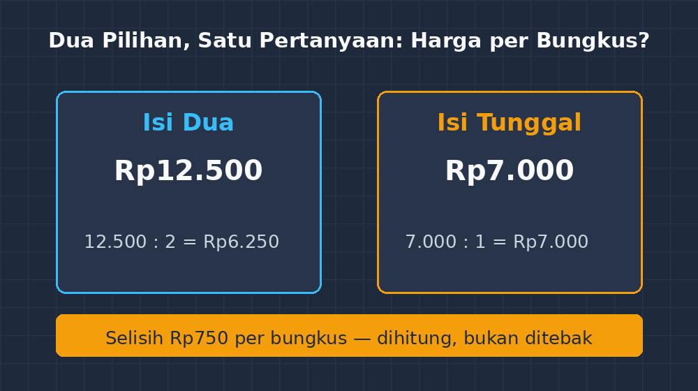

Ada satu lembar kertas yang selalu saya simpan di tas: struk belanja. Bukan struk yang penting-penting, lho — struk telur dan minyak goreng di warung dekat sekolah. Ibu warungnya sudah hafal saya, dan begitu tahu saya minta struk untuk "bahan mengajar", dia tertawa, "Belanja saja pak, nggak usah pura-pura riset." Tapi struk kecil itu ternyata salah satu media paling jujur yang pernah saya bawa ke kelas VII.

## Murid yang Percaya Iklan

Awalnya bukan rencana besar. Saya sedang masuk ke materi perbandingan, dan seperti biasa, soal di buku paket menyajikannya dengan rapi: "Harga 3 buku Rp12.000. Berapa harga 5 buku?" Murid bisa. Nilainya bagus. Tapi ada satu hal yang mengganjal di kepala saya: soal seperti itu sudah memberi tahu murid *apa yang harus dihitung*. Di kehidupan nyata, tidak ada yang memberi tahu. Yang ada hanya dua kemasan di rak minimarket dan tanda tanya di kepala: mana yang lebih murah?

Kesempatan datang dari hal sepele. Seorang murid, sebut saja Rahmat, bilang di kelas, "Bu, kemarin saya disuruh ibu beli sabun. Yang isi dua harganya Rp12.500, yang tunggal Rp7.000. Saya ambil yang isi dua, kan keliatan lebih murah." Rahmat mengatakannya dengan yakin sekali, dan setengah kelas mengangguk.

Saya tidak langsung menjawab benar atau salah. Saya hanya menulis di papan: **Rp12.500 ÷ 2** dan **Rp7.000 ÷ 1**. Lalu saya diam.

*Papan tulis kelas: dua kemasan, dua pembagian, dan keputusan yang sekarang bisa dihitung — bukan ditebak.*

Kelasnya hening sebentar. Lalu ada yang menyahut, "Bu, yang tunggal malah murah?!" Rp6.250 per bungkus versus Rp7.000 per bungkus. Yang isi dua memang lebih murah per satuan — tapi selisihnya hanya Rp750, bukan "jauh lebih murah" seperti kesan pertama. Dan kalau misalnya angkanya sedikit berubah, kesimpulannya bisa terbalik total. Rahmat bengong. Bagus, bengongnya. Itu bengong yang produktif.

## Struk Masuk Kelas

Dari diskusi itu, saya mulai rutin membawa struk. Bukan untuk menakut-nakuti, tapi untuk menunjukkan bahwa matematika yang kita pelajari sedang bekerja diam-diam di setiap transaksi. Struk warung sebelah, struk minimarket, struk pasar — semuanya saya fotokopi diperbesar supaya seluruh kelas bisa membaca.

Aktivitasnya sederhana, tapi saya minta satu aturan: **sebelum menghitung, taksir dulu.** Mana yang kira-kira lebih murah? Tuliskan tebakanmu. Baru setelah itu hitung harga satuan tiap produk, bandingkan, lalu cek: tebakanmu benar atau meleset?

Menariknya, tebakan murid sering meleset di tempat yang sama. Kemasan besar dikira otomatis lebih murah. Tulisan "HEMAT!" dikira kebenaran. Angka Rp9.999 dikira "hampir sepuluh ribu, sama saja dengan yang sepuluh ribu". Taksiran yang meleset ini justru bahan diskusi terbaik — karena sekarang mereka *butuh* pembagian, bukan dibebani pembagian.

Harga satuan sendiri secara matematis tidak sulit: harga total dibagi banyak satuan, $\text{harga satuan} = \frac{\text{harga total}}{\text{banyak satuan}}$. Yang sulit justru kesediaan untuk melakukannya di kepala saat berdiri di rak toko. Itu kebiasaan, bukan kecerdasan. Dan kebiasaan dibangun lewat latihan yang terasa relevan.

## Tiga Hal yang Saya Perhatikan

Setelah beberapa kali kelas seperti ini, ada tiga hal yang saya catat.

**Pertama, unit yang tidak ditulis adalah musuh.** Di struk, "isi 2" kadang tertulis kecil sekali, atau bahkan hanya terbaca dari harga totalnya. Murid yang terbiasa dengan soal buku — di mana data selalu lengkap dan rapi — perlu belajar bahwa di dunia nyata, data kadang harus *dicari*. Ini latihan literasi yang bagus: membaca struk itu juga keterampilan.

**Kedua, konteks menumbuhkan pertanyaan.** Anak-anak mulai bertanya hal-hal yang tidak saya ajarkan: "Bu, kalau diskon 20% dihitung setelah harga satuan atau sebelum?" Pertanyaan seperti itu adalah pintu masuk ke materi aritmetika sosial, dan karena lahir dari kebutuhan mereka sendiri, tidak perlu saya paksa.

**Ketiga, tidak semua murid butuh angka yang sama.** Untuk murid yang sudah lancar, saya beri struk dengan tiga produk sekaligus dan minta mereka menyusun "peringkat hemat". Untuk yang masih berat dengan pembagian, cukup satu pasang produk. Media yang sama, tangga yang berbeda. Tidak ada yang merasa diberi soal anak kelas satu.

## Dari Struk ke Kebiasaan

Ada satu momen yang saya simpan di jurnal mengajar saya. Beberapa minggu setelah materi itu, Rahmat datang dengan wajah bangga, "Bu, kemarin di minimarket saya hitung duluan sebelum ibu saya pilih. Yang keluarga Rp9.500 tiga bungkus ternyata lebih murah dari yang tunggal Rp4.000." Saya tanya, "Jadi?" Dia menjawab, "Jadi saya bilang ke ibu, ambil yang tiga bungkus. Ibu saya kaget saya bisa hitung begitu cepat."

Momen seperti itu yang membuat saya percaya bahwa numerasi paling melekat bukan yang dilatih lewat lembar soal tambahan, tapi yang dipakai untuk memecahkan persoalan kecil yang benar-benar milik murid. Harga satuan hanyalah satu contoh. Sama halnya dengan diskon, bunga, atau takaran resep — matematika aritmetika sosial seharusnya diajarkan dari barang-barang yang murid lihat setiap hari, bukan dari tokoh fiktif yang membeli 12 buku tulis dengan harga yang dibulatkan rapi.

Kalau Bapak/Ibu Guru ingin mencoba, tidak perlu menyiapkan banyak hal. Cukup: satu-dua struk asli (atau foto struk dari ponsel Anda sendiri), waktu satu pertemuan, dan keberanian membiarkan taksiran murid meleset. Meleset itu bukan kegagalan pelajaran — justru di situ pembagian harga satuan mendapat pekerjaan yang layak ia kerjakan.

Struk itu kecil, hampir tak terlihat, sering langsung dibuang setelah keluar dari toko. Tapi di dalamnya ada seluruh alasan kenapa murid kita perlu bisa membagi dengan percaya diri. Dan untuk saya, melihat Rahmat berdiri di rak minimarket sambil menghitung di dalam kepalanya — itu bukti bahwa pelajaran matematika bisa keluar dari kelas dan ikut pulang bersama murid.
