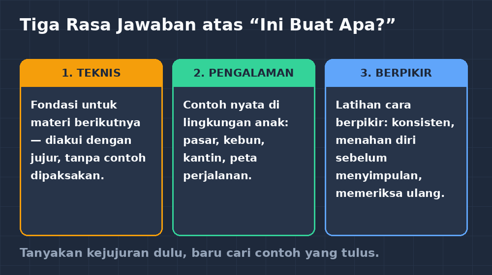

Pertanyaan itu muncul di kelas VIII, di tengah pelajaran tentang bilangan berpangkat. Saya sedang menuliskan contoh di papan tulis ketika seorang anak di barisan belakang mengangkat tangan setengah malas, setengah serius, dan bertanya: "Ini buat apa, Bu? Nanti kerja juga nggak kepake." Suara kelas langsung hening sejenak, lalu ada yang terkikik. Saya waktu itu menjawab cepat — semacam refleks guru yang sudah sering ditanya — "Nanti waktu SMA dipakai kok, ini dasar untuk materi berikutnya." Anak itu mengangguk-angguk, tapi saya tahu dia tidak puas. Saya juga tidak puas dengan jawaban saya sendiri.

<!--more-->

## Jawaban refleks yang ternyata curang

Dalam beberapa tahun berikutnya, saya perhatikan jawaban yang biasa saya dan rekan guru berikan pada pertanyaan semacam itu. Ada yang bilang "dipakai di kelas berikutnya" — yang secara teknis benar, tapi cuma memindahkan pertanyaannya ke kelas depan. Ada yang bilang "matematika melatih logika" — benar juga, tapi terlalu kabur untuk didengar anak kelas delapan yang sedang kehilangan motivasi. Ada pula yang menunjuk contoh penggunaan di dunia nyata, kadang dipaksakan: bahwa bilangan berpangkat dipakai untuk menghitung bunga bank, misalnya, padahal anak-anak saya belum pernah punya deposito.

Yang membuat saya merenung lebih dalam: pertanyaan "ini buat apa" itu sebenarnya bukan pertanyaan teknis. Ia adalah pertanyaan tentang makna. Dan anak yang bertanya seperti itu — seberapa pun nadanya terdengar sindir — sebenarnya sedang melakukan sesuatu yang bagus: dia menolak belajar sesuatu yang baginya tidak berarti. Di kelas saya, siswa yang paling repot biasanya bukan yang bertanya "buat apa", melainkan yang sudah berhenti bertanya dan hanya mencatat.

## Mendengarkan pertanyaan itu dengan sungguh-sungguh

Perubahan kecil saya mulai dari satu keputusan: pertanyaan "ini buat apa" tidak lagi saya lempar balik atau saya gantung sampai pertemuan berikutnya. Kalau pertanyaan itu muncul, saya berhenti sejenak dan menjawabnya dengan sungguh-sungguh, di tempat, di depan semua orang.

Yang menarik, begitu saya berhenti membela diri, jawabannya jadi lebih jujur. Untuk bilangan berpangkat, saya mulai cerita tentang notasi saja. Saya tanya ke kelas, "Kalau saya tulis $2 \times 2 \times 2 \times 2 \times 2 \times 2 \times 2 \times 2 \times 2 \times 2$, capek nggak nulisnya?" Mereka bilang capek. Nah, pangkat itu pada awalnya cuma tinta hemat — cara manusia menulis perkalian berulang dengan singkat. Perkembangannya, aturan-aturan pangkat ternyata bekerja rapi bahkan ketika pangkatnya nol atau negatif, dan di situlah ia mulai menghitung hal-hal yang mengecil dan membesar dengan cepat: bakteri, populasi, utang bunga. Dua kalimat pertamanya murni soal kenyamanan menulis, dan itu jujur; dua kalimat berikutnya soal dunia, dan itu bonus.

Saya sadar sesuatu yang hampir memalukan: selama ini saya sering menunda menjawab karena saya sendiri belum pernah merumuskan jawabannya. Pertanyaan anak itu sebenarnya menagih utang saya — utang guru untuk tahu kenapa materi yang diajarkannya penting, bukan sekadar tercantum di silabus.

## Tiga jenis jawaban yang saya simpan

Sejak itu saya diam-diam menyiapkan jawaban, dan ternyata jawaban itu datang dalam tiga rasa.

Rasa pertama: **jawaban teknis**. Beberapa materi memang terutama dibutuhkan untuk materi berikutnya, dan mengatakannya tidak apa-apa, asalkan jujur. "Kalian belum akan merasakan manfaatnya sekarang. Tapi ini fondasi, seperti kaki rangka rumah yang tidak kelihatan tapi menopang." Anak-anak menghargai kejujuran semacam ini lebih daripada contoh buatan yang mereka cium bau dipaksakan.

Rasa kedua: **jawaban pengalaman**. Aritmetika sosial dipakai saat menawar di pasar dan membaca diskon. Perbandingan dipakai saat menghitung takaran pupuk di kebun, dan di sekitar sekolah saya banyak orang tua yang berkebun. Skala dipakai saat membaca peta perjalanan sekolah. Untuk materi-materi ini, jawabannya gampang karena memang ada di lingkungan anak — dan biasanya anak-anak sendiri yang lebih dahulu menyebutkan contohnya kalau diberi ruang.

Rasa ketiga, dan ini yang paling sulit: **jawaban tentang berpikir**. Kalau ditanya gunanya mencari bayangan titik terhadap garis, atau gunanya teorema tertentu, jawaban terbaik kadang bukan contoh dunia nyata, melainkan kejujuran bahwa kita sedang berlatih cara berpikir: menahan diri sebelum menyimpulkan, mengikuti aturan yang konsisten, memeriksa ulang. Saya biasa mengibaratkannya seperti latihan fisik — tidak ada satu pun gerakan push-up yang nanti dipakai "dunia nyata" persis seperti itu, tapi kekuatannya dibawa ke mana-mana.

*Diagram kecil yang saya simpan di kepala: tiap materi biasanya cocok dengan salah satu dari tiga rasa jawaban ini — kadang dua.*

## Saat pertanyaan itu datang dengan nada lain

Tidak semua "ini buat apa" ditanyakan dengan polos. Ada juga yang datang dengan nada menantang, kadang diikuti senyum teman-temannya, dan jelas-jelas menguji kesabaran guru. Dulu saya merasa harus memenangkan duel itu. Sekarang saya memandangnya sama saja: pertanyaannya tetap sah, meski nadanya tidak.

Bahkan ada satu momen yang saya simpan. Seorang siswa bertanya dengan nada senada-tidak-senada, "Nilai-nilai rapat ini buat apa, Bu? Nanti kerja nggak dilihat." Saya bisa saja tersinggung. Sebaliknya, kami diskusi singkat lima menit — tentang apa yang sebenarnya diukur dari nilai, dan bagaimana angka yang sama bisa berarti hal berbeda bagi dua orang. Di akhir obrolan itu dia bilang, "Oh, gitu." Dua kata saja, tapi nadanya berubah. Tidak semua pertanyaan harus dijawab dengan jawaban; kadang cukup dengan menunjukkan bahwa pertanyaan itu layak ditimbang serius.

## Yang saya pelajari dari pertanyaan sepele itu

Kalau saya boleh merangkum, ada tiga hal yang saya pelajari dari "ini buat apa, Bu?" selama bertahun-tahun menahannya di kelas.

Pertama, pertanyaan itu adalah alarm makna. Ia muncul paling sering justru di materi yang penghubungnya ke dunia anak sudah paling tipis — bukan di materi yang paling susah. Kelas saya bisa menyiksa diri lewat soal cerita yang panjang tanpa protes, tapi memberontak di materi yang terasa hanya latihan-latihan tanpa arah. Sirene itu patut dibaca sebagai data, seperti halnya jawaban salah di CBT yang bercerita tentang pola kesalahan.

Kedua, menjawabnya memaksa guru jujur — termasuk jujur mengakui "materi ini sebagian besar fondasi, belum terasa manfaatnya sekarang". Anak-anak lebih pintar mendeteksi contoh yang dipaksakan daripada yang kita kira. Contoh yang dipaksakan justru merusak kepercayaan pada contoh-contoh yang tulus di bab-bab lain.

Ketiga — dan ini yang paling personal — pertanyaan itu ternyata membuat saya mengajar lebih baik. Sejak berhenti menolak "ini buat apa", saya jadi membiasakan diri memikirkan alasan setiap materi sebelum pertemuan, bukan saat diserang di tengah pelajaran. Saya tidak selalu punya jawaban indah, dan tidak semua jawaban saya memuaskan semua anak. Tapi kalimat refleks yang saya tulis di jurnal kecil saya di aplikasi itu sekarang sering berbunyi sederhana: hari ini, kalau ada yang bertanya buat apa, apakah saya sudah siap?

Pertanyaan satu kalimat itu ternyata lebih banyak mengubah cara saya mengajar daripada banyak pelatihan yang pernah saya ikuti. Ia murah, datang terus-menerus, dan gratis. Tinggal soal kita mau dengar atau tidak.
