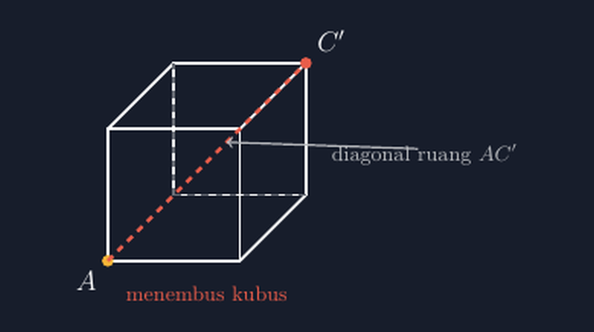
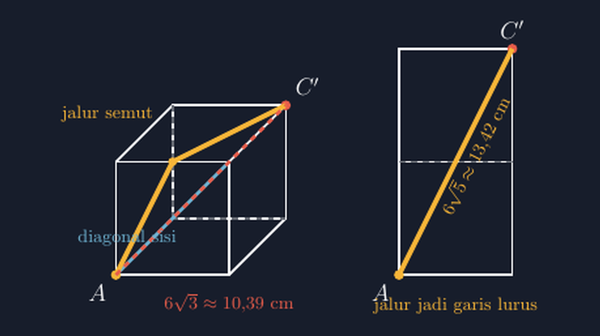

Semut itu muncul setiap tahun. Saya tidak tahu kenapa soal tentang semut yang berjalan di permukaan kubus selalu jadi soal favorit di buku-buku, tetapi setiap kali saya mengajarkannya, kelas terbelah dua. Setengah kelas yakin jalur terpendeknya adalah lewat sisi depan terus naik lurus ke titik atas. Setengah lagi yakin harus menyeberang lewat sisi samping. Mereka berdebat dengan penuh keyakinan, dan ironisnya, dua-duanya salah.

Soalnya sederhana: sebuah kubus berukuran $6 \text{ cm} \times 6 \text{ cm} \times 6 \text{ cm}$. Sebuah semut berada di titik sudut $A$ bawah, dan ingin berjalan di permukaan kubus menuju titik sudut $C'$ yang berada di "sudut diagonal" atasnya. Berapa panjang jalur terpendek yang bisa ditempuh semut itu?

<!--more-->

## Kenapa kelas selalu terbelah

Saya pernah mencoba menunjukkan jawabannya langsung di papan tulis: gambar kubus, tarik garis dari $A$ ke $C'$. Anak-anak mengangguk. Lalu saya hitung pakai Pythagoras, $AC' = 6\sqrt{3} \approx 10{,}39$ cm, dan mereka mencatat. Tidak ada yang bertanya. Dan justru di situ masalahnya: tidak ada yang bertanya berarti tidak ada yang paham.

Kesalahan saya waktu itu adalah mencampuradukkan dua soal yang berbeda. $AC'$ adalah diagonal ruang, dan garis diagonal ruang itu *menembus* kubus. Tetapi semut tidak bisa terbang. Semut menempel di permukaan. Jalur semut harus mengikuti selimut kubus, bukan menembus isinya. Jadi jawaban $6\sqrt{3}$ cm itu salah untuk soal semut, dan saya pernah membuat seisi kelas mencatatnya sebagai jawaban yang benar. Itu pengalaman yang membuat saya malu sampai sekarang.

## Bedanya diagonal ruang dan jalur semut

Sebelum masuk ke jaring, saya sekarang berhenti dulu untuk memisahkan dua istilah ini di papan tulis. Diagonal ruang $AC'$ itu jarak terpendek *melalui ruang* — jalur burung terbang. Jalur semut itu jarak terpendek *melalui permukaan* — jalur binatang yang tidak bisa terbang. Dua konsep, dua jawaban berbeda, dan perbedaannya bukan soal teknis tapi soal pemahaman situasi.

Perhatikan gambar berikut — kubus dengan titik $A$ di bawah dan $C'$ di atas, plus dua garis yang sering tertukar di kepala siswa: diagonal ruang (garis putus-putus yang menembus kubus) dan diagonal sisi (yang hanya merangkak di satu sisi):



Diagonal ruang menembus isi kubus. Semut tidak bisa ikut jalan itu.

## Cara saya menemukan solusinya (dengan bantuan kotak kado bekas)

Tahun lalu saya membawa satu kubus kardus bekas kotak kado ke kelas. Warna polos, ditandai huruf $A$ di satu sudut bawah dan $C'$ di sudut diagonal atasnya. Saya minta seorang anak, sebut saja Raka, untuk menunjukkan jalur terpendek yang dia yakini dengan spidol di permukaan kardus. Raka menggambar garis miring di sisi depan, lalu garis miring lagi di sisi atas. "Ini terpendek, Pak," katanya yakin.

Lalu saya buka kardus itu. Saya sengaja membuka sisi depan dan sisi atas sampai keduanya rata di satu bidang — persis seperti membuka kotak kado yang lengketnya lepas. Dan tiba-tiba semua orang di kelas melihat sesuatu yang sebelumnya tidak terlihat: dua sisi yang tadinya bertemu di satu rusuk kini membentuk satu persegi panjang yang besar, dan garis yang tadinya "belok" di rusuk itu kini terlihat sebagai jalur berkelok yang jelas bukan jalur paling pendek. Jalur terpendek di bidang rata itu sederhana: garis lurus.

Kelas hening sejenak. Lalu Raka bilang, "Oh. Jadi harus di-terbuka dulu." Kalimat itulah yang saya tunggu. Persegi panjang rata itu berukuran $6$ cm (lebar kubus) kali $12$ cm (dua sisi yang dibentangkan, masing-masing $6$ cm). Jalur semut dari $A$ ke $C'$ di bidang rata ini tinggal diagonalnya, yang bisa dihitung pakai Pythagoras:

$$ \text{Jarak semut} = \sqrt{6^2 + 12^2} = \sqrt{36 + 144} = \sqrt{180} = 6\sqrt{5} \approx 13{,}42 \text{ cm} $$

Dibandingkan dengan diagonal ruang yang hanya $6\sqrt{3} \approx 10{,}39$ cm, jalur semut itu ternyata lebih panjang. Itu masuk akal — berjalan di permukaan memang lebih melelahkan daripada terbang menembus ruang. Perbandingan dua angka ini juga penting, karena kadang anak menyamakan kedua konsep itu tanpa sadar.

## Menggambar perbandingannya dengan TikZ

Narasi kardus itu enak di kelas, tetapi tidak bisa dibawa pulang oleh setiap anak. Untuk handout, saya menggambar dua versi yang berdampingan: kubus tertutup dengan jalur semut yang belok di rusuk, dan kubus yang terbuka menjadi jaring dengan jalur lurus yang sama. Perhatikan bahwa panjang jalurnya sama — hanya tampilannya yang berbeda karena satu kubus masih "tertutup" dan yang satunya sudah "dibuka":



Gambar di atas dibuat dengan TikZ, dan bagian yang paling penting bukan gambar kubusnya, tetapi konsistensi panjang rusuk di antara kedua tampilan. Kalau rusuk sisi depan di gambar kubus panjangnya 2 unit, maka rusuk yang sama di jaring juga harus 2 unit — kalau tidak, anak akan melihat dua gambar yang tidak nyambung dan gambar itu justru membingungkan. Konsep kuncinya sederhana: setiap rusuk di jaring harus sama panjang dengan rusuk di kubus, karena itu rusuk yang sama, hanya posisinya yang berubah karena kubus dibuka.

Bagian kode TikZ-nya tidak rumit. Untuk kubus tertutup, saya gambar dua bujur sangkar berukuran sama dan geser satu sepanjang diagonal:

```latex
\begin{tikzpicture}[scale=1]
  % Bujur sangkar depan
  \draw (0,0) -- (2,0) -- (2,2) -- (0,2) -- cycle;
  % Bujur sangkar belakang (geser diagonal)
  \draw (1,1) -- (3,1) -- (3,3) -- (1,3) -- cycle;
  % Rusuk penghubung
  \draw (0,2) -- (1,3);
  \draw (2,2) -- (3,3);
  \draw (2,0) -- (3,1);
\end{tikzpicture}
```

Untuk jaringnya, saya tidak menggambar kubus lagi, tetapi lima bujur sangkar yang dibentangkan di satu bidang:

```latex
\begin{tikzpicture}[scale=1]
  \foreach \x in {0,2,4,6} {
    \draw (\x,0) -- (\x+2,0) -- (\x+2,2) -- (\x,2) -- cycle;
  }
  \draw (2,2) -- (4,2) -- (4,4) -- (2,4) -- cycle;
\end{tikzpicture}
```

Titik $A$ saya letakkan di sudut kiri bawah bujur sangkar pertama, dan titik $C'$ di sudut kanan atas bujur sangkar yang terangkat. Garis jalur semut di jaring hanya satu segmen garis lurus dari $A$ ke $C'$, dan panjangnya bisa dihitung langsung dengan Pythagoras di bidang rata. Kalau siswa menghitung panjangnya dan mendapat $6\sqrt{5}$, gambar dan hitungan mereka saling menguatkan.

## Yang terpenting bukan rumusnya

Kalau saya renungkan, soal semut ini sama sekali bukan soal tentang Pythagoras. Pythagoras itu sudah hafal semua. Soal semut adalah soal tentang *mengubah cara pandang*: dari melihat kubus sebagai objek tiga dimensi yang menempel di mata, menjadi objek yang bisa dibuka dan dibentangkan. Sekali murid mengalami momen "oh, jadi harus dibuka dulu" itu, mereka akan mengangkat semut ke semua soal serupa — bola, tabung, kerucut — dengan naluri yang sama: cari bidang rata tempat jalur itu bisa dilihat sebagai garis lurus.

Sekarang saya menyimpan satu kubus kardus di lemari kelas, sengaja dibuat lengketnya mudah lepas. Setiap tahun, kotak itu keluar di saat yang sama. Dan setiap tahun, ada satu anak yang mengalami momen yang sama seperti Raka: dulu yakin dengan jalur yang belok, lalu terdiam sejenak, lalu bilang "oh" dengan nada yang membuat guru senang semalaman. Momen-momen kecil itu tidak masuk ke nilai raport, tetapi itulah alasan saya tetap mengajar.

> 📎 **Berkas TikZ lengkap:** [tex/jalur-terpendek-kubus.tex](tex/jalur-terpendek-kubus.tex) — siap kompilasi (butuh paket `tikz`).
