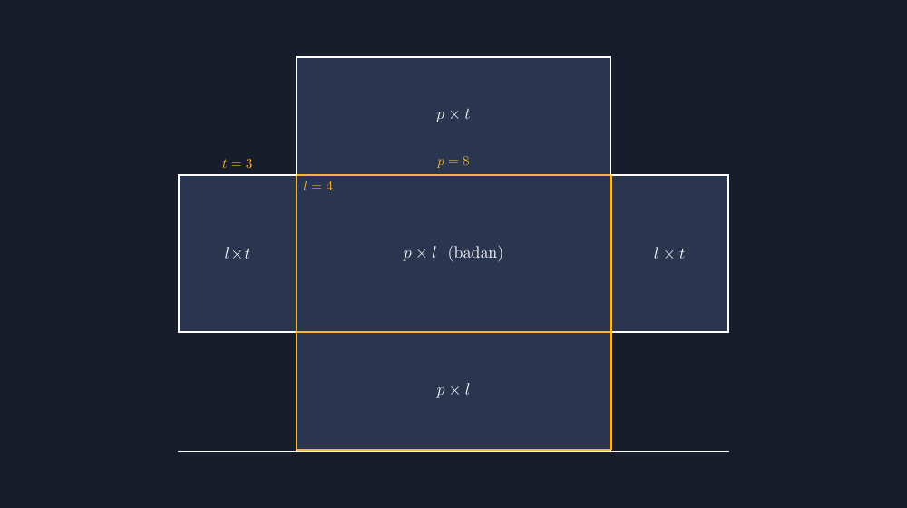
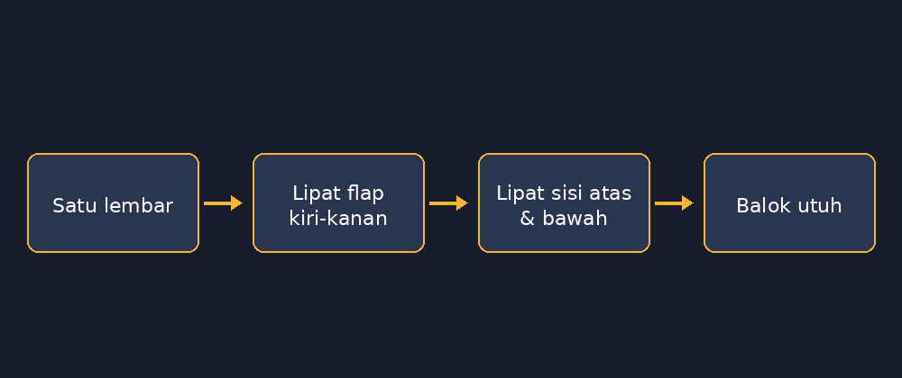

Minggu lalu saya membawa kertas gunting dan lem ke kelas VIII. Rencananya sederhana: setiap kelompok mendapat satu lembar berisi jaring-jaring balok, lalu mereka lipat menjadi balok utuh. Kegiatan ini sudah pernah saya lakukan bertahun lalu, dan ingatan saya waktu itu: seru, rapi, selesai tepat waktu. Kenyataannya minggu lalu berbeda. Dua kelompok mengangkat karya mereka sambil tertawa geli — balok mereka punya celah. Ada satu sisi yang tidak bertemu dengan sisi lainnya, jadi ada lubang kecil di sudut balok, dan selotip pun akhirnya dipanggil untuk menutupi kegagalan lipatan.

Saya tidak menyalahkan siswa. Saya menyalahkan lembar kerja itu. Jaring-jaring yang saya fotokopi ternyata tidak proporsional. Panjang satu sisi di kertas tidak sama dengan sisi yang seharusnya bertemu padanya. Mata siswa memang tidak selalu menyadari hal semacam ini, tetapi tangan mereka merasakannya: saat dilipat, dua sisi yang seharusnya berbarengan justru tidak saling menutup.

<!--more-->

## Jaring-jaring adalah janji bahwa semuanya akan bertemu

Sebelum bicara TikZ, saya biasa mengajak siswa berpikir sejenak tentang apa itu jaring-jaring. Jaring-jaring bukan sekadar "gambar bongkahan balok yang ditarik". Ia adalah janji: kalau semua sisi ini dilipat pada garis yang ditandai, setiap tepi sisi yang satu akan bertepatan dengan tepi sisi yang lain. Kalau janji itu tidak ditepati — kalau panjang sisi yang satu tidak cocok dengan sisi yang seharusnya menutupinya — jaring itu bukan jaring-jaring balok. Ia cuma kumpulan persegi panjang yang duduk berdekatan.

Di sini letak masalahnya. Kalau saya menggambar jaring-jaring "pakai feeling" di Word atau di papan tulis, janji itu mudah dilanggar tanpa saya sadari. Sedikit saja satu dimensi meleset, celah kecil muncul, dan siswa yang jeli akan bertanya, "Pak, kok nggak ketemu ya?" Pertanyaan seperti itu bagus kalau memang kita sedang membahas konsep. Tapi kalau penyebabnya cuma gambar saya yang ceroboh, jadi kurang ajar.

## Merancang jaring-jaring yang pas di atas kertas

Jaring-jaring balok ada banyak susunan, tetapi yang paling sering kita pakai di kelas adalah susunan palang: satu sisi di tengah, satu di atasnya, satu di bawahnya, dan dua sisi kecil di kiri-kanan. Untuk balok berukuran panjang $p$, lebar $l$, dan tinggi $t$, susunan ini bisa digambar dengan koordinat yang benar-benar dihitung, bukan ditaksir.

Susunan palang dengan alas di tengah, sisi atas dan bawah, serta dua flap di kiri-kanan — gambarnya seperti ini:


*Jaring-jaring balok $8 \times 4 \times 3$ cm dalam susunan palang, digambar dengan TikZ. Garis kuning menandai garis lipat.*

Kuncinya di koordinat. Sisi tengah (badan balok) saya gambar sebagai persegi panjang $p \times l$. Sisi di atasnya tingginya $t$ — ini sisi $p \times t$, yaitu tutupnya. Sisi di bawahnya sama: $p \times l$, alasnya. Flap kiri dan kanan lebarnya $t$ — keduanya sisi $l \times t$. Kalau koordinatnya ditulis begitu saja di kode, maka setiap tepi yang seharusnya bertemu memang panjangnya sama, karena mereka dihitung dari bilangan yang sama.

Potongan kodenya seperti ini:

```latex
\def\p{8} \def\l{4} \def\t{3}
% sisi tengah (badan)
\fill[face,draw=white,line width=1.2pt] (0,-\l) rectangle (\p,0);
% sisi atas (tutup) dan bawah (alas)
\fill[face,draw=white,line width=1.2pt] (0,0) rectangle (\p,\t);
\fill[face,draw=white,line width=1.2pt] (0,-\l-\t) rectangle (\p,-\l);
% flap kiri dan kanan
\fill[face,draw=white,line width=1.2pt] (-\t,-\l) rectangle (0,0);
\fill[face,draw=white,line width=1.2pt] (\p,-\l) rectangle (\p+\t,0);
```

Perhatikan bahwa $p$, $l$, dan $t$ didefinisikan sekali saja. Kalau besok saya ingin jaring-jaring untuk balok $10 \times 6 \times 2$, saya cukup mengganti tiga angka itu dan seluruh gambar menyesuaikan diri. Tidak ada satu pun garis yang perlu saya tarik ulang dengan tangan. Inilah yang menurut saya paling berharga dari menggambar jaring-jaring dengan TikZ: **dimensi yang kita janjikan benar-benar ditepati oleh gambar.**

## Dari gambar ke pengalaman melipat

Gambar yang jujur baru separuh cerita. Separuhnya lagi ada di meja siswa. Setelah lembar jaring-jaring tercetak, saya minta siswa memotongnya dan melipatnya. Di kelas minggu lalu (setelah saya ganti lembar kerja dengan yang digambar ulang dari kode di atas), dua hal menarik terjadi.

Pertama, tidak ada lagi kelompok yang mengeluhkan celah. Balok mereka tertutup sempurna, dan anak-anak yang semula ragu justru menjadi percaya diri: "Pak, yang ini nggak ada bolongnya!" Perasaan berhasil seperti ini kecil, tetapi ia menempel. Siswa yang berhasil melipat jaring dengan benar akan mengingat struktur balok jauh lebih lama daripada siswa yang hanya memandang gambar jadi di papan tulis.

Kedua, ada kelompok yang bertanya hal yang lebih dalam: "Pak, kalau flap-nya dipindah ke sisi lain, bisa jadi balok juga nggak?" Pertanyaan ini emas. Kami akhirnya mencoba memindahkan flap kiri ke posisi lain dan menguji dengan melipat. Sebagian susunan berhasil, sebagian tidak. Dari percobaan sederhana itu, siswa menemukan sendiri bahwa jaring-jaring balok tidak hanya satu bentuk — tetapi tidak semua susunan enam persegi panjang menjadi jaring yang sah.


*Alur kegiatan dari lembar jaring-jaring sampai balok utuh di tangan siswa.*

## Kesalahan yang justru jadi bahan ajar

Saya jadi teringat bahwa jaring-jaring juga punya sisi "menipu" yang bisa dimanfaatkan. Tahun lalu saya pernah sengaja membagikan jaring-jaring yang salah: satu sisi $p \times l$ saya ganti jadi $p \times t$. Sebagian siswa langsung melipat dan menabrak masalahnya sendiri; sebagian lagi berusaha mengira-ngira dulu sebelum memotong. Diskusi yang muncul dari lembar yang sengaja salah itu justru lebih hidup daripada lembar yang benar. Siswa belajar bahwa jaring-jaring punya syarat, dan syarat itu bisa diperiksa dengan menghitung, bukan hanya dengan mencoba.

Tetap saja, lembar yang salah itu harus salahnya *sengaja dan terlihat jelas*. Kalau salahnya cuma satu milimeter akibat gambar yang ceroboh, yang muncul bukan diskusi, melainkan kebingungan. Menggambar jaring-jaring dengan TikZ memberi saya dua opsi sekaligus: gambar yang pas presisi untuk latihan biasa, dan gambar yang saya sengaja buat salah dengan kesalahan yang mudah ditemukan untuk memancing diskusi.

## Menutup dengan refleksi

Dulu saya pikir menggambar jaring-jaring itu pekerjaan lima menit: buka pengolah kata, tarik beberapa kotak, cetak. Pengalaman dua kali kelas yang sama dengan hasil yang jauh berbeda mengubah pikiran saya. Gambar yang proporsional bukan pemanis, melainkan bagian dari isi pelajaran itu sendiri. Jaring-jaring yang tidak tertutup sempurna mengajarkan hal yang salah: bahwa matematika itu pakai selotip.

Sekarang, setiap kali saya menyiapkan lembar jaring-jaring, saya buka dulu kode TikZ-nya, ganti tiga angka, kompilasi, cetak. Limamenit di laptop saya menghemat banyak lembar kertas dan, yang lebih penting, menyelamatkan kelas dari tawa geli di atas balok bocor.

> 📎 **Berkas TikZ lengkap:** [jaring-jaring-balok.tex](tex/jaring-jaring-balok.tex) — siap kompilasi (butuh paket `tikz`).
