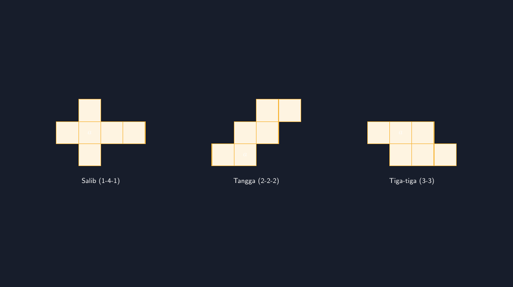
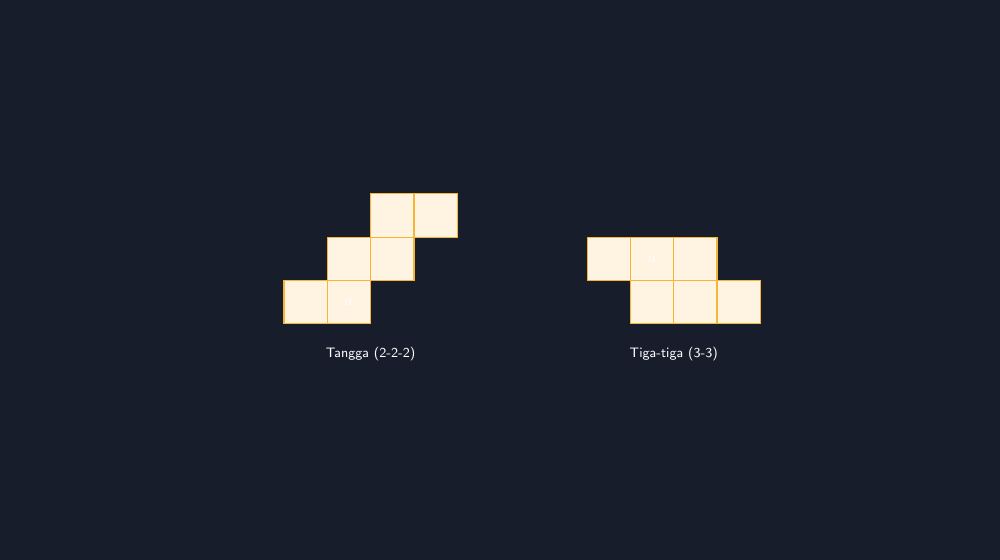

Minggu lalu saya membawa gunting dan karton ke kelas VIII. Rencananya sederhana: siswa memotong jaring-jaring kubus dari lembar kerja yang saya siapkan, lalu melipatnya untuk membuktikan sendiri bahwa kubus punya enam sisi persegi yang sama. Tapi ada satu hal yang selalu mengganggu saya setiap kali mengajar topik ini dengan gambar dari buku paket: gambar jaring-jaringnya sering tidak proporsional. Persegi yang seharusnya sisi kubus itu kelihatan lonjong, jarak lipatannya tidak konsisten, dan anak-anak yang jeli langsung kompak: "Bu, ini kok ukurannya beda, padahal katanya kubus?"

<!--more-->

Pertanyaan itu wajar. Kubus adalah bangun yang "janji"-nya jelas: semua rusuk sama panjang, semua sisinya persegi kongruen. Kalau gambarnya melanggar janji itu, siswa bukan belajar tentang kubus — mereka belajar bahwa gambar matematika kadang bohong. Itu pelajaran yang tidak saya inginkan.

## Jaring-jaring itu sesederhana apa?

Jaring-jaring kubus adalah susunan enam persegi di bidang datar yang, kalau dilipat sepanjang rusuk-rusuknya, menjadi kubus utuh tanpa tumpang tindih. Ada sebuah fakta yang selalu membuat kelas sedikit heboh ketika saya singgung: dari semua cara menyusun enam persegi yang "menempel sepanjang rusuk", hanya **sebelas** yang benar-benar bisa dilipat menjadi kubus. Sisanya, sekilas terlihat masuk akal, ternyata gagal — biasanya karena ada empat persegi yang bertumpuk di satu sisi yang sama, atau karena persegi terpisah yang tidak akan pernah bertemu.

Fakta sebelas ini saya tidak beritahu di awal. Saya hanya bagikan lembar kerja berisi sekitar enam belas susunan persegi — sebelas di antaranya jaring-jaring kubus yang sah, lima yang bukan — dan tugasnya cuma satu: potong, lipat, dan tandai mana yang berhasil. Sisa kelasnya menjadi laboratorium kecil yang riuh: suara gunting, karton terlipat, dan teriakan "yang nomor tiga bohong, Bu!" dari pojok kelas.

## Menggambar jaring-jaring yang jujur dengan TikZ

Untuk lembar kerja itu, saya menggambar semua susunannya dengan TikZ. Kuncinya satu: saya tidak menggambar persegi satu per satu dengan koordinat yang saya karang di tempat, tapi saya definisikan panjang rusuk sekali, misalnya $a = 1$, lalu setiap persegi dibangun dari grid yang konsisten.

Sebagai contoh, bentuk paling klasik — susunan "salib" — saya tulis begini:

```latex
\begin{tikzpicture}[scale=1.2]
  % enam persegi bersisi a=1, susunan salib
  \draw[fill=gray!15] (0,1) rectangle (1,2);  % atas
  \draw[fill=gray!15] (1,1) rectangle (2,2);  % pusat
  \draw[fill=gray!15] (2,1) rectangle (3,2);  % kanan
  \draw[fill=gray!15] (1,2) rectangle (2,3);  % sisi atas kedua
  \draw[fill=gray!15] (1,0) rectangle (2,1);  % bawah
  \draw[fill=gray!15] (3,1) rectangle (4,2);  % sisi kanan kedua
  % label sisi
  \node at (1.5,1.5) {$a$};
\end{tikzpicture}
```

Tidak ada koordinat yang "kira-kira". Persegi pusat mulai di $(1,1)$, persegi di kanannya mulai di $(2,1)$ — satu satuan, sama dengan panjang rusuknya. Kalau saya ganti $a$, cukup ubah `scale`, dan seluruh jaring-jaring ikut berubah dengan tetap jujur. Itu rasa aman yang tidak pernah saya dapat dari gambar hasil salin-tempel.


*Jaring-jaring kubus bentuk salib, digambar dengan koordinat grid yang konsisten. Enam persegi, satu panjang rusuk, tanpa tumpang tindih.*

## Ketika siswa menemukan pola sendiri

Bagian yang saya suka dari aktivitas ini bukan saat siswa berhasil melipat — itu sudah saya duga. Yang menarik justru setelahnya, saat saya minta mereka membandingkan sebelas jaring-jaring yang sah dan mencari "famili"-nya.

Seorang siswa, Rani, membetulkan gigi karton di mejanya lalu bilang, "Bu, kok kayaknya nggak ada yang punya empat persegi sekaligus di satu baris... eh, ada satu yang punya." Dia benar sebagian, dan diskusi menyelesaikan sisanya. Perlahan kelas menemukan pola yang di literatur memang dikenal: ada susunan berbentuk salib, ada "tangga", ada dua baris tiga persegi yang saling menyamping, dan lainnya. Tidak ada yang saya sebut dulu — semua keluar dari karton yang mereka lipat sendiri.

Yang lebih berharga lagi adalah lima susunan yang gagal. Ketika siswa mencoba melipat dan menemukan dua persegi bertabrakan di satu sisi, mereka belajar sesuatu yang tidak bisa diajarkan lewat ceramah: bahwa syarat menjadi jaring-jaring itu ketat. Enam persegi menempel saja tidak cukup; mereka harus bisa "berkumpul" jadi kubus tanpa ada yang bertumpuk.

## Kenapa saya tetap repot-repot dengan TikZ

Sebenarnya saya bisa saja mengambil gambar jaring-jaring dari internet. Tapi pengalaman beberapa tahun mengajar membuat saya curiga pada gambar yang tidak bisa saya pertanggungjawabkan garis per garisnya. Dengan TikZ, gambar itu jadi bagian dari pengetahuan saya sendiri: saya tahu kenapa persegi pusat berada di $(1,1)$, saya tahu kenapa lipatan digambar dengan garis putus-putus, dan saya bisa mengubah susunannya lima menit sebelum kelas kalau tiba-tiba saya ingin menambah satu varian lagi.


*Dua susunan lain yang juga sah: keduanya melipat menjadi kubus utuh. Siswa diminta mencari sendiri lima susunan di lembar kerja yang ternyata gagal.*

Ada juga manfaat kecil yang tak terduga: karena gambar saya buat dari kode, lembar kerja yang sama bisa saya pakai ulang setiap tahun dengan susunan yang saya acak ulang. Siswa tahun ini tidak menerima lembar yang persis sama dengan kakak kelasnya — dan itu murni karena mengubah empat koordinat lebih cepat daripada mengedit gambar.

## Penutup: janji kecil yang harus ditepati

Kubus itu bangun yang menjanjikan kesamaan: enam sisi, semua persegi, semua sama. Mengajar topik ini dengan gambar yang proporsional adalah cara paling sederhana untuk menepati janji itu sejak menit pertama. TikZ membantu saya menepatinya tanpa drama — cukup grid, koordinat yang konsisten, dan sedikit kebiasaan mengukur sebelum menggambar.

Dan kalau Bapak/Ibu ingin mencoba: mulailah dari susunan salib di atas. Enam `rectangle`, satu `scale`. Setelah itu sisakan sisanya untuk siswa — sebelas yang sah dan lima yang bohong masih menyimpan banyak ketawa di kelas.

> 📎 **Berkas TikZ lengkap:** [jaring-jaring-kubus-tikz.tex](tex/jaring-jaring-kubus-tikz.tex) — siap kompilasi (butuh paket `tikz`).