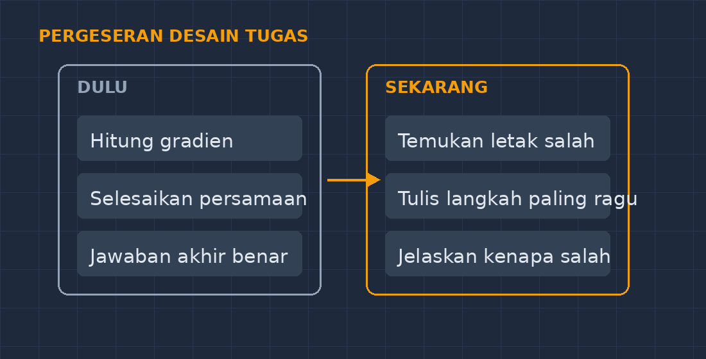

Beberapa waktu lalu saya membagikan PR tentang persamaan garis lurus untuk kelas VIII. Soalnya standar: tentukan gradien dan titik potong dari beberapa persamaan. Keesokan paginya, tiga puluh dua lembar jawaban terkumpul, dan hampir semuanya benar. Rapi, langkahnya lengkap, tulisannya bahkan lebih tertib dari biasanya. Seandainya saya tidak bertanya satu hal kecil, PR itu akan saya nilai sempurna.

Pertanyaannya sederhana: "Coba jelaskan, kenapa kamu pindah $3x$ ke ruas kanan jadi $-3y + b$?"

Anak itu diam lama, lalu jujur: "Saya foto pakai aplikasi, Pak."

<!--more-->

## Jawaban yang datang lebih cepat dari lapar

Ini kenyataan yang tidak bisa kita ubah balik. Siswa kita sekarang punya akses ke mesin yang bisa membaca foto soal matematika dan mengeluarkan jawaban lengkap dengan langkahnya dalam hitungan detik. Bukan cuma anak yang "nakal" — hampir semua anak tahu aplikasinya, dan sebagian besar pernah mencobanya setidaknya sekali. Jarak dari jam pelajaran sampai jawaban instan kini cuma sejauh kantong celana.

Reaksi pertama saya, kalau jujur, adalah marah. Insting guru lama bilang: ini curang, ini membunuh kemampuan berpikir, ini harus dilawan. Saya sempat mengancam akan menurunkan nilai kalau ketahuan pakai aplikasi. Tapi semakin saya pikirkan, semakin saya sadar ancaman itu seperti menutup pintu depan padahal jendelanya terbuka lebar. Aplikasi itu gratis, mudah, dan menurut anak-anak justru "membantu". Melarang tanpa memberi pemahaman kenapa itu merugikan diri sendiri, sama saja dengan menyuruh mereka diam-diam lebih pintar.

## Kenapa PR foto-jawab itu merusak, sebenarnya?

Masalahnya bukan pada anak itu jahat. Masalahnya pada apa yang hilang. Matematika SMP itu bukan soal jawaban akhir; jawaban akhirnya cuma angka. Yang dilatih adalah proses di antaranya: memilih strategi, menghadapi kebuntuan, mencoba jalur lain, sadar sendiri kalau hasilnya tidak masuk akal. Semua kemampuan itu lahir justru di saat *kerepotan* — saat anak harus berjuang beberapa menit sebelum paham.

Aplikasi foto-soal memotong persis bagian itu. Ia memberi kenyamanan yang harganya mahal: rasa "saya bisa" yang palsu. Anak merasa paham karena membaca langkah-langkah yang ditulis rapi oleh mesin, padahal membaca solusi dan mampu memproduksi solusi itu dua keterampilan yang sangat berbeda — seperti menonton video masak dan bisa memasak. Andai bisa, saya ingin menguji istilahnya di minggu berikutnya, tanpa HP, di papan tulis. Biasanya di situlah jembatan keledainya kelihatan.

## Dari melawan ke menyesuaikan: cara saya sekarang

Seiring waktu, saya berhenti berperang melawan teknologi dan mulai mengubah desain tugasnya sendiri. Beberapa hal yang saya coba di kelas, dan ternyata lumayan berhasil:

**Pertanyaan bergeser dari "hitung" ke "hakimi".** Karena jawaban mekanis mudah didapat dari mesin, saya memberi tugas yang justru menuntut penilaian. Contoh: saya tulis satu penyelesaian yang *salah di tengah jalan* — misalnya tanda berubah salah saat pindah ruas — lalu siswa diminta menemukan letak kesalahannya dan menjelaskan kenapa itu salah. Aplikasi foto-soal tidak berguna di sini, karena soalnya bukan menyelesaikan, melainkan mengevaluasi. Menariknya, tipe soal seperti ini justru sejalan dengan arah soal AKM/HOTS yang terus kita dengar.

**Prosesnya yang dikumpulkan, bukan cuma hasil.** Untuk PR tertentu saya minta siswa menuliskan di bagian bawah: satu langkah yang paling membuat mereka ragu, dan kenapa. Anak yang memfoto jawaban justru harus *membaca* solusinya sampai paham untuk bisa menjawab ini — jadi minimal ada usaha berpikir yang tersisa. Tidak sempurna, tapi lebih baik daripada nol.

**Waktu berlatih dikembalikan ke kelas.** Soal-soal rutin sekarang saya habiskan di kelas, dikerjakan berpasangan di papan kecil, sambil saya berkeliling. Yang di rumah tinggal soal penalaran dan refleksi. Ironisnya, kehadiran AI ini memaksa saya kembali ke prinsip lama yang selama ini saya akui sering saya langgar karena keterbatasan waktu: matematika itu butuh didampingi saat belajar, bukan cuma diberi tugas lalu dinilai.

*Perubahan arah tugas saya: dari soal rutin yang bisa difoto, bergeser ke soal penilaian dan refleksi yang justru menghidupkan diskusi.*

Saya juga sadar, anak yang terbiasa mencari jawaban instan perlu diberi pengalaman sukses yang justru datang dari jalan yang lambat. Karena itu saya selipkan satu jenis tugas lagi: soal tantangan mingguan. Satu soal saja, sulit, tidak dinilai benar-salah, tapi harus dikumpulkan dengan catatan "apa yang sudah saya coba dan di mana saya macet". Anak yang biasa foto-soal awalnya frustrasi — tidak ada yang bisa difoto untuk soal seperti ini. Tapi justru di situ letak gunanya: mereka belajar bahwa macet itu bukan tanda bodoh, melainkan tanda sedang berada tepat di batas kemampuan yang bisa dikembangkan. Beberapa anak mulai menikmati rasa penasaran itu, dan itu awal yang baik.

## Mengajak siswa jujur, bukan cuma patuh

Satu hal yang menurut saya paling penting: saya mulai berbicara terbuka soal ini di kelas. Saya cerita sendiri pengalaman memakai AI — termasuk kapan ia membantu (membuat variasi soal latihan, mengecek perhitungan saya sendiri di malam hari) dan kapan ia jebakan (saat kita memakainya untuk melewati proses berpikir). Anak-anak bisa membedakan orang yang bicara jujur dengan orang yang sekadar melarang.

Saya juga menunjukkan eksperimen kecil: saya minta mereka mencoba mengerjakan lima soal tanpa HP minggu ini, lalu minggu depan lima soal dengan bantuan aplikasi, dan mencatat sendiri mana yang lebih membuat mereka paham. Hasil refleksi mereka beragam, tapi hampir semua mengakui hal yang sama: jawaban instan itu lega, tapi cepat hilang dari kepala. Pengakuan dari mulut mereka sendiri jauh lebih berdaya daripada larangan dari mulut saya.

## Penutup: tugas kita yang berubah, bukan hilang

Ada kecemasan di kalangan guru bahwa AI akan membuat kita tidak diperlukan. Pengalaman saya justru sebaliknya — perannya berubah. Kalau dulu tugas guru banyak di bagian "menyampaikan informasi dan mengoreksi jawaban", bagian itu memang semakin bisa dilakukan mesin. Yang tidak bisa digantikan adalah hal-hal yang terjadi di antara anak dan guru: membangun keberanian mencoba, menampung kegagalan tanpa menghakimi, membuat anak sadar bahwa berpikir itu proses yang tidak bisa dipinjam dari aplikasi.

Soal itu kini sudah saya ubah namanya di kepala saya: bukan "PR yang harus diburu jawabannya", melainkan "undangan berpikir yang saya rancang sedemikian rupa sampai memfoto saja tidak cukup". Kadang rancangan saya lolos, kadang tidak. Tapi setidaknya sekarang anak-anak tahu bahwa di kelas saya, yang dinilai bukan seberapa benar jawabannya, melainkan seberapa jujur mereka menghadapi prosesnya.

Dan anehnya, justru sejak itu, ada lebih banyak tangan yang terangkat untuk bertanya di kelas saya. Ternyata anak tidak takut berpikir. Mereka hanya butuh alasan untuk melakukannya sendiri.
