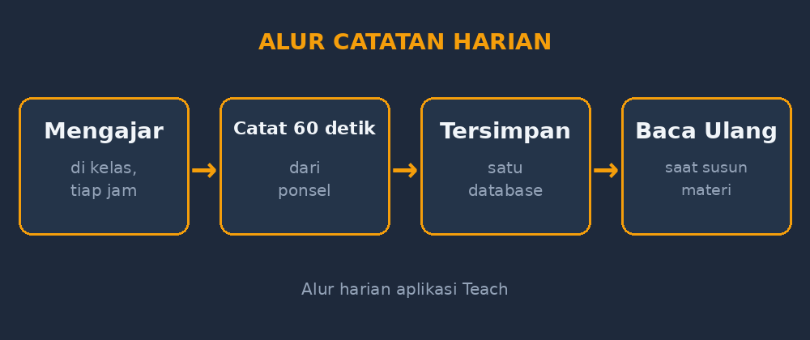
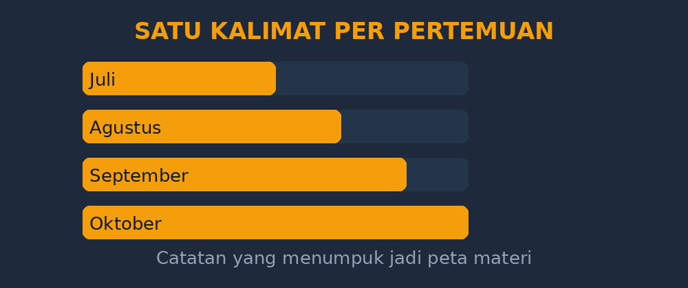

Kalau Bapak/Ibu guru pernah ditanya kepala sekolah atau pengawas, "Coba tunjukkan jurnal mengajarnya?", saya yakin banyak dari kita yang langsung buru-buru membuka lemari, mencari satu-satu buku tulis yang dimulai semangat di Juli lalu perlahan jadi tipis catatannya di September, lalu nyaris kosong menjelang ujian. Saya dulu persis begitu. Dan artikel ini adalah cerita kenapa jurnal mengajar saya sekarang tinggal di sebuah aplikasi web bernama Teach — yang, lagi-lagi, saya bangun sendiri.

## Jurnal yang selalu kalah cepat dari kelas

Saya mengajar matematika di SMPN 1 Punggur. Dengan jadwal yang cukup padat, satu hari bisa empat sampai lima jam pelajaran pindah-pindah kelas. Antara jam ketiga dan jam keempat, biasanya cuma ada waktu lima menit: minum, cek pesan di grup guru, lalu berangkat lagi ke kelas berikutnya.

Pada jurnal kertas, catatan itu selalu kalah. Bukan karena saya malas, tapi karena menulis dengan rapi butuh waktu, dan waktu lima menit itu sering habis untuk hal lain. Jadi saya menunda. "Nanti sore saya tulis ulang yang tadi pagi." Nanti sore berubah jadi nanti malam, nanti malam jadi akhir pekan, dan akhir pekan jadi... lupa. Yang tercatat hanya sebagian, dan yang sebagian itu pun sering ditulis berhari-hari setelah kejadian, saat detailnya sudah kabur.

Nah, masalahnya begini: jurnal mengajar itu baru bernilai kalau jujur dan segar. Refleksi "tadi kelas 8B tersendat di langkah faktorisasi" yang ditulis sore hari masih tajam. Yang ditulis seminggu kemudian jadi generik: "Pembelajaran berjalan dengan baik." Kalimat yang kalau dibaca lagi sebelum mengajar kelas yang sama di tahun berikutnya, tidak memberi apa-apa.

## Titik balik: waktu menulis harus lebih pendek dari waktu mengingat

Ada satu sore di bulan Oktober tahun lalu yang saya ingat jelas. Saya mau menyusun bahan remedial, dan saya butuh mengingat kelas mana saja yang kesulitan di materi pecahan bentuk aljabar. Saya membuka buku jurnal, menghalau debu, dan menemukan catatan seperti ini di tiga halaman berbeda:

> "Kelas 8C: pembelajaran berjalan lancar."
> "Kelas 8C: lanjut materi."
> "Kelas 8C: absen lengkap."

Tidak ada satu pun petunjuk yang bisa saya pakai. Di titik itu saya sadar, masalahnya bukan disiplin saya — meskipun ya, disiplin saya juga ada andilnya — tapi *biaya* menulis terlalu tinggi dibanding manfaat yang terasa saat itu. Kalau mau jurnal yang rutin, menulisnya harus bisa selesai dalam waktu lebih pendek daripada waktu yang saya butuhkan untuk mengingat apa yang terjadi.

Karena kebetulan saya senang utak-atik web — ceritanya sudah sering saya tulis di blog ini, dari GezyCBT sampai GezySlide — saya mulai membuat aplikasi yang sangat sederhana: satu form, tanggal otomatis, dropdown kelas, kolom materi, kolom kehadiran, dan satu kolom refleksi bebas. Dibangun dengan Hono dan SQLite, jalan di VPS saya sendiri. Saya beri nama Teach, dan sekarang hidup di teach.gezytech.web.id.

## Apa yang berubah

Perubahannya bukan sihir, tapi nyata. Beberapa hal yang saya rasakan:

**Menulis jurnal jadi soal 60 detik.** Setelah jam pelajaran selesai, saya buka aplikasi dari ponsel, pilih kelas, ketik dua-tiga kalimat refleksi, selesai. Tidak ada buku yang harus dibawa, tidak ada tulisan yang harus dirapikan. Kalau mau, saya bahas menulis di sela siswa mengerjakan latihan mandiri.

**Data jadi bisa dicari.** Ini yang paling saya syukuri. Sekarang kalau mau tahu "kelas mana saja yang kesulitan di SPLDV", saya ketik kata kuncinya, dan seluruh catatan dari empat kelas paralel muncul berurutan. Dari buku kertas, untuk mendapat gambaran itu saya harus membaca ulang dari awal. Dari database, butuh hitungan detik. Untuk guru yang mengajar banyak kelas paralel, ini perbedaan besar: pola kesulitan antar kelas jadi terlihat, dan itu informasi yang sangat mahal harganya.

*Alur sederhana yang saya jalankan setiap hari: mengajar, mencatat 60 detik, dan data itu menumpuk jadi gambaran besar di akhir semester.*

**Refleksi menumpuk jadi keputusan.** Catatan harian yang dulunya mati di buku sekarang hidup di rapat MGMP internal kecil saya sendiri. Sebelum menyusun rencana pembelajaran semester genap, saya baca ulang catatan semester ganjil. Materi apa yang selalu tersendat di kelas mana. Kapan suatu kelas tiba-tiba bersemangat karena saya mencoba satu metode tertentu. Pola itu tidak muncul dari ingatan — ia muncul dari data yang tertulis konsisten.

**Absensi ikut tercatat.** Kolom kehadiran sederhana ternyata punya nilai lebih dari dugaan saya. Ketika ada wali kelas atau BK yang bertanya tentang pola kehadiran seorang siswa, saya punya datanya, bukan kesan-kesan.

## Yang jujur: aplikasi tidak menyelamatkan jurnal yang malas

Tapi saya juga harus jujur di bagian ini, karena saya tidak mau pembaca membeli mitra yang salah. Aplikasi hanya memindahkan *biaya* menulis, tidak menghapusnya. Ada minggu-minggu kosong juga di Teach — biasanya pekan ujian, atau pekan ketika segala urusan sekolah menumpuk. Bedanya, sekarang saya bisa melihat kekosongan itu dan mengisinya belakangan dari ingatan yang masih cukup segar, karena aplikasi memang tidak memaksa kejadian itu ditulis hari itu juga.

Dan satu pelajaran desain yang saya petik: aplikasi jurnal yang baik itu *membosankan*. Tidak ada notifikasi, tidak ada gamifikasi, tidak ada fitur yang menjerit minta dilihat. Ia cuma harus cepat dibuka dan cepat ditutup. Setiap kali saya tergoda menambah fitur, saya ingat tujuannya: jangan sampai aplikasinya sendiri jadi alasan baru untuk menunda mencatat.

## Rekomendasi kecil untuk Bapak/Ibu yang ingin memulai

Kalau Bapak/Ibu belum punya kebiasaan jurnal mengajar, saya sarankan mulai dari versi paling minim, apapun medianya — buku, Google Form, atau catatan di ponsel. Cukup tiga hal per pertemuan: satu kalimat tentang apa yang berjalan, satu kalimat tentang apa yang tersendat, dan satu kalimat tentang apa yang mau dicoba lain kali. Itu saja. Jangan mulai dari template yang indah; mulai dari yang bisa bertahan sampai bulan ketiga. Keindahan bisa menyusul, kebiasaan tidak.

Bagi saya pribadi, perjalanan dari buku kertas ke aplikasi buatan sendiri ini sebenarnya bagian dari cerita yang lebih besar — sama seperti GezyCBT yang lahir dari malam koreksi yang panjang, atau Multivote yang lahir dari karton pemilihan OSIS. Setiap aplikasi GezyTech lahir dari satu gesekan kecil di pekerjaan mengajar yang nyata, bukan dari ide besar yang menghantui. Kalau Bapak/Ibu punya gesekan serupa — satu pekerjaan mengajar yang terasa berulang dan tidak bernilai — mungkin dari situ juga bisa lahir sesuatu. Kalau tidak, ya tidak apa-apa; yang penting gesekannya berkurang.

Sekarang, ketika ditanya "tunjukkan jurnal mengajarnya", saya tinggal membuka satu tautan. Tapi yang lebih saya hargai bukan itu — melainkan saat menyusun bahan ajar tahun ini, saya tahu persis di titik mana kelas 8B pernah tersendat tahun lalu, dan kenapa. Itu memori mengajar yang akhirnya tidak hilang ditelan waktu.

*Satu kalimat refleksi per pertemuan terlihat kecil. Empat bulan kemudian, ia menjadi peta materi yang bisa dibaca ulang kapan saja.*
