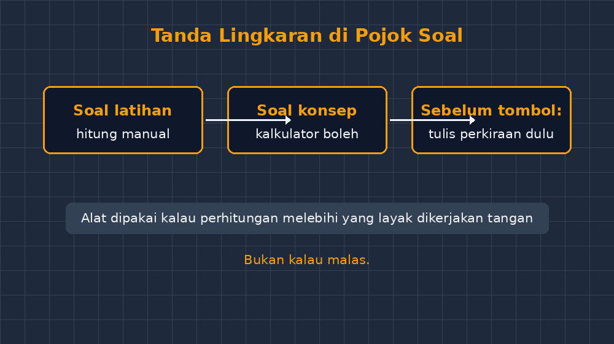

Semester lalu, saat kelas VIII sedang mengerjakan latihan bangun ruang, saya menangkap seorang siswa mengeluarkan HP dari saku celana dengan gerakan yang jelas terlatih — agak merunduk, satu tangan menutupi layar. Saya pikir dia sedang mengobrol atau membuka media sosial. Ternyata bukan. Dia membuka aplikasi kalkulator, menghitung $3{,}14 \times 7 \times 7 \times 12$ dengan serius, lalu menutup HP lagi dan melanjutkan menulis di buku.

Anehnya, saya tidak marah sebesar yang saya bayangkan. Yang saya rasakan malah agak sedih sekaligus tersindir. Selama ini kelas saya memang melarang kalkulator. Kalau ada yang hitungannya meleset, teguran pertama biasanya cukup. Tapi malam itu di rumah saya bertanya-tanya: siswa itu sebenarnya sedang berbuat apa? Dia sedang *memilih alat*. Dia memutuskan bahwa perhitungan panjang itu tidak layak menghabiskan tenaganya, dan dia butuh jawaban yang benar agar kesimpulan soal luas permukaan tabungnya tidak salah karena faktor selain pemahaman. Secara matematika, keputusan itu sebenarnya cukup matang. Sayangnya dia melakukannya secara diam-diam, karena di kelas saya alat itu ilegal.

## Aturan yang lama dipertahankan tanpa pernah ditinjau

Larangan kalkulator di sekolah SMP kami hampir seperti adat. Alasannya klasik dan sebagian benar: siswa harus lancar berhitung dasar, kalau semua dihitung mesin maka kemampuan numerasi akan tumpul. Saya pernah melihat sendiri siswa kelas IX yang bingung mencari 10% dari 200 tanpa alat bantu — bukan karena tidak paham konsep persen, tapi karena otot hitungnya memang jarang dilatih.

Tapi ada sisi lain yang jarang kita bicarakan. Banyak soal di buku dan di ujian tidak menguji kecakapan berhitung, melainkan menguji *pemahaman prosedur yang panjang*. Untuk mencari volume tabung, siswa harus mengalikan tiga bilangan desimal. Kesalahan perkalian $3{,}14 \times 49$ sama sekali tidak memberi tahu saya apakah siswa paham konsep volume atau tidak — dia bisa saja paham sempurna tapi meleset di angka keenam setelah koma. Ketika satu soal mencampur pemahaman konsep dan ketelitian hitung, nilai yang saya dapat jadi campuran dua hal yang berbeda, dan saya sulit mendiagnosis yang mana yang bermasalah.

Jadi masalahnya sebenarnya bukan kalkulator itu sendiri. Masalahnya, selama ini saya melarang alat tanpa pernah mengajarkan siswa *kapan alat itu pantas dipakai*. Kita melarang tanpa mendidik, dan siswa yang butuh alat akan memakainya diam-diam — seperti siswa dengan HP di sakunya itu.

## Kapan alat dipakai, kapan tidak?

Musim ini saya coba ubah aturan mainnya. Bukan jadi bebas total, tapi jadi eksplisit. Setiap lembar kerja sekarang punya penanda sederhana: jika ada tanda lingkaran kecil di pojok soal, kalkulator boleh dipakai. Kalau tidak, harus hitung manual. Dengan satu tanda itu, diskusi di kelas berubah jauh lebih menarik daripada yang saya duga.

Pertama, tanda lingkaran memaksa saya jujur merancang soal. Kalau soal itu menguji pemahaman luas permukaan, ya saya beri tanda — karena yang ingin saya lihat adalah langkah-langkahnya, bukan ketelitian mengalikan 3,14. Kalau soal itu memang latihan operasi hitung, tanda itu tidak saya berikan, dan alasannya bisa saya jelaskan terbuka ke siswa: "soal ini sedang melatih otot hitung kalian."

Kedua, siswa mulai berdebat soal penandaan itu sendiri. Ada yang bertanya, "Pak Gun, kalau tanda lingkarannya di soal nomor 3, tapi hitungannya cuma $12 \times 5$, ngapain pakai kalkulator?" Pertanyaan seperti itu justru emas. Itu pertanyaan tentang *keputusan penggunaan alat* — keterampilan yang di dunia nyata jauh lebih penting daripada kecepatan mengalikan. Saya jadi bisa mengajarkan sesuatu yang dulu tidak pernah punya tempat di kelas saya: alat itu dipakai kalau perhitungannya melebihi yang layak dikerjakan tangan, bukan kalau malas.

Ketiga, dan ini yang paling tidak saya duga, latihan hitung manual justru terasa lebih disiplin. Karena kini hitung manual punya alasan yang jelas ("soal ini latihan berhitung"), siswa tidak merasa diberi hukuman pekerjaan membosankan. Mereka tahu kapan mode "latihan" dan kapan mode "pekerjaan sungguhan".

## Kekhawatiran yang tetap ada

Saya tidak mau terdengar seperti orang yang menyerah begitu saja pada zaman digital. Kekhawatiran saya yang lama masih sah. Kemampuan estimasi itu rapuh: siswa yang terbiasa menekan tombol akan menelan hasil $\frac{1}{8} = 0{,}125$ sebagai kebenaran tanpa pernah merasakan maknanya. Ada siswa yang pernah menjawab keliling lingkaran berjari-jari 7 cm dengan angka 43,96 lalu tidak curiga sedikit pun padahal diameter baru 14 cm — artinya keliling tiga kali diameter, harusnya terasa "sekitar 44". Angka itu benar, tapi rasa matematika untuk menyaringnya tidak pernah terbentuk kalau semua angka datang dari mesin.

Karena itu, di kelas saya sekarang ada kebiasaan kecil yang saya paksa: sebelum menekan tombol, siswa harus menulis perkiraan kasarnya dulu. "43,96 itu masuk akal tidak untuk lingkaran yang diameternya 14 cm?" Kalau perkiraan dan hasil mesin beda jauh, ada yang harus diperiksa — biasanya salah ketik, kadang salah rumus. Kebiasaan menaksir dulu ini ternyata juga melatih rasa bilangan, mungkin bahkan lebih efektif daripada sepuluh soal perkalian panjang.

## Ujian tetap tanpa kalkulator, dan itu tidak masalah

Ada pertanyaan wajar dari rekan guru: kalau latihan boleh pakai kalkulator, bagaimana dengan ujian yang melarangnya? Saya pilih menjawab dengan jujur ke siswa: ujian itu menguji kemampuan berhitung tanpa alat, jadi ada latihan khusus untuk itu, dan latihan itu diberikan secara terprogram — bukan sesekali muncul sebagai kejutan. Bedanya dengan dulu, siswa sekarang tahu bahwa larangan kalkulator di ujian adalah *pilihan pengukuran*, bukan hukum alam. Mereka memahami kenapa, dan anehnya itu membuat mereka lebih kooperatif daripada saat aturan hanya dipaksakan.

Pengalaman kecil ini juga mengingatkan saya pada pola yang sama di tempat lain. Saya pernah menulis soal siswa yang memfoto soal untuk ditanyakan ke AI, dan soal siswa yang langsung percaya jawaban AI yang salah. Semuanya bermuara ke satu hal yang sama: teknologi tidak bisa dilawan dengan melarang, tapi bisa dikelola dengan mengajarkan *pertimbangan*. Siswa kita akan hidup di dunia yang penuh alat hitung, mesin pencari, dan asisten AI. Yang membedakan mereka bukan punya atau tidaknya alat, tapi bisa atau tidaknya memutuskan kapan alat itu membantu dan kapan alat itu menggantikan otak mereka.

## Penutup: siswa dengan HP di saku

Balik ke siswa yang saya tangkap basah itu. Beberapa minggu setelah aturan baru berjalan, dia datang ke saya untuk hal yang tidak kuduga: menanyakan cara mencari akar kuadrat 2401 dengan cara manual, karena soal latihannya tidak bertanda lingkaran dan dia ingin paham, bukan sekadar menjawab. Saya tidak tahu apakah momen ini akan bertahan sampai akhir semester. Tapi untuk pertama kalinya dalam bertahun-tahun mengajar, larangan kalkulator di kelas saya bukan lagi tembok yang harus dihindari secara diam-diam — dia jadi bahan diskusi yang terbuka, dengan alasan yang bisa dipahami semua pihak.

Kalau Bapak/Ibu guru masih berada di posisi yang sama dengan saya dulu — melarang karena memang begitunya adat — mungkin coba saja tanya balik ke diri sendiri: apa yang sebenarnya ingin saya ukur dari soal ini? Kalau jawabannya bukan kecepatan berhitung, mungkin yang perlu diubah bukan sikap siswa, tapi penanda di pojok soal kita.
