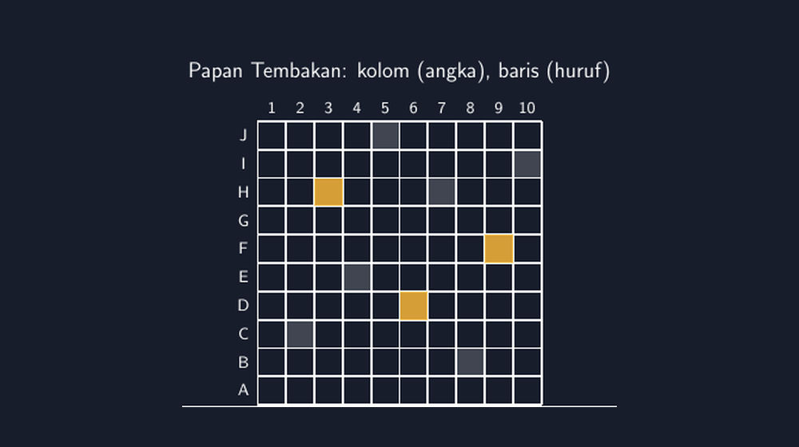

Kalau Bapak/Ibu pernah main kapal-kertas (battleship) semasa kecil, mungkin ingat bagaimana seriusnya wajah kita saat menyebut "E-5!" sambil menahan napas. Tembakan itu bisa mengenai kapal lawan, atau hanya mendarat di laut kosong. Yang tidak kita sadari waktu itu: kita sedang berlatih membaca koordinat. Kolom dan baris, urutan yang tidak boleh tertukar, dan konsekuensi nyata kalau salah baca — tembakan kita mendarat di tempat yang salah, dan lawan tertawa.

<!--more-->

Pengalaman itu yang coba saya bawa ke kelas VII tahun ini, saat materi koordinat Kartesius mulai disentuh. Dua tahun terakhir saya mengajar materi ini dengan cara yang biasa: papan koordinat di papan tulis, titik-titik diplot satu per satu, latihan soal "tentukan koordinat titik A, B, dan C". Hasilnya standar. Sebagian besar murid bisa, tapi ada yang menunjuk $(3, 5)$ padahal maksudnya $(5, 3)$ — dan itu tetap dianggap "salah kecil" yang muncul lagi dan lagi di ulangan berikutnya.

## Urutan yang Tidak Bisa Ditawar

Miskonsepsi yang paling bandel di materi ini bukan soal angkanya, tapi soal *urutannya*. Kebiasaan resmi matematika memang menyepakati sumbu mendatar (absis) disebut dulu, baru sumbu tegak (ordinat). Tapi murid tidak hidup dengan "kebiasaan resmi" itu. Bagi mereka, $(3, 5)$ dan $(5, 3)$ terasa seperti dua tulisan yang sama saja. Kenapa harus ada urutan? Angkanya kan sama dua-duanya.

Di papan tulis, pertanyaan itu susah dijawab dengan meyakinkan. Jawaban "karena begitu kesepakatannya" terdengar seperti aturan paksaan. Tapi di permainan kapal-kertas, jawabannya datang sendiri: karena kalau urutannya tertukar, tembakanmu nyasar. Tidak ada guru yang perlu menjelaskan apa-apa. Papan permainannya sendiri yang mengajarkan.

Saya buat papan permainannya sederhana. Kolom diberi nomor 1 sampai 10, baris diberi huruf A sampai J — sama seperti papan kapal-kertas klasik, dan seperti yang saya gambar ulang dengan TikZ di bawah ini:

Kenapa huruf dan angka, bukan angka dan angka? Karena di tahap ini saya belum mau memperkenalkan $(x, y)$ secara formal. Dulu saya pernah langsung terjun ke pasangan terurut, dan murid yang masih bingung "mana yang mana" langsung kewalahan sebelum sempat paham ide dasarnya. Huruf dan angka membuat dua sumbu itu terasa benar-benar berbeda — kolom itu dunia angka, baris itu dunia huruf, dan menyebut keduanya jadi satu alamat: E-5. Menyebutnya terbalik ("5-E") terasa aneh di mulut, dan ketidaknyamanan kecil itu justru mengajarkan urutan lebih cepat daripada semua penjelasan saya.

## Dari Papan Permainan ke Bidang Koordinat

Permainannya berjalan berpasangan. Tiap murid punya papan kapal sendiri (biasanya tiga kotak, misalnya) dan papan tembakan untuk mencatat serangan ke lawan. Aturannya persis kapal-kertas klasik: sebut satu alamat, lawan menjawab "kena" atau "lewat". Yang menarik, murid yang biasanya diam di bangku belakang ikut teriak alamat dengan semangat yang sama seperti anak-anak yang rajin.

Setelah dua sesi permainan, barulah saya tarik jembatannya ke bidang koordinat formal. Papan itu digambar ulang di papan tulis — kali ini kedua sumbu bernomor, huruf A sampai J diganti 1 sampai 10. Alamat E-5 dipakai menjadi perbandingan: dulu baris huruf kelima dengan kolom angka kelima, sekarang jadi $(5, 5)$. Tapi sumbu mendatar tetap disebut dulu, seperti kebiasaan kita menyebut kolom sebelum baris.

Di titik ini miskonsepsi lama mulai goyah. Murid yang dulu selalu tertukar $(3, 5)$ dan $(5, 3)$ sekarang punya cerita untuk membandingkan: "kalau di papan kemarin, ini kolom 3 baris 5, bukan sebaliknya." Permainan itu memberi mereka *pengalaman* tentang urutan, bukan sekadar aturan yang dihafal. Dan pengalaman jauh lebih sulit dilupakan daripada aturan.

Saya juga menghubungkan ini dengan kebiasaan yang sudah mereka kenal sehari-hari: kursi di kelas. Kalau saya sebut "baris ketiga, kursi kedua dari jendela", murid langsung tahu kursi siapa yang saya maksud. Koordinat pada dasarnya hanya alamat yang lebih rapi, dengan kesepakatan yang konsisten.

## Ketika Kalah Jadi Guru

Satu hal yang paling saya sukai dari permainan ini: kalah karena salah baca koordinat itu tidak memalukan. Murid yang tembakannya nyasar karena tertukar urutan tidak mendapat nilai merah atau catatan "kurang teliti". Dia hanya mendapat papan yang kosong di tempat yang dia kira ada kapalnya — dan lawan yang menyeringai. Umpan balik itu langsung, jujur, dan tidak menghakimi.

Bandingkan dengan cara lama saya: murid yang salah menuliskan koordinat di lembar kerja baru tahu kesalahannya seminggu kemudian, setelah koreksi saya selesai. Saat itu semangatnya sudah turun, dan kesalahan itu sudah jadi kebiasaan yang lebih sulit diluruskan. Di permainan, umpan baliknya datang dalam hitungan detik, saat kesalahan masih hangat dan mudah dikoreksi.

Ada juga efek samping yang tidak saya rencanakan. Beberapa murid mulai berbicara tentang *strategi*: alamat mana yang paling mungkin mengenai kapal kalau kapalnya panjang tiga kotak dan bisa diletakkan mendatar atau menegak. Mereka tidak sadar sedang berpikir tentang kombinasi, jarak, dan asosiasi pola. Untuk tingkat SMP kelas VII, itu sudah pekerjaan matematis yang layak — dan terjadi karena permainan, bukan karena saya menyuruh.

## Catatan untuk Kali Depan

Meski begitu, permainan ini bukan obat ajaib. Ada beberapa hal yang perlu saya perbaiki kalau mengulang tahun depan. Pertama, waktu. Dua sesi permainan terasa pas, tapi sesi ketiga mulai membosankan bagi sebagian murid — mereka sudah paham idenya dan ingin materi bergerak. Permainan yang bagus tahu kapan harus berhenti.

Kedua, papan yang terlalu besar bisa membuat murid kehilangan jejak. Papan $10 \times 10$ cukup, tapi untuk kelas yang muridnya masih ragu-ragu, papan $6 \times 6$ terasa lebih ramah. Tidak ada yang malu karena papan kecilnya lebih mudah dibaca.

Ketiga, dan ini yang paling penting: jembatan ke bidang koordinat formal tidak boleh dilewati. Permainan yang berhenti di "E-5" hanya menghasilkan murid yang pandai main kapal-kertas. Sesi plot titik formal dengan pasangan terurut tetap harus ada, tapi sekarang murid masuk ke sesi itu dengan bekal pengalaman, bukan bekal ketakutan.

Bapak/Ibu yang kebetulan sedang mengajar koordinat Kartesius mungkin bisa mencoba. Bahan-bahannya sederhana: kertas bergaris kotak, pensil, dan kesediaan kita membiarkan kelas sedikit lebih ribut dari biasanya selama satu jam pelajaran. Noise yang muncul itu bukan tanda kelas tidak terkendali — itu tanda murid sedang sibuk memikirkan alamat mana yang harus disebut berikutnya.

> 📎 **Berkas TikZ lengkap:** [kapal-kertas-koordinat-kartesius.tex](tex/kapal-kertas-koordinat-kartesius.tex) — siap kompilasi (butuh paket `tikz`).
