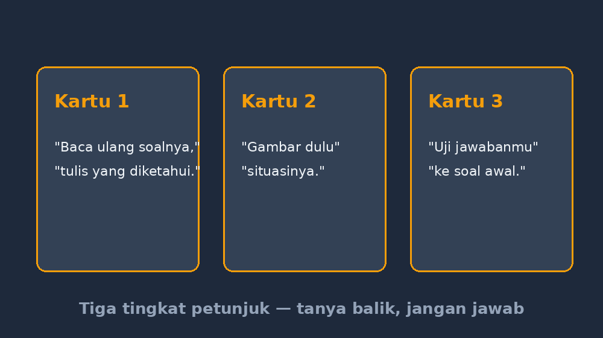

Ada satu momen di kelas yang entah kenapa paling sering saya ingat kalau pulang mengajar: siswa mengangkat tangan, saya datang, dan tiga puluh detik kemudian saya sudah menjelaskan langkah ketiga padahal dia belum selesai memikirkan langkah pertama. Saya menolong. Setidaknya itu yang saya kira. Tapi kalau dilihat lagi, yang saya lakukan sebenarnya cuma satu: mencuri soalnya dari tangannya.

Sudah lama saya tahu teorinya. scaffolding, pinggiran, bantuan yang dikurangi sedikit demi sedikit. Tapi antara tahu dan melakukan di tengah empat puluh anak yang menunggu, jaraknya lumayan jauh. Yang terjadi biasanya begini: siswa bilang "Bu, saya tidak paham," saya bertanya bagian mana yang tidak paham, dia jawab "semuanya," dan daripada percakapan berlarut, saya langsung tunjukkan. Lima menit kemudian dia mengangkat tangan lagi. Dan begitu terus sampai bel.

<!--more-->

## Tiga puluh detik yang terlalu cepat

Masalahnya bukan saya tidak mau sabar. Masalahnya adalah menolong itu ... mengasyikkan. Kalau saya jelaskan langkah penyelesaian persamaan $3x + 5 = 20$, siswa mengangguk-angguk, catat, dan terlihat puas. Ada rasa "berhasil" yang datang instan, buat saya dan sepertinya juga buat dia. Tapi puasnya siswa itu terhadap penjelasan saya, bukan terhadap kemampuannya sendiri. Besok, soal serupa dengan angka berbeda, tangan itu naik lagi.

Saya mulai menghitung satu hal yang mengejutkan saya sendiri: berapa banyak waktu kelas yang saya habiskan untuk "menolong" dengan cara seperti itu. Kalau saya menolong satu siswa selama dua menit, sepuluh kali naik tangan berarti dua puluh menit — dan siswa yang lain juga tahu triknya: angkat tangan, tunggu, terima jawaban. Semua orang sibuk, tapi tidak ada yang banyak berpikir.

## Kartu-kartu kecil di meja kelompok

Solusi yang akhirnya bertahan sampai sekarang sederhana sekali, dan saya akui sebagian lahir dari rasa malu sendiri. Saya menulis tiga kalimat di kartu-kartu kertas, laminasi kasar dengan selotip, dan menaruh satu set di setiap meja kelompok. Aturannya saya umumkan dengan nada setengah bercanda: "Kalau Bu masih ada di kelas dan kalian macet, angkat kartu dulu sebelum angkat tangan."

Kartu pertama berbunyi: *"Baca ulang soalnya, lalu tulis apa yang diketahui."* Terdengar terlalu umum? Justru di sinilah sebagian besar kebuntuan sebenarnya berada. Banyak siswa yang bilang tidak paham ternyata belum pernah membaca soal sampai selesai dengan niat memahami. Mereka membaca sambil panik, melihat angka-angka berlalu, lalu menyerah. Kartu ini memaksa mereka kembali ke langkah paling awal yang tidak membutuhkan saya sama sekali.

Kartu kedua: *"Coba gambar dulu situasinya."* Untuk soal cerita — dan saya memang banyak memberi soal cerita — hampir selalu ada sketsa yang bisa dibuat: garis untuk perjalanan, kotak untuk kubus, panah untuk perbandingan. Menggambar memindahkan beban dari memori ke kertas. Siswa yang tadinya melihat soal sebagai dinding, tiba-tiba punya sesuatu yang bisa ditunjuk.

Kartu ketiga: *"Uji jawabanmu kembali ke soal awal."* Kartu ini dipakai bukan saat macet, tapi setelah punya jawaban. Kalau hasilnya tidak masuk akal — berat bayi 300 kg, panjang pensil 17 m — kartu ini menyuruh mereka menemukan sendiri letak kelirunya, jauh sebelum saya sempat datang ke meja mereka.

Efek yang paling saya rasakan bukan sesuatu yang dramatis. Tidak ada momen "kelas berubah total." Yang berubah adalah frekuensi. Naik tangan tanpa mencoba kartu dulu makin jarang, karena teman sebangkunya justru yang menunjuk kartu: "Eh, kartu satu dulu." Menariknya, siswa saling mengingatkan lebih efektif daripada peringatan saya. Aturan yang dijaga teman sebangku beratnya berbeda dari aturan yang dijaga guru.

## Kalau kartu sudah habis, baru saya masuk

Aturan kedua yang saya tambahkan kemudian: kalau ketiga kartu sudah dicoba dan tetap macet, siswa boleh memanggil saya — tapi wajib menyebutkan satu hal yang sudah mereka coba. Kalimatnya harus diawali, "Bu, saya sudah baca ulang soal dan tulis yang diketahui, tapi masih buntu di ..." Bagian "tapi masih buntu di" itu emas. Dari kalimat setengah panjang itu, saya langsung tahu di mana hambatannya, dan penjelasan saya jadi pendek — dua menit menunjuk titik yang tepat, bukan lima menit menceritakan ulang seluruh soal.

Ada juga siswa yang memakai kartu untuk berpura-pura sibuk, tentu saja. Anak-anak itu pintar menemukan celah. Tapi bahkan pura-pura itu masih lebih baik daripada langsung menerima jawaban: minimal mereka membaca soalnya dua kali. Dan waktu berjalan, pura-puranya lupa sendiri karena kartu kedua menuntut mereka menggambar, dan menggambar tidak bisa dilakukan sambil mengobrol.

Saya pernah menghitung dengan jurnal mengajar harian saya: setelah dua bulan, jumlah pertanyaan "Bu, ini gimana?" yang benar-benar sampai ke saya turun dari sekitar dua puluh per pelajaran jadi sekitar tujuh atau delapan. Yang tersisa hampir semuanya pertanyaan yang layak ditanyakan — pertanyaan tentang ide, bukan pertanyaan karena belum membaca. Sisanya, waktu itu kembali ke siswa yang sedang berpikir.

## Tanda yang paling saya tunggu

Ada satu suara yang muncul belakangan dan justru menjadi tanda keberhasilan yang paling saya hargai: "Bu, kartunya kurang satu!" Siswa kelas VII menemukan soal yang menurut mereka tidak terjawab oleh kartu mana pun — soal tentang himpunan yang tidak bisa digambar sebagai situasi. Lalu mereka mengusulkan kartu keempat, dan menulis sendiri kalimatnya: *"Tulis saja semua angkanya, lihat yang mana nyambung."* Rancu, tapi arahnya benar. Kami rapikan bersama di papan.

Saat itu saya sadar, kartu-kartu itu sudah berhenti menjadi alat dari saya. Mereka menjadi milik kelas. Siswa tidak lagi menunggu saya untuk menolong; mereka menolong diri sendiri dulu, lalu saling menolong. Peran saya bergeser dari penjawab soal menjadi sesuatu yang lebih mahal: orang yang muncul tepat saat bantuan benar-benar dibutuhkan, dan hilang secepat mungkin setelah itu.

Kalau Bapak/Ibu mau mencoba, tidak perlu kartu yang cantik. Kertas HVS, spidol, selotip — cukup. Yang penting cuma dua: petunjuknya harus berbentuk tindakan yang siswa bisa lakukan sendiri (bukan pertanyaan yang membutuhkan jawaban dari guru), dan jumlahnya sedikit. Tiga sudah pas. Lebih dari itu, kartu akan menjadi dinding yang sama seperti soal yang mereka hindari.

Saya tidak lagi menganggap diri saya sudah selesai dengan soal ini. Masih ada siswa yang pandai menghindari kartu, masih ada jam di mana saya kelelahan dan kembali menjelaskan terlalu cepat. Tapi sekarang kalau itu terjadi, biasanya ada siswa yang berbisik ke temannya, "Kartu satu dulu, jangan langsung tanya Bu." Mendengar kalimat itu dari mulut mereka, bukan dari mulut saya — itu penolong sejati di kelas saya. Saya cuma yang pertama menulisnya di kertas.

---

*Kalau Bapak/Ibu mencoba kartu petunjuk di kelas masing-masing, saya senang sekali mendengar kalimat petunjuk apa yang akhirnya cocok untuk murid-murid di sana. Tulis di kolom komentar, atau ceritakan lewat surel.*
