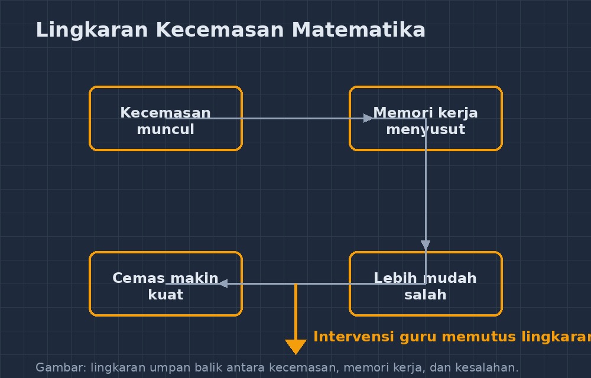

Kemarin saya mengoreksi ulangan statistika kelas VIII. Ada satu anak — sebut saja Rani — yang lembar kerjanya saya hafal bentuknya: kosong di nomor satu sampai tiga, lalu di nomor empat tiba-tiba muncul pekerjaan yang rapi, hitungannya benar semua sampai selesai. Persisnya seperti ulangan dua bulan lalu. Dan bulan sebelumnya lagi.

<!--more-->

Ketika saya tanya di luar jam pelajaran, jawabannya sederhana tapi menusuk: "Saya kalau lihat nomor pertama susah, jadi bingung semua, Pak." Bukan dia tidak belajar. Bukan dia tidak bisa. Dia menghitung rata-rata di pekerjaan rumah dengan benar, bahkan membantu temannya menjelaskan. Tetapi begitu lembar ulangan berbalik di mejanya dan nomor pertama terlihat rumit, sesuatu di kepalanya seperti menutup pintu.

Saya yakin Bapak/Ibu guru pernah bertemu murid seperti Rani. Anak yang *bisa* tetapi *merasa tidak bisa* — dan perasaan itu ternyata cukup kuat untuk membuat kemampuannya benar-benar tidak keluar.

## Kecemasan matematika itu bukan mitos

Dunia penelitian pendidikan matematika punya nama untuknya: *math anxiety*. Bukan sekadar "malas" atau "tidak percaya diri" dalam arti longgar. Kecemasan matematika adalah respons ketakutan yang muncul ketika seseorang dihadapkan pada tugas bermatematika — dan respons itu memakan sumber daya pikir yang seharusnya dipakai untuk menyelesaikan soal.

Cara kerjanya kurang lebih begini. Kapasitas memori kerja kita terbatas; itulah "meja kerja" di kepala tempat kita menaruh angka sementara, menyimpan langkah, dan memeriksa hasil. Ketika cemas, sebagian meja itu terisi oleh pikiran yang mengganggu: *"aku pasti salah"*, *"temanku sudah selesai"*, *"ini pasti susah"*. Sisa meja yang dipakai untuk matematika menyusut. Akibatnya siswa memang menjadi lebih banyak salah — dan kesalahan itu memperkuat kecemasan untuk kesempatan berikutnya.

Lingkaran yang berputar begitu terus. Yang bikin saya geleng-geleng: kecemasan ini bahkan bisa muncul pada siswa yang nilainya tidak buruk. Penelitian yang cukup terkenal menemukan bahwa ada anak-anak dengan capaian tinggi yang tingkat kecemasannya juga tinggi. Mereka lulus ujian, tetapi membawa trauma kecil setiap kalinya — dan sering kali mereka yang berhenti memilih matematika lebih cepat, bukan karena tidak mampu, tetapi karena merasa tidak sanggup lagi memikul perasaan itu.

## Membaca gejalanya di kelas

Setelah bertahun-tahun mengajar, saya mulai bisa mengenali beberapa pola yang (diduga kuat) lebih ke kecemasan daripada ketidakmampuan:

Pertama, soal kosong di awal, jawaban muncul di tengah atau akhir. Seperti Rani. Beban terbesar ada di menit-menit awal; begitu satu soal berhasil dikerjakan, tekanannya turun dan sisanya keluar.

Kedua, siswa yang berkata "belum" padahal belum mulai mencoba. Ada murid saya yang kalau saya tanya "kenapa belum kerja" selalu menjawab "belum, Pak" — bukan "tidak bisa" atau "sudah coba tapi bingung". Kata *belum* itu sebenarnya penanda: dia belum pernah benar-benar memulai karena tidak berani menghadapi kemungkinan gagal di lembaran pertama.

Ketiga, perubahan watak saat pelajaran matematika. Anak yang cerewet di pelajaran lain diam membeku di jam matematika. Anak yang rajin bertanya di IPA tiba-tiba hanya menunduk di kelas saya.

Gejala keempat paling menyakitkan untuk dilihat: siswa yang memperhatikan cara mengerjakan teman sebangkunya dulu sebelum mencoba. Dia *bisa* menyelesaikan soalnya, tetapi tidak berani memasang jawaban sendiri tanpa kalibrasi dengan orang lain. Di kelas yang padat, perilaku ini mudah lolos dari mata — bahkan bisa terlihat seperti kerja sama.

## Apa yang saya coba ubah

Saya tidak akan berpura-pura punya resep ajaib. Tetapi ada beberapa hal kecil yang selama dua tahun terakhir saya ubah, dan yang menurut saya lumayan membantu.

**Satu, membongkar mitos "cepat berarti pintar".** Di kelas saya dulu, urutan selesai mengerjakan soal terasa seperti penghargaan terselubung — murid yang selesai duluan dianggap paling jago. Sekarang saya secara eksplisit bilang: matematika bukan lomba kecepatan, dan saya akan selalu menunggu. Saya juga mengurangi soal-soal "cepat menjawab" di kuis harian, karena format itu justru menyogok kecemasan.

**Dua, memberi jalan masuk yang landai di ulangan.** Setelah insiden Rani, saya mulai menata soal ulangan supaya nomor pertama adalah soal yang hampir pasti bisa dikerjakan semua orang — sesuatu yang menurut mereka "terlalu mudah untuk ulangan". Ternyata itu bukan kelemahan soal, melainkan pemanasan. Murid yang berhasil menggaruk satu jawaban benar di nomor satu datang ke nomor dua dengan meja kerja yang lebih bersih. Rani sendiri, di ulangan berikutnya, akhirnya mengisi dari nomor satu — dan kertasnya tidak kosong lagi di bagian mana pun.

**Tiga, mengubah kata yang saya pakai.** Saya berhenti berkata "yang tidak bisa, coba lagi" dan mulai berkata "yang belum ketemu, boleh coba cara lain". Perbedaannya terdengar kosmetik, tetapi kata *tidak bisa* itu penutup, sedangkan *belum ketemu* itu masih terbuka. Ada penelitian yang menyebut kekuatan kata *yet* — "belum" — dan saya percaya versi Indonesianya bekerja sama kuatnya, asal dikatakan sungguh-sungguh, bukan sekadar jargon.

**Empat, melegitimasi kesalahan di depan kelas.** Kalau saya salah menghitung di papan (dan ini sering, jujur), saya tidak menutupinya. Saya bilang, "Nah, lihat, Pak tadi salah di langkah ini. Mana yang aneh? Bagian mana yang tidak masuk akal?" Saya ingin murid melihat bahwa kesalahan bukan bencana yang harus disembunyikan, melainkan bahan kerja biasa. Kecemasan hidup dari rasa malu; kalau malu dilucuti, kecemasan kehilangan pakannya.

## Yang tetap jadi pekerjaan rumah saya

Ada satu bagian yang belum saya selesaikan: asesmen. Selama nilai ulangan tetap jadi satu-satunya ukuran yang "berarti" di rapor dan di mata orang tua, sebagian kecemasan itu struktural — bukan sesuatu yang bisa diatasi dengan kata-kata hangat sebelum ujian. Murid tahu lembar itu menentukan. Tidak ada trik pedagogis yang benar-benar meniadakan itu.

Yang bisa saya lakukan adalah memperbanyak jalan lain untuk menunjukkan bisa: kerja kelompok kecil, presentasi singkat, tangga nilai dari tugas rutin — sehingga satu lembar ulangan tidak lagi memikul seluruh beban penilaian. Sebagian dari ini sudah saya jalankan, sebagian masih bertahap.

Dan ada satu hal lagi yang saya pegang: murid yang cemas matematika tidak butuh dikasihani seperti orang lemah. Dia butuh dirawat seperti atlet yang cedera — masih pegang potensinya, hanya jalannya perlu diperbaiki. Rani, siapa tahu suatu hari, tidak akan lagi membuka lembar ulangan dengan perut yang tidak enak. Untuk itu saya terus mencoba, satu nomor soal yang ramah demi satu kata *belum* yang diucapkan sungguh-sungguh.

Kalau Bapak/Ibu punya murid yang "bisa tapi merasa tidak bisa", coba dilihat lembar jawabannya: kosong di awal, rapi di tengah? Mungkin bukan soal kemampuan. Mungkin cuma pintu di kepalanya yang butuh didorong lebih lembut — dari sisi dalam, bukan didorong masuk dari luar.
