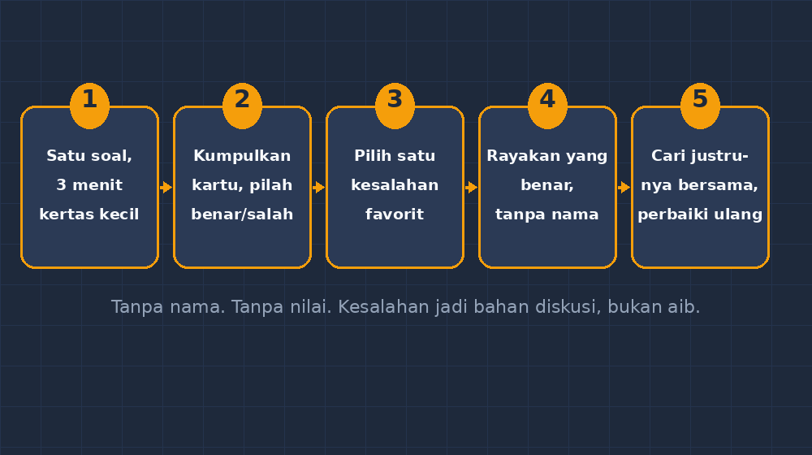

Malam sebelumnya saya sempat ragu. Besok kelas VII B masuk dengan materi penjumlahan bilangan bulat, dan pengalaman saya selama ini: kesalahan siswa selalu datang seperti petir di siang bolong. Ada yang tercoreng di papan tulis, ada yang terselip di lembar kerja, dan hampir semuanya dimusuhi. Siswa yang salah langsung merosot ke mejanya, teman-temannya menahan tawa, dan saya — jujur saja — kadang ikut wajah memelas sambil mencoret besar-besar dengan spidol merah.

Padahal kalau dipikir-pikir, kesalahan itu adalah data. Data paling jujur tentang apa yang terjadi di kepala anak. Tapi data itu biasanya disembunyikan, bukan dibaca. Sampai suatu malam saya tidak sengaja menemukan video singkat tentang sebuah rutinitas kelas bernama *My Favorite No* dari Leah Alcala, guru matematika di Amerika. Idenya sederhana sampai saya hampir tidak percaya: kumpulkan jawaban salah dari siswa, pilih satu yang "favorit", lalu bahas di depan kelas — bukan untuk dipermalukan, tapi untuk dirayakan karena kesalahannya itu penting dan bisa dipelajari semua orang.

Saya putuskan mencobanya keesokan paginya. Tulisan ini adalah catatan apa yang terjadi.

<!--more-->

## Rutinitasnya Sebenarnya Sederhana Sekali

Persiapannya nol. Tidak ada alat, tidak ada aplikasi, tidak ada lembar yang harus difotokopi. Alurnya begini:

Semua siswa diberi satu soal, mengerjakan di kertas kecil atau kartu dalam waktu singkat — di kelas saya biasanya dua sampai tiga menit. Setelah itu setiap siswa menaruh kertasnya di meja depan seperti membuang surat ke kotak pos. Saya mengocok, lalu memilah menjadi dua tumpukan: yang benar dan yang salah. Tumpukan benar tidak dibahas banyak; tumpukan salah justru yang jadi bintang.

Dari tumpukan salah, saya memilih satu — kesalahan yang paling menarik, paling mewakili, atau paling sering muncul — dan menyalinnya ke papan tulis **persis seperti aslinya**, coretan dan semua. Yang penting: tanpa nama. Siswa yang kertasnya dipilih boleh mengaku, tapi tidak wajib, dan saya tidak pernah menunjuk.

Lalu bagian yang paling saya sukai: sebelum saya bicara apa pun, kelas diminta menyebut hal yang *sudah benar* dari pekerjaan itu. "Langkah pertamanya benar." "Ia tahu harus mengubah pengurangan jadi penjumlahan." Baru setelah itu kita cari bersama di mana justrunya, dan mengapa justru itu terjadi.

Kemudian kelas menulis ulang perbaikannya, dan satu-dua siswa mencoba soal serupa. Selesai. Lima sampai tujuh menit, biasanya di awal atau akhir pelajaran.

## Hari Pertama: Kelas Curiga

Saya tidak akan berbohong bahwa hari pertamanya mulus. Kelas VII B jelas curiga. Ketika saya bilang "ini kesalahan favorit Bapak hari ini", ada senyum-senyum sinis, seperti menunggu lelucon yang berakhir dengan hukuman. Budaya kelas kami selama bertahun-tahun sudah melatih anak bahwa salah = aib.

Tapi ada satu momen yang mengubah suasana. Dari soal $-7 + 4$, saya memilih satu kertas yang menjawab $-11$. Sebelum saya membuka mulut, seorang siswa di belakang sudah berkata, "Bu, eh Pak, dia udah tahu kok harus dihitung dari minus tujuannya." Benar. Anak itu tahu harus mulai dari $-7$, hanya salah memilih arah bergerak — dia bergerak ke kiri (menambah) padahal $+4$ artinya bergerak ke kanan. Kesalahan teknis kecil, tapi miskonsepsi arah ini justru dimiliki separuh kelas. Kalau kertas itu berakhir di tempat sampah bersama tanda merah, miskonsepsi itu tetap tinggal di kepala tiga puluh anak, tidak terdeteksi.

Dengan dibahas di papan, satu kesalahan jadi mengajari seluruh kelas. Dan yang menyenangkan: siswa yang kertasnya "favorit" hari itu, belakangan saya dengar dari temannya, malah agak bangga. Itu bukan yang saya incarkan — tapi itu tanda bahwa pesan kelas sudah berubah: di ruangan ini, salah itu aman.

## Kenapa Ini Bekerja (dan Saya Coba Tuliskan Alasannya)

Setelah beberapa minggu, saya merenungkan kenapa rutinitas sepele ini lebih berdampak daripada koreksi individual yang selama ini saya jalani.

Pertama, ia **mengumpulkan data dari semua orang sekaligus**. Koreksi saat berkeliling kelas hanya menyentuh satu anak pada satu waktu. Dengan kartu jawaban, saya mendapatkan potret kelas dalam tiga menit — termasuk dari anak-anak yang tidak pernah angkat tangan.

Kedua, ia **menormalkan kesalahan**. Anak-anak belajar bahwa kesalahan itu bukan pengecualian yang memalukan, tapi bagian biasa dari belajar matematika. Ini penting sekali di kelas yang sebelumnya penuh kecemasan — saya pernah menulis soal anak yang "bisa tapi merasa tidak bisa", dan rasanya dua masalah itu berhubungan erat.

Ketiga — dan ini yang paling sering saya lewatkan dulu — ia **memaksa saya membaca kesalahan sebagai pola, bukan sebagai kecerobohan**. Dulu refleks saya melihat jawaban $-11$ adalah "kurang teliti". Sekarang saya terbiasa bertanya: proses berpikir apa yang menghasilkan angka ini? Jawaban salah hampir selalu masuk akal *menurut logika si anak*. Tugas kita menemukan logikanya itu, bukan sekadar mencoret hasilnya.

*Alur My Favorite No: dari kartu jawaban, memilah, memilih satu kesalahan, merayakan yang benar dulu, lalu memperbaiki bersama.*

## Penyesuaian kecil untuk kelas saya

Tidak semuanya saya salin mentah-mentah, dan mungkin ini yang bisa Bapak/Ibu ambil: rutinitas impor tetap harus dikemas ulang sesuai kelas kita.

Kartu jawaban saya ganti kertas HVS bekas yang dipotong empat. Tidak perlulah cantik; yang penting cukup besar untuk menampung langkah pengerjaan, bukan cuma jawaban akhir. Justru langkah pengerjaan itulah bahan bakar diskusi — kalau siswa hanya menulis "$-11$", tidak ada cerita yang bisa dibaca.

Soalnya saya buat satu nomor saja dan tidak dinilai. Sekali soal dinilai, rutinitas ini berubah jadi ulangan kecil dan semua kejujuran lenyap. Anak akan menyalin dari teman. Tanpa nilai, mereka menulis apa adanya — dan justru apa adanya itulah yang saya butuhkan.

Untuk memilih "favorit", saya punya kriteria kasar: kesalahan yang paling banyak diulang orang, atau kesalahan yang prosesnya sudah jauh benar tapi tersandung di satu titik. Kesalahan acak karena lupa menyalin soal biasanya saya simpan untuk dibahas pribadi — itu bukan bahan diskusi kelas.

## Bukan Pengganti, Tapi Pengisi yang Mahal Harganya

Saya perlu menegaskan ini bukan metode ajaib yang menggantikan asesmen tertulis atau umpan balik tertulis. Ia hanya lima sampai tujuh menit. Tapi lima sampai tujuh menit itu membuka sesuatu yang berharga: sebuah ritual harian yang bilang pada setiap anak bahwa kesalahannya dilihat, dibaca, dan dihargai — bukan dicoret.

Ada satu efek samping yang tidak saya duga. Karena kertasnya dianonimkan dan kesalahannya "dibeli" sebagai bahan diskusi, beberapa siswa mulai dengan sengaja menuliskan proses berpikirnya lebih panjang di kartu. Seolah mereka mulai paham: yang diperiksa guru bukan angka terakhirnya, tapi jalannya. Bagi saya, perubahan perilaku sekecil itu sudah lebih mahal daripada satu jam penjelasan tambahan.

Kalau Bapak/Ibu ingin mencobanya, saran saya mulai dari satu kelas saja, sekali atau dua kali seminggu, dengan soal yang memang rawan salah — operasi bilangan bulat, penjumlahan pecahan berpenyebut beda, atau langkah awal pindah ruas. Jangan mulai dari soal yang semua orang pasti bisa; tumpukan salahnya harus ada isinya, kalau tidak, diskusinya tidak akan jalan.

Dan siapkan diri untuk hal yang mungkin agak aneh di awal: kita, gurunya, harus ikut belajar membaca kesalahan dengan mata yang baru. Spidol merah di tangan kita ternyata bukan alat paling ampuh di kelas. Kesalahan yang dirayakan dengan jujur itu, entah kenapa, lebih melekat daripada seribu coretan.

---

*Catatan: rutinitas My Favorite No dipopulerkan oleh Leah Alcala; videonya banyak beredar dan layak ditonton sebelum mencoba. Tapi seperti biasa, yang menentukan berhasil tidaknya bukan videonya — melainkan seberapa jujur kita memperlakukan kesalahan anak di kelas sendiri.*
