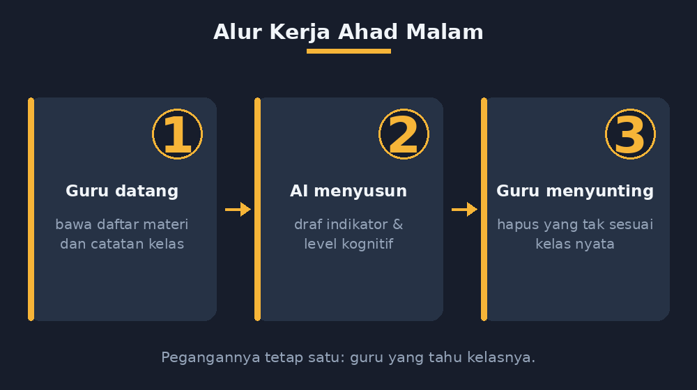

Kalau ada satu dokumen sekolah yang paling sering saya kerjakan terlambat, itu kisi-kisi penilaian sumatif. Formatnya sederhana: nomor soal, materi, indikator, level kognitif, bentuk soal. Tapi menyusunnya itu seperti merapikan rumah sebelum tamu datang — semua orang tahu pentingnya, tidak ada yang benar-benar menikmati prosesnya.

Pekan lalu kisi-kisi untuk sumatif tengah semester kelas VII jatuh tempo hari Senin. Ahad malam jam sembilan, saya menatap dokumen yang baru terisi dua baris dari tiga puluh. Di titik seperti itu dulu saya akan memilih jalan pintas: menyalin kisi-kisi tahun lalu dan mengganti nama materi. Malam itu saya mencoba jalan lain. Saya membuka percakapan dengan AI dan mengajaknya bekerja — bukan menyerahkan pekerjaannya.

<!--more-->

## Kenapa Kisi-Kisi Tidak Boleh Sekadar Formalitas

Sebelum cerita tentang AI, saya perlu jujur dulu soal kebiasaan lama. Kisi-kisi yang saya salin dari tahun lalu itu punya penyakit halus: indikatornya tidak lagi cocok dengan soal yang saya buat. Ada soal di lembar jawaban yang tidak punya indikator, dan ada indikator yang tidak punya soal. Kalau ada supervisor yang menelusuri satu per satu, celahnya langsung kelihatan.

Lebih penting lagi, kisi-kisi seharusnya menjadi peta berpikir saya sebelum menulis soal. Kalau saya menulis indikator "menyelesaikan masalah kontekstual yang melibatkan operasi bilangan bulat" dengan level kognitif C4, maka soal nomor yang bersangkutan *harus* benar-benar menuntut penalaran, bukan sekadar pengurangan bersusun dengan cerita di depannya. Kisi-kisi yang jujur memaksa soal yang jujur.

Masalahnya, menyusun tiga puluh indikator yang masing-masing punya kata kerja operasional yang tepat, sebaran level kognitif yang seimbang, dan urutan materi yang sesuai dengan apa yang benar-benar saya ajarkan — itu pekerjaan yang menguras konsentrasi. Konsentrasi saya pada Ahad malam jam sembilan sudah habis dimakan oleh koreksi kelas VI.

## Percakapan Pertama: AI yang Salah Cara

Percobaan pertama saya gagal, dan gagalnya itu justru mengajari saya sesuatu. Saya menulis prompt seperti orang memesan makanan: "Buatkan kisi-kisi penilaian sumatif matematika kelas VII semester ganjil, 30 soal." AI dengan ramahnya menyerahkan tabel yang rapi. Materinya benar: bilangan bulat, pecahan, Himpunan, aljabar. Tapi indikatornya kosong. Maksud saya benar-benar kosong — semua indikatornya bunyi "siswa dapat memahami materi bilangan bulat", "siswa dapat memahami materi pecahan", dan seterusnya. Level kognitifnya rata semua C3.

Itu bukan kisi-kisi. Itu daftar isi yang dipakaikan baju kisi-kisi. Dan di sinilah kesadaran pentingnya: AI tidak tahu bahwa indikator harus menggambarkan perilaku yang teramati. AI tahu *bentuk* kisi-kisi, tapi tidak tahu *jiwanya*. Jiwa kisi-kisi ada di kepala guru yang tahu materi mana yang muridnya sering tersandung.

## Percakapan Kedua: Memberi AI Bahan Baku, Bukan Memberinya Kendali

Malam itu saya mengganti cara kerja. Saya tidak lagi meminta AI *mengarang*, saya memberinya *bahan*. Saya mengetik daftar materi yang benar-benar saya ajarkan, lengkap dengan catatan kecil dari jurnal mengajar saya: di kelas VII-B bilangan bulat aman, tapi pecahan campuran masih bikin separuh kelas diam; Himpunan jalan baik sampai soal cerita irisan; aljabar baru sampai bentuk sederhana, belum menyentuh persamaan.

Kali ini AI bekerja dengan bahan yang nyata. Indikatornya jadi spesifik: bukan "memahami pecahan", tapi "menyelesaikan masalah sehari-hari yang melibatkan operasi penjumlahan dan pengurangan pecahan dengan penyebut berbeda". Level kognitifnya bervariasi, dan yang menarik, AI menyarankan tiga soal Himpunan diubah ke bentuk soal cerita karena catatan saya menyebut soal konteksnya lemah. Saran yang saya terima.

Tapi saya tidak menerima semuanya. AI menyodorkan satu indikator tentang "menggeneralisasi pola bilangan ke dalam bentuk aljabar" dengan level C4. Kedengarannya bagus, tapi pola bilangan itu belum saya ajarkan sampai tahap itu. Kalau saya timpakan ke kisi-kisi, saya yang akan gagal memenuhi kisi-kisi saya sendiri. Itu indikator saya hapus. Guru yang tahu kelasnya, bukan tabel yang tahu kurikulumnya.

*Alur kerja Ahad malam itu. Posisi duduknya jelas: saya yang pegang peta, AI yang duduk di kursi asisten.*

## Keseimbangan yang Akhirnya Ketemu

Ada satu kebiasaan kecil yang membuat kolaborasi ini layak dilanjutkan: setelah AI menyusun draf, saya membaca kisi-kisi itu *seolah-olah saya penulis soal lain*. Kalau saya tidak bisa membayangkan bentuk soalnya dari satu baris indikator, berarti indikator itu kabur. Dua baris dari draf AI saya tulis ulang karena alasan itu.

Hasil akhirnya: tiga puluh indikator selesai dalam waktu yang biasanya saya habiskan hanya untuk membuka formatnya. Lebih penting, kisi-kisi itu *cocok* dengan kelas saya — sebaran materinya mengikuti kecepatan kelas yang sebenarnya, dan ada jejak catatan jurnal mengajar di dalamnya. Kisi-kisi tahun lalu tidak punya jejak itu.

## Yang Saya Pelajari dari Ahad Malam Itu

Saya tidak lagi melihat AI sebagai mesin penghasil dokumen. Untuk kisi-kisi, AI paling berguna di dua titik yang tidak terduga: pertama, sebagai *penjaga konsistensi* — AI pandai memeriksa apakah kata kerja operasional cocok dengan level kognitif yang saya klaim, dan menangkap beberapa inkonsistensi yang lolos dari mata saya yang mengantuk. Kedua, sebagai *penyusun draf yang cepat* — draf yang jelek tetap lebih mudah disunting daripada halaman kosong, asalkan saya tahu persis bagian mana yang jelek dan kenapa.

Tapi keputusan-keputusan yang menentukan tetap di tangan guru. Materi apa yang masuk, materi mana yang dihilangkan, level mana yang terlalu tinggi untuk kelas ini — semua itu membutuhkan pengetahuan yang tidak bisa diunduh. AI tahu bagaimana wujud kisi-kisi yang benar; saya tahu murid-murid yang akan menghadapi soal-soalnya. Ahad malam itu keduanya duduk di meja yang sama, dan pekerjaan yang biasanya menyiksa selesai sebelum jam sebelas.

Ada satu hal lagi yang saya simpan untuk rekan-rekan guru yang ingin mencoba. Jangan mulai dari AI, mulai dari catatan Anda sendiri. Percakapan Ahad malam itu berhasil bukan karena promptnya bagus, tapi karena saya datang membawa informasi yang tidak dimiliki siapa pun selain saya: mana materi yang aman, mana yang licin, sampai mana materi sudah diajarkan. Semakin lengkap bahan yang kita berikan, semakin kecil bagian yang harus kita karang ulang. Prompt yang baik untuk pekerjaan seperti ini bukan yang panjang dan penuh istilah, tapi yang jujur soal kondisi kelas.

Juga, simpan draf yang sudah disunting. Tahun depan, ketika kisi-kisi lagi jatuh tempo, saya akan punya contoh nyata dari kelas sendiri untuk diperlihatkan ke AI — bukan lagi mulai dari halaman kosong. Dokumen sekolah yang baik ternyata bertumbuh, sama seperti pengalaman mengajarnya.

Kisi-kisi yang selesai malam itu saya cetak Senin pagi. Dan untuk pertama kalinya dalam beberapa tahun, saya membacanya sekali lagi sebelum menyerahkan — bukan karena ragu, tapi karena penasaran. Ternyata enak juga punya dokumen yang isinya benar-benar menggambarkan kelas saya sendiri.
