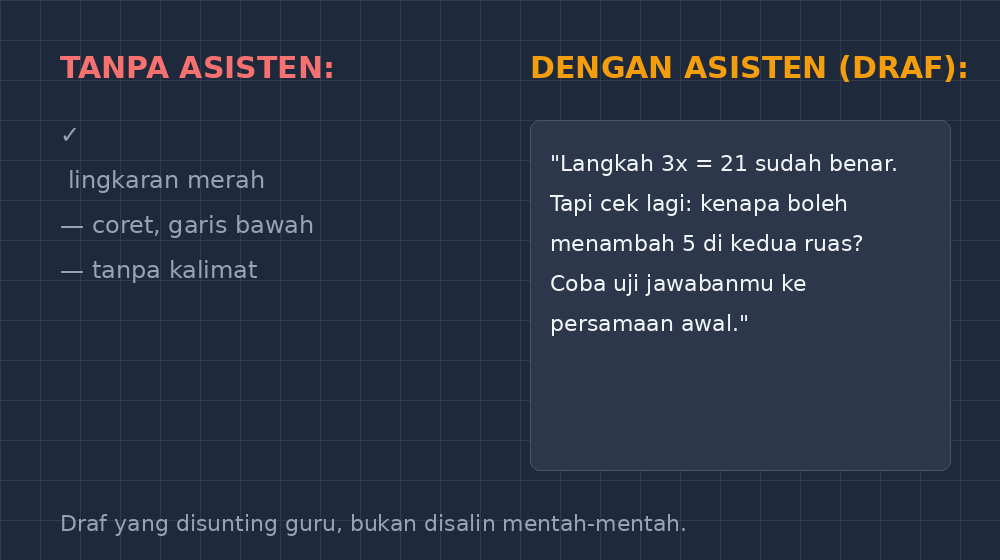

Ada satu pekerjaan yang selama bertahun-tahun saya kerjakan setengah hati: menulis komentar di pinggir lembar kerja siswa. Bukan karena saya tidak peduli, justru karena saya terlalu peduli. Kalau hanya mencoret "kurang teliti" di pojok kertas, itu bukan umpan balik — itu cap. Umpan balik yang layak harus menyebut langkah mana yang sudah benar, di mana letak jebakannya, dan apa yang bisa dicoba berikutnya. Dan untuk tiga puluh dua lembar per kelas, dengan empat kelas yang menunggu, kesiapan itu sering kalah oleh jam malam.

<!--more-->

## Umpan Balik yang Baik Itu Mahal Waktunya

Penelitian tentang umpan balik formatif sudah lama mengatakan hal yang sama: komentar spesifik yang mengarah ke langkah perbaikan jauh lebih berpengaruh daripada nilai angka sendirian. Saya percaya itu. Masalahnya, menulis kalimat yang spesifik untuk setiap anak itu pekerjaan yang tidak bisa diseragamkan. Kesalahan Danu tidak sama dengan kesalahan Sari, meskipun keduanya salah di nomor yang sama.

Contoh sederhana dari kelas VIII minggu lalu, soal persamaan linear:

$$3x - 5 = 16$$

Sari menulis $3x = 16 - 5 = 11$, lalu $x = 11/3$. Danu menulis $3x = 16 + 5 = 21$, lalu $x = 7$. Kalau saya hanya tulis "salah, -5 harusnya pindah ruas jadi +5", keduanya menerima komentar yang sama. Padahal Sari paham aturan pindah ruas tapi menerapkannya di arah yang keliru; Danu justru sudah benar sekali dan tinggal perlu dipastikan bahwa dia paham *mengapa* boleh menambah 5, bukan hanya hafal langkahnya. Dua anak, satu nomor, dua umpan balik yang seharusnya berbeda total.

Itulah kenapa koreksi saya selalu lama. Dan itulah kenapa, sebelum ada bantuan apa pun, banyak komentar saya akhirnya menyusut jadi simbol: tanda centang, garis bawah, kadang hanya lingkaran di sekitar angka yang salah. Siswa mengerti bahwa itu artinya "ada yang keliru di sini" — tapi tidak pernah tahu apa, dan tidak pernah tahu kenapa.

## Percobaan Pertama: Meminta AI Menulis Komentar

Ide mengajak AI masuk ke proses ini bukan datang dari seminar atau jurnal, tapi dari kelelahan biasa. Suatu malam, setelah koreksi dua kelas, saya mencoba hal sederhana: mengetikkan satu soal, satu jawaban siswa (salah), dan satu instruksi — "tulis komentar umpan balik untuk siswa SMP kelas VIII, bahasa yang hangat, maksimal tiga kalimat, sebut langkah yang sudah benar dulu."

Hasilnya menarik. AI menulis komentar yang secara struktur bagus: menyebut langkah yang benar, menunjuk kesalahan, memberi saran. Tapi ada yang janggal. Nadanya terlalu rapi. Terlalu seperti buku panduan guru. Ada kalimat yang tidak akan pernah keluar dari mulut saya: "Kerja bagus dalam mempertahankan konsistensi operasi aljabar!" Saya membayangkan Sari membaca itu dan langsung curiga — ini bukan tulisan Pak Gunanto, Pak Gunanto tidak pernah bilang "konsistensi operasi aljabar".

Dari situ saya belajar pelajaran pertama: AI itu penulis draf, bukan penulis akhir. Perannya bukan menggantikan saya, tapi menghilangkan beban yang paling melelahkan — memulai kalimat dari nol. Menghadapi lembar kosong tiga puluh dua kali itu yang membuat orang menyerah. Menghadapi draf yang sudah ada dan tinggal disunting? Itu masih bisa dilakukan sambil mengeteh.

## Alur Kerja yang Akhirnya Bertahan

*Draf yang disunting guru, bukan disalin mentah-mentah.*

Setelah beberapa minggu mencoba, alur yang bertahan sampai sekarang sederhana:

1. Saya koreksi lembar kerja seperti biasa, tapi tidak menulis komentar — hanya menandai letak kesalahan dan menulis catatan singkat untuk diri sendiri (misalnya "pindah ruas salah arah, paham konsep").
2. Untuk tiap pola kesalahan, saya minta AI membuat tiga varian draf komentar dengan nada berbeda: satu membangun, satu menantang, satu netral-singkat.
3. Saya sunting tiap draf sebelum ditulis di lembar siswa — memotong kata-kata yang terlalu formal, menambahkan sesuatu yang personal ("ingat percobaan kita di papan tulis kemarin").

Langkah ketiga yang paling penting, dan paling sering dilewati kalau saya lelah. Sekali saya iseng tidak menyunting dan langsung salin komentar AI ke lembar siswa, dua hari kemudian ada anak bertanya, "Bu, kata-kata di lembar saya ini bahasa buku ya?" Ia bukan menyalahkan — hanya mengamati. Tapi itu cukup membuat saya sadar: siswa mengenali suara gurunya, dan umpan balik yang kehilangan suara itu kehilangan sebagian kekuatannya.

## Yang AI Tidak Bisa Lihat

Ada batas yang jelas di kegiatan ini, dan batasnya bukan soal teknologi tapi soal penglihatan. AI hanya melihat apa yang saya ketik: satu potong pekerjaan siswa, tanpa wajahnya, tanpa riwayatnya. Ia tidak tahu bahwa Danu sudah tiga kali ulangan berturut-turut mendapat nilai rendah dan minggu ini akhirnya berani mengangkat tangan. Ia tidak tahu bahwa komentar yang terlalu panjang justru membuat Rina — yang punya kecemasan matematika — menutup lembar itu begitu melihat banyak coretan merah.

Keputusan tentang *berapa banyak* umpan balik yang sepatutnya diterima seorang anak hari itu, itu keputusan guru. Tidak ada model bahasa yang bisa mengambilnya, dan saya tidak ingin ada. Yang bisa dilakukan AI adalah membuat biaya menulis umpan balik yang baik turun drastis — dan itu saja sudah mengubah sesuatu yang nyata di kelas saya.

Perubahan yang paling saya rasakan bukan di lembar siswa, tapi di jadwal saya. Koreksi yang dulu makan dua malam sekarang selesai dalam satu, dengan komentar yang lebih panjang dan lebih spesifik dari sebelumnya. Waktu yang tersisa saya pakai untuk hal yang tidak bisa diserahkan ke siapa pun: menyiapkan soal berikutnya yang lebih pas untuk tiap kelompok kemampuan.

## Aturan Saya Sendiri

Kalau rekan guru ingin mencoba, ini batasan-batasan yang saya pegang — bukan karena teorinya, tapi karena sudah saya langgar dan menyesalinya:

- **AI menulis draf, saya menulis keputusan.** Tidak ada komentar yang sampai ke lembar siswa tanpa saya baca dan sunting. Satu kali saja saya melanggar, dan siswa langsung merasakannya.
- **Konteks yang saya ketikkan harus jujur.** Saya selalu sertakan bagian pekerjaan yang benar, bukan hanya yang salah. Kalau saya hanya potong bagian kesalahannya, AI cenderung menulis komentar yang menganggap siswa tidak paham apa-apa — dan itu tidak adil untuk anak yang sudah benar setengah jalan.
- **Bukan untuk nilai rapor.** Umpan balik formatif itu tempat yang tepat. Menilai capaian akhir dengan bantuan AI adalah wilayah lain, dengan pertimbangan etika yang jauh lebih berat, dan saya belum mau menyentuhnya.
- **Cadangkan suara sendiri.** Setiap minggu saya simpan beberapa komentar tulisan tangan asli tanpa bantuan AI — bukan untuk arsip, tapi untuk menjaga agar saya sendiri tidak lupa bagaimana rasanya menulis umpan balik dari nol. Keterampilan itu tidak boleh hilang hanya karena ada yang lebih nyaman.

## Penutup: Tentang yang Sebenarnya Berubah

Kadang saya berpikir, perdebatan "apakah guru boleh pakai AI" itu menyalahkan tempat. Pertanyaan yang lebih berguna bagi saya: pekerjaan mana dalam mengajar yang selama ini tidak saya kerjakan sebaik yang saya mau karena terlalu mahal waktunya — dan apakah menurunkan biayanya membuat pekerjaan itu jadi benar-benar dikerjakan?

Untuk komentar di pinggir lembar, jawabannya ya. Siswa-siswa saya sekarang menerima umpan balik yang lebih banyak, lebih spesifik, dan tetap berbunyi seperti tulisan gurunya — dengan bantuan yang tidak pernah mereka ketahui namanya, dan tidak perlu mereka ketahui. Yang perlu mereka tahu hanya satu: di pojok kertasnya ada seseorang yang membaca pekerjaannya sampai tuntas, memperhatikan langkah yang sudah benar sebelum menunjuk yang keliru, dan menyimpan harapan bahwa percobaan berikutnya akan lebih baik.

Selama itu tetap terjadi, saya tidak keberatan punya asisten yang bekerja di malam hari dan tidak pernah minta gaji. Yang penting, pena terakhir tetap di tangan saya.
