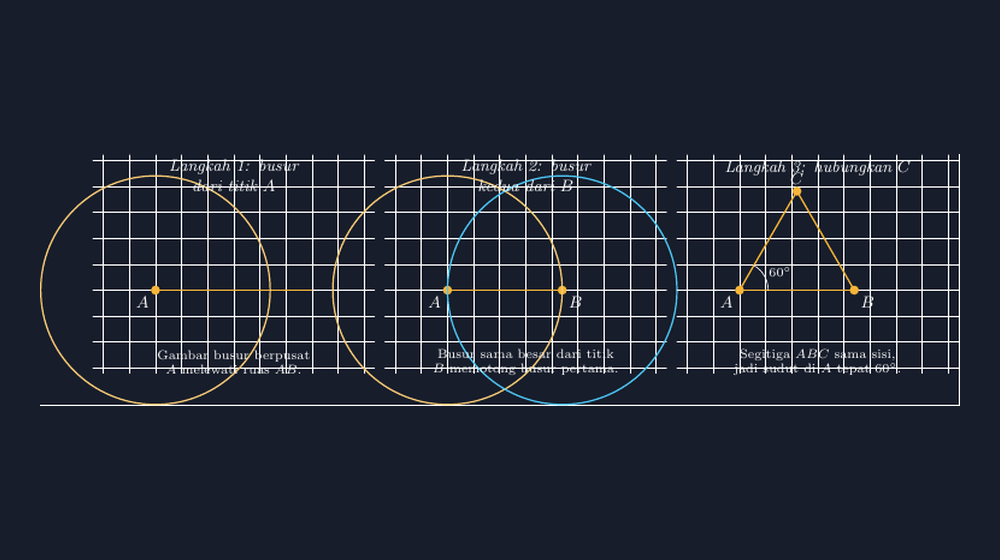

Di kelas VII semester genap lalu, saya membagikan busur derajat plastik untuk mengukur sudut. Lima menit kemudian, satu kelompok mengangkat tangan: "Pak, sudut ini 45 atau 135?" Saya mendekat, dan memang dua kemungkinan itu sama masuk akalnya kalau siswa lupa memperhatikan dari mana skala mulai. Di kelompok lain ada yang membaca 60 derajat sebagai 120, dan yang paling menghibur: busur derajat yang diputar-putar seperti kompas karena "skalanya kebalik, Pak".

Itu bukan kelalaian siswa. Busur derajat memang alat yang licik: dua skala berlawanan arah, garis nol yang harus sejajar kaki sudut, titik pusat yang harus tepat di vertex. Banyak hal yang bisa salah sebelum angkanya terbaca. Maka pada pertemuan berikutnya saya mencoba jalan lain — sengaja menyita (dengan izin) semua busur derajat, dan menyuruh siswa membuat sudut 60 derajat hanya dengan jangka dan penggaris tanpa skala.

<!--more-->

## Kenapa justru 60 derajat?

Dari semua sudut "spesial", 60 derajat adalah yang paling ramah untuk dikonstruksi. Tidak perlu membagi sudut, tidak perlu garis tegak lurus lebih dulu. Cukup satu ruas garis, dua busur dengan jari-jari sama, dan selesai. Logikanya sederhana: jika $AB$ adalah ruas garis, dan kita gambar lingkaran berpusat di $A$ melewati $B$ sekaligus lingkaran berpusat di $B$ melewati $A$, maka titik potongnya $C$ berjarak sama dari $A$ dan $B$ — sama dengan panjang $AB$. Segitiga $ABC$ pun punya tiga sisi sama panjang, alias segitiga sama sisi. Dan sudut dalam segitiga sama sisi tentu $60^\circ$ semuanya.

Bagi siswa, ini momen yang indah: sudut yang "ditemukan" bukan dibaca. Tidak ada skala yang bisa salah dibaca, karena sudutnya lahir dari konstruksi, bukan dari pengukuran. Salah satu siswa saya menyebutnya "sudut yang dijamin", dan istilah itu langsung saya pakai sampai sekarang.



Tiga langkahnya persis seperti di gambar atas. Pertama, gambar ruas $AB$ dan busur berpusat $A$ melewati $B$. Kedua, dengan jari-jari yang sama (jangka tidak boleh digeser — sering terlewat!), gambar busur berpusat $B$ hingga memotong busur pertama. Ketiga, tarik garis dari $A$ ke titik potong $C$. Sudut di $A$ yang terbentuk adalah $60^\circ$, dan bonusnya kita sekaligus mendapat segitiga sama sisi utuh.

## Kesalahan-kesalahan kecil yang justru berharga

Percobaan pertama di kelas tidak sesempurna teorinya. Ada yang melangkah jangkanya setelah busur pertama selesai, sehingga busur keduanya berbeda jari-jari dan kedua busur tidak bertemu di titik yang "seharusnya". Ada yang busurnya terlalu pendek sehingga tidak berpotongan, lalu bingung. Ada juga yang menarik garis dari $B$ ke $C$ padahal yang diminta sudut di $A$ — hasilnya tetap benar secara segitiga, tapi mereka harus diingatkan apa yang sedang dicari.

Justru kesalahan-kesalahan ini yang membuat aktivitas itu bernilai. Siswa terpaksa bertanya: kenapa jari-jarinya harus sama? Kenapa busurnya harus saling memotong? Pertanyaan-pertanyaan itu tidak muncul kalau mereka tinggal menempelkan busur derajat dan membaca angka. Konstruksi memaksa mereka memikirkan *syarat*, bukan sekadar *prosedur*. Dan ketika saya tanyakan "kalau jari-jarinya dua kali lebih panjang, apakah sudutnya berubah?" — hampir seluruh kelas yakin sudutnya tetap, dan beberapa bisa menjelaskan kenapa. Itu penalaran geometri yang tumbuh dari tangan mereka sendiri.

Dari 60 derajat, jalan ke sudut-sudut lain terbuka dengan sendirinya. Sudut $30^\circ$ tinggal membagi dua sudut $60^\circ$ dengan konstruksi garis bagi. Sudut $120^\circ$ adalah dua kali lipatnya. Sudut $90^\circ$ dikonstruksi lewat garis tegak lurus, lalu $45^\circ$ dibagi dua. Dalam dua pertemuan, kelas kami membangun seluruh keluarga sudut spesial tanpa satu pun busur derajat — dan tanpa satu pun perdebatan "45 atau 135".

## Mengulang konstruksi yang sama di TikZ

Sebagai guru, saya punya kebutuhan lain: menggambar konstruksi ini untuk soal dan lembar kerja. Dan di sinilah TikZ berperan. Persis seperti pengalaman saya menulis soal bangun datar dulu, gambar geometri yang dibuat asal-asalan akan mengkhianati soalnya. Kalau saya menggambar segitiga sama sisi dengan tangan (atau dengan menebak-nebak koordinat), sudutnya mungkin 58 atau 63 derajat — dan itu berbahaya untuk soal konstruksi yang justru berbicara tentang kepastian.

Solusinya: hitung koordinatnya dengan matematika yang sama seperti konstruksinya. Titik $A$ di $(0,0)$, titik $B$ di $(2.2, 0)$, dan titik $C$ di atasnya. Karena segitiganya sama sisi, $C$ berada tepat di tengah-tengah secara horizontal ($x = 1.1$) dan tingginya $s\cdot\frac{\sqrt{3}}{2} \approx 1.9053$ untuk sisi $s = 2.2$. Dengan koordinat seperti ini, segitiga yang saya gambar *benar-benar* sama sisi, dan sudutnya *benar-benar* 60 derajat — bukan sekadar mirip.

```latex
\begin{tikzpicture}[line cap=round]
  \coordinate (A) at (0,0);
  \coordinate (B) at (2.2,0);
  \coordinate (C) at (1.1, 1.9053); % s*sqrt(3)/2 untuk s=2.2
  \draw (A) -- (B);
  \draw (A) -- (C) -- (B);
  \fill (A) circle (2.5pt) (B) circle (2.5pt) (C) circle (2.5pt);
  \node[below left] at (A) {$A$};
  \node[below right] at (B) {$B$};
  \node[above] at (C) {$C$};
  \draw (0.55,0) arc[start angle=0, end angle=60, radius=0.55];
  \node at (0.78,0.34) {$60^\circ$};
\end{tikzpicture}
```

Perhatikan satu kejujuran kecil di kode di atas: $1.9053$ adalah pembulatan dari $2.2\cdot\frac{\sqrt3}{2} = 1.90525...$. Untuk gambar ukuran ini pembulatannya tak terlihat mata, tapi kebiasaan baiknya adalah menulis komentar di kode — begitu seseorang (termasuk saya enam bulan kemudian) membuka file itu lagi, ia tahu angka itu datang dari mana dan bahwa sudut di $A$ memang *dirancang* 60 derajat, bukan kebetulan.

Ada juga keindahan simetri antara alat dan gambar: busur-putus-putus pada gambar soal bisa saya gambar dengan perintah `arc` atau lingkaran dengan opsi `dashed`, sehingga siswa melihat jejak konstruksinya — persis seperti jejak pensil di buku gambar mereka. Busur penanda sudut di $A$ dibuat dengan `arc[start angle=0, end angle=60]`, yang sekaligus mengingatkan saya bahwa di TikZ pun sudut ini "dibangun" dari nol derajat, bukan dibaca dari skala.

> 📎 **Berkas TikZ lengkap:** [konstruksi-sudut-60.tex](tex/konstruksi-sudut-60.tex) — siap kompilasi (butuh paket `tikz`).

## Yang saya bawa pulang dari jam itu

Dua jam tanpa busur derajat mengajarkan saya sesuatu yang lebih luas dari sekadar konstruksi sudut. Sering kali kesulitan siswa bukan pada matematikanya, tapi pada *alat* yang kita anggap sepele. Busur derajat bukan alat yang netral — ia punya tata cara pemakaian yang penuh jebakan, dan kita jarang mengajari tata cara itu secara eksplisit. Begitu juga dengan banyak hal lain: kalkulator, aplikasi kuis, bahkan AI yang kini mereka bawa di saku.

Konstruksi dengan jangka memberi siswa pengalaman yang berbeda sifatnya: matematika yang *dibuktikan dengan tangan*, di mana kebenarannya tidak bergantung pada ketelitian membaca skala melainkan pada logika langkah demi langkah. Dan TikZ memberi saya hal yang serupa dalam skala guru: gambar soal yang kebenarannya dijamin oleh koordinat, bukan oleh nekah-nekahan tangan.

Alat yang baik, baiknya adalah membuat kita tidak perlu mempercayainya secara buta — karena kebenarannya bisa kita telusuri sampai ke akar. Sepertinya pelajaran itu tidak hanya berlaku untuk geometri kelas VII.
