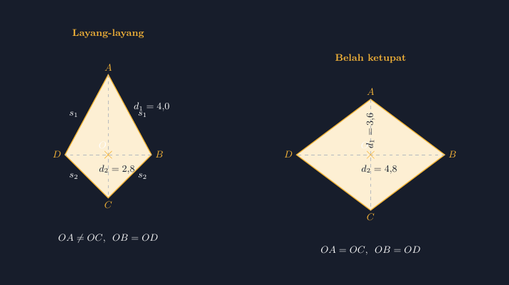

title: "Layang-Layang dan Belah Ketupat: Dua Bangun yang Sering Ditukar Tempat"
date: 2026-11-13T11:58:00+07:00
draft: false
authors: ["Gunanto"]
description: "Di kelas, layang-layang dan belah ketupat hampir selalu tertukar. Catatan tentang cara saya meluruskan bedanya: dua pasang sisi berdekatan sama lawan empat sisi sama, lengkap dengan kode TikZ-nya."
featuredImage: "featured-image.png"

tags: ["TikZ", "Layang-Layang", "Belah Ketupat", "Geometri", "Bangun Datar"]
categories: ["Matematika", "TikZ"]

math:
  enable: true
---

Minggu lalu, saat membahas sifat-sifat bangun datar di kelas VIII, saya menggambar sebuah bangun empat sisi di papan tulis lalu bertanya, "Ini apa?" Hampir separuh kelas menjawab layang-layang, hampir separuh lagi menjawab belah ketupat. Bangunnya sama persis, jawabannya terbelah dua. Saya tidak marah — justru momen seperti ini yang paling saya nantikan, karena dari situ kelihatan persis di mana miskonsepsi itu tinggal.

Setelah saya telusuri lewat jurnal kelas saya di teach.gezytech.web.id, polanya ternyata konsisten sejak mereka di kelas VII: anak-anak mengenali kedua bangun ini dari **bentuk gambarannya**, bukan dari **definisinya**. Kalau gambarnya tampak "miring kanan-kiri", mereka bilang layang-layang; kalau "rapi dan tegak", mereka bilang belah ketupat. Padahal keduanya bisa digambar miring, bisa digambar tegak, dan keputusan mana yang benar tidak boleh diambil dari penampakan.

<!--more-->

## Perbedaan yang sebenarnya cuma satu kalimat

Definisi keduanya sebenarnya sederhana, dan perbedaannya bisa ditulis dalam satu kalimat:

- **Layang-layang** adalah segiempat yang memiliki **dua pasang sisi berdekatan yang sama panjang**. Misalnya $AB = AD$ dan $CB = CD$.
- **Belah ketupat** adalah segiempat yang **keempat sisinya sama panjang**. $AB = BC = CD = DA$.

Dari sini langsung terlihat sesuatu yang menarik: kalau kedua pasang sisi berdekatan pada layang-layang sama panjangnya, artinya keempat sisinya sama panjang — dan bangun itu jadi belah ketupat. Jadi **setiap belah ketupat adalah layang-layang**, tapi tidak sebaliknya. Belah ketupat adalah layang-layang yang istimewa.

Analogi yang biasa saya pakai di kelas: belah ketupat itu seperti layang-layang mainan yang kedua rangka bambunya dibuat sama panjang. Rangka yang sama panjang membuat bentuknya jadi simetris sempurna, sifat-sifatnya pun bertambah — tapi dia tetap satu keluarga.

Yang sering bikin anak terkecoh adalah gambar di buku. Layang-layang biasanya digambar "kurus" dan belah ketupat digambar "rapi", sehingga muncul kesan keduanya beda jauh. Padahal belah ketupat yang digambar agak pipih akan kelihatan seperti layang-layang, dan hanya definisi sisi yang bisa memutuskan.

## Diagonal: tempat kedua bangun bersepakat

Sifat yang paling sering diuji di soal adalah tentang diagonalnya, dan untungnya di titik ini kedua bangun sepakat:

- Kedua diagonal **berpotongan tegak lurus**. Ini berlaku untuk layang-layang maupun belah ketupat.
- Pada layang-layang, diagonal yang panjang (yang "vertikal" pada gambar biasa) **membagi dua** diagonal yang pendek, dan sekaligus menjadi **sumbu simetri** bangun.
- Pada belah ketupat, **kedua diagonal saling membagi dua**, dan keduanya sama-sama menjadi sumbu simetri.

Sifat diagonal tegak lurus ini juga yang menjelaskan kenapa layang-layang mainan betul-betul stabil di udara: rangka bambunya adalah kedua diagonalnya, dan persilangan tegak lurus itu yang membuat struktur rangka kaku.

Untuk luas, kedua bangun memakai rumus yang sama, dan ini salah satu hal yang paling saya sukai:

$$L = \frac{1}{2} \, d_1 \times d_2$$

Hanya butuh panjang dua diagonal, tidak perlu tinggi atau sisi. Saya selalu ingat murid bernama Raka yang dulu menghafal rumus luas belah ketupat dan luas layang-layang sebagai dua rumus berbeda, lalu kaget saat tahu keduanya identik. "Berarti saya menghafal satu rumus dua kali, Pak?" Iya, Raka, dan sejak itu dia jadi lebih percaya diri mencari pola daripada menghafal.

## Menggambar keduanya dengan TikZ

Karena diagonalnya berpotongan tegak lurus, cara paling aman menggambar kedua bangun di TikZ bukan dengan menuliskan empat titik sudut satu per satu, melainkan dengan **dua diagonal di sumbu koordinat**. Titik potong diagonal saya letakkan di titik asal $O$, lalu diagonalnya sepanjang sumbu-$x$ dan sumbu-$y$.

Ini inti kode untuk layang-layang — diagonal vertikal 4 cm, horizontal 2,8 cm, dengan titik potong yang tidak di tengah (diagonal panjang membagi dua diagonal pendek, tapi titik bagiannya tidak harus pas di tengah diagonal panjang):

```latex
\coordinate (O) at (0,0);
\coordinate (A) at (0,2.6);   % ujung atas diagonal panjang
\coordinate (C) at (0,-1.4);  % ujung bawah: AO = 2.6, CO = 1.4
\coordinate (B) at (1.4,0);   % OB = 1.4
\coordinate (D) at (-1.4,0);  % OD = 1.4, jadi OB = OD
\draw[thick] (A) -- (B) -- (C) -- (D) -- cycle;
\draw[dashed] (A) -- (C) (B) -- (D);
```

Perhatikan: $OB = OD = 1{,}4$ (diagonal pendek terbagi dua), sementara $OA \neq OC$ — itulah ciri khas layang-layang. Sisi $AB$ dan $AD$ otomatis sama panjang, begitu juga $CB$ dan $CD$, karena simetri terhadap sumbu-$y$.

Untuk belah ketupat, saya cukup mengganti koordinatnya sehingga kedua diagonal sama-sama terbagi dua di titik asal:

```latex
\coordinate (A) at (0,1.8);
\coordinate (C) at (0,-1.8);
\coordinate (B) at (2.4,0);
\coordinate (D) at (-2.4,0);
```

Kini $OA = OC$ dan $OB = OD$; keempat sisi menjadi sama panjang dan bangun itu berubah status menjadi belah ketupat. Dua baris koordinat yang diubah, satu bangun yang berbeda — ini contoh kecil yang selalu saya tunjukkan ke murid tentang kekuatan definisi dalam geometri.



*Kedua bangun digambar dari dua diagonal yang berpotongan tegak lurus di titik asal. Kiri: layang-layang dengan $OA \neq OC$ tetapi $OB = OD$. Kanan: belah ketupat dengan $OA = OC$ dan $OB = OD$, keempat sisi sama panjang.*

Saat demonstrasi di kelas, saya suka memproyeksikan kedua gambar ini berdampingan lalu menutupi labelnya dan mengulang pertanyaan pembuka: "Sekarang mana yang layang-layang?" Anak-anak jadi terdiam sejenak — dan justru kebingungan sesaat itulah yang memaksa mereka akhirnya berpindah dari mengenal bentuk ke mengenal sifat.

## Latihan kecil yang menutup pelajaran

Di akhir jam pelajaran itu, saya memberi satu soal pendek: sebuah layang-layang punya diagonal 12 cm dan 8 cm, berapa luasnya? Kalau saya tarik diagonalnya sampai kedua pasang sisi sama panjang, apakah luasnya berubah? Kebanyakan murid langsung menjawab $\frac{1}{2} \cdot 12 \cdot 8 = 48$ cm² untuk yang pertama, dan setelah berpikir sebentar mereka sadar jawaban soal kedua pun tetap 48 cm² — sebab rumusnya sama, dan yang berubah hanya status bangunnya.

Soal semacam ini kelihatannya sepele, tapi fungsinya besar: ia menanamkan bahwa **belah ketupat bukan tetangga layang-layang, melainkan anggota keluarganya yang paling teratur**. Begitu relasi ini melekat, miskonsepsi "dua bangun yang mirip" berubah menjadi "satu bangun khusus dari bangun yang umum" — dan cara berpikir seperti itu bisa mereka bawa ke konsep lain, misalnya persegi sebagai belah ketupat yang sudutnya siku, yang biasanya saya bahas di pertemuan berikutnya.

Kalau Bapak/Ibu ingin mencoba menggambar kedua bangun ini untuk bahan soal, kodenya tinggal disalin dan angka diagonalnya diganti sesuai kebutuhan. Saya sendiri sekarang hampir selalu menggambar segiempat dari diagonalnya dulu, baru menuliskan sisinya — cara yang terbalik dari dulu waktu masih menggambar manual di papan, dan jauh lebih jarang salah.

> 📎 **Berkas TikZ lengkap:** [tex/layang-layang-belah-ketupat-tikz.tex](tex/layang-layang-belah-ketupat-tikz.tex) — siap kompilasi (butuh paket `tikz`).
