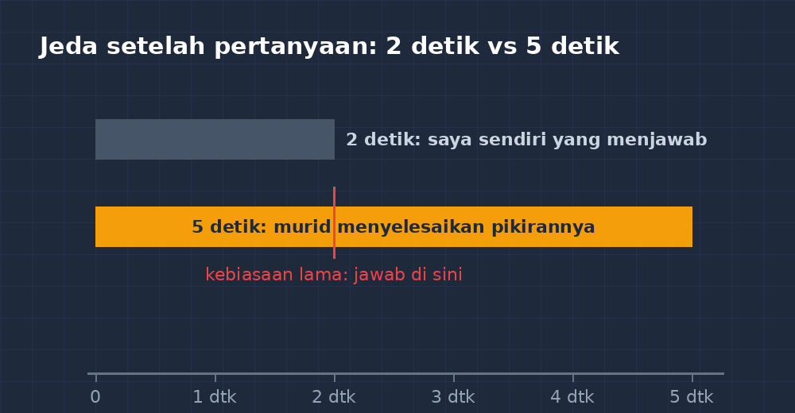

Saya baru sadar betapa buruknya kebiasaan saya setelah menonton rekaman pembelajaran sendiri. Bukan rekaman yang sengaja dibuat untuk lomba atau supervisi, melainkan ponsel tua yang saya taruh di lemari kelas untuk tugas lain, lalu iseng saya putar ulang. Di video itu ada sebuah pertanyaan bagus yang saya ajukan ke kelas: "Kalau keliling persegi panjangnya 24 cm, apa saja kemungkinan panjang dan lebarnya?" Pertanyaannya bagus. Yang tidak bagus adalah apa yang terjadi setelahnya: sekitar dua detik hening, lalu saya sendiri yang menjawab.

<!--more-->

Dua detik. Lebih pendek dari waktu yang dibutuhkan seorang murid untuk membaca ulang soalnya, apalagi untuk memikirkannya. Saya memanggil nama anak, dia diam karena masih berpikir, dan dalam panik kecil yang gengsi saya akui, saya langsung melanjutkan dengan, "Nah, misalnya panjangnya 8, lebarnya berapa?" Seolah-olah diam berarti tidak tahu, dan kelas harus selalu berbunyi.

## Menghitung Jeda Sendiri

Setelah malam itu, saya membuat percobaan sederhana. Tiga hari berturut-turut, di tiga kelas berbeda, saya mencatat berapa lama jeda saya setelah mengajukan pertanyaan, dengan mengandalkan jurnal digital yang saya isi di aplikasi teach saat jam kosong. Hasilnya memalukan tapi jujur: sebagian besar jeda saya di bawah tiga detik. Sering kali bahkan pertanyaannya belum selesai saya ucapkan penuh, saya sudah menyodorkan petunjuk.

Padahal penelitian tentang *wait time* sudah lama berbicara. Istilahnya diperkenalkan Mary Budd Rowe pada tahun 1970-an: rata-rata guru menunggu kurang dari satu detik setelah bertanya, padahal bila jeda diperpanjang ke kisaran tiga sampai lima detik, banyak hal berubah — jawaban murid lebih panjang, lebih banyak murid yang ikut menyumbang, dan pertanyaan balik dari murid justru muncul. Angka tiga sampai lima detik itu terdengar sepele, tapi rasanya di kelas nyata seperti abad. Siapa pun yang pernah mengajar tahu sensasi hening yang membuat telinga panas dan dorongan untuk segera mengisi.

*Gambar: dua detik pertama sering saya isi sendiri; di jeda lima detik, murid sempat menyelesaikan pikirannya.*

## Yang Muncul di Jeda Kedua

Yang membuat saya yakin bukan angkanya, melainkan apa yang terjadi begitu saya bersikeras diam. Contoh paling jelas datang dari soal sederhana tentang bilangan berpangkat. Saya bertanya, "Kalau $2^3$ artinya $2 \times 2 \times 2$, kira-kira apa arti $2^0$?" Lalu saya diam. Bukan diam pura-pura santai, melainkan diam yang saya jaga seperti menahan batuk: mata saya berpindah dari satu anak ke anak lain, tangan saya sengaja tidak memegang spidol, supaya tidak ada isyarat bahwa saya sudah punya jawaban sendiri.

Detik ketiga masih hening. Detik keempat, ada anak di baris belakang menggumam, "dibagi dua terus?" Detik kelima, teman sebangkunya menangkap gumaman itu dan menyambung, "artinya dibagi dua terus sampai... ya tinggal satu, berarti satu." Barulah diskusi benar-benar dimulai — bukan karena saya menjelaskan, melainkan karena dua anak sempat saling menyusul pikirannya masing-masing. Kalau di detik kedua saya sudah menjawab, kedua anak itu tinggal pendengar.

Ada juga efek yang tidak saya duga: jeda membuat pertanyaan saya lebih jujur diperiksa. Beberapa kali saat menahan diri untuk tidak menjawab, saya justru sadar pertanyaan saya rancu. "Berapa banyak cara membilang bilangan prima di bawah 20" misalnya — ambigu, bisa berarti jumlah banyaknya (delapan) atau menyebutkannya satu per satu. Selama bertahun-tahun anak-anak diam itu saya tafsir sebagai tidak paham, padahal mungkin mereka sedang bingung menafsirkan pertanyaan saya yang memang sulit ditafsirkan.

## Menahan Diri Itu Keterampilan

Menunggu ternyata bukan cuma soal niat, tapi soal teknik. Yang saya latih sekarang:

Pertama, saya memutuskan *sebelum* bertanya bahwa saya akan menghitung pelan di kepala sampai lima. Tidak berhasil kalau keputusan menunggu dibuat saat panik. Rencana harus lebih dulu dari pertanyaan.

Kedua, saya memberi tahu kelas bahwa diam itu bagian dari pelajaran. Saya bilang terang-terangan, "Setelah Bapak bertanya, kita diam dulu sembilan puluhan. Diam bukan berarti tidak tahu; diam artinya sedang berpikir." Anak-anak butuh dijelskan aturan diam ini, karena mereka juga terbiasa dengan kelas yang buru-buru — ada yang merasa gagal kalau tidak langsung menyahut.

Ketiga, dan ini yang paling sulit, saya mempertahankan jeda yang sama bahkan setelah satu anak menjawab. Ini penting dan sering terlewat: kalau jawaban pertama langsung saya puji dan lanjut, murid lain berhenti berpikir. Jawaban pertama sekarang saya perlakukan sebagai pembuka, bukan penutup: "Menarik. Ada yang setuju, ada yang punya cara lain?" Lalu diam lagi. Jeda kedua ini yang paling mengubah suasana kelas, karena yang paling ditakuti anak bukan salah menjawab, melainkan cepat dianggap selesai.

## Masih Gagal, Tapi Sudah Sadar

Jujur saja, saya masih sering kalah. Di jam pelajaran terakhir, saat jam menunjukkan menit-menit kritis dan materi belum selesai, tiga detik hening terasa seperti kemewahan yang tidak mampu saya bayar. Saya kembali memotong jeda, kembali menyodorkan petunjuk, dan sore itu di jurnal teach saya tulis satu kalimat: "buru-buru lagi." Catatan itu bukan untuk menghukum diri, tapi supaya kebiasaan lama tidak mengendap tanpa saya sadari.

Tapi ada satu hal yang sekarang menjadi pegangan: diam lima detik setelah pertanyaan bukan waktu yang terbuang, melainkan waktu yang sedang bekerja. Di jeda itulah seorang anak membaca ulang soal, menyusun kalimat jawabannya di kepala, atau — seperti pada kisah $2^0$ itu — menggumam sesuatu yang dikejar temannya sampai menjadi ide. Saya yang dulu selalu mengisi keheningan justru yang membunuh semua proses itu.

Kalau Bapak/Ibu kebetulan punya kebiasaan yang sama seperti saya dulu, coba satu eksperimen kecil: rekam satu sesi mengajar, lalu hitung berapa detik jeda sesungguhnya ada setelah pertanyaan. Angkanya mungkin memalukan seperti milik saya. Tapi dari angka yang memalukan itulah perubahan paling jujur biasanya dimulai — bukan dari niat yang hanya disimpan di kepala, melainkan dari bukti yang bisa dilihat sendiri.
