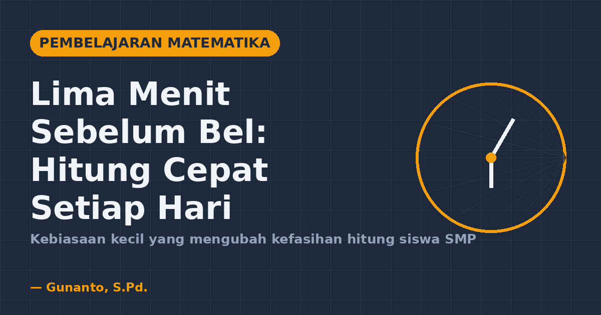
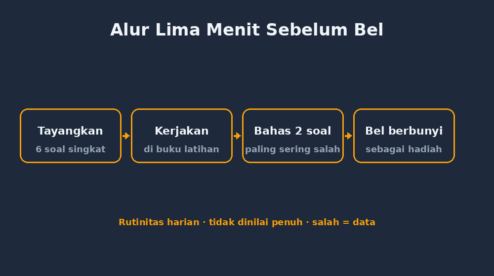
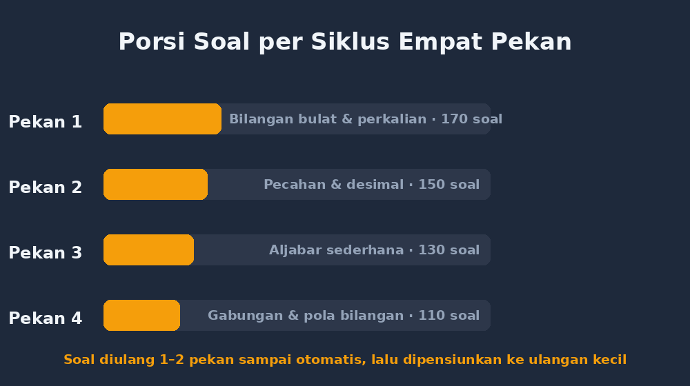

Ada satu momen yang masih menempel di kepala saya sampai sekarang. Awal tahun ajaran lalu, saya memberikan pretest sederhana kelas tujuh: dua puluh soal operasi bilangan bulat, waktu tujuh menit, soalnya levelnya cuma soal operasi dasar — tanda kurung, perkalian, campuran kecil. Tidak ada soal olimpiade. Hasilnya? Dari tiga puluh dua anak, hanya sembilan yang bisa menjawab lebih dari setengah dengan benar. Ada anak yang mengerjakan $(-5) + 3$ dan menjawab $-8$. Ada yang menghitung $7 \times 6$ terlalu lama sambil menulis perlahan di sudut kertas seperti sedikit berdoa.

Saya tidak marah. Kalau Anda mengajar cukup lama, Anda tahu marah tidak menyelesaikan apa-apa. Yang saya lakukan malah duduk sebentar setelah pulang, membuka jurnal digital saya, dan menulis satu pertanyaan yang akhirnya jadi awal semuanya: *kalau penalaran itu dibangun di atas kefasihan hitung, dan kefasihan hitung siswa saya masih rapuh, apa yang bisa saya lakukan setiap hari tanpa menambah jam pelajaran?*

Jawabannya ternyata sederhana sekali: **lima menit sebelum bel.**

<!--more-->

## Kenapa lima menit, bukan jam khusus

Ide latihan rutin numerasi bukan hal baru. Banyak sekolah punya gerakan literasi pagi, dan ada sekolah yang mulai menerapkan semacam "lima menit literasi numerasi". Tapi realita di lapangan: kalau kita tunggu jadwal khusus, program itu sering mati sendiri. Jam pelajaran matematika sudah penuh, materi terus berjalan, dan latihan hitung cepat jadi hal yang "kapan-kapan kita coba".

Justru karena kecil, lima menit itu bisa diselipkan. Di kelas saya, ritmenya begini: lima menit terakhir sebelum bel, ketika siswa sudah mulai kendor tapi belum boleh keluar, saya tayangkan enam sampai delapan soal singkat. Mereka kerjakan di buku latihan khusus — buku kecil yang memang fungsinya cuma untuk ini. Tidak dinilai penuh, tidak dibahas semua. Satu atau dua soal yang paling banyak salah itu saja yang kita diskusikan cepat.

Kenapa lima menit terakhir dan bukan awal? Awal kelas biasanya saya butuh untuk pembukaan materi, dan jujur saja, kalau ditaruh di awal, soal latihan ini gampang tergelincir jadi "bahan ajar" yang makan waktu. Di akhir, posisinya justru manis: siswa sudah tahu bahwa sebelum pulang mereka "harus" melewati ini, jadi ada ekspektasi rutin. Bel berbunyi sebagai hadiah setelah enam soal selesai. Kedengarannya sepele, tapi efek psikologisnya nyata.

## Aturan main yang sengaja dibuat sederhana

Saya tidak suka prosedur yang rumit, karena prosedur rumit selalu gagal di minggu ketiga. Jadi aturannya cuma tiga.

Pertama, **soal harus bisa dikerjakan mental atau setengah mental**. Kalau siswa butuh coretan panjang, itu bukan latihan kefasihan lagi, itu latihan ketelitian — penting juga, tapi beda tujuan. Soal-soal saya seperti $25 \times 4 - 8$, atau $(-3)^2 + (-4)$, atau $\frac{3}{4} \times \frac{8}{9}$. Ketiga contoh itu bisa diselesaikan dalam sepuluh sampai dua puluh detik kalau strateginya tersedia.

Kedua, **soal berulang dengan variasi**. Ini bagian yang paling sering dilewatkan orang. Satu tipe soal tidak cukup muncul sekali. Tipe yang sama saya pakai beruntun selama satu sampai dua minggu, hanya angkanya yang berganti, sampai mayoritas kelas menjawabnya otomatis. Setelah itu tipe itu tidak dihapus, tapi "dipensiunkan" ke daftar soal ulangan kecil.

Ketiga, **salah itu data, bukan aib**. Saya tidak pernah memanggil anak maju untuk mempermalukan jawaban salah. Yang saya lakukan: saya catat tipe kesalahan yang dominan di jurnal digital saya — hari itu, kelas itu — dan justru dari catatan itu saya tahu soal apa yang perlu muncul lagi besok. Kebiasaan lima menit ini ternyata juga jadi instrumen asesmen formatif yang gratis dan tak terasa.

## Minggu-minggu awal: yang saya tidak duga

Pekan pertama, siswa mengeluh. "Pak, kan sudah bel," itu kalimat yang paling sering saya dengar. Tapi kebiasaan itu, seperti biasa, butuh dua sampai tiga pekan untuk mengakar. Yang tidak saya duga justru muncul di pekan keempat.

Ada seorang siswa — sebut saja Rina — yang di pretest awal hanya menjawab lima soal dengan benar. Di pekan keempat, saat saya menayangkan $15 \times 4 - 20$, dia angkat tangan sebelum saya selesai membaca soal dan bilang, "Empat puluh, Pak. Limabelas kali empat itu enam puluh, kurang dua puluh." Bukan jawabannya yang membuat saya tersenyum, tapi strukturnya: dia menjelaskan *caranya*. Dua bulan sebelumnya dia hanya menulis angka acak dan berharap.

Yang saya pelajari dari Rina: banyak anak SMP yang lemah di hitung bukan karena tidak bisa, tapi karena **tidak punya jalur jalan di kepalanya**. Mereka setiap kali menghitung dari nol, seperti menempuh jalan berliku yang setiap kali harus dicari ulang. Latihan rutin yang berulang itu bekerja dengan menaburkan jalur-jalur itu. Begitu jalurnya ada, yang mereka butuhkan tinggal konsistensi.

## Cara saya menyusun porsinya

Karena banyak rekan guru yang bertanya, ini pola yang sekarang saya pakai. Anggap satu siklus empat pekan.

Pekan pertama murni fondasi: operasi bilangan bulat, sifat operasi, perkalian cepat tipe $25 \times 4$, kelipatan yang sering dipakai. Pekan kedua masukkan pecahan dan desain soal campuran ringan, misalnya $\frac{1}{2} + \frac{1}{4}$ tanpa menyamakan penyebut secara formal — cukup mengandalkan intuisi. Pekan ketiga mulai ada bentuk aljabar sederhana: substitusi cepat, kalau $a = 3$ dan $b = -2$, berapa $2a - b$? Pekan keempat, soal yang menggabungkan dua pekan sebelumnya, plus beberapa soal tipe penalaran singkat yang terasa seperti "main" — misalnya soal pola bilangan pendek.

Ada satu hal teknis yang saya pelajari dengan cara yang agak sakit: **jangan tayangkan soal lebih dari enam di lima menit**. Saya pernah serakah, taruh sepuluh soal, dan hasilnya siswa hanya sempat mengerjakan empat lalu sisa waktu habis untuk merapikan buku. Enam soal itu pas: cukup padat, masih sempat dibahas dua yang paling sulit, dan bel tetap berbunyi tepat waktu.

## Apa yang berubah setelah satu semester

Saya tidak mau bercerita seolah-olah ada keajaiban. Kelas saya tidak mendadak jadi juara olimpiade. Tapi perubahannya nyata di tempat-tempat yang tidak saya duga.

Yang paling terlihat: **kecepatan mengerjakan soal cerita meningkat**, bukan karena mereka lebih pintar membaca, tapi karena bagian "hitung" di soal cerita tidak lagi jadi ganjalan. Ketika menghitung $\frac{3}{4} \times 240$ tidak lagi memakan satu menit, pikiran siswa bisa dipakai untuk hal yang lebih penting: memahami konteks soalnya. Ini sejalan dengan yang selama ini saya yakini — kefasihan hitung itu bukan tujuan akhir, tapi fondasi supaya ruang kepala siswa tersisa untuk penalaran.

Perubahan kedua: soal ulangan kecil, yang dulu sering ada soal "itu sih gampang, kok salah" sekarang lebih jarang muncul. Karena soal-soal yang sering salah di lima menit itu sudah kita bedah dan ulang, yang sampai ke ulangan seharusnya sudah dilewati proses perbaikan.

Perubahan ketiga yang paling personal: saya jadi punya **data mingguan tentang kelemahan tiap kelas** yang dulu tidak pernah saya punya. Dulu saya tahu kelas itu "lemah di bilangan bulat" secara umum dan vague. Sekarang saya tahu kelas 7A lemah di operasi campuran tanda kurung, kelas 7B lemah di pecahan campuran, dan kelas 7C sebenarnya sudah siap diberi tantangan perkalian dua digit mental. Informasi se-detail itu mengubah cara saya menyiapkan pertemuan berikutnya.

## Kalau mau mencoba, mulai dari yang paling membosankan

Saran saya untuk rekan guru yang ingin mencoba: jangan mulai dari soal keren, gambar menarik, atau aplikasi. Mulai dari yang paling membosankan — sepuluh soal bilangan bulat, enam soal per hari, selama dua pekan, tanpa variasi. Kesederhanaan itu justru yang membuat kebiasaan bisa bertahan. Variasi dan kreativitas boleh masuk nanti, setelah siswa (dan kita) terbiasa dengan rutinitasnya.

Kedua, siapkan bank soalnya di rumah, jangan improvisasi di kelas. Saya dulu coba improvisasi, dan hasilnya soal yang muncul sering tidak seimbang tingkat kesulitannya — kadang terlalu mudah, kadang tiba-tiba jebakan. Sekarang saya punya kumpulan soal per tipe, diurutkan, tinggal pakai. Tidak perlu aplikasi khusus; dokumen sederhana pun cukup.

Ketiga, jangan lupa memuaskan proses, bukan cuma hasil. Anak yang tadi jawab $-8$ untuk $(-5) + 3$ dan sekarang jawab $-2$ — itu progres yang layak disebut di depan kelas, walau jawabannya belum "benar sempurna" menurut standar ujian.

## Penutup: yang saya sadari setelah ini

Setelah satu semester menjalankan lima menit ini, saya sadar sesuatu yang agak memalukan: soal yang paling mengubah kelas saya ternyata bukan soal tersulit yang pernah saya susun, bukan juga soal paling kreatif yang pernah saya buat. Melainkan soal-soal sederhana yang diulang dengan sabar setiap hari, di waktu yang paling tidak terduga — lima menit terakhir sebelum bel.

Ada pelajaran yang lebih besar di balik itu: **perubahan pendidikan tidak selalu datang dari program besar**. Kadang dia datang dari kebiasaan kecil yang dijalankan cukup lama sampai hasilnya terlihat. Lima menit itu terasa hampir tidak ada. Tapi kalau dijumlah, lima menit sehari selama satu semester itu sekitar tujuh setengah jam latihan — kira-kira satu setengah pertemuan penuh yang tadinya hilang begitu saja.

Sekarang, setiap kali bel berbunyi dan siswa saya menutup buku latihan hitung cepat mereka, ada rasa puas kecil yang saya bawa pulang. Bukan karena mereka semua jadi jenius. Tapi karena saya tahu, lima menit tadi bukan lima menit yang terbuang. Itu investasi kecil yang dihitung dengan cara yang tidak terlihat di rapor, tapi terasa jelas di cara anak-anak itu menghitung.

Dan bagi saya, sebagai guru matematika, itu sudah lebih dari cukup.
