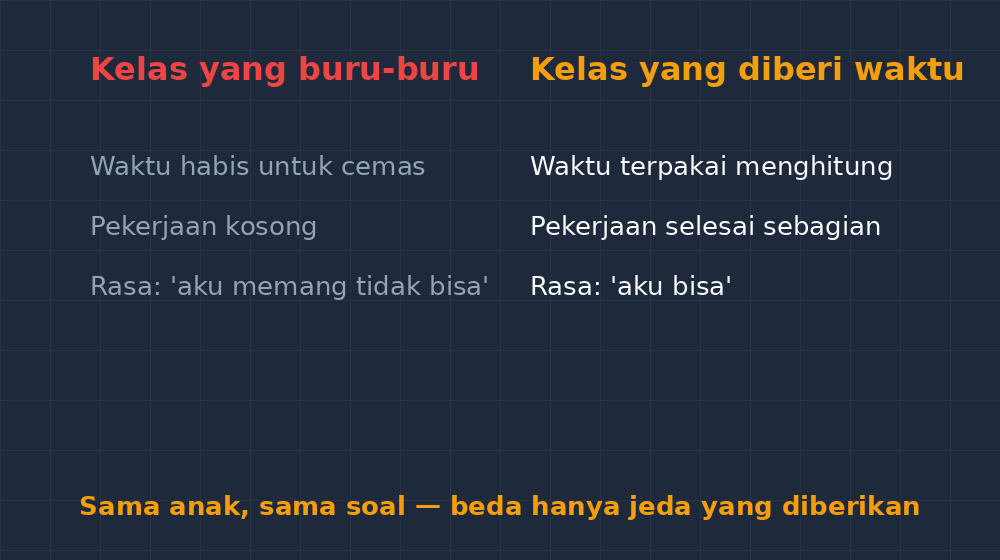

Lembar ulangan terakhir yang saya terima kemarin adalah milik Danu, kelas VII. Bukan karena namanya paling atas, tapi karena memang selalu begitu: tiga puluh menit setelah teman-temannya selesai, Danu masih menunduk menghitung. Ketika saya dekati, tangannya masih bergerak — bukan bingung, bukan menggambar di pinggir kertas, tapi benar-benar menghitung, pelan, satu langkah satu langkah.

<!--more-->

Dulu reaksi saya kurang bijak. Waktu ujian tinggal sepuluh menit, saya suka berdiri di samping meja Danu dan berkata, "Yang bisa dikerjakan dulu saja, Pak." Niatnya menolong. Tapi lihat saja hasilnya: Danu berhenti, menghapus setengah pekerjaan yang sebenarnya benar, lalu mengisi sisa waktu dengan menyalin ulang soal tanpa menyelesaikan apa pun. Waktu yang tersisa habis untuk ketakutan, bukan untuk berhitung.

Anak itu tidak lambat karena tidak bisa. Dia lambat karena setiap langkah dikerjakan dengan sungguh-sungguh. Angka ditulis ulang, dihitung dua kali, dipastikan dulu sebelum melangkah. Persoalannya, sistem kelas kita — jam pelajaran 80 menit, ulangan 40 menit — tidak punya ruang untuk kecermatan seperti itu.

## Kecepatan bukan bagian dari kemampuan matematika

Ada anggapan yang hampir tidak pernah kita katakan secara terang-terangan tapi diam-diam kita jalankan: matematika harus cepat. Yang paling dulu selesai dianggap paling paham. Yang paling akhir, sisa tenaganya tinggal sedikit.

Tapi coba saya tanya balik: kalau dua murid menyelesaikan enam soal persamaan linear dengan benar semua, tapi yang satu butuh 20 menit dan yang satu butuh 45, mana yang paham? Jawaban jujurnya: sama-sama paham. Yang berbeda cuma kecepatan. Dan kecepatan, kalau dipikir lagi, itu lebih dekat ke soal keterampilan prosedur yang terlatih — bukan soal pemahaman.

Bukti yang paling nyolok bagi saya: di ulangan berikutnya, soal yang paling menyulitkan anak-anak cepat justru diselesaikan oleh Danu. Soal cerita yang panjang, yang biasanya dilewati teman-temannya karena malas membaca dua kali. Danu membacanya tiga kali, mencatat yang diketahui dan ditanyakan, baru menghitung — dan jawabannya benar. Anak yang "terlambat" itu ternyata yang paling disiplin membaca soal.

Jadi kalau kelas saya memang berisi anak-anak dengan kecepatan berbeda — dan kelas mana yang tidak — berhenti menilai semuanya dengan ukuran waktu yang sama itu bukan turun dari standar. Itu kejujuran.

## Perbedaan kecil yang bisa dilakukan besok pagi

Saya tidak berbicara tentang program diferensiasi yang butuh kisi-kisi resmi dan persiapan seminggu. Yang saya maksud lebih sederhana dari itu, dan saya sendiri baru mencobanya dua bulan terakhir.

Yang pertama: soal diurutkan dari yang paling mungkin berhasil. Anak yang lambat biasanya menderita di awal — nomor satu susah, dia tersangkut, waktu habis, dan sisanya kosong meski sebenarnya mampu. Sekarang saya susun agar lima soal pertama jelas jalan keluarnya, lalu yang menantang di belakang. Anak seperti Danu sekarang pulang dengan pekerjaan yang selesai sebagian, bukan kosong. Bedanya besar: pekerjaan yang selesai sebagian itu menumbuhkan rasa "aku bisa", pekerjaan yang kosong menumbuhkan rasa "aku memang tidak bisa".

Yang kedua: waktu diberi pilihan, bukan diberi batas. Di latihan biasa (bukan ulangan), saya menuliskan di papan: "15 menit untuk yang paham cepat, lanjut ke soal pengayaan di halaman belakang. Yang butuh lebih lama, pakai sampai habis, tidak apa-apa." Kalimat terakhir itu terdengar sepele, tapi ada murid yang bilang langsung, "Terima kasih, Pak," padahal saya cuma memberi izin untuk tidak buru-buru.

Yang ketiga: mengurangi jumlah soal, bukan mengurangi kedalaman. Dulu saya memberi 10 soal latihan. Sekarang 5 soal, tapi saya minta satu soal di antaranya dijelaskan tulisan tangan kenapa langkahnya begitu — bukan cuma hitungan akhirnya. Hasilnya menarik: murid cepat justru kadang kesulitan menjelaskan (mereka terbiasa melompat), sementara Danu menulis dengan rapi dan panjang, langkah demi langkah, sampai kelihatan alurnya.

Yang keempat mungkin paling penting: mengubah cara saya bicara tentang waktu di depan kelas. Dulu frasa yang sering keluar adalah "cepat dong, teman-temannya sudah selesai". Sekarang saya sadar kalimat itu tidak menyuruh anak menghitung lebih baik — dia hanya menyuruh anak panik. Frasa yang saya pakai sekarang lebih ke arah isi pekerjaan: "Pastikan dua langkah terakhir kamu cek dulu, baru lanjut." arah perhatiannya berpindah dari stopwatch ke kualitas. Dan anehnya, ketika tekanan waktu saya turunkan, kecepatan beberapa anak justru naik dengan sendirinya — mereka tidak lagi menghabiskan energi untuk cemas, karena energi itu kembali dipakai untuk berhitung.

## Kapan "lambat" perlu disikapi lebih serius

*Satu anak yang sama, satu lembar soal yang sama — yang membedakan cuma jeda yang kita berikan.*

Tentu ada batas antara lambat yang wajar dan lambat yang menandakan persoalan lain. Kalau anak lambat *dan* hasilnya salah terus, atau lambat karena daya tahan membacanya rendah, itu perlu penanganan berbeda — bukan sekadar diberi waktu tambahan. Saya tidak berbicara tentang kasus seperti itu di sini.

Kasus Danu beda. Pemeriksaannya benar, logikanya utuh, hanya kecepatan menulis dan menghitungnya memang di bawah rata-rata. Untuk anak semacam ini, memberi waktu lebih bukan memberi belas kasihan — itu hanya memberi ruang yang semestinya. Ibaratnya kita menanam dua jenis tanaman di satu petak: ada yang cepat panen, ada yang akarnya dalam dan butuh lebih lama. Menyiram keduanya dengan jadwal yang sama bukan keadilan; menyiram sesuai kebutuhan, itulah keadilan.

## Penutup: soal yang akhirnya saya ubah

Bapak/Ibu mungkin punya murid seperti Danu di kelas masing-masing — anak yang namanya selalu disebut paling akhir dalam daftar pengumpulan pekerjaan, tapi pekerjaannya justru yang paling rapi kalau dibaca pelan-pelan. Anak semacam ini gampang sekali terlewat di laporan, karena nilainya tidak pernah paling tinggi dan tidak pernah paling rendah. Dia tidak meminta perhatian, tidak membuat masalah, cuma diam-diam membutuhkan sesuatu yang tidak pernah tertulis di kisi-kisi: waktu yang sedikit lebih panjang dan keyakinan bahwa lambat itu bukan aib.

Seminggu lalu saya mengoreksi ulangan Danu. Semua soal yang sempat dia kerjakan benar. Ada satu soal nomor lima yang tidak selesai — dia sempat menulis "kapan-kapan saya selesaikan, Pak" di bagian kosongnya, tulisan tangan miring khas anak kelas VII.

Saya buka buku nilai, dan yang saya catat bukan "belum selesai", tapi "6 dari 7 benar — waktu terbatas, bukan kemampuan". Kalimat panjang untuk satu kolom nilai, memang. Tapi kalimat pendek seperti "belum tuntas" sering kali menyembunyikan cerita yang sebenarnya — dan cerita yang sebenarnya itu penting, bukan cuma untuk raport, tapi untuk cara saya melihat anak itu di kelas nanti.

Anak yang lambat tapi tetap jalan itu, kalau kita beri jalan yang cukup panjang, akan sampai. Persoalannya, selama ini kita yang sering menutup pintu sebelum dia sempat tiba.
