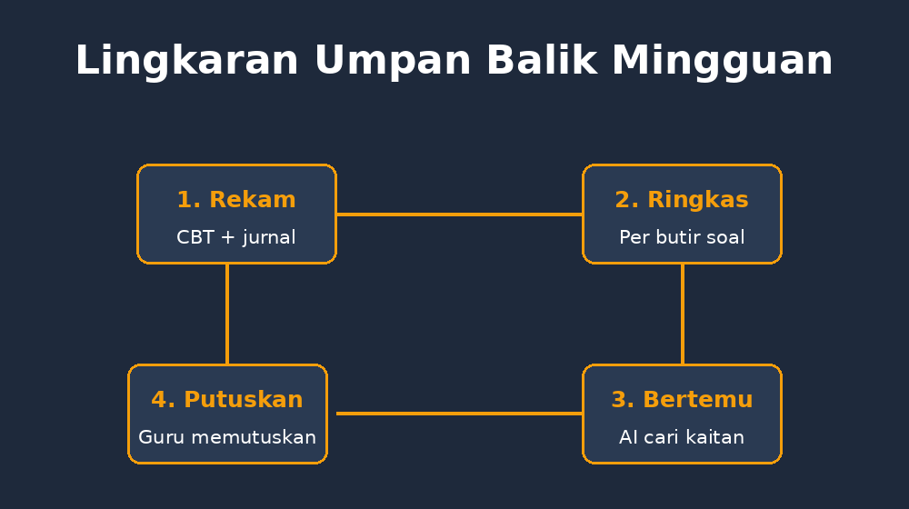

Minggu lalu saya mengalami satu momen yang sebenarnya sudah lama saya cari: seluruh data mengajar saya untuk pertama kalinya saling berbicara. Bukan secara puitis, tetapi secara harfiah. Hasil ulangan CBT kelas VIII menunjukkan satu butir soal tentang penjumlahan bentuk aljabar dijawab benar hanya oleh 31% siswa. Di layar sebelah, jurnal mengajar saya untuk kelas yang sama, minggu yang sama, tercatat satu kalimat refleksi pendek: *“Saya buru-buru hari itu, contoh hanya dua, langsung latihan kelompok.”*

Dua data dari dua aplikasi yang saya bangun sendiri. Selama ini mereka hidup berjauhan — CBT di satu tempat, jurnal di tempat lain. Ternyata begitu ditaruh berdampingan, keduanya saling menjelaskan dengan cara yang tidak bisa dilakukan masing-masing sendirian.

<!--more-->

## Data yang selama ini saling berpapasan

Saya dulu membaca hasil CBT seperti kebanyakan guru: membuka daftar nilai, melihat rata-rata, lalu menggaruk kepala. Kelas yang nilainya rendah, ya diulang pelajarannya. Titik. Yang tidak pernah saya tanyakan dengan serius: *kenapa* materi itu gagal, dan apakah jawabannya ada di cara saya mengajarkannya?

Sebaliknya, jurnal mengajar yang sekarang saya tulis di aplikasi [Teach](https://teach.gezytech.web.id) tiap hari penuh dengan petunjuk seperti itu. Tanggal, materi, kelas, refleksi dua-tiga kalimat. Tapi jurnal punya kelemahan yang sama dengan buku catatan guru mana pun: ia hanya dibaca oleh penulisnya, dan biasanya hanya kalau ingat. Tidak pernah ada yang menyilangkan catatan refleksi saya dengan hasil asesmen siswa secara sistematis.

Padahal kalau dipikir-pikir, keduanya adalah dua sisi dari satu peristiwa yang sama. CBT merekam *apa yang terjadi pada siswa*. Jurnal merekam *apa yang saya lakukan*. Satu peristiwa, dua rekaman, tidak pernah dipertemukan.

## Lingkaran yang akhirnya tertutup

Model yang saya coba bangun sederhana, dan saya gambarkan sebagai lingkaran dengan empat langkah:

1. **Rekam.** Siswa mengerjakan CBT; hasil per butir soal tersimpan. Saya menulis jurnal mengajar hari itu, termasuk refleksi jujur — termasuk kalau saya buru-buru.
2. **Susun ringkasan.** Dari CBT saya ekspor statistik per butir: mana yang persentase benarnya rendah, mana pengecoh yang paling banyak dipilih.
3. **Pertemukan.** Di sinilah AI masuk. Saya tempelkan ringkasan butir soal dan catatan jurnal minggu itu, lalu minta satu hal: cari kaitan antara cara mengajar (dari jurnal) dan pola jawaban (dari CBT).
4. **Keputusan.** AI memberi dugaan, saya yang memutuskan. Remedial, pengulangan konsep, atau justru memperbaiki soalnya.

*Empat langkah lingkaran umpan balik mingguan — AI mencari kaitan, guru memutuskan.*

Langkah ketiga adalah yang dulu mustahil dilakukan manual dengan delapan kelas. Bukan karena sulitnya membandingkan satu soal dengan satu catatan, tetapi karena jumlahnya: berpuluh butir dikali banyak kelas dikali banyak hari. AI memang bagus untuk pekerjaan seperti ini — mencari pola di tempat yang membosankan untuk manusia.

Yang penting ditegaskan: AI di sini tidak menilai saya. Ia hanya menunjukkan hubungan. Keputusan pedagogis tetap milik guru, karena hanya saya yang tahu konteks penuh — siapa yang absen hari itu, kelas mana yang membawa suasana lain, materi mana yang memang sengaja saya lewati cepat.

## Contoh nyata yang bikin saya terdiam

Satu kasus minggu itu. Butir soal tentang sifat distributif: $3(x + 4) = 3x + 12$. Hanya 29% kelas VII B menjawab benar, dan pengecoh $3x + 4$ dipilih oleh separuh siswa yang salah. Kalau berhenti di sini, kesimpulan klasiknya: “siswa belum paham distributif, perlu latihan lagi.”

Tapi ketika AI membaca jurnal saya hari materi itu diajarkan, ada satu hal yang ia sorot: saya hanya memberi *satu* contoh distribusi, dan contohnya angka semua — tidak pernah memakai konteks luas. Kandidat dugaan pertamanya bukan “siswa lemah”, melainkan: pengecoh $3x + 4$ adalah kesalahan yang *dipelajari dari contoh yang terlalu sedikit* — siswa menangkap pola permukaan “kalikan yang pertama saja” karena tidak pernah melihat variasi cukup.

Saya cek ulang soal-soal latihan hari itu di catatan: betul, dari enam soal, empat soal bentuknya hampir identik. Kesalahannya mungkin bukan di kepala siswa, tetapi di menu latihan yang saya sajikan. Minggu ini saya ulang materi itu dengan bermacam-macam bentuk — termasuk bentuk $x(a + b)$ dan bentuk dengan koefisien negatif — sebelum masuk latihan. Baru tiga hari, angka kelas VII B untuk butir serupa sudah melompat.

Momen seperti ini yang membuat saya yakin arah ini layak diteruskan. Bukan karena AI pintar, tetapi karena data yang selama ini terpisah akhirnya dipertemukan. Siswa mendapat remedial yang tepat sasaran, dan saya mendapat cermin yang jujur.

## Hati-hati dengan cermin yang terlalu fasih

Namun saya juga sudah belajar dari [pengalaman-pengalaman sebelumnya](/ai-jangan-langsung-percaya-literasi/) bahwa AI bisa terlalu fasih membuat cerita. Kalau saya hanya memberi statistik tanpa jurnal, ia akan tetap menemukan “penyebab” — entah dari mana. Kalau jurnal saya ditulis dengan nada membenarkan diri, ia akan menemukan alasan yang menenangkan, bukan yang benar.

Jadi ada dua aturan yang saya buat untuk diri sendiri. Pertama, jurnal harus ditulis hari yang sama, sebelum melihat hasil CBT — supaya refleksi tidak “disesuaikan” dengan nilai. Kedua, setiap dugaan AI harus lolos uji sederhana: *apakah ada bukti kedua di data yang mendukung, bukan hanya cerita yang masuk akal?* Dugaan soal distributif tadi lolos karena pola latihan yang hampir identik memang terverifikasi di catatan. Dugaan yang tidak lolos uji, saya buang tanpa merasa kehilangan.

Saya juga berhenti meminta AI menilai kualitas mengajar dengan skala atau angka. Skor “kualitas pengajaran 6/10” itu menggoda, tetapi palsu — tidak ada dasar pengukurannya. Yang berguna adalah hubungan antar-fakta, bukan penilaian keseluruhan.

## Bukan otomatisasi, tapi kebiasaan

Ada godaan untuk membuat semua ini otomatis penuh: CBT kirim data ke jurnal, jurnal kirim ke AI, AI kirim rekomendasi tiap Senin pagi. Saya sengaja tidak melakukannya. Pada bagian yang penting — membaca ringkasan, menguji dugaan, memutuskan — saya mau ada di situ. Karena justru di situ letak tumbuhnya seorang guru: ketika ia dipaksa melihat hubungan antara apa yang ia lakukan dan apa yang terjadi pada anak-anaknya.

Lingkaran refleksi guru itu sebenarnya sudah ada sejak lama: mengajar, menilai, merenung, mengajar lagi. Yang berubah bukan lingkarannya, tetapi kecepatan dan ketelitiannya. Yang dulu butuh saya satu semester untuk menyadari pola di satu kelas, sekarang bisa terlihat dalam satu minggu — karena dua catatan yang dulu saling berpapasan akhirnya duduk bersebelahan.

Dan jujur saja, ada perasaan aneh yang menyertainya: untuk pertama kalinya, aplikasi yang saya bangun malam-malam itu tidak hanya mengerjakan tugas saya, tetapi juga membuat saya jadi guru yang lebih jujur pada diri sendiri.
