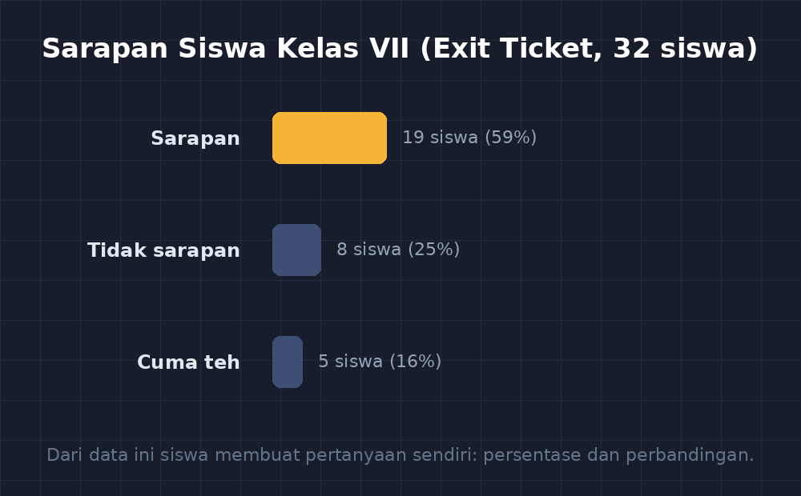

Ada satu lembar kertas yang masih saya simpan sampai sekarang. Bukan lembar soal ulangan, melainkan poster kecil dari puskesmas dekat sekolah tentang gizi anak. Di atasnya ada gambar piring yang dibagi-bagi jadi beberapa bagian: separuh sayur dan buah, seperempat karbohidrat, seperempat lauk. Warna-warninya cerah, tulisannya pendek-pendek, dan di pojok bawah ada angka kecil: "Anak usia SMP butuh sekitar 2.000 kkal per hari."

Poster itu saya pasang di dinding kelas tanpa rencana apa-apa. Saya cuma merasa lucu kalau dinding kelas matematika kosong melompong. Ternyata, poster itulah yang minggu itu memicu percakapan matematika paling hidup di kelas VII. Salah satu siswa bertanya, "Pak, kalau perlu 2.000, terus piringnya segitu berapa kkal?" Dan seketika, tanpa saya suruh, kelasnya masuk ke soal perbandingan senilai.

<!--more-->

## Soal yang Bersembunyi di Dinding

Setelah kejadian itu saya jadi berpikir. Saya sering mengeluh siswa tidak bisa menyelesaikan soal cerita, lalu saya mencari soal cerita baru di buku paket. Padahal, di luar jendela kelas — benar-benar di dinding kelas — sudah ada begitu banyak "soal cerita" yang jauh lebih dekat dengan hidup mereka: infografis.

Infografis itu pada dasarnya kumpulan data yang dikemas dengan gambar. Diagram lingkaran persentase pengguna internet di Indonesia. Grafik garis suhu harian di aplikasi cuaca. Piktogram jumlah kasus demam berdarah di papan informasi puskesmas. Tabel kecepatan dan jarak pemberhentian kendaraan di kantor Samsat. Semuanya berisi angka, perbandingan, perubahan — semua bahasa yang kita ajarkan di kelas matematika.

Bedanya, infografis tidak pernah bertanya "berapa luas" atau "berapa nilai x". Ia cuma berdiri di sana, dan siswa yang harus memutuskan mau bertanya apa. Justru di titik itulah numerasi yang sesungguhnya muncul: kemampuan berpikir matematika ketika tidak ada yang menyuruh kita berhitung.

## Percobaan Pertama: Satu Infografis, Satu Jam

Percobaan serius pertama saya sederhana sekali. Saya ambil satu infografis dari internet tentang pemakaian air bersih rumah tangga — ada diagram batang per kegiatan: mandi, mencuci, menyiram tanaman. Tidak ada soal. Saya tempel di depan kelas dan cuma bilang, "Lihat baik-baik. Sekarang, tiap kelompok bikin satu pertanyaan yang bisa dijawab dari gambar ini."

Awalnya mereka curiga. Biasanya gambar di kelas saya selalu disertai instruksi bernomor. Sekarang tidak ada nomor, dan itu bikin bingung. Kelompok pertama bertanya balik, "Pak, pertanyaannya boleh semudah apa?" Saya jawab, "Yang penting jawabannya ada di data, bukan di tebakan."

Sepuluh menit kemudian, pertanyaan-pertanyaan mulai muncul di papan:

- Berapa persen air yang dipakai untuk mandi dibanding seluruh pemakaian?
- Kalau keluarga mengurangi mencuci pakaian dua kali seminggu, berapa banyak air yang bisa dihemat?
- Kenapa kegiatan menyiram tanaman porsinya kecil padahal kelihatannya sering dilakukan?

Pertanyaan ketiga itu yang paling membuat saya diam. Ia tidak sepenuhnya bisa dijawab dari infografisnya — dan siswa menyadarinya. Mereka belajar hal yang jarang tersentuh di lembar soal: bahwa ada data yang tidak cukup, dan mengenali kekurangan data itu sendiri bagian dari literasi.

## Tiga Jenis Pertanyaan yang Saya Ajarkan

Dari percobaan-percobaan setelahnya, saya perlahan membentuk suatu kebiasaan kecil di kelas. Setiap kita membaca data — entah dari infografis, poster, atau tabel — saya minta siswa melewati tiga tingkat pertanyaan.

Tingkat pertama: **membaca langsung**. Nilai apa yang tertulis? Porsi mana yang paling besar? Ini level yang paling sering dijadikan satu-satunya level di soal pilihan ganda, dan memang penting, tapi tidak berhenti di situ.

Tingkat kedua: **membandingkan dan menghitung**. Di sinilah matematika sekolah bekerja: menghitung selisih, persentase, rata-rata, sampai perkiraan. Kalau infografis menyebut 34% siswa tidak sarapan di sebuah sekolah berisi 480 siswa, berapa banyak anak yang dimaksud? Perhitungannya sederhana, $0{,}34 \times 480 = 163{,}2$, tapi diskusinya tidak: dibulatkan ke 163 atau ke 164? Kenapa jawaban "orang" tidak boleh 163,2? Siswa belajar bahwa angka hasil hitung harus ditafsirkan, bukan hanya ditulis.

Tingkat ketiga: **mempertanyakan data itu sendiri**. Dari populasi berapa survei ini diambil? Kapan datanya dikumpulkan? Siapa yang membuat infografisnya, dan ada kepentingan apa di baliknya? Ini tingkat yang paling sering saya lewatkan dulu, dan justru tingkat inilah yang paling dibutuhkan anak-anak kita di zaman setiap orang bisa membuat grafik dengan bantuan aplikasi dalam lima menit.

## Apa yang Berubah Setelah Itu

Yang paling saya rasakan, kebiasaan membaca infografis membuat soal buku paket terasa berbeda. Ketika siswa bertemu soal cerita tentang data penggunaan listrik atau tabel hasil panen, mereka tidak lagi langsung mengerjakan mekanis. Ada siswa yang bertanya dulu, "Ini datanya dari mana, Pak?" — pertanyaan yang setahun lalu tidak akan terlintas sama sekali.

Ada juga efek yang tidak saya duga. Beberapa siswa mulai membawa infografis sendiri dari rumah: tangkapan layar grafik dari aplikasi ponsel, foto poster di rumah sakit, bahkan satu siswa membawa infografis dari kotak kemasan mi instan tentang kandungan gizi. Ia bertanya, "Pak, sodium 1.100 mg itu banyak atau sedikit?" Kami akhirnya sejam berhitung tentang batas harian sodium, dan saya tidak menyesalikan satu jam pelajaran itu bergeser.

*Gambar: Infografis sederhana tentang sarapan siswa yang kami buat bersama di kelas — datanya berasal dari exit ticket kelas VII sendiri, bukan dari internet.*

Membuat infografis sendiri ternyata juga bagian yang tidak boleh dilewatkan. Membaca data itu satu keterampilan; menyusun data supaya jujur dan mudah dibaca adalah keterampilan yang lain. Siswa yang pernah memutar sumbu diagram supaya terlihat lebih bagus, lalu sadar sendiri bahwa itu menyesatkan, belajar etika data lebih dalam daripada dari nasihat saya.

## Untuk Rekan Guru yang Mau Mencoba

Kalau Bapak/Ibu tertarik mencoba, sebenarnya tidak perlu persiapan besar. Poster di sekitar sekolah, halaman resmi BPS, infografis kesehatan di puskesmas, atau tangkapan layar aplikasi cuaca sudah lebih dari cukup. Kuncinya satu: jangan langsung menyertakan soal. Biarkan siswa yang membuat pertanyaannya dulu, minimal sekali dua kali, supaya mereka merasakan bahwa angka di sekitar mereka memang punya cerita.

Saya juga menyarankan untuk tidak buru-buru menilai. Membaca data butuh waktu diam yang cukup panjang — jauh lebih panjang daripada waktu yang biasa saya beri di lembar soal. Semakin saya sabar menunggu, semakin baik pertanyaan yang keluar.

Dari poster gizi puskesmas yang saya tempel asal-asalan itu, saya belajar satu hal yang sekarang jadi pegangan: numerasi tidak tinggal di bab-bab buku paket. Ia menunggu di dinding kelas, di layar ponsel, di kotak kemasan mi instan. Tugas kita mungkin hanya satu — mengajak siswa berhenti sejenak, dan bertanya.

