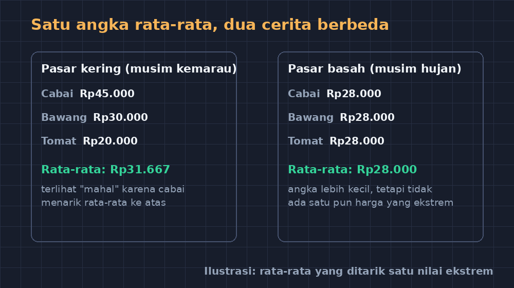

Ada satu angka yang setiap pekan saya catat di jurnal digital saya setelah belanja di pasar Punggur: harga cabai merah. Awalnya hanya kebiasaan iseng — saya penasaran kenapa harga cabai bisa melompat dari dua puluh ribu ke lima puluh ribu hanya dalam dua minggu. Tapi lama-lama catatan pekanan itu berubah jadi bahan mengajar yang tidak saya duga. Dari situ pula saya menemukan satu miskonsepsi statistika yang ternyata sangat umum, bahkan di kalangan orang dewasa: menganggap angka rata-rata hari ini sebagai angka yang berdiri sendiri, tanpa melihat kemana ia bergerak.

<!--more-->

## Dimulai dari Keluh Kesah Ibu-ibu di Pasar

Suatu Sabtu pagi, saya dengar dua ibu berdebat di depan kios sayur. Yang satu mengeluh, "Cabai kok naik terus minggu ini." Yang lain menjawab, "Ah tidak, malah turun. Minggu lalu saya beli tiga puluh dua ribu, sekarang dua puluh delapan ribu."

Dua orang, pasar yang sama, data yang sama — tapi kesimpulan berlawanan. Siapa yang benar? Ternyata, kalau kita lihat harga cabai selama enam pekan, keduanya sama-sama benar dan sama-sama salah. Harga pekan ini memang lebih murah dari pekan lalu, tetapi rata-rata dua pekan terakhir masih jauh di atas rata-rata bulan sebelumnya. Yang satu melihat satu langkah terakhir; yang lain melihat satu titik pembanding. Tidak ada yang melihat *geraknya*.

Nah, di titik inilah konsep yang di kelas VIII kita sebut **rata-rata bergerak** (moving average) jadi jawaban yang paling jujur.

## Masalah Klasik: Rata-rata yang Ditarik Satu Angka

Sebelum bicara indeks musim, saya selalu mulai dari masalah yang lebih sederhana tapi akarnya sama. Pakai contoh harga tiga bumbu dapur di dua kondisi pasar:

Di pasar saat musim kemarau, harga cabai melonjak jadi Rp45.000 sementara bawang dan tomat stabil. Rata-ratanya Rp31.667 — terlihat "mahal". Di musim hujan, semua harga merata Rp28.000 dan rata-ratanya Rp28.000 — terlihat "murah". Padahal kalau diteliti, yang membuat rata-rata kemarau tampak mahal bukanlah harga bawang atau tomat, melainkan satu nilai ekstrem: cabai. Rata-rata itu ditarik ke atas oleh satu angka saja.

Murid-murid saya cepat menangkap ini kalau diceritakan lewat harga jualan, jauh lebih cepat daripada lewat deret angka abstrak $\{20, 22, 24, ...\}$ di papan tulis. Ada satu anak, Maisa, yang spontan bilang, "Berarti rata-rata itu bisa bohong, Bu?" Saya jawab, "Tidak bohong. Dia hanya jujur tapi tidak bercerita lengkap."

## Apa Itu Indeks Musim?

Indeks musim (seasonal index) adalah alat yang lebih halus lagi untuk masalah yang sama. Intinya: berapa "kali lipat normal"-nya sebuah periode dibanding rata-rata keseluruhan?

Misal rata-rata penjualan kios buah Pak Amat sepanjang tahun adalah 200 kg per pekan. Di pekan-pekan dekat Idulfitri, penjualannya rata-rata 260 kg per pekan. Maka indeks musim untuk pekan-prek-idulfitri adalah:

$$\text{Indeks musim} = \frac{260}{200} = 1{,}3$$

Artinya: pekan-prek-idulfitri biasanya 30% lebih ramai dari pekan biasa. Sebaliknya kalau di bulan Ramadan awal penjualan rata-rata 160 kg, indeksnya $\frac{160}{200} = 0{,}8$ — hampir 20% lebih sepi.

Yang membuat indeks musim penting bukan angkanya, tapi apa yang ia lindungi kita dari. Tanpa indeks musim, Pak Amat bisa saja panik, "Ramai-ramainya turun! Bulan ini hanya 180 kg, dari 200 kg." Padahal bulan itu memang bulan yang secara alami sepi. Bandingkan dengan yang seharusnya: 180 kg dibanding ekspektasi $200 \times 0{,}8 = 160$ kg — artinya justru performanya *lebih baik* dari normal. Satu angka mentah, tanpa dikoreksi musim, menyesatkan.

## Di Kelas: Saya Tidak Langsung Pakai Istilah "Indeks Musim"

Jujur, istilah "indeks musim" tidak ada di buku siswa SMP. Yang ada di kelas VIII adalah rata-rata, median, modus, dan sedikit perbandingan. Jadi di kelas, saya tidak pernah membuka pelajaran dengan istilah itu. Saya buka dengan pertanyaan:

> "Kalau toko abc di dekat sekolah tahu bulan Maret selalu sepi, apa yang harus mereka lakukan?"

Jawaban murid-murid biasanya kreatif: bikin promo, tutup sehari, ganti jualan. Dari sana saya tarik: untuk tahu bulan mana yang "memang selalu sepi", kita butuh melihat pola berulang dari data beberapa tahun. Kita butuh angka pembanding yang adil. Baru setelah kebutuhannya terasa, saya perkenalkan nama formalnya.

Langkah per langkah, kami pakai data sederhana: penjualan kios Pak Amat per kwartal, dua tahun. Hitung rata-rata per kwartal antar tahun, hitung rata-rata keseluruhan, bagi. Dua langkah, satu pembagian. Rumit di penjelasan, mudah di kertas.

Yang menarik, konsep perbandingan terhadap nilai pembanding ini tidak baru bagi mereka. Mereka sudah pakai logika yang sama di materi skala ($\frac{\text{jarak di peta}}{\text{jarak sebenarnya}}$) dan di persen. Rasanya seperti bertemu kenalan lama di tempat baru.

## Kenapa Ini Penting untuk Anak SMP?

Saya sering ditanya, "Bukankah ini materi analisis data yang lebih cocok di SMK atau kuliah?" Mungkin. Tapi saya melihat tiga alasan kenapa benihnya perlu ditanam lebih awal.

**Pertama, siswa kita hidup di lingkungan yang penuh angka rata-rata.** "Rata-rata nilai kelas", "rata-rata curah hujan", "rata-rata harga beras naik 5%". Kalau mereka tidak dibiasakan bertanya "rata-rata dari apa, dibandingkan dengan apa, dalam periode mana", mereka akan terus membaca angka seperti ibu-ibu di pasar tadi: mengambil satu titik dan menggeneralisasi.

**Kedua, ini latihan menahan kesimpulan.** Kebiasaan intelektual yang paling sulit diajarkan di SMP adalah menahan diri untuk tidak menyimpulkan dari satu data. Indeks musim, atau sekadar rata-rata bergerak tiga titik, adalah latihan konkret: sebelum berkata "naik" atau "turun", tanyakan dulu — dibanding apa?

**Ketiga, ini jembatan ke literasi data yang mereka butuhkan nanti.** Grafik harga komoditas di aplikasi berita, angka pertumbuhan ekonomi di TV, statistik jumlah pengguna aplikasi di iklan — semuanya angka rata-rata yang punya musim. Anak yang pernah menghitung indeks musim kios buah akan membaca angka-angka itu dengan tanda tanya yang sehat.

## Tantangan di Kelas Nyata

Tentu tidak semua berjalan mulus. Ada tiga hal yang saya catat di jurnal mengajar saya setelah dua kali mengajar ini.

Pertama, murid sering bingung kenapa harus *dibagi* dengan rata-rata keseluruhan, bukan dikurangi. Saya menjawab dengan bahasa mereka: kalau kita bilang "pekan Lebaran = 1,3 kali pekan normal", kelipatan itu lebih gampang dibayangkan daripada selisih 60 kg. Keduanya benar secara matematis, tapi kelipatan lebih portabel — bisa dipakai dibandingkan antar toko dengan ukuran berbeda.

Kedua, data nyata butuh waktu. Kalau saya pakai data fiktif yang terlalu rapi, murid merasa itu cuma latihan. Kalau saya bawa data harga pasar Punggur yang memang berantakan, mereka lebih serius — tapi hitungannya makan waktu 15 menit lebih lama. Solusi saya: data nyata untuk demonstrasi, data setengah-rapi untuk latihan mandiri.

Ketiga — dan ini kesadaran pahit — banyak dari kita guru sendiri belum terbiasa. Ketika rapat membahas "rata-rata nilai ujian sekolah turun 3 poin", kita jarang bertanya, "turun dibanding tren berapa tahun? Apa bulan ini memang bulan ulangan sulit?" Mengajarkan indeks musim memaksa saya juga lebih jujur membaca data sekolah sendiri.

## Penutup: Angka yang Bergerak, Bukan Angka yang Berdiri

Minggu lalu saya lewat lagi pasar Punggur. Harga cabai sudah turun ke dua puluh dua ribu. Ibu-ibu yang dulu berdebat sekarang sepaham: "Sudah turun, ya, Bu." Mereka benar — dan saya diam-diam senang, karena harga pekan ini memang lebih rendah dari rata-rata empat pekan terakhir. Kesimpulan mereka kali ini bukan lagi tebakan dari satu titik, tapi kesimpulan yang kebetulan cocok dengan yang benar.

Di kelas, hal yang saya harapkan dari murid-murid saya persis seperti itu: bukan hafal rumus indeks musim, tapi terbiasa bertanya "dibanding dengan apa?" setiap kali melihat angka rata-rata. Karena di dunia nyata, angka tidak berdiri diam — ia bergerak, ia punya musim, dan tugas kita adalah membaca gerakannya, bukan sekadar potretnya.
