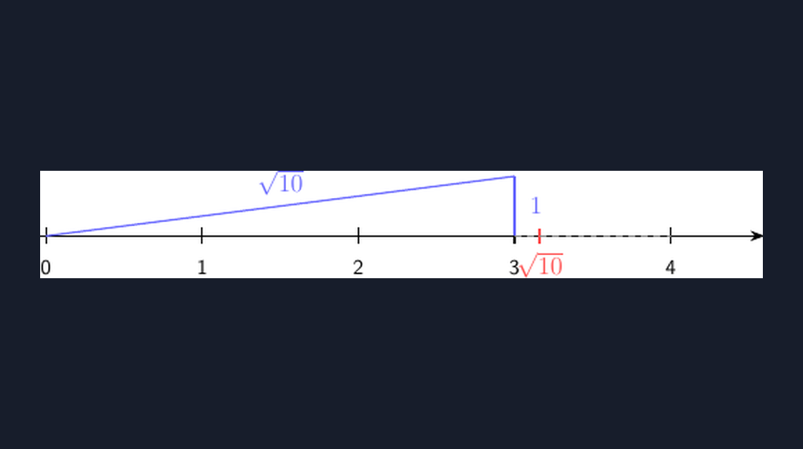

Kelas VII kami sedang belajar bilangan kuadrat dan akar kuadrat. Di satu titik, seorang anak bernama Rafi mengangkat tangan dan bertanya pertanyaan yang selalu saya tunggu setiap tahun: "Pak, kalau akar sepuluh itu kira-kira tiga koma satu enam, terus dia di mana? Sumbu berapa?"

Pertanyaan itu terdengar sederhana, tapi sebenarnya dalam. Selama ini siswa kami menghitung $\sqrt{10}$ sampai dapat dua desimal, lalu jawabannya "selesai" di lembar jawaban. Angka itu tidak pernah punya alamat. Tidak pernah berdiri di mana pun. Bagi banyak anak, $\sqrt{10}$ hanyalah tombol kalkulator yang mengeluarkan angka aneh. Padahal kalau mereka bisa *melihat* di mana bilangan itu berada di garis bilangan — benar-benar di antara 3 dan 4, lebih dekat ke 3 — sesuatu akan klik: bilangan irasional bukan makhluk abstrak, dia punya tempat duduk yang tetap.

<!--more-->

## Masalahnya: tebakan yang tidak bisa diuji

Cara yang biasa saya pakai dulu adalah meminta siswa menaksir. $\sqrt{9} = 3$ dan $\sqrt{16} = 4$, jadi $\sqrt{10}$ pasti di antara 3 dan 4. Karena 10 hanya sedikit lebih besar dari 9, akarnya hanya sedikit lebih besar dari 3. Bagus, tapi ada kelemahan besar di cara ini: semua kesimpulannya bertumpu pada perasaan. "Sedikit lebih besar" — sedikit itu berapa? Kalau siswa menaruh tanda $\sqrt{10}$ terlalu dekat ke 3 atau terlalu jauh, tidak ada cara untuk memeriksanya di kertas. Tebakan yang tidak bisa diuji bukan matematika penuh; dia baru setengah jalan.

Di titik ini saya teringat materi lama yang sudah pernah saya tulis di blog ini: menggambar segitiga siku-siku yang jujur dengan TikZ. Waktu itu tujuannya supaya sisi miring tidak digambar asal miring. Sekarang segitiga yang sama saya pakai untuk tujuan yang lain — bukan hanya untuk menghitung panjang sisi miring, tapi untuk *menemukan alamat* sebuah bilangan.

## Ide yang sudah berumur lebih dari dua ribu tahun

Gagasan ini bukan barang baru. Orang-orang Yunani kuno sudah melakukannya dengan tali dan patok: kalau ada segitiga siku-siku dengan kaki mendatar 3 dan kaki tegak 1, maka sisi miringnya — menurut teorema Pythagoras — panjangnya

$$c = \sqrt{3^2 + 1^2} = \sqrt{10}.$$

Nah, sekarang triknya. Pasang jangka (atau dalam bahasa gambar: jaring lingkaran) di titik nol, buka sejauh panjang sisi miring itu, lalu *potong garis bilangan*. Titik potong itulah alamat $\sqrt{10}$. Bilangan yang tadinya cuma angka desimal di kalkulator tiba-tiba punya lokasi yang bisa ditunjuk dengan ujung pensil.

Yang saya suka dari aktivitas ini: siswa bisa memverifikasi sendiri. Tanda $\sqrt{10}$ harus jatuh sedikit di kanan 3, dan jaraknya ke 3 harus jelas lebih kecil daripada jarak 3 ke 4. Kalau siswa menggambar dan tandanya jatuh di 3,5 — jelas ada yang salah, dan mereka bisa mencari salahnya sendiri. Itu bagian yang menurut saya paling bernilai secara matematika.

## Menerjemahkannya ke TikZ

Seperti kebiasaan saya belakangan ini, saya ingin aktivitas ini punya versi digital yang presisi — gambar di lembar kerja yang bisa saya cetak berulang, dengan geometri yang tidak mengelabui. Berikut bagian inti dari kodenya (berkas lengkapnya saya sertakan di akhir tulisan ini):

```latex
\begin{tikzpicture}[x=2.6cm, y=1cm]
  \draw[thick, -{Stealth}] (-0.6,0) -- (4.6,0);
  \foreach \x in {0,...,4}
    \draw[thick] (\x,0.14) -- (\x,-0.14) node[below=4pt] {\x};
  % segitiga siku-siku: kaki 3 dan kaki 1
  \draw[thick, blue!60] (3,0) -- (3,1);
  \draw[thick, blue!60] (0,0) -- (3,1);
  % tanda potong di sqrt(10) ~ 3.16
  \draw[very thick, red!70] ({sqrt(10)},-0.12) -- ({sqrt(10)},0.12);
\end{tikzpicture}
```

Dua hal di kode ini yang ingin saya garis bawahi. Pertama, skala sumbu: `x=2.6cm, y=1cm`. Skala x dan y saya buat *berbeda* dengan sengaja — kalau sama, segitiga dengan kaki 3 dan kaki 1 akan terlihat sangat landai dan tanda $\sqrt{10}$ yang cuma 0,16 di kanan angka 3 akan nyaris menempel, susah dibedakan oleh mata siswa. Dengan skala yang sedikit diregangkan, perbedaan yang menentukan justru jadi terlihat. Ini keputusan pedagogis yang disamarkan sebagai pengaturan teknis.

Kedua, ada `({sqrt(10)}, ...)`. TikZ menghitung posisi ini secara matematis, jadi tanda merah itu tidak diketarik-tebar pakai perasaan — dia benar-benar berada di $\sqrt{10}$. Gambar yang kita janjikan "jujur" pada siswa memang harus jujur sampai ke koordinatnya.


*Segitiga siku-siku dengan kaki 3 dan 1. Sisi miringnya $\sqrt{10}$; potongan merah di garis bilangan adalah alamat bilangan itu — sedikit di kanan 3, jelas sebelum 4.*

## Dari gambar ke aktivitas kelas

Gambar ini saya jadikan lembar kerja sederhana dengan tiga tahap. Tahap pertama, siswa menaksir dulu tanpa alat: di antara bilangan bulat mana $\sqrt{10}$ berada, dan lebih dekat ke yang mana? Tahap kedua, mereka menghitung sisi miring segitiga dengan Pythagoras dan memakai jangka di kertas untuk "memutar" panjang itu ke garis bilangan. Tahap ketiga — yang paling ramai — setiap kelompok mengukur jarak tanda mereka ke angka 3 dengan penggaris, lalu kita bandingkan antar kelompok. Kelompok yang tandanya paling pas langsung jadi bintang lima menit.

Tahun ini ada satu momen yang ingin saya simpan. Seorang siswa, Dinda, setelah memotong garis bilangan dengan jangkanya, berkata pelan: "Jadi akarnya bisa digambar, Pak? Kirim tidak bisa." Kalimat itu yang membuat saya tetap rela menyiapkan gambar-gambar seperti ini. Bagi saya, $\sqrt{10}$ baru benar-benar "ada" bagi Dinda pada detik itu — bukan saat dia menghitung 3,162 di kalkulator, tapi saat ujung jangkanya menandai titik itu di kertas.

## Lanjutan yang menyambung

Aktivitas ini tidak berhenti di $\sqrt{10}$. Minggu berikutnya kami ulangi untuk $\sqrt{5}$ (kaki 2 dan 1), $\sqrt{13}$ (kaki 3 dan 2), dan akhirnya $\sqrt{2}$ — yang paling bersejarah, bilangan yang konon membuat para Pythagoras oleng kepercayaannya. Dengan pola yang sama, siswa mulai membangun peta bilangan irasional di garis bilangan mereka sendiri, satu segitiga demi satu segitiga. Beberapa yang rajin bahkan bertanya: kalau $\sqrt{10}$ dan $\sqrt{5}$ sudah punya alamat, apakah $\sqrt{10} - \sqrt{5}$ tinggal dihitung jaraknya? Jawabannya ya — dan pada titik itu mereka sudah bermain aritmetika bilangan irasional tanpa sadar, hanya dengan penggaris dan jangka.

Bagi saya, ini juga pelajaran tentang apa yang selama ini kurang dari latihan hitung biasa. Menghitung $\sqrt{10}$ sampai dua desimal menghasilkan *angka*. Menggambar $\sqrt{10}$ di garis bilangan menghasilkan *makna lokasi* — dan untuk anak usia SMP, makna hampir selalu datang lewat yang bisa dilihat dan disentuh. Kalkulator memberi jawaban dalam setengah detik, tapi tidak pernah menunjukkan di mana jawaban itu tinggal.

> 📎 **Berkas TikZ lengkap:** [menaksir-akar-kuadrat-garis-bilangan-tikz.tex](tex/menaksir-akar-kuadrat-garis-bilangan-tikz.tex) — siap kompilasi (butuh paket `tikz`).
