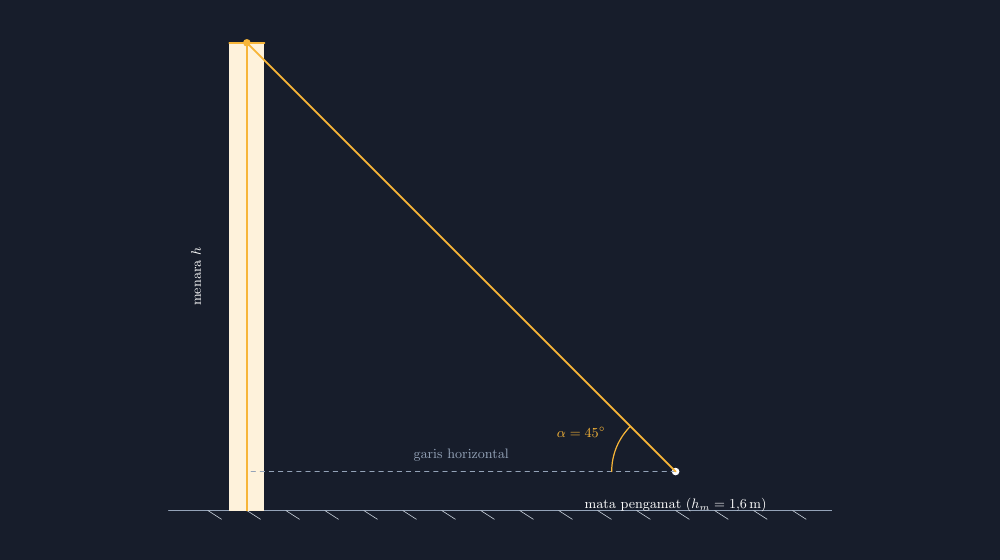
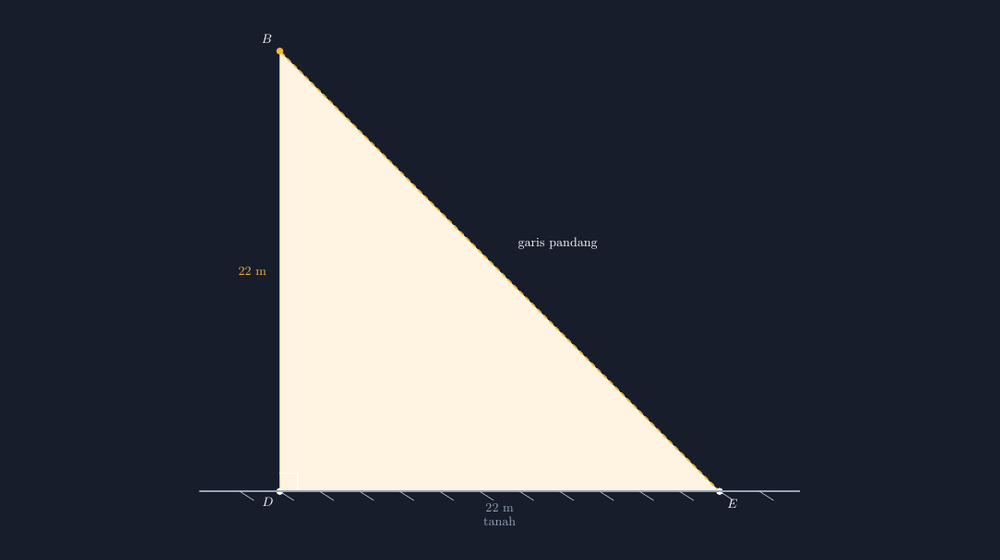

Soal trigonometri tentang menara itu sudah seperti bahan baku wajib di kelas VIII. Sebuah menara berdiri di tanah datar, seorang pengamat berdiri beberapa meter darinya, lalu ia mendongak ke puncak menara dengan sudut tertentu. Hitunglah tinggi menara. Setiap tahun soal seperti ini muncul, dan setiap tahun juga saya menggambar situasinya di papan tulis dengan cara yang sama: persegi panjang tinggi mewakili menara, garis miring dari bawah, dan sebuah sudut yang saya gambar "kira-kira di sana".

Tahun lalu, saat membahas soal seperti itu, seorang siswa — sebut saja Rani — mengajukan pertanyaan yang membuat saya berhenti sejenak. "Pak, sudutnya kok kayak lebih besar dari 45 derajat ya? Digambar kok rasanya kayak 60-an?" Saya menatap papan. Ia benar. Garis pandang yang saya gambar cepat-cepat itu turun dengan kemiringan yang tidak sesuai dengan sudut 45 derajat yang tertulis. Angka di soal mengatakan 45°, tapi gambar saya sedang berbohong.

<!--more-->

## Soal yang Menjadi Bahan Cerita Kali Ini

Soal yang saya pakai kurang lebih begini: sebuah menara berdiri di tanah datar. Pengamat yang matanya berada pada ketinggian 1,6 m dari tanah berjarak 22 m dari kaki menara. Sudut elevasi puncak menara dari mata pengamat adalah 45°. Berapa tinggi menara?

Situasinya saya gambar ulang dengan TikZ, kali ini dengan koordinat yang benar-benar dihitung, bukan ditaksir:

*Gambar 1. Menara, mata pengamat, garis horizontal, dan sudut elevasi $\alpha = 45^\circ$. Garis pandang pada gambar ini benar-benar membentuk sudut 45° terhadap garis horizontal, karena koordinat ujungnya dihitung, bukan ditarik asal.*

Perhatikan satu hal yang sering hilang pada gambar-gambar soal: garis horizontal itu digambar dari *mata* pengamat, bukan dari tanah. Sudut elevasi didefinisikan sebagai sudut antara garis pandang dan garis horizontal **yang melalui mata pengamat**. Di kelas, ini justru sumber kebingungan yang paling sering saya temui. Murid yang menyeret garis horizontalnya ke tanah akan menghitung tinggi menara langsung dari tanah, dan jawabannya meleset sebesar tinggi mata pengamat.

## Memungut Segitiga dari Gambar

Cara yang saya ajarkan untuk menyelesaikan soal seperti ini sederhana: gambar dulu situasinya, lalu "pungut" segitiga siku-sikunya ke tempat yang lebih lega. Dari gambar situasi tadi, segitiganya begini:

*Gambar 2. Segitiga siku-siku $BDE$: $D$ tepat sejajar dengan mata pengamat, $B$ puncak menara, $E$ mata pengamat. Sisi $BD$ adalah tinggi menara di atas garis mata, bukan tinggi menara dari tanah.*

Sekarang perhitungannya jujur. Karena sudut elevasinya 45° dan segitiganya siku-siku di $D$:

$$\tan 45^\circ = \frac{BD}{DE} = \frac{BD}{22}$$

$$BD = 22 \tan 45^\circ = 22 \times 1 = 22 \text{ m}$$

Tinggi menara dari tanah adalah tinggi segitiga ditambah tinggi mata pengamat:

$$h = BD + h_m = 22 + 1{,}6 = 23{,}6 \text{ m}$$

Soal ini saya sengaja pilih karena angkanya bersahabat — 45° membuat segitiganya sama kaki, sehingga siswa bisa menebak dulu jawabannya sebelum menghitung. Justru di titik itulah gambar berperan: kalau gambar tidak jujur, murid yang menaksir dari gambar akan mendapat tebakan yang salah, dan kepercayaan pada gambar itu hancur. Kalau gambar jujur, menaksir menjadi kebiasaan yang sehat — seperti yang sering saya tuliskan di [artikel tentang menaksir sebelum menghitung](https://pakgun.gezytech.web.id/menaksir-sebelum-menghitung-kebiasaan-kecil-yang-menyelamatkan-jawaban/).

## Kesalahan yang Saya Temui di Kelas

Dari pembahasan soal ini, ada tiga kesalahan yang hampir selalu muncul, dan ketiganya bisa dideteksi lewat gambar:

**Pertama, garis horizontal dari tanah.** Murid menggambar garis horizontalnya dari kaki menara, bukan dari mata pengamat. Kalau gambar soalnya sendiri sudah menggambar dari mata pengamat dengan jelas — seperti Gambar 1 di atas — kesalahan ini jauh lebih jarang. Gambar yang benar adalah pengajaran yang bekerja diam-diam.

**Kedua, lupa menambah tinggi mata.** Murid menghitung $BD = 22$ m lalu melaporkan tinggi menara 22 m. Angkanya masuk akal, jadi tidak ada alarm yang berbunyi. Di sinilah gambar situasi yang memperlihatkan $h_m$ secara eksplisit membantu: kotak kecil "menara" di gambar terlihat lebih tinggi dari segitiganya, dan murid yang jeli akan bertanya, "Pak, terus bagian bawah menaranya?" Pertanyaan itu adalah momen pembelajaran yang tidak bisa dicapai soal polos tanpa gambar.

**Ketiga, tangen dan sinus tertukar.** Kalau sudutnya bukan 45°, murid kadang memakai $\sin$ untuk sisi yang seharusnya dihitung dengan $\tan$. Kebiasaan memungut segitiga dan menandai sudutnya — sudut elevasi di $E$, siku di $D$, sisi depan $BD$, sisi datar $DE$ — membuat pilihan rasio tidak lagi ditebak dari hafalan SOH-CAH-TOA semata, tapi terlihat dari letak sisi di gambar.

## Kenapa Gambar Saya Buat dengan TikZ, Lagi

Mungkin ada yang bertanya: untuk soal segitiga siku-siku sederhana ini, repot-repot TikZ? Bisa saja saya gambar di aplikasi gambar biasa. Tapi pengalaman saya selama ini konsisten: gambar matematika yang digambar "asal mirip" selalu menipu pada hal yang paling penting. Untuk sudut elevasi, hal itu adalah kemiringan garis pandang. Mata manusia ternyata cukup jeli membaca kemiringan — Rani mendeteksi kebohongan 45° yang saya gambar hanya dengan menatapnya — tapi kurang jeli pada kesejajaran dan ketinggian, sehingga kesalahan lain lolos tanpa terdeteksi.

TikZ menutup celah itu dengan cara yang paling saya sukai: sudutnya *dijamin* oleh koordinat. Pada Gambar 1, ujung garis pandang saya taruh di koordinat yang jarak horizontalnya sama dengan jarak vertikalnya dari mata pengamat, sehingga sudut 45° itu bukan klaim, melainkan konsekuensi. Kalau besok saya mengubah soalnya menjadi sudut 60°, saya tinggal mengganti koordinat ujung garis pandang dengan perhitungan $\tan 60°$ — dan gambar baru otomatis jujur lagi. Inilah alasan saya terus menulis rangkaian artikel TikZ ini: bukan karena saya ingin gambar yang cantik, tapi karena saya ingin gambar yang tidak perlu saya minta maaf ke Rani.

Untuk rekan guru yang ingin memakai atau memodifikasi gambar-gambar di artikel ini, berkas TikZ lengkapnya saya sertakan. Dua gambar di atas berasal dari berkas yang sama, tinggal dikompilasi.

> 📎 **Berkas TikZ lengkap:** [menara-sudut-elevasi-tikz.tex](tex/menara-sudut-elevasi-tikz.tex) — siap kompilasi (butuh paket `tikz`).
