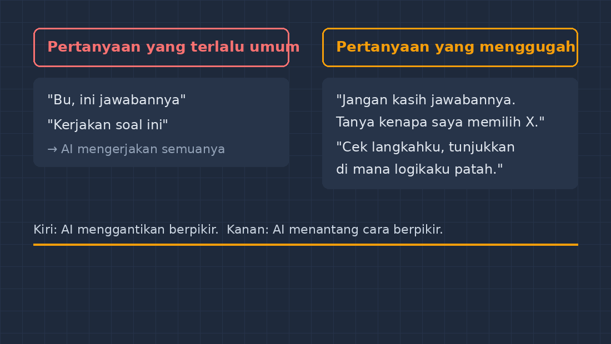

Sepanjang bulan lalu, saya mulai menyadari sesuatu yang aneh di kelas VII. Ada beberapa siswa yang tiba-tiba jawabannya rapi, langkahnya lengkap, dan benar. Terlalu benar. Seorang murid yang biasanya kewalahan menyelesaikan soal persamaan linear, tiba-tiba menuliskan solusi tiga baris dengan notasi yang bahkan tidak pernah saya ajarkan. Saat saya tanya, "Coba jelaskan langkah kedua ini, kenapa pindah ruas?", dia terdiam, lalu jujur: "Ini dari aplikasi AI, Pak."

<!--more-->

Reaksi pertama saya waktu itu, kalau saya boleh jujur, adalah keinginan untuk melarang. Apalagi di grup guru, topik ini hampir selalu berakhir dengan satu kata: blokir. Tapi semakin saya pikir-pikir, semakin saya yakin larangan itu tidak akan menyelesaikan apa pun. Murid-murid kami tinggal di lingkungan yang sama dengan kita; aplikasi AI ada di ponsel mereka, gratis, dan tinggal diketik. Sama seperti yang terjadi dengan kalkulator satu-dua dekade lalu, menyuruh mereka tidak menggunakannya hanya membuat mereka menggunakannya diam-diam — tanpa kita, tanpa bimbingan, tanpa kesempatan kita mengajari cara yang benar.

Maka pertanyaannya bergeser. Bukan "bagaimana mencegah murid memakai AI?", melainkan "apa yang harus bisa murid agar AI tidak membuat mereka malas berpikir?"

## Masalahnya Bukan di Jawabannya, Tapi di Pertanyaannya

Dari beberapa percakapan yang saya lakukan dengan murid-murid yang jujur, saya menemukan pola yang hampir seragam. Ketika mereka bertanya kepada AI, pertanyaannya biasanya seperti ini: "Kerjakan soal nomor tiga halaman 121." Selesai. AI pun menjawab sesuai permintaan: mengerjakan nomor tiga halaman 121, dari langkah pertama sampai jawaban akhir.

Masalahnya jelas: tidak ada proses berpikir sama sekali dari pihak murid. AI di sini dipakai seperti mesin fotokopi yang bisa bicara. Dan yang membuat saya prihatin, dari semua keterampilan yang mereka perlukan untuk memakai AI dengan sehat, justru keterampilan merumuskan pertanyaan itulah yang tidak pernah diajarkan di buku kurikulum mana pun.

Kemudian saya mencoba sesuatu di kelas. Saya ambil satu sesi, dan alih-alih melarang AI, saya menantang mereka: "Kalian boleh pakai AI untuk tugas ini. Tapi ada satu syarat — kalian tidak boleh meminta jawabannya. Kalian hanya boleh bertanya tentang prosesnya."

Aturan sederhana itu mengubah semuanya. Murid yang tadi hanya mengetik "kerjakan soal ini" sekarang terpaksa merumuskan hal seperti: "Aku sudah sampai di langkah $2x = 14$, tapi aku bingung kenapa koefisiennya dibagi. Jangan kasih jawabannya, cuma jelasin konsepnya." Untuk bisa mengetik pertanyaan seperti itu, dia **harus** membaca soal, mencoba sendiri, dan menemukan titik di mana dia tersendat. Berpikir tidak hilang — dia cuma berpindah tempat: dari sebelum AI dipakai, menjadi saat merumuskan pertanyaan.

Gambar di atas saya buat berdasarkan yang benar-benar terjadi di kelas: kiri adalah pertanyaan yang membuat AI menggantikan berpikir, kanan adalah pertanyaan yang membuat AI menantang cara berpikir. Bedanya satu kalimat, tapi dampaknya di otak murid sangat jauh.

## Prompting sebagai Keterampilan Berpikir

Setelah beberapa kali latihan seperti itu, saya mulai melihat bahwa yang kita sebut "prompting" ini sebenarnya bukan keterampilan teknologi. Dia adalah keterampilan berpikir yang menyamar jadi istilah teknologi. Coba perhatikan apa saja yang harus dilakukan murid ketika dia diminta membuat pertanyaan yang baik kepada AI:

Pertama, dia harus bisa mengenali **apa yang sudah dia pahami dan apa yang belum**. Ini sesuatu yang sangat sulit, bahkan untuk orang dewasa. Murid yang bilang "aku tidak mengerti" padahal sebenarnya hanya tersandung di satu langkah kecil — dia belum punya peta kesulitannya sendiri. Merumuskan pertanyaan kepada AI memaksa dia membuat peta itu: bagian mana yang jelas, bagian mana yang kabur.

Kedua, dia harus bisa **memecah kebingungan besar menjadi pertanyaan kecil yang spesifik**. Ini persis keterampilan yang kita latih saat mengajarkan penyelesaian masalah di matematika: memecah soal cerita rumit menjadi beberapa persamaan sederhana. Murid yang belajar bertanya kepada AI sebenarnya sedang berlatih dekomposisi — keterampilan yang sama yang dipakai matematikawan.

Ketiga, dia harus bisa **menilai jawabannya**. AI bisa salah. AI bisa menjawab soal dengan percaya diri tapi langkahnya keliru, misalnya salah menyederhanakan $-3(x-2)$ menjadi $-3x - 6$ padahal seharusnya $-3x + 6$. Murid yang terbiasa menerima jawaban tanpa memeriksa akan tergantung selamanya. Tapi murid yang kita latih untuk selalu bertanya "masuk akalkah ini kalau dicek ulang?" sedang membangun kebiasaan verifikasi — dan kebiasaan itu jauh lebih berharga daripada hafalan rumus apa pun.

Jadi ketika orang bertanya kepada saya, "Jadi Bapak mengajarkan anak-anak cara pakai AI?" jawaban saya sekarang: bukan. Saya mengajarkan mereka cara **berpikir dengan bantuan AI**. Teknologinya cuma alat peraga, seperti OHP dulu atau proyektor sekarang.

## Ketika AI Tidak Bisa Dipercaya Sepenuhnya

Ada satu momen yang saya rasa penting untuk diceritakan. Di salah satu latihan, seorang murid menanyakan soal tentang luas gabungan bangun datar ke aplikasi AI. Jawabannya keluar lengkap, dengan langkah dan gambar deskripsi. Masalahnya, di tengah jawaban itu AI menulis rumus luas trapesium dengan salah tanda — dan murid itu memindahkan semuanya ke buku tanpa membaca ulang.

Saat saya tunjukkan, dia terkejut: "Kok bisa salah, Pak? Aku kira AI selalu benar."

Percakapan itu jadi jembatan untuk diskusi kelas yang tidak saya rencanakan tapi ternyata paling berkesan: kalau AI bisa salah dengan tampak sangat yakin, apa yang harus kita lakukan? Jawaban yang kami bangun bersama sederhana tapi kuat: **jadilah orang yang tidak mudah percaya, termasuk pada mesin dan termasuk pada guru.** Cek ulang. Uji dengan contoh lain. Tanyakan "kenapa" sampai masuk akal. Ketika murid memperlakukan AI seperti sumber yang perlu diperiksa, bukan perintah yang harus dilaksanakan, sesuatu yang menarik terjadi: mereka justru jadi lebih kritis kepada semua sumber — termasuk materi di internet, termasuk kata teman, termasuk saya.

Ini bukti bahwa kecemasan banyak guru tentang AI itu sebenarnya bisa dibalik. Yang kita takutkan bukan kehadiran teknologinya, tapi kebiasaan murid menerima apa saja tanpa menyaring. AI itu seperti memperbesar kebiasaan yang sudah ada: murid yang terbiasa berpikir akan jadi lebih produktif dengan AI, murid yang terbiasa asal-comot akan asal-comot lebih cepat. Tugas kita bukan menghilangkan AI, tapi memperbaiki kebiasaan yang diperbesar itu.

## Hal Kecil yang Saya Coba Selanjutnya

Saya belum sampai ke mana-mana. Ini masih eksperimen kelas biasa, dengan keterbatasan yang nyata: hanya sebagian murid punya akses ponsel dan kuota di rumah, jadi latihan seperti ini tidak bisa jadi tugas wajib untuk semua. Yang bisa saya lakukan untuk sekarang adalah memanfaatkan momen di kelas — ketika ada murid yang membawa jawaban AI, saya jadikan itu bahan diskusi, bukan alasan hukuman.

Rencana saya berikutnya sederhana: membuat "kartu pertanyaan" — beberapa contoh rumusan pertanyaan yang bisa dipakai murid untuk bertanya kepada AI tanpa mencuri kesempatan berpikirnya sendiri. Sesuatu seperti: "Jelaskan konsepnya, jangan jawabannya", "Cek langkahku dan tunjukkan di mana logikaku patah", "Beri aku soal serupa untuk menguji apakah aku benar-benar paham". Kalau kartu ini sudah jadi dan terbukti berguna di kelas, saya akan tulis lagi di blog ini.

Bagi Bapak/Ibu guru yang membaca ini dan sedang galau antara melarang atau membiarkan, mungkin bisa mulai dari pertanyaan yang sama dengan saya: bukan teknologinya yang kita takutkan, tapi murid yang tidak pernah kita ajari cara bertanya dengan baik. Karena pada akhirnya, AI tidak menggantikan kemampuan berpikir murid — yang dia gantikan adalah **kesempatan berpikir yang tidak kita rancang**. Dan merancang kesempatan itu, seharusnya, pekerjaan kita sebagai guru.
