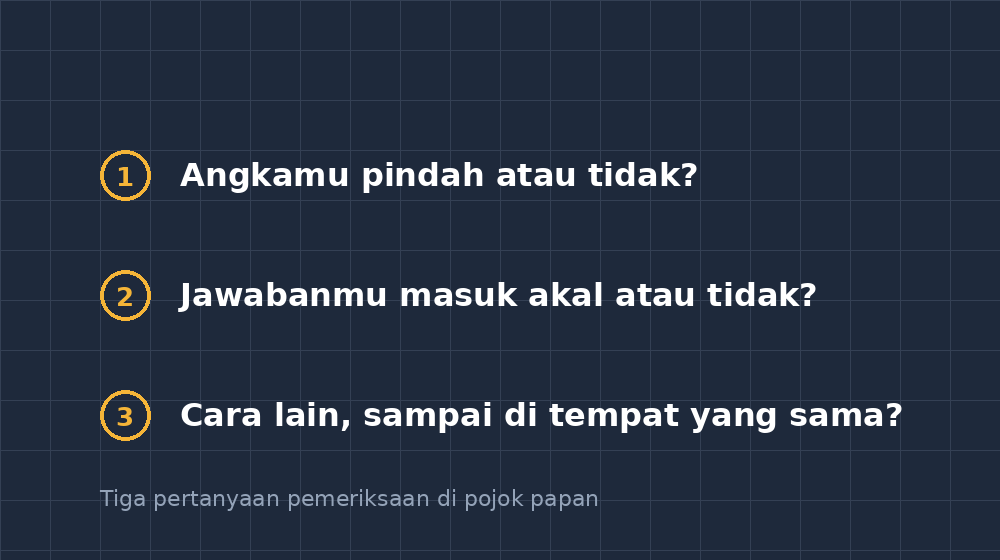

Di kelas VIII, ada seorang anak bernama Rafi yang punya kebiasaan menutup bukunya begitu bilangan terakhir selesai ditulis. Ulangan kali ini soalnya soal cerita panjang: sebuah truk membawa karung beras, sampai rumah si A, sampai harga, sampai sisa uang. Saya periksa lembarannya sore itu dan langkah-langkahnya rapi. Perhitungan pertama benar. Yang kedua benar. Tapi di langkah terakhir, Rafi salah menyalin angka dari baris atas — yang tadi tertulis 38, di baris bawah ia tulis 83 — dan jawabannya langsung kejedot jauh.

Yang bikin saya diam bukan angka 38 yang jadi 83. Saya sendiri di rumah guru sering begitu, bahkan minggu lalu waktu mengetik soal di aplikasi saya. Yang bikin diam: begitu saya tunjukkan, Rafi menemukan salahnya dalam waktu kurang dari sepuluh detik. Artinya, kemampuan memeriksa itu ada di dalam dirinya. Ia cuma tidak pernah diberi waktu dan kebiasaan untuk memakainya.

## Memeriksa bukan bonus, itu bagian dari mengerjakan

Saya mulai sadar bahwa selama bertahun-tahun saya mengajar matematika dengan alur yang diam-diam aneh. Siswa disuruh mengerjakan dengan teliti, lalu kertasnya diambil, lalu saya yang memeriksa. Semua kebiasaan pemeriksaan itu "di-paksa-pindah" ke saya. Siswa tidak pernah belajar cara membaca kembali pekerjaannya sendiri, karena di dalam sistem kelas kami, langkah itu bukan tugasnya.

Padahal kalau dipikir-pikir, kebiasaan memeriksa itu justru lebih sering menyelamatkan daripada kebiasaan menghitung dengan cepat. Anak yang hanya bisa menghitung cepat akan tetap menabrak kesalahan salin, kesalahan tanda, kesalahan satuan. Anak yang membiasakan diri memeriksa bisa menabrak, lalu mundur dan memperbaiki sendiri. Di kehidupan nyata — waktu menghitung total belanja di warung, waktu memeriksa kembalian, waktu menyusun jadwal — tidak ada guru di sebelah yang berkata "hayo, coba cek lagi baris ketiga."

Jadi saya menarik kebiasaan itu kembali ke kelas. Masalahnya: menyuruh "cek lagi jawabanmu" itu tidak berguna. Siswa akan membaca sekilas, menemukan semua jawaban sesuai niatnya, lalu menutup buku lagi. Perintah yang terlalu umum tidak menghasilkan pemeriksaan sungguhan.

## Tiga pertanyaan yang lebih berguna daripada "sudah dicek?"

Yang akhirnya terbukti jalan adalah saya mengubah perintah "periksa" menjadi tiga pertanyaan yang pendek dan menyebutkan objeknya, ditulis di pojok papan setiap kali ulangan atau latihan:

1. **Angkamu pindah atau tidak?** Periksa: angka yang di baris atas sama dengan yang dipakai di baris bawah. Kesalahan salin seperti milik Rafi itu penyakit nomor satu di kelas saya.
2. **Jawabanmu masuk akal atau tidak?** Kalau soalnya umur manusia, tidak mungkin hasilnya 340 tahun. Kalau soalnya sisa uang, tidak mungkin lebih besar dari uang semula. Ini pertanyaan estimasi: menakar dulu, seperti yang sering saya tulis di blog ini, tapi diarahkan ke belakang — setelah jawaban, bukan sebelum.
3. **Cara lain, sampai di tempat yang sama?** Untuk soal tertentu, cobalah jalur kedua: substitusi balik, hitung mundur, atau perkiraan cepat. Kalau dua jalan sampai di angka yang sama, percaya dirinya jujur; kalau beda, ada yang harus ditelusuri.

Pertanyaan ketiga kadang memicu perdebatan bagus. Ada siswa yang menyelesaikan persamaan $3x + 7 = 22$ lalu memeriksa dengan substitusi: kalau $x = 5$, maka $3(5) + 7 = 22$ — cocok. Itu pemeriksaan yang sehat, karena bukan membaca ulang langkah yang sama (yang rawan salah di tempat yang sama juga), tapi menempuh rute lain. Tapi kadang ada siswa yang "menebak angka sampai cocok" untuk semua soal dan menyebutnya memeriksa. Saya tulis di papan: menebak untuk menemukan itu boleh, menebak untuk mengganti langkah tidak. Bedanya tipis di mulut, tapi besar di otak.

*Daftar tiga pertanyaan yang saya tempel di pojok papan setiap kali latihan atau ulangan.*

## Waktu lima menit yang tidak dijadwalkan

Dulu saya jengah kalau siswa selesai duluan. Kelas yang tidak sama kemampuannya membuat murah anak yang cepat menganggur, jadi biasanya saya memberi soal tambahan. Sekarang saya ganti kebijakannya: yang selesai duluan boleh memeriksa pekerjaannya sendiri memakai ketiga pertanyaan itu, dan kalau menemukan serta memperbaiki kesalahan sendiri, mereka menandai huruf K kecil di pojok halaman.

Huruf K tidak menambah nilai. Tapi sepuluh menit pertama pemberlakannya, delapan anak menemukan kesalahan sendiri dan dengan senyum campur malu menandainya. Ada yang berkata, "Bu, tadi saya baca sekali langsung ketemu salahnya, padahal waktu ngerjain nggak sadar." Persis pengalaman Rafi. Ada jarak antara menulis dan memeriksa — mata yang baru saja menulis ternyata buta terhadap kesalahan tulisannya sendiri, dan jarak waktu itu menolong.

Untuk anak yang lambat seperti Danu, lima menit pemeriksaan justru lebih aman daripada soal tambahan. Ia tidak dikejar jumlah soal, dia dikejar kualitas satu lembar. Nilainya tidak selalu naik besar, tapi kesalahan salin dan kesalahan satuan di lembarannya berkurang terasa, dan yang lebih penting: tidak ada lagi rasa kaget saat lembaran kembali merah.

## Kebiasaan yang terbawa pulang

Ada satu bukti kecil yang membuat saya yakin kebiasaan ini sehat. Suatu sore, orang tua salah satu siswa menyampaikan lewat grup kelas: anaknya menolak langsung menyerahkan PR, menghitung ulang jawabannya sendiri dulu sambil menggumam "angka pindah atau tidak, masuk akal atau tidak." Ia bahkan menemukan sendiri salah satu tanda kurang dan membetulkan sebelum dikumpulkan. Saya tidak pernah menyuruh anak itu memeriksa PR — kebiasaan itu melompat dari kelas ke rumah tanpa saya desak.

Ini yang membuat saya yakin: pemeriksaan jawaban bukan soal kedisiplinan yang dipaksakan, tapi keterampilan metakognitif yang bisa ditumbuhkan kalau instruksinya konkret dan waktu luangnya disediakan. Guru hanya perlu dua hal — pertanyaan yang menyebutkan dengan jelas apa yang diperiksa, dan kesabaran menahan diri untuk tidak langsung menandai sendiri setiap kesalahan, biar siswa yang menemukannya dulu.

Sekarang, kalau mengoreksi lembaran di kelas, saya punya kebiasaan baru sebelum menandai: apakah anak ini sempat memeriksa? Kalau sudah, tulis saja "bagus, kamu menemukan kesalahanmu sebelum saya" di pinggir. Kalimat itu sering lebih disayang anak daripada nilai delapan puluh.

Sebab ujian yang sesungguhnya di luar sana tidak datang dengan lembar jawaban dan koreksi guru. Yang datang hanya angka-angka keputusan kecil — belanja, kembalian, jadwal, takaran. Dan untuk itu, satu-satunya korektor yang akan selalu tersedia adalah diri sendiri. Lebih baik kami melatihnya sejak di kelas VII dan VIII, daripada dikejar dunia nanti.

---

*Sekian catatan kecil kali ini. Kalau Bapak/Ibu punya cara lain menumbuhkan kebiasaan memeriksa di kelas, saya senang sekali dibocori — ruang komentar atau email selalu terbuka.*
