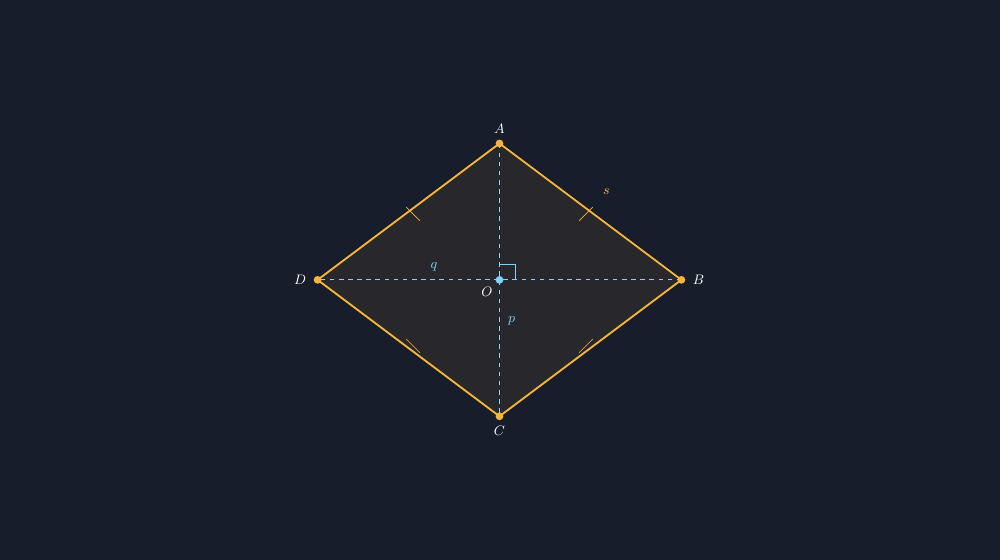

Ada satu bangun datar yang di kelas VII selalu muncul di pertengahan semester: belah ketupat. Dan ada satu soal yang hampir setiap tahun muncul di lembar ulangan saya. Soalnya sederhana — diketahui panjang kedua diagonal, hitung luasnya. Tapi setiap tahun, hampir selalu ada beberapa siswa yang menjawab dengan menjumlah kedua diagonal lalu membagi dua. Bukan mengalinya. $L = \frac{p \times q}{2}$ mereka tulis, tapi ketika menghitung, $p \times q$ berubah jadi $p + q$ di tengah jalan.

Tahun lalu saya berhenti menyalahkan siswanya. Saya perhatikan ulang lembar soal yang saya tulis sendiri, dan baru sadar: belah ketupat di soal saya digambar asal-asalan. Diagonalnya tidak tegak lurus sejati — sedikit miring, mungkin dua sampai tiga derajat, tak terlihat mata. Kedua diagonalnya juga tidak terbagi dua sama panjang di titik potongnya, karena saya menggambar ujungnya "kira-kira" di sana. Siswa yang mengamati gambar dengan teliti justru dibingungkan: bangun yang digambar bahkan tidak memenuhi sifat yang soalnya klaim.

Di situlah saya akhirnya memindahkan belah ketupat ke TikZ, bersama jajargenjang, trapesium, dan segitiga-segitiga lain yang sudah lebih dulu "menemukan rumah baru". Ternyata belah ketupat justru salah satu bangun yang paling mudah digambar dengan jujur — karena sifat-sifatnya bisa diletakkan langsung di koordinatnya, bukan diharapkan muncul dari tangan yang stabil.


*Belah ketupat $ABCD$ dengan diagonal $AC = p$ dan $BD = q$. Tanda sisi sama panjang dan sudut siku di titik $O$ bukan hiasan — keduanya dijamin oleh koordinat.*

## Belah ketupat itu sebenarnya apa

Sebelum bicara koordinat, saya biasa membangun definisinya bersama siswa, bukan membacakannya. Kegiatannya sederhana: saya gambar sebuah persegi di papan, lalu menanyakan, "Kalau persegi ini saya tekan dari pojoknya begini," sambil saya gambar versi yang terdorong, "sifat apa yang tetap dan sifat apa yang hilang?"

Dari diskusi itu siswa biasanya menemukan sendiri: sisinya masih empat dan sama panjang — itu yang tetap. Sudutnya tidak lagi siku — itu yang hilang. Belah ketupat, kata mereka, "persegi yang ditekan". Definisi formal menunggu di belakang: belah ketupat adalah segiempat dengan empat sisi sama panjang.

Tapi bagian yang paling sering dilupakan siswa justru sifat diagonalnya. Di belah ketupat, kedua diagonal saling tegak lurus dan saling membagi dua sama panjang. Persegi pun begitu, tapi di persegi diagonalnya tampak "jelas" karena bangunnya simetris dari segala arah. Di belah ketupat yang terdorong, sifat ini tidak terlihat mata — dia harus dipastikan. Dan justru karena tidak terlihat, gambar yang digambar tangan cenderung mengingkarinya. Di sinilah TikZ bekerja untuk kita.

## Koordinat yang membawa sifatnya sendiri

Kunci menggambar belah ketupat di TikZ sangat sederhana: jangan menggambar empat sisi dulu. Gambar diagonalnya dulu.

Kalau kedua diagonal saling tegak lurus dan saling membagi dua sama panjang, maka cara paling jujur adalah menempatkan titik potongnya di titik asal, lalu meletakkan keempat titik sudut pada dua garis yang benar-benar tegak lurus:

```latex
\coordinate (A) at (0,3);
\coordinate (B) at (4,0);
\coordinate (C) at (0,-3);
\coordinate (D) at (-4,0);
\draw[very thick] (A) -- (B) -- (C) -- (D) -- cycle;
```

Titik $A$ dan $C$ saya letakkan di sumbu tegak, $B$ dan $D$ di sumbu datar, dengan jarak yang sama dari titik asal. Titik potong diagonalnya $(0,0)$ — dan tanpa saya tulis apa pun lagi, garis $AC$ sudah tegak lurus $BD$, dan $O$ sudah tepat di tengah keduanya. Ini bagian yang paling saya sukai dari TikZ: sifat yang di soal kita klaim tidak perlu kita percayai begitu saja, dia **terjadi** karena konstruksi. Tidak ada kemungkinan diagonalnya "sedikit miring" seperti gambar tangan saya tahun lalu.

Dari koordinat yang sama, rumus luas yang selalu salah dihitung siswa itu jadi punya alasan yang bisa dilihat:

$$L = \frac{p \times q}{2}$$

Kenapa bagi dua? Karena belah ketupat terbagi oleh kedua diagonalnya menjadi empat segitiga siku-siku yang kekongruenan (atau minimal kesebangunan posisinya) bisa didiskusikan siswa. Segitiga $AOB$ misalnya, punya alas setengah dari $q$ dan tinggi setengah dari $p$. Kalau luas empat segitiga itu dijumlah, muncul $\frac{p \times q}{2}$. Rumus yang tadinya hafalan yang mudah salah ketik kini bisa diturunkan dari gambar yang koordinatnya sendiri sudah jujur.

## Label dan keterangan yang tidak mengelabui

Gambar belah ketupat untuk lembar soal biasanya butuh lebih dari empat sisi. Saya menambahkan tanda sisi sama panjang, sudut siku di titik potong diagonal, dan label diagonalnya:

```latex
\draw[dashed, thick] (A) -- (C) node[pos=0.65, right=2pt] {$p$};
\draw[dashed, thick] (B) -- (D) node[pos=0.68, above=2pt] {$q$};
\draw (0,0.35) -- (0.35,0.35) -- (0.35,0); % siku di O
```

Dua hal kecil di potongan ini sering menyelamatkan saya dari revisi lembar soal. Pertama, `pos=0.65` dan `pos=0.68`: label $p$ dan $q$ saya letakkan tidak tepat di tengah diagonal, supaya tidak menabrak titik $O$ dan garis diagonal satunya. Kedua, diagonal saya gambar `dashed` — garis putus-putus yang di kelas saya selalu kita sepakati berarti "potongan bantu, bukan sisi bangun". Konvensi kecil seperti ini, dipakai konsisten di semua gambar soal sepanjang semester, membuat siswa membaca gambar dengan keyakinan yang sama seperti membaca soalnya.

Tanda siku di $O$ saya gambar manual dengan tiga segmen pendek: naik 0.35, ke samping 0.35, turun ke garis. TikZ punya cara otomatis untuk ini lewat pustaka `angles` dan `quotes`, tapi untuk satu sudut siku, tiga segmen garis justru lebih mudah dikontrol dan tidak menuntut paket tambahan.

## Satu perangkap yang saya alami sendiri

Gambar pertama yang saya buat untuk tema ini gagal dengan cara yang memalukan: saya menggambar belah ketupat dengan koordinat $(0,3)$, $(2.9,0)$, $(0,-3)$, $(-2.9,0)$. Niatnya supaya terlihat "agak pipih" biar tidak monoton. Tapi ketika saya cetak dan perbesar, siswa di kelas langsung berkomentar: "Bu, kok diagonalnya kayak nggak lurus?"

Dia memang lurus — secara matematika. Yang tidak lurus adalah persepsi kita: diagonal yang hampir tapi tidak persis sama panjang di kedua sisi titik potong membuat mata mengira ada kemiringan. Sejak itu saya berpegang pada satu aturan untuk bangun yang punya sifat simetri: **jangan mencari keunikan di tempat yang sifatnya harus tetap**. Kalau ingin belah ketupat terlihat berbeda, ubah proporsinya keseluruhan — skala, ketebalan garis, posisi di halaman — bukan dengan mengorbankan tegak lurusnya atau kesamaan pembagian diagonalnya. TikZ membuat aturan ini gratis: koordinat yang simetris menghasilkan gambar yang simetris, dan variasi bisa dicari di luar geometrinya.

## Menutup lingkaran dengan soal

Setelah gambar jujur, soal luas yang dulu menjadi perangkap tahunan saya rombak sedikit. Sekarang soalnya tidak berhenti di "hitung luasnya", tapi menambah satu langkah: "tandai pada gambar bagian yang mewakili $\frac{p}{2}$ dan $\frac{q}{2}$, lalu jelaskan mengapa luasnya dibagi dua." Siswa yang tadinya menjumlah $p$ dan $q$ kini harus berhadapan dengan gambar yang memang membagi dirinya menjadi empat segitiga siku-siku — sulit mengklaim rumus itu turun dari langit kalau gambar di depan mata justru menunjukkan asal-usulnya.

Belah ketupat ternyata mengajari saya pelajaran yang lebih luas dari ukurannya yang kecil. Bangun yang paling sederhana pun, kalau digambar dengan setengah hati, akan mengajarkan kesetengah-hatian itu kepada siswa. Dan sebaliknya: empat koordinat yang ditempatkan dengan benar di dua sumbu tegak lurus sudah cukup menjadi kesaksian — bahwa sifat-sifat yang kita ajarkan bukan hafalan, tapi sesuatu yang benar-benar terjadi.

> 📎 **Berkas TikZ lengkap:** [menggambar-belah-ketupat-dengan-tikz.tex](tex/menggambar-belah-ketupat-dengan-tikz.tex) — siap kompilasi (butuh paket `tikz`).
